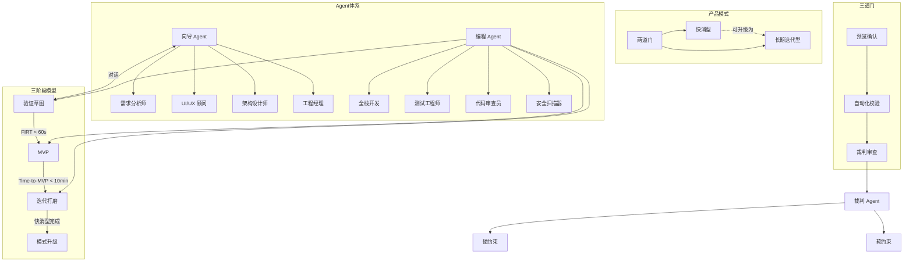

# 术语表

> 项目：向导 Agent 多智能体协同开发平台
> 文档ID：DOC-1.2
> 版本：v1.0 | 日期：2026-07-10 | 状态：已确认
> 依赖：`../01_PRD/prd.md`（同目录）

---

本文档统一全平台术语定义。后续所有设计文档必须引用本表中的标准术语，不得自行发明新词或使用不一致的别名。

---

## 1. 产品模式

| 术语 | 定义 | PRD | 关联 |
|-----|------|:---:|------|
| **快消型**（Quick MVP） | 以快速产出可用软件为首要目标的产品模式。AI 自主决策技术架构和工程管理细节，文档精简，以 BDD+GWT 测试全量通过作为交付标准。完成后可升级为长期迭代型 | §4.1 | 长期迭代型、模式升级、GWT、FIRT |
| **长期迭代型**（Long-term Iteration） | 以完整软件工程方法论为驱动、支持持续迭代演进的产品模式。文档体系完备，架构设计师和工程经理跳到前台与用户确认设计，PlantUML + BDD+GWT 双约束保障交付质量 | §4.2 | 快消型、模式升级、PlantUML、Sprint |
| **模式升级** | 快消型项目完成后，将已有代码和运行状态作为起点，补全正式文档体系后进入长期迭代型流程的转换操作 | §4.4 | 快消型、长期迭代型 |
| **两道门** | 用户启动应用后面对的入口选择界面，形象化指代"快消型"和"长期迭代型"两种产品模式入口。模式一经选择不提供运行时切换 | §4/§13.2 | 快消型、长期迭代型、两道门选择页 |
| **P0 用户**（零基础用户） | 平台的首要目标用户，完全不具备任何编程知识，不懂 HTML/CSS/JS、数据库、前后端等概念。通过"看"来判断好坏而非"读"，抗拒代码和报错日志。所有 UX 设计和交互决策以 P0 用户为最高优先级 | §3.1 | P1 用户、研究用户 |
| **P1 用户**（概念用户） | 有一定基础概念但不写代码的人——知道网页、数据库等基本概念，但自己不会写。优先级低于 P0 用户 | §3.2 | P0 用户、研究用户 |
| **研究用户** | 内部用户——课题组成员或研究者。通过后台数据看板分析用户行为数据，提炼自然语言最佳交互指令范式。不直接使用本平台的软件生成功能 | §3.3 | P0 用户、P1 用户 |

---

## 2. Agent 体系

| 术语 | 定义 | PRD | 关联 |
|-----|------|:---:|------|
| **向导 Agent** | 平台中唯一面向用户的 Agent。根据当前阶段自动切换内部角色（需求分析师、UI/UX 顾问、架构设计师、工程经理），用户始终只面对同一个对话对象，不感知角色切换 | §6.2 | 需求分析师、UI/UX 顾问、架构设计师、工程经理、编程 Agent |
| **编程 Agent** | 不面向用户的 Agent 体系，负责代码生成、测试编写、自动修复、安全扫描等工程执行工作，内部包含全栈开发、测试工程师、代码审查员、安全扫描器等角色 | §6.4 | 向导 Agent、裁判 Agent、全栈开发、沙箱 |
| **裁判 Agent** | 介于向导 Agent 和编程 Agent 之间的独立流程门禁，负责检查文档完整性、代码-文档一致性。由自动化脚本（硬约束，输出"通过/不通过"）和 AI 评估（软约束，输出"通过/建议改进/退回"）两层机制组成。最终判定规则：硬约束全部通过 + 软约束无"退回"（"建议改进"不阻塞流程，记录后放行）= 通过；任一硬约束不通过 或 软约束"退回" = 退回。不深入审计具体代码质量 | §10.1 | 硬约束、软约束、退回次数上限、三道门模型 |
| **需求分析师** | 向导 Agent 的核心角色，始终激活。负责与用户对话、挖掘需求、引导思考、从对话中自动提取并产出 PRD 文档 | §6.3 | 向导 Agent、PRD |
| **UI/UX 顾问** | 向导 Agent 的角色之一。在有 UI 需求时与需求分析师并行激活，负责设计页面布局、产出 HTML 原型、进行视觉审查 | §6.3 | 向导 Agent、需求分析师、验证草图 |
| **架构设计师** | 向导 Agent 的角色之一。负责技术选型、PlantUML 建模、API 规范设计。快消型中隐于后台自动决策，长期迭代型中跳到前台与用户确认 | §6.3 | 向导 Agent、PlantUML、工程经理 |
| **工程经理** | 向导 Agent 的角色之一。负责确定编程 Agent 团队配置（角色数量与分工）、Sprint 规划、协作流程定义。快消型中隐于后台，长期迭代型中跳到前台 | §6.3 | 向导 Agent、编程 Agent、Sprint、架构设计师 |
| **全栈开发** | 编程 Agent 的核心角色，始终激活。负责代码生成、在沙箱中运行、自动修复运行错误 | §6.4 | 编程 Agent、沙箱、异常自愈 |
| **测试工程师** | 编程 Agent 的角色之一，始终激活。负责编写 GWT 测试用例、执行测试、产出测试报告（GWT 场景由系统从 PRD 功能项自动生成，测试工程师对其进行细化并确保可执行性） | §6.4/§11.3 | 编程 Agent、GWT、BDD |
| **代码审查员** | 编程 Agent 的角色之一，长期迭代型必选、快消型可选。负责代码质量检查和安全性审查 | §6.4 | 编程 Agent、长期迭代型 |
| **测试 Agent** | 编程 Agent 体系的独立执行实体，定位为"执行者（运动员）"。负责执行 GWT 测试用例、产出测试报告。与测试工程师的关系：测试工程师负责编写测试用例，测试 Agent 负责运行测试并输出结果。测试报告提交给裁判 Agent 作为判定输入 | §6.5/§12.5 | 编程 Agent、测试工程师、裁判 Agent、GWT |

---

## 3. 验证流程

| 术语 | 定义 | PRD | 关联 |
|-----|------|:---:|------|
| **FIRT**（First Interactive Result Time） | 从用户发送第一条需求消息，到预览区首次渲染出可交互草图的耗时。目标中位数 < 60 秒，上限 120 秒（超时则展示已生成的部分）。FIRT 的产物是验证草图，不是完整产品 | §2.1/§5.2 | 验证草图、快速验证循环、FIRT 中位数 |
| **Time-to-MVP** | 从用户输入首条消息到 MVP 首次交付的总耗时，目标中位数 < 10 分钟。与 FIRT 不同，Time-to-MVP 衡量的是完整可运行产品的交付速度 | §5.3 | MVP、FIRT、三阶段生成模型 |
| **验证草图** | 三阶段生成模型中第一阶段的产物。一个只有 1-3 个核心页面的极简可交互原型，使用静态模拟数据（硬编码），生命周期用完即弃。唯一目的是让用户确认"系统理解的方向对不对" | §5.2 | FIRT、三阶段生成模型、MVP |
| **MVP**（Minimum Viable Product） | 三阶段生成模型中第二阶段的产物。基于用户对草图的反馈，生成的全页面、全功能可运行版本。经过自动测试和安全扫描后方可交付 | §5.3 | 验证草图、三阶段生成模型、Time-to-MVP |
| **三阶段生成模型** | 系统生成软件的统一流程框架，包含三个阶段：验证草图（FIRT < 60s）→ MVP（Time-to-MVP < 10min）→ 迭代打磨。两种产品模式共享此框架，区别在于各阶段的工程深度和用户确认节点 | §5.1 | 验证草图、MVP、迭代打磨、快速验证循环 |
| **快速验证循环** | 平台的核心工作方式——快速生成 → 用户确认方向 → 修正 → 再验证，整个循环以"速度即质量"为原则，用短周期降低纠偏成本 | §5 | FIRT、验证草图、点选纠错、三阶段生成模型 |
| **迭代打磨** | 三阶段生成模型的第三阶段。用户在 MVP 上点选纠错、补充需求，系统每次修改后自动回归测试、关键节点自动快照。快消型完成此阶段后标记"完成"，长期迭代型进入 Sprint 循环 | §5.1 | MVP、点选纠错、快照、Sprint |
| **熔断回滚** | 异常自愈流程的最终保护机制。当编程 Agent 连续 3 次自动修复失败后，放弃当前修复尝试，将项目回滚到上一个健康快照，通知向导 Agent 与用户沟通。快消型中系统自动更换技术方案重新尝试（编程层闭环，用户无感知），长期迭代型中如涉及设计约束则出具变更说明与用户确认 | §6.6 | 异常自愈、快照、线性回滚、退回次数上限 |

---

## 4. 文档体系

| 术语 | 定义 | PRD | 关联 |
|-----|------|:---:|------|
| **PRD**（Product Requirements Document） | 从用户与向导 Agent 的对话中自动提取、结构化生成的需求文档。是 Agent 间交接和裁判校验的基准输入，不是给用户确认用的。在固定检查点触发同步更新，非实时逐轮更新 | §7.1 | 文档检查点、需求分析师、裁判 Agent |
| **PlantUML** | 文本化的 UML 实现，产出 `.puml` 代码文件而非图片。定位为 PRD（弱约束、自然语言）与代码（实现层）之间的强约束桥梁，确保编程 Agent 产出的代码结构符合设计意图。裁判 Agent 可直接解析 `.puml` 文本进行代码结构校验 | §9 | 类图、时序图、架构设计师、裁判 Agent |
| **GWT**（Given-When-Then） | BDD 验收标准的描述格式——Given（给定前置状态）、When（当用户执行操作）、Then（期望系统响应）。系统从 PRD 每个功能项自动生成 GWT 场景骨架（自然语言描述的场景概要），测试工程师将其转化为可执行的 Gherkin 语法 Feature 文件并进行细化（补充具体输入值、边界条件、异常场景），覆盖正常路径 + 边界条件 + 异常输入 | §11.2/§11.3 | BDD、Feature 文件、测试工程师 |
| **BDD**（Behavior Driven Development） | 行为驱动开发——以可执行的验收测试场景作为开发驱动力的方法论。本平台中，BDD 以 GWT 格式落地，PRD 中每个功能项必须有对应的 GWT 场景，全部通过才可交付 | §11 | GWT、Feature 文件、测试工程师 |
| **Feature 文件** | GWT 测试场景的载体文件，使用 Gherkin 语法编写（`.feature` 后缀）。每个 Feature 文件描述一个功能模块的验收场景，含至少 1 个正常路径和 1 个异常场景。测试工程师负责编写，测试执行器负责运行 | §11.2/§7.2 | GWT、BDD、测试工程师 |
| **文档检查点** | 文档自动同步的触发时机。文档不在每轮对话后实时更新，而是在固定节点（草图确认后、MVP 交付前、每轮迭代结束后、安全扫描完成后、测试执行后）统一合并待处理事件后同步 | §7.1 | PRD、PlantUML |
| **文档一致性优先级** | 当多份文档间出现矛盾时的裁定规则。优先级从高到低：可运行的代码 > GWT 测试场景 > PlantUML > PRD。裁判 Agent 检测到矛盾时不自动覆盖，而是生成不一致报告交由向导 Agent 修正 | §7.1 | 裁判 Agent、PRD、PlantUML、GWT |
| **决策标注** | Agent 每次做出不可逆或高影响决策时自动生成的记录条目。格式包含决策内容、原因、影响范围、可逆性等级、替代方案、标注时间。记录在 `decisions.md` 文件中，供后续需求变更时追溯 | §5.4 | 可逆性、快照、时间轴 |
| **可逆性** | 决策标注中对"回退该决策的代价"的分级评估。分为高（仅影响单一文件）、中（影响多个文件但边界明确）、低（影响架构核心，需重构）三级。用户回滚快照时，系统自动识别受影响决策并提示 | §5.4 | 决策标注、快照、线性回滚 |

---

## 5. 质量保障

| 术语 | 定义 | PRD | 关联 |
|-----|------|:---:|------|
| **三道门模型** | 三种不同主体的质量把关串联机制。第一道门（预览确认）由用户把关"做对了吗"；第二道门（自动化校验）由系统把关"做对的东西质量过关吗"；第三道门（裁判审查）由裁判 Agent 把关"文档和代码对齐吗"。三道门串行，任一未通过则不能进入下一阶段 | §8.1 | 预览确认、自动化校验、裁判审查、裁判 Agent |
| **预览确认**（第一道门） | 用户通过查看预览区中的可交互产物来判断系统是否理解了需求。包括验证草图的方向确认和 MVP 的功能完整性确认。用户通过"看"而非"读文档"来确认——点选纠错是表达不满的方式 | §8.1 | 三道门模型、验证草图、MVP、点选纠错 |
| **自动化校验**（第二道门） | MVP 代码生成后自动运行的系统质量检查，包括 GWT 测试用例全量通过、OWASP Top 10 安全扫描、沙箱运行无错误。对用户完全透明，必须全部通过才能进入下一道门 | §8.1 | 三道门模型、GWT、安全扫描器、沙箱 |
| **裁判审查**（第三道门） | 裁判 Agent 在交付前执行的最终检查，包括文档完整性、PlantUML-代码一致性、PRD-测试对应、逻辑一致性。按产品模式区分严格度，是唯一可能触发用户交互的系统层质量关卡 | §8.1/§10 | 三道门模型、裁判 Agent、硬约束、软约束 |
| **硬约束** | 由自动化脚本执行的结构化检查规则，结果为"通过/不通过"，不通过自动触发修复流程。检查项包括 PlantUML 语法有效性、GWT 场景计数、文件存在性、代码类结构与 PlantUML 对比等。检查范围按产品模式区分 | §10.2 | 软约束、裁判 Agent、PlantUML、GWT |
| **软约束** | 由 AI 模型评估的定性检查，结果为"通过/建议改进/退回"。评估维度包括逻辑一致性（功能与模块对齐）、可测试性（功能-GWT 对应）、完整性（边界覆盖）、可读性（非技术用户能否大致理解）。检查范围按产品模式区分 | §10.2 | 硬约束、裁判 Agent |
| **硬约束等级** | 工程模板预设的三级硬约束严格度，决定 PRD 必填项、API Spec 深度、安全扫描范围、测试覆盖率的差异。宽松（个人小工具：PRD 仅需项目名+核心功能，OWASP Top 5，核心功能测试）；标准（Web/桌面：+目标用户+验收标准，OWASP Top 10，全部功能+边界测试）；严格（远期商业产品：+用户故事+竞品分析，+渗透测试，+性能测试）。Phase 1 使用标准级 | §12.4 | 硬约束、工程模板、Web 全栈模板 |
| **退回次数上限** | 裁判 Agent 退回后自动修复重试的最大次数。"普通问题"指所有可被异常自愈流程自动修复的问题（功能遗漏/偏差、文档-代码不对应等），每次退回消耗 1 次额度。安全漏洞不计入普通退回额度，独立处理（见 PRD §10.5）。快消型：普通问题退回 ≤ 2 次后提示用户决定；长期迭代型：普通问题退回 ≤ 3 次后提示用户决定。达到上限后决定权让渡给用户 | §10.3/§10.4 | 裁判 Agent、异常自愈、用户最终裁量权 |
| **用户最终裁量权** | 当裁判发现的问题经自动修复仍无法解决时，系统将决定权交还给用户。交还时用生活化语言告知用户具体偏差（如"你希望做按月统计，但当前页面里没有这个功能"）而非技术警告。用户可选择继续修复或接受现状 | §2.5/§10.4 | 裁判 Agent、退回次数上限 |

---

## 6. 交互元素

| 术语 | 定义 | PRD | 关联 |
|-----|------|:---:|------|
| **两道门选择页** | 用户启动应用后首先看到的页面。居中布局两个大卡片并列——"快速尝鲜"（蓝绿色系）和"精细打磨"（紫色系），各有简短说明文字。用户点击任一卡片后进入对应模式的工作区，不提供返回入口 | §13.2 | 两道门、快消型、长期迭代型 |
| **软件生成工作区** | 用户使用平台的主要界面——左区（对话区，与向导 Agent 交互）、右区（预览区，运行生成的软件）、底部（时间轴，历史版本管理）。快消型工作区为对话区+预览区+时间轴三分栏，长期迭代型在此基础上增加文档面板 | §13.3 | 对话区、预览区、时间轴、快消型、长期迭代型 |
| **点选纠错** | 用户在预览区中对不满意的元素直接点击，弹出输入框"这里有什么问题？"。向导 Agent 将点击位置 + 上下文 + 用户描述转化为修改指令，修改后自动回归测试。若系统连续两次猜不对，主动追问用户 | §13.5 | 预览区、预览确认 |
| **时间轴** | 工作区底部的历史版本可视化管理面板。以水平时间线展示关键快照节点（验证草图 v1 → MVP v1 → 当前版本等），每个节点附带预览截图和自然语言摘要，用户点击任意节点可一键回滚到对应状态 | §13.4 | 快照、线性回滚、软件生成工作区 |
| **快照** | 系统在关键节点自动保存的完整项目状态，包含三层内容：全部源文件的完整副本（可直接运行）、当前界面的预览截图、一句自然语言摘要。触发时机包括草图生成后、MVP 生成后、用户确认一轮修改后、高风险操作前 | §13.4 | 时间轴、线性回滚、快照管理器 |
| **线性回滚** | 系统只支持沿时间轴向前或向后移动，不做版本分支。回到旧版本后继续修改，旧版本之后的快照仍保留但仅作存档。这样设计是为了零基础用户不需要理解"分支"概念 | §13.4 | 时间轴、快照 |
| **对话区** | 软件生成工作区左侧区域，用户与向导 Agent 文字交互的界面。保留 Proma 原有的消息列表和输入框，新增上下文阶段指示器（显示当前处于"理解需求"/"生成草图"/"构建 MVP"等阶段） | §13.3 | 软件生成工作区、向导 Agent |
| **预览区** | 软件生成工作区右侧区域，系统内置沙箱 WebView 嵌入于此，实时渲染生成的软件。用户可直接在预览区中与生成的软件交互，并对任意元素点选纠错 | §13.3 | 软件生成工作区、沙箱、点选纠错 |
| **文档面板** | 软件生成工作区中对话区与预览区之间的可折叠面板，仅长期迭代型工作区显示。以文件树形式展示当前项目的完整文档目录（PRD、PlantUML、GWT Feature 等），用户展开可查看自然语言版的文档概览 | §13.3 | 软件生成工作区、长期迭代型、文档体系 |
| **心理防御文案** | 平台在各关键等待或异常场景下展示给用户的安抚性提示文案。目的是降低用户焦虑和放弃率——让用户在任何状态下都知道系统在干什么、数据是否安全、接下来可以做什么 | §13.6 | FIRT、异常自愈、用户最终裁量权 |

---

## 7. 科研指标

| 术语 | 定义 | PRD | 关联 |
|-----|------|:---:|------|
| **FIRT 中位数** | 对所有已完成项目的 FIRT 值取中位数，衡量"系统给用户第一反馈的速度"的核心指标。目标中位数 < 60 秒 | §2.1/§14.5 | FIRT、验证草图 |
| **纠错密度** | 点选纠错次数 ÷ 对话轮数的比例。衡量"用户对系统产出的满意程度"——纠错密度高意味着系统首次理解准确率低或用户需求表达不够精确 | §14.5 | 点选纠错、对话轮 |
| **完成率** | 项目标记为"完成"的数量 ÷ 全部创建项目总数。与放弃率互为补集概念（两者之和可能小于 100%，因存在既未完成也未放弃的进行中项目）。衡量"用户能否走完全流程得到可用产品"的核心指标，与对照组比较以评估系统有效性 | §14.5/§14.6 | 放弃率、MVP |
| **放弃率** | 用户主动放弃的项目数 ÷ 全部创建项目总数。通过追踪用户在各流程节点的停止行为定位，与放弃节点配合分析。PRD 以放弃率为正式统计指标，完成率为衍生指标 | §14.5 | 放弃节点、完成率 |
| **放弃节点** | 用户在哪个流程环节停止使用并放弃项目。通过追踪埋点事件序列定位——是模式选择后就走了？草图后不满意？MVP 等待中放弃？用于识别系统的关键流失点 | §14.5 | 完成率、埋点事件 |
| **自动修复成功率** | 编程 Agent 在代码运行失败后，经自动修复（最多 3 次尝试）解决问题的比例。衡量"系统自主纠错能力"的指标——成功率越高，用户遭遇熔断回滚的频率越低 | §14.5 | 异常自愈、编程 Agent、熔断回滚 |
| **Time-to-MVP 中位数** | 对所有已完成项目的 Time-to-MVP 值取中位数，衡量"从需求到交付可用产品"的端到端效率。目标中位数 < 10 分钟 | §14.5 | Time-to-MVP、MVP |
| **对话轮** | 用户发送一条消息 + 向导 Agent 回复一条消息 = 一轮对话。用于衡量交互效率指标（如纠错密度 = 点选纠错次数 ÷ 对话轮数），以及定位用户在哪一轮后放弃 | §14.3 | 纠错密度、放弃节点、埋点事件 |
| **埋点事件** | 系统在关键行为节点自动记录的标准化数据条目，共 13 个事件类型（项目创建、每轮对话提交、草图生成、MVP 交付、点选纠错、裁判判定等）。每个事件含事件 ID、类型、时间戳、payload JSON、会话 ID、项目 ID | §14.4 | 埋点采集层、科研指标、放弃节点 |

---

## 8. 平台技术

| 术语 | 定义 | PRD | 关联 |
|-----|------|:---:|------|
| **沙箱** | 编程 Agent 生成代码后，在其中运行和测试代码的隔离环境。本平台的沙箱为系统内置的 WebView（不暴露给用户系统浏览器），代码在沙箱内运行不影响用户本地文件系统，解决了"生成的代码不伤害用户电脑"的问题 | §1.3/§8.3 | 编程 Agent、安全扫描器、验证草图 |
| **工程模板** | 预定义的项目类型配置包，每个模板包含推荐编程 Agent 团队角色、硬约束规则清单、测试策略。系统根据用户描述自动推断匹配模板（如"做个网站"匹配到 Web 全栈模板） | §12.1/§12.2 | Web 全栈模板、硬约束 |
| **Web 全栈模板** | Phase 1 唯一支持的工程模板，面向 Web 项目（博客、商城、管理后台等）。团队配置为全栈开发 + 测试工程师 + 代码审查员（长期迭代型），硬约束等级为标准 | §12.3 | 工程模板 |
| **MCP**（Model Context Protocol） | Proma 平台的工具扩展协议，允许 Agent 调用外部工具服务（如脚手架项目、代码生成、测试运行、预览部署等）。本平台通过 MCP Server 为向导 Agent 和编程 Agent 提供专业工具能力 | 项目基础 | Skill、Proma |
| **Skill** | Proma 平台的提示词扩展机制——放在工作区 `skills/` 目录下的 Markdown 指令文件（含 YAML 元数据），定义了 Agent 在特定场景下的行为和能力。本平台的核心能力 `software-builder` 即以 Skill 形态实现 | 项目基础 | MCP、Proma |
| **异常自愈** | 编程 Agent 在代码运行失败后的自动修复流程：运行失败 → 自动分析错误 → 修复代码 → 重新运行，最多尝试 3 次。3 次失败后触发熔断，回滚到上一个健康快照，通知向导 Agent 与用户沟通后续方案 | §6.6 | 编程 Agent、全栈开发、快照、熔断回滚 |
| **对话路由层** | 本平台在 Proma 基础上新增的技术模块。负责判断用户当前所处的阶段和模式，加载对应 Agent 角色的 System Prompt，实现向导 Agent 内部角色的静默切换 | §15.3 | 向导 Agent、需求分析师、UI/UX 顾问、架构设计师、工程经理 |

---

## 9. 工程管理

| 术语 | 定义 | PRD | 关联 |
|-----|------|:---:|------|
| **Sprint** | 长期迭代型项目中以 ≤ 2 周为单位的开发周期。每个 Sprint 结束时交付可运行的增量，Sprint 规划由工程经理在前台与用户确认 | §12.5/§16 | 长期迭代型、工程经理 |
| **安全扫描器** | 编程 Agent 的内置角色，自 MVP 阶段起自动激活，对用户透明。负责自动检测 OWASP Top 10 安全漏洞（XSS、SQL 注入、IDOR、敏感数据暴露等），检测到问题后自动尝试修复 | §6.4/§8.3/§11.4 | 编程 Agent、自动化校验、OWASP Top 10 |
| **快照管理器** | 平台技术模块之一。负责自动快照的创建、列表管理、线性回滚执行。每次快照保存完整代码副本 + 预览截图 + 自然语言摘要 | §15.3 | 快照、时间轴、线性回滚 |
| **埋点采集层** | 平台技术模块之一。负责全量无侵入式采集用户交互数据（对话、点击、模式切换等），覆盖 13 个关键埋点事件，数据脱敏后供科研分析使用 | §14/§15.3 | 科研指标、埋点事件 |

---

## 附录 A：别称对照

PRD 中同一概念有时以不同表述出现。以下统一术语表选定的标准术语与其别称：

| 标准术语 | 别称（PRD 中出现过的其他表述） |
|---------|---------------------------|
| 快消型 | Quick MVP、快速尝鲜 |
| 长期迭代型 | Long-term Iteration、精细打磨 |
| 两道门 | 两种产品模式入口 |
| 验证草图 | 草图、快速草图、可交互草图 |
| 点选纠错 | 点击标记不满意 |
| 时间轴 | 版本历史面板 |
| 裁判 Agent | 裁判 |
| 编程 Agent | 编程团队 |

---

## 附录 B：术语关系图

---

> 本文档已完成第一轮审查收口，术语与 PRD v5.0、用户故事、站点地图保持一致。后续设计文档产出过程中如新增术语或定义调整，须经审查后更新版本号与日期。
