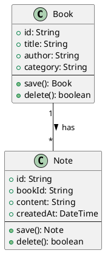

# 产品需求文档（PRD）

## 向导 Agent 多智能体协同开发平台

---

## 目录

1. [产品概述](#1-产品概述)
2. [核心设计理念](#2-核心设计理念)
3. [用户画像](#3-用户画像)
4. [两种产品模式](#4-两种产品模式)
5. [快速验证循环](#5-快速验证循环)
6. [Agent 架构](#6-agent-架构)
7. [文档体系](#7-文档体系)
8. [质量保障体系](#8-质量保障体系)
9. [PlantUML 强约束层](#9-plantuml-强约束层)
10. [裁判 Agent 机制](#10-裁判-agent-机制)
11. [PRD-测试强对应体系（BDD + GWT）](#11-prd-测试强对应体系bdd--gwt)
12. [工程模板体系](#12-工程模板体系)
13. [UX 与交互设计](#13-ux-与交互设计)
14. [数据采集与分析体系](#14-数据采集与分析体系)
15. [技术架构概述](#15-技术架构概述)
16. [开发路线图](#16-开发路线图)
17. [版本修订记录](#17-版本修订记录)

---

## 1. 产品概述

### 1.1 产品定位

一款**桌面应用**，通过"向导 Agent + 编程 Agent"双脑协同，让**完全不具备编程能力的普通用户**，仅凭自然语言对话即可驱动完整软件制品的开发与持续迭代。

### 1.2 核心价值主张

> "告诉它你想做什么，它帮你做好——先让你看个草图，方向对了再继续。"

- **对用户**：不需要学编程、不需要懂架构、不需要配置开发环境。开口描述想法，系统即刻给出可交互的验证草图，用户通过"看"而不是"读文档"来确认系统是否理解正确。从草图到 MVP 到长期维护，全程自然语言驱动。
- **对研究者**：全量采集用户交互数据，量化分析非专业人员使用自然语言驱动 AI 开发的最佳范式。

### 1.3 产品形态

- 桌面应用（基于 Proma fork）
- 编程 Agent 在用户本地安全沙箱中运行
- 用户全程不接触代码

---

## 2. 核心设计理念

本章是本 PRD 最重要的章节。后续所有设计决策都从这几条理念推导而来。

### 2.1 速度即质量

> **First Interactive Result Time（FIRT）：从用户输入第一句话到看到第一个可交互预览的目标时间 < 60 秒。**

对于零代码用户，一个正确但需要等 2 小时的结果，和一个 80% 正确但 5 分钟就能看到并修正的结果，后者更好。原因有三：

- **心理留存**：用户看到屏幕上有东西在运行，才知道系统在工作，才愿意继续投入时间
- **早期纠偏**：用户越早看到结果，越早发现"系统理解偏了"，纠偏成本越低
- **迭代信心**：快速验证 → 快速修正 → 快速再验证，这个循环本身建立用户对系统的信任

FIRT 不是 Time-to-MVP。FIRT 的产物是一个极简可交互草图（可能只有一页、功能不全），它的唯一目的是回答一个问题：**"我理解对了吗？"**

### 2.2 预览即确认

传统软件工程中，PRD 文档是需求确认的手段。但零代码用户不看文档——他们看预览。"你觉得这个页面看起来对吗？" 比 "请确认 PRD 第 3.2 节" 有效百倍。

因此：**用户只确认预览，不确认文档。** 文档（PRD、架构说明、PlantUML 规约、测试报告）是系统在运行过程中自动生成并持续同步的副产品。

文档的价值在于 Agent 间交接、裁判校验、研究者分析——唯独不是给用户确认用的。用户如果想看，可以点开看自然语言版的概览，但不是必须的。

### 2.3 两种模式，各取所需

不同类型的项目需要不同程度的工程深度。我们提供两种产品模式：

- **快消型（Quick MVP）**：快速实现，测试收口。适合一次性工具、验证想法。文档精简，PlantUML 可省略或极简，以 BDD+GWT 测试全部通过作为交付标准。
- **长期迭代型（Long-term Iteration）**：完整方法论，持续演进。适合长期维护的项目。PlantUML + BDD+GWT 双约束，完整文档体系，Sprint 规划。

两种模式在创建项目时由用户选择，快消型完成后可升级为长期迭代型。

### 2.4 约束层对用户透明，但必须存在

用户的交互（对话、预览、点击纠错）解决"做对的东西了吗"的问题。系统内部的约束层（PlantUML 校验、裁判门禁、测试收口、安全扫描）解决"做出来的东西质量过关吗"的问题。

约束层对用户完全透明——用户不需要知道 PlantUML 是什么、GWT 用例有多少、裁判 Agent 检查了什么。但缺少这一层，系统就是一个"好用的玩具"，而不是一个"可靠的平台"。

### 2.5 用户有最终决定权

AI 的质量判断不总是正确的。裁判 Agent 发现的问题经自动修复仍无法解决时，系统将决定权交还给用户——但交还的方式取决于问题类型：

- **功能偏差**（缺功能、逻辑不对）：系统用生活化语言告知用户具体偏差——"你希望做按月统计，但当前页面里没有这个功能。你觉得现在这样可以吗？"——而非笼统警告。用户可以选择继续修复或接受现状。
- **安全问题**（XSS、SQL 注入等）：系统**强制尝试修复**，不把安全问题当作选择题抛给用户。只有多次修复无法解决时，才向用户说明具体风险（如"别人可能通过输入框获取你的私人数据"）并建议不交付，但最终决定权仍在用户。

无论哪种模式，自动修复都有上限（快消型 2 次，长期迭代型 3 次），达到上限后交出决定权。安全问题的修复不计入此上限，独立处理。详见 10.4 和 10.5 节。

---

## 3. 用户画像

### 3.1 主要目标用户（P0）

**完全零基础的非专业用户**：不具备任何编程知识，不懂 HTML/CSS/JS，不了解数据库、前后端等概念。

行为特征：

- 有明确想法但不知如何技术实现
- 希望做出实际可用的软件工具来解决问题
- 不能/不愿投入时间学习编程
- 抗拒代码、报错日志和专业术语
- **通过"看"来判断好坏，而不是通过"读"**

### 3.2 次要用户（P1）

**有一定基础概念但不写代码的人**：知道网页、数据库等基本概念，但自己不会写代码。

### 3.3 研究用户（内部）

**课题组成员/研究者**：通过后台数据看板分析用户行为数据，提炼自然语言最佳交互指令范式。

### 3.4 核心恐惧点与产品应对

| 恐惧点 | 产品应对 |
|--------|---------|
| 怕看到代码 | 默认不展示源码，预览优先 |
| 怕搞坏东西 | 操作前自动快照，随时可回滚 |
| 怕隐私泄露 | 数据脱敏说明，本地运行保障 |
| 怕 AI 做的东西不对 | 草图预览确认 + 测试报告收口 |
| 怕操作太复杂 | 卡片选择代替文本输入，单选代替填空 |
| 怕等待焦虑 | 超过 5 秒显示进度提示文案 |

---

## 4. 两种产品模式

用户启动应用后，面对**两道门**，选择其一进入（模式一经选择不提供运行时切换，但快消型完成后可升级为长期迭代型）。

### 4.1 快消型（Quick MVP）

**适用场景**：一次性工具、小应用、验证想法。用户想要快速得到一个能用的东西。

**核心理念**："快速实现，测试收口"——允许 AI 在充分沟通后以尽快产出成品为目标实现，以 GWT 测试用例全部通过作为交付标准。

**关键特征**：
- 文档精简，尽快进入原型和编码
- **BDD+GWT 为核心验收机制**，PlantUML 可省略或极简
- AI 主导多轮自动化测试，测试用例全量通过 = 交付合格
- 架构设计师和工程经理**隐于后台**，自动化决策，不对用户暴露
- 编程 Agent 在编程层自主解决异常，不倒回向导 Agent 改需求
- 交付用户试用 + 反馈改进循环
- 完成后可"升级"为长期迭代型项目

### 4.2 长期迭代型（Long-term Iteration）

**适用场景**：需要持续更新版本的项目，如开源工具、商业产品、长期维护的个人项目。

**核心理念**：完整的软件工程方法论驱动，PRD → 架构 → 设计 → 编码 → 测试 → 版本交付 → 持续迭代。

**关键特征**：
- 全文档完备后才开工编码
- **PlantUML 类图+时序图为主约束，BDD+GWT 为行为验证补充**，两者互补
- 架构设计师和工程经理**跳到前台**，与用户确认设计方案和 Sprint 规划
- Sprint 规划、版本管理、变更日志
- 编程 Agent 执行异常时可出具变更说明，告知用户原因并调整实现方案（不倒回需求阶段）
- 不同 Agent 在版本间可平滑交接，上下文不丢失

### 4.3 模式对比

| | 快消型 | 长期迭代型 |
|------|--------|-----------|
| 文档深度 | 精简（PRD + 核心原型 + GWT） | 完整（全 7 个目录 + PlantUML） |
| PlantUML | 可省略或极简 | 类图 + 时序图必须 |
| BDD+GWT | 核心收口机制 | 行为验证补充 |
| 架构设计师 | 隐于后台 | 跳到前台，用户确认 |
| 工程经理 | 隐于后台 | 跳到前台，Sprint 规划 |
| 裁判严格度 | 核心项（PRD + GWT 存在性） | 全量硬约束 + 软约束 |
| 退回次数上限 | 2 次（超过提示用户决定） | 3 次（超过提示用户决定） |
| 安全问题 | 不计入普通退回，强制修复，上限 3 次 | 同快消型 |
| 用户确认节点 | 仅预览确认 | 设计 + Sprint + 预览 |

### 4.4 模式转换

快消型项目完成后，用户可以将其"升级"为长期迭代型项目。已完成的软件作为起点，补全正式文档体系后进入规范化迭代流程。

---

## 5. 快速验证循环

> 两种模式共享同一套三阶段生成模型。区别在于：快消型以速度为优先快速通过各阶段，长期迭代型在每个阶段做更深度的工程化。

### 5.1 三阶段生成模型

```
用户选择模式 → 输入需求
    │
    ▼
┌─────────────────────────────────────────────┐
│ 阶段 1：验证草图（FIRT < 60s）               │
│                                             │
│ 向导 Agent 首次理解 → 1-3 个问题确认         │
│ → 编程 Agent 生成极简可交互草图              │
│                                             │
│ 草图特征：只有 1-2 个核心页面、模拟数据、     │
│ 功能不完整。唯一目的是回答"我理解对了吗？"    │
│                                             │
│ 用户反馈："对，就是这个方向" 或 "不对，……"   │
└──────────────┬──────────────────────────────┘
               │
               ▼
┌─────────────────────────────────────────────┐
│ 阶段 2：MVP（Time-to-MVP，目标 < 10min）     │
│                                             │
│ 基于用户对草图的反馈，向导 Agent 产出完整规约  │
│ → 编程 Agent 生成全页面 MVP                  │
│ → 自动测试 + 安全扫描                        │
│ → 全部通过后交付可交互 MVP                   │
│                                             │
│ 快消型：精简文档即可交付                      │
│ 长期迭代型：此阶段补充完整文档 + PlantUML     │
└──────────────┬──────────────────────────────┘
               │
               ▼
┌─────────────────────────────────────────────┐
│ 阶段 3：迭代打磨                            │
│                                             │
│ 用户在 MVP 上点选纠错、补充需求               │
│ → 每次修改后自动回归测试                     │
│ → 关键节点自动快照                           │
│ → 用户满意后标记为"完成"                     │
│                                             │
│ 快消型：完成 → 可升级为长期迭代型             │
│ 长期迭代型：Sprint 循环 → 版本发布 → 持续迭代 │
└─────────────────────────────────────────────┘
```

### 5.2 验证草图的设计约束

草图的唯一目的是**验证理解**。两种模式共用：

- **速度优先于完整**：FIRT < 60 秒，宁可少做不可慢做
- **可交互**：不是截图或静态原型，是用户能点击、能翻页的真东西
- **可表达不满**：草图上每个元素都可被点击标记"不满意"
- **反馈驱动 MVP**：用户在草图上表达的不满，转化为 MVP 阶段的修正项

**草图的技术规格：**

| 属性 | 规格 |
|------|------|
| **交付物格式** | 单文件 HTML（含内联 CSS + JS），不依赖外部构建工具 |
| **渲染环境** | 系统内置沙箱浏览器（WebView），不暴露给用户系统浏览器 |
| **页面数量上限** | 1-3 个核心页面（模拟多页通过 JS 切换视图实现） |
| **数据** | 静态模拟数据（硬编码在 HTML 内），不连接任何数据库 |
| **生命周期** | 用完即弃。草图代码不进入 MVP 工程，MVP 从零搭建正式项目结构 |
| **FIRT 计时** | 从用户发送首条消息到预览区首次渲染完成，目标 < 60s，上限 120s（超时则告知用户并展示已生成的部分） |

草图的唯一目的仍是验证理解——它不需要正确的架构、不需要可维护的代码、不需要真实数据。它是一个便宜的假设检验工具。

### 5.3 为什么需要三阶段，而不是直接出 MVP

如果跳过草图直接出 MVP：用户在等待 MVP 的时间里不知道系统在干什么，容易放弃。MVP 出来后如果方向偏了，修正成本远超草图阶段的修正成本。

草图是一个"便宜的假设检验"——用 60 秒验证方向，比用 10 分钟做一个方向错误的 MVP 再推翻，总时间更短。

### 5.4 AI 脑补决策的可追溯与可逆性

系统在生成过程中会自动做出大量决策（技术栈、数据库选型、配色方案、页面结构等），这些决策对用户不可见。如果用户后来不满意某个被脑补的决策，需要能追溯和低成本推翻。

**决策标注机制**：

Agent 每次做出一个不可逆或高影响的决策时，自动生成一条"决策标注"，格式如下：

```
[DECISION] 数据库选型 → SQLite
  原因：用户未指定数据库，项目为单用户本地应用
  影响范围：所有数据存储逻辑
  可逆性：中（迁移到 MySQL 需改驱动和部分 SQL 语法）
  替代方案：PostgreSQL（适合未来多用户扩展）、MySQL（适合 Web 部署）
  标注时间：2026-05-31 14:22
```

这些标注以 Git tag + 项目根目录 `decisions.md` 文件两种方式同时记录。用户不需要主动管理 Git——系统在用户说"回到之前那个版本"或"把数据库换了"时，自动搜索 `decisions.md` 找到相关决策点，评估改动影响面，告知用户后再执行。

**可逆性分级**：

| 等级 | 定义 | 回退成本 | 示例 |
|------|------|---------|------|
| **高** | 修改仅影响单一文件或模块 | 直接替换，无连锁影响 | 配色方案、字体大小 |
| **中** | 修改影响多个文件，但有明确的修改边界 | 需批量替换，影响面可控 | 数据库选型、前端框架 |
| **低** | 修改影响系统架构核心，连锁影响广泛 | 需重构，可能出现短期不稳定 | 从单页应用改为多页应用 |

用户在时间轴上点击任意快照即可回退到对应状态，系统自动识别该快照之后的所有决策标注，提示用户哪些决策将被回滚。

### 6.1 总览

系统包含两大 Agent 体系 + 一个独立裁判模块：

```
┌──────────────────────┐     ┌──────────────────────┐
│    向导 Agent        │     │    编程 Agent         │
│   （唯一面向用户）    │     │   （不面向用户）       │
│                      │     │                      │
│  内含角色：           │     │  内含角色：           │
│  · 需求分析师         │     │  · 全栈开发           │
│  · UI/UX 顾问        │     │  · 测试工程师         │
│  · 架构设计师（按模式）│     │  · 代码审查员（按模式）│
│  · 工程经理（按模式）  │     │  · 安全扫描器（内置）  │
└──────────┬───────────┘     └──────────┬───────────┘
           │                             │
           │   文档体系（自动生成）         │
           └──────────┬──────────────────┘
                      │
              ┌───────┴───────┐
              │   裁判 Agent    │
              │  (独立模块)    │
              │ 硬约束+软约束   │
              │ 用户可覆盖      │
              └───────────────┘
```

### 6.2 用户视角

用户始终只面对一个"向导 Agent"进行对话。角色在后台静默切换，用户不需要知道也不应该感知到背后有多少个 Agent 角色在工作。

### 6.3 向导 Agent 内部角色

| 角色 | 职责 | 模型策略 | 激活时机 |
|------|------|---------|---------|
| **需求分析师** | 与用户对话、挖掘需求、引导思考、产出 PRD | 对话能力强、有耐心 | 始终激活 |
| **UI/UX 顾问** | 设计页面布局、产出 HTML 原型、视觉审查 | 带视觉能力的多模态模型 | 有 UI 需求时激活，与需求分析师**并行** |
| **架构设计师** | 技术选型、PlantUML 建模、API 规范设计 | 逻辑推理强、长上下文 SOTA | PRD 确认后（快消型隐于后台，长期迭代型跳到前台） |
| **工程经理** | 确定编程 Agent 团队配置、协作流程、Sprint 规划 | 长上下文 SOTA | 架构设计后（快消型隐于后台，长期迭代型跳到前台） |

**关键协作关系**：
- **需求分析师 + UI/UX 顾问并行工作**：图形化界面的描述也是揭示需求的过程
- **架构设计师 + 工程经理的模式差异**：快消型全自动决策，不对用户暴露；长期迭代型需用户确认设计方案和工程计划

### 6.4 编程 Agent 内部角色

| 角色 | 职责 | 激活条件 |
|------|------|---------|
| **全栈开发** | 代码生成、沙箱运行、自动修复 | 始终激活 |
| **测试工程师** | 编写/运行 GWT 测试用例，回归测试 | 始终激活 |
| **代码审查员** | 代码质量检查，安全审查 | 长期迭代型必选，快消型可选 |
| **安全扫描器** | OWASP Top 10 自动检测 | MVP 阶段起激活，对用户透明 |

团队配置由向导 Agent/工程经理根据模式和模板决定，对用户完全透明。

### 6.5 测试 Agent 与裁判 Agent 的职责边界

```
编程 Agent 产出代码
        │
        ▼
┌──────────────────┐
│   测试 Agent      │  ← 执行者（运动员）
│   执行 GWT 用例   │     "代码能不能跑通验收场景？"
│   输出测试报告    │     关注测试覆盖率、通过率
└──────┬───────────┘
       │ 测试报告
       ▼
┌──────────────────┐
│   裁判 Agent      │  ← 判定者（流程门禁）
│   综合判定        │     检查：
│   输出通过/退回   │     - 测试是否全部通过？
│                    │     - 代码结构是否匹配 PlantUML？
│                    │     - PRD 功能是否全部有测试对应？
│                    │     不管代码质量和具体实现细节
└──────────────────┘
```

### 6.6 异常自愈流程

- 代码运行失败 → 自动修复，最多尝试 3 次
- 3 次失败 → 熔断，回滚到上一个健康快照
- 通知向导 Agent 与用户沟通
- 快消型：换个技术方案重新尝试（编程层闭环）
- 长期迭代型：如涉及设计约束不可实现 → 出具变更说明 → 用户确认 → 调整方案（不倒回需求阶段）

---

## 7. 文档体系

### 7.1 核心原则：文档是自动产物，不是前置条件

**文档是系统运行过程中自动生成并持续同步的产品**：

- 用户和向导 Agent 的对话 → 自动提取为 PRD
- 用户在预览中的操作和反馈 → 自动更新 PRD
- 向导 Agent 产出 PlantUML 规约 → 存入架构目录，供编程 Agent 遵循和裁判校验
- 测试运行结果 → 自动生成测试报告
- 代码变更 → 自动更新 changelog

**用户不需要确认文档，只需要确认预览。** 文档始终和代码保持同步。

**文档自动同步的触发机制：**

文档不是实时逐轮更新的——那样会导致文档频繁变动、Agent 上下文腐化。文档在以下固定检查点触发同步：

| 触发节点 | 同步内容 | 说明 |
|---------|---------|------|
| **草图确认后** | 生成 PRD 初稿（从对话提取） | 首次结构化 |
| **MVP 交付前** | 更新 PRD + 生成 PlantUML + 生成 GWT Feature | 冻结，进入裁判校验 |
| **每轮迭代结束后** | 更新 PRD（合并本轮反馈）+ 更新 PlantUML（如有结构变更）+ 追加 Changelog | 攒一轮反馈后统一修订 |
| **安全扫描完成后** | 更新 security-scan.md | 自动触发 |
| **测试执行后** | 更新 test-plan.md 中的通过率数据 | 自动触发 |

**同步规则**：触发节点之间的对话和代码变更**不**实时写入文档——它们被暂存为"待处理事件"，在下一个检查点统一合并。这保证了文档的权威性和稳定性。

**文档一致性优先级规则：**

当多份文档之间出现矛盾时（如 PRD 说 3 个字段，PlantUML 写了 4 个），按以下优先级裁定：

| 优先级 | 文档 | 理由 |
|--------|------|------|
| 1（最高） | **可运行的代码** | 代码是唯一真实的行为。任何文档与实际行为不符→以代码为准，文档标注为"待同步" |
| 2 | **GWT 测试场景** | 测试是对代码行为的可验证约束。测试通过 = 代码行为符合预期 |
| 3 | **PlantUML** | 结构约束，但代码实现可能因技术原因偏离 |
| 4 | **PRD** | 需求意图，但经过多层转换后可能与最终实现有偏差 |

裁判 Agent 检测到文档间矛盾时，不自动覆盖——它生成一份"文档不一致报告"，标注具体矛盾项，交由向导 Agent 在下一个检查点统一修正。

### 7.2 长期迭代型——完整文档目录

```
project-root/
├── 01_PRD/
│   ├── prd.md                       # 从对话自动提取
│   └── user-stories.md              # 自动拆解
│
├── 02_UX_DESIGN/
│   ├── wireframes/                  # 各阶段生成的 HTML 原型
│   │   ├── sketch-v1.prototype.html
│   │   ├── mvp-v1.prototype.html
│   │   └── ...
│   └── design-system.md             # 从代码自动提取的颜色/字体
│
├── 03_ARCHITECTURE/
│   ├── architecture.md              # 架构总览与技术选型
│   ├── class-diagram.puml           # PlantUML 类图（机读）★
│   └── sequence-diagrams/           # PlantUML 时序图 ★
│       └── ...
│
├── 04_API_SPEC/
│   └── api-spec.md                  # 接口完整定义
│
├── 05_PROJECT_PLAN/
│   ├── sprint-plan.md               # Sprint 分解与里程碑
│   ├── team-config.md               # 编程 Agent 团队角色配置
│   └── workflow.md                  # 团队协作流程定义
│
├── 06_TESTS/
│   ├── features/                    # GWT Feature 文件 ★
│   │   └── ...
│   ├── test-plan.md                 # 测试策略概述
│   └── security-scan.md             # 安全扫描结果
│
├── 07_VERSIONS/
│   ├── changelog.md                 # 版本变更记录
│   └── snapshots/                   # 关键节点快照
│
└── README.md                        # 自动生成的项目总览
```

### 7.3 快消型——精简文档目录

```
project-root/
├── 01_PRD/
│   └── prd.md                       # 精简 PRD（含 UX 原型描述）
│
├── 02_UX_DESIGN/
│   └── wireframes/                  # 核心页面原型
│       └── page-main.prototype.html
│
├── 03_ARCHITECTURE/
│   └── architecture.md              # 简版架构，技术选型概要
│                                    # PlantUML 可省略或极简
│
├── 04_API_SPEC/
│   └── api-spec.md                  # 自动推断的接口定义
│
├── 06_TESTS/                        # ★ 收口环节
│   ├── features/                    # GWT Feature 文件 ★核心
│   └── test-plan.md                 # 测试策略
│
└── README.md
```

**关键差异**：快消型砍掉 PROJECT_PLAN、VERSIONS、user-stories 等工程管理文档，聚焦于"PRD → 原型 → 代码 → GWT 测试收口"的最短路径。

### 7.4 文档的用途

| 用途 | 受众 | 说明 |
|------|------|------|
| Agent 间交接 | 系统内部 | 编程 Agent 读取 PRD 理解需求，读取 PlantUML 理解结构约束 |
| 裁判校验 | 裁判 Agent | 硬约束检查文档完整性，软约束检查逻辑一致性 |
| 研究分析 | 研究者 | 分析用户需求表达模式、文档演进路径 |
| 用户可读（可选）| 用户 | 如果用户想看，可以点开看自然语言版的 PRD，但不是必须的 |

---

## 8. 质量保障体系

### 8.1 三道门模型

```
用户需求
    │
    ▼
┌─────────────────────────────┐
│ 第一道门：预览确认（用户把关） │  ← 测"做对了吗"
│                             │
│ · 验证草图：方向对吗？       │
│ · MVP 预览：功能全吗？       │
│ · 点选纠错：细节对吗？       │
│                             │
│ 通过条件：用户不再标记不满意  │
└──────────┬──────────────────┘
           │
           ▼
┌─────────────────────────────┐
│ 第二道门：自动化校验（系统把关）│  ← 测"做对的东西对吗"
│                             │
│ · GWT 测试用例全量通过       │
│ · OWASP Top 10 安全扫描      │
│ · 沙箱运行无错误             │
│                             │
│ 通过条件：硬约束全部通过      │
│ 用户不可见，但必须通过        │
└──────────┬──────────────────┘
           │
           ▼
┌─────────────────────────────┐
│ 第三道门：裁判审查（独立把关） │  ← 测"文档和代码对齐吗"
│                             │
│ · 文档完整性                 │
│ · PlantUML-代码一致性        │
│ · PRD-测试对应               │
│ · 逻辑一致性                 │
│                             │
│ 通过条件：硬约束+软约束       │
│ 快消型：普通问题退回 ≤2 次     │
│ 长期迭代型：普通问题退回 ≤3 次 │
│ 安全问题独立处理，强制修复     │
└─────────────────────────────┘
```

### 8.2 三道门的关系

- 第一道门（用户预览确认）：用户在前台看预览并交互
- 第二道门（自动化校验）：在 MVP 代码生成后运行，与第三道门串行（先测试通过再裁判审查）
- 第三道门（裁判审查）：在交付前做最终检查，也是唯一可能触发用户交互的系统层

### 8.3 安全扫描（用户透明）

沙箱解决了"生成的代码不伤害用户电脑"的问题。但没有解决"生成的软件本身是否安全"的问题——如 XSS 漏洞、不安全的 Cookie 设置、敏感信息泄露等。

系统在 MVP 阶段自动运行 OWASP Top 10 安全检查，对用户完全透明。检查不通过则自动修复，修复失败则在裁判报告中标记为"安全风险"。

---

## 9. PlantUML 强约束层

### 9.1 定位

PlantUML 规约是**PRD（弱约束、自然语言）与代码（实现层）之间的强约束桥梁**。它像"锚"一样钉住大模型的发散性，确保编程 Agent 产出的代码结构符合设计意图。

PlantUML 作为 UML 的文本化实现，产出 `.puml` 代码文件而非图片。裁判 Agent 可直接解析 `.puml` 文本进行代码结构校验。

```
用户需求（自然语言，弱约束）
        │
        ▼
  PlantUML 规约层（强约束，机读 .puml）★ 核心约束点
        │
        ▼
    代码实现（编程 Agent 产出）
```

### 9.2 与快速验证循环的关系

验证草图阶段（FIRT < 60s）**不使用 PlantUML**。草图是方向的假设检验，用完即弃，不需要结构约束。

PlantUML 在 MVP 阶段才介入，生成途径如下：

```
用户对话 → 需求分析师提取 PRD → 架构设计师从 PRD 中提取领域模型 → 生成 PlantUML
```

即 PlantUML 不是从用户原话中直接提取，而是经过 PRD 这一中间层——架构设计师读取 PRD 中已结构化的功能描述，识别核心实体及其关系，产出 `.puml` 文件。裁判校验时可以沿此链路追溯：PlantUML 是否覆盖了 PRD 中的核心功能 → 代码是否实现了 PlantUML 定义的类结构。

两种模式下的具体行为：

- **快消型**：PlantUML 可省略或极简——仅在有明确必要时生成简版架构草图，不作为裁判硬约束
- **长期迭代型**：用户确认草图方向后，架构设计师产出完整 PlantUML 类图（约束 3-5 个关键类及其关系）→ 跳到前台与用户确认 → 编程 Agent 在 PlantUML 框内生成 MVP 代码 → 裁判 Agent 校验代码结构是否与 PlantUML 一致

后续迭代中，长期迭代型每个 Sprint 开始时架构设计师更新 PlantUML（补充时序图），编程 Agent 在更新后的框内编码。

**PlantUML 对非专业用户完全透明**（长期迭代型中架构设计方案确认除外，此时用户只看到结构化功能描述，不接触 PlantUML 代码）。

### 9.3 约束类型

| 阶段 | PlantUML 图类型 | 约束内容 | 适用模式 |
|------|----------|---------|---------|
| **MVP 阶段** | 类图 | 有哪些类、属性、方法、类间关系 | 长期迭代型必须，快消型可选 |
| **迭代阶段** | 时序图 | API 调用序列、参与者、消息顺序 | 长期迭代型 |
| **长期维护** | 状态图 | 系统状态、合法转移路径 | 长期迭代型 |

### 9.4 PlantUML 示例（类图）



### 9.5 校验逻辑

裁判 Agent 读取编程 Agent 产出的代码 → 提取实际的类结构 → 与 PlantUML 规约逐项对比 → 输出合规报告（类是否存在？属性类型是否匹配？关系是否正确？）。

---

## 10. 裁判 Agent 机制

### 10.1 定位

裁判 Agent 是两个 Agent 之间的**独立流程门禁**。文档/代码不经裁判通过，不能进入下一阶段。

**裁判 Agent 是流程门禁，不是质量审计员。** 它只检查"交接是否到位"，不深入审计具体代码质量——那是编程 Agent 内部各角色的职责。

**执行机制**：裁判 Agent 并非单一 AI 模型，而是两层机制的组合——

- **硬约束**：由自动化脚本执行。包括 PlantUML 语法解析、GWT 场景计数、文件存在性检查（如 PRD 是否包含必填字段）、代码类结构提取与 PlantUML 对比。结果为"通过/不通过"，不通过自动触发修复流程。
- **软约束**：由 AI 模型评估。包括逻辑一致性（PRD 功能与代码模块是否对齐）、完整性（边界条件是否覆盖）、可读性。结果为"通过/建议改进/退回"，退回时附带具体问题描述供编程 Agent 修复参考。

两层机制共用"裁判 Agent"这一名称，但在系统内部是不同的执行路径。

### 10.2 双重约束

#### 硬约束（结构化检查，不通过直接退回）

| 检查对象 | 快消型 | 长期迭代型 |
|---------|--------|-----------|
| PRD | 项目名称、核心功能 | + 目标用户、用户故事 |
| API Spec | 自动推断即可 | 每个端点完整定义（Method、Path、Schema） |
| PlantUML | 不检查 | 类图/时序图语法有效，类关系完整 |
| 代码结构 | 不检查 PlantUML 一致性 | 自动提取实际代码类结构与 PlantUML 比对 |
| GWT 测试 | 每个 PRD 功能项必须有对应 GWT 场景 | 同快消型 |
| 安全 | OWASP Top 10 无高危漏洞 | 同快消型 |

硬约束规则由**工程模板**决定，以上为默认规则。

#### 软约束（AI 评估，给建议）

| 评估维度 | 评估内容 | 快消型 | 长期迭代型 |
|---------|---------|--------|-----------|
| 逻辑一致性 | PRD 的功能与代码实现的模块是否对齐 | 检查 | 检查 |
| 可测试性 | 每个功能是否有对应 GWT 测试场景 | 检查 | 检查 |
| 完整性 | 边界条件和异常情况是否被覆盖 | 检查 | 检查 |
| 可读性 | 零基础用户能否大致理解文档内容 | — | 检查 |

### 10.3 两种模式的裁判严格度

| | 快消型 | 长期迭代型 |
|------|--------|-----------|
| 硬约束检查 | 核心项（PRD + GWT 测试存在性 + 安全） | 全量硬约束 |
| 软约束评估 | PRD-GWT 对应关系 + 完整性 | 全部维度 |
| 退回次数上限（普通问题）| 2 次（超过提示用户决定） | 3 次（超过提示用户决定） |
| 安全问题处理 | 不计入普通退回，强制修复，上限 3 次后给出最终警告 | 同快消型 |

### 10.4 退回处理与用户让渡

**裁判不是最高权威。** 当裁判发现的问题无法通过自动修复解决时，决定权交还给用户。让渡时系统用生活化语言告知用户具体偏差，而非笼统警告：

> "系统注意到你希望做一个记账应用，但当前生成的页面里缺少了'按月统计'功能——这可能和你的预期有偏差。你觉得现在这样可以吗？[继续修改] [现在这样就挺好]"

不同问题类型的让渡策略：

| 问题类型 | 处理方式 |
|---------|---------|
| **功能遗漏/偏差** | 明确告知用户具体缺了什么，用户决定是否必须补齐 |
| **文档-代码不对应** | 告知不一致之处，用户决定以哪边为准 |
| **安全问题** | 见 10.5 节——安全问题的处理独立于普通让渡流程 |

退回与让渡的具体流程：

- 裁判第一次退回 → 系统自动修复后重试
- 裁判第二次退回 → 系统再次自动修复后重试
- **快消型**：第 2 次退回后直接提示用户（含具体偏差描述）→ 用户选择 **[让系统再试一次]** 或 **[现在这样就挺好]**
- **长期迭代型**：第 2 次退回后继续自动修复 → 第 3 次退回时系统提示用户（含具体偏差描述）→ 用户选择继续修复或接受现状
- 用户选择接受现状 → 系统记录此决定，标记项目为"用户确认偏差"，继续流程

### 10.5 安全问题的特殊处理

安全问题（XSS 漏洞、SQL 注入、敏感信息泄露等）与功能偏差性质不同——用户通常不理解安全风险，不应被鼓励"忽略"。因此安全问题的处理独立于 10.4 的普通让渡流程：

1. 安全扫描器检测到漏洞 → 裁判标记为"安全风险"，系统**强制尝试自动修复**
2. 自动修复成功 → 重新扫描确认，通过后继续
3. 自动修复失败 → 裁判不退回给用户做选择题，而是**强制阻止交付**，同时告知用户风险（生活化语言）：

> "系统发现这个页面存在一个安全问题——别人可能通过输入框获取你的私人数据。系统正在尝试用其他方法修复，请稍等。"

4. 若经多次修复仍无法解决，系统向用户说明风险并**建议不交付**，但最终决定权在用户（依据 2.5）：

> "我们尝试了几种方法都没能完全消除这个风险。如果你仍然想使用，请注意不要在输入框里填写手机号、密码等私人信息。[我还是想用] [好的，先不交付]"

安全问题的退回不计入 10.4 的普通退回次数，独立计数（上限 3 次强制修复，之后给出最终警告）。

---

## 11. PRD-测试强对应体系（BDD + GWT）

### 11.1 核心闭环

系统的交付质量由 PRD-测试强对应体系保证：**PRD 中每个功能需求 → 自动生成 GWT 验收场景 → 绑定为验收条件 → 全部通过才交付。**

快消型以此为**核心收口**，长期迭代型以此为行为验证层。

### 11.2 BDD + GWT 验收标准格式

验收标准采用 Gherkin 语法的 **Given-When-Then（GWT）** 格式：

```gherkin
Feature: 读书笔记管理

  Scenario: 成功添加一条读书笔记
    Given 用户在笔记列表页面
    When 用户输入书名"百年孤独"
    And 用户输入笔记内容"精彩的开篇"
    And 用户点击"保存"按钮
    Then 笔记列表中显示"百年孤独"
    And 系统提示"保存成功"

  Scenario: 空书名提交被拒绝
    Given 用户在笔记列表页面
    When 用户不输入书名
    And 用户点击"保存"按钮
    Then 系统提示"请输入书名"
    And 笔记不会被保存
```

### 11.3 功能-测试自动对应

PRD 中的每个功能项（从对话自动提取），系统自动生成对应的 GWT 场景：

```
PRD 功能项                      GWT 验收场景（自动生成）
────────                      ──────────────────
[F-01] 用户能添加读书笔记    → Scenario: 成功添加一条笔记
                              → Scenario: 空书名被拒绝
                              → Scenario: 超长内容不崩溃

[F-02] 用户能按分类筛选      → Scenario: 按分类筛选正确
                              → Scenario: 空分类显示提示
```

每个功能项覆盖：正常路径 + 边界条件 + 异常输入。

### 11.4 安全测试用例（用户透明，自动注入）

除功能测试外，系统自动注入安全测试用例，覆盖 OWASP Top 10：

- XSS 注入测试（输入 `<script>alert(1)</script>`）
- SQL 注入测试（如项目涉及数据存储）
- 不安全的直接对象引用测试（IDOR）
- 敏感数据暴露测试

安全测试失败时系统自动修复，用户全程无感知。修复失败则进入裁判报告。

### 11.5 测试即验收

交付条件：所有 GWT 功能测试 + 安全测试全部通过。快消型以此为核心交付标准，长期迭代型在此基础上还需通过全量裁判审查。

---

## 12. 工程模板体系

### 12.1 模板即预设

每个项目类型模板预定义：推荐团队角色、硬约束规则清单、测试策略。模板由系统根据用户需求自动选择，对用户透明。

### 12.2 模板自动推断

向导 Agent 从用户对话中提取关键词，自动匹配模板。对用户不可见。

| 用户表述 | 推断结果 | 匹配模板 |
|---------|---------|---------|
| "做个网站/网页/博客/商城/后台" | Web 项目 | Web 全栈 |
| "做个电脑工具/桌面软件" | 桌面应用 | 桌面工具 |
| "帮我处理数据/批量操作" | 无 UI 脚本 | CLI/脚本 |
| "调用 AI/做智能 XX" | AI 应用 | AI 应用 |

推断规则的具体实现留待架构设计阶段确定。

### 12.3 模板分类（本阶段聚焦三种）

| 模板 | 典型项目 | 团队配置 | 硬约束等级 |
|------|---------|---------|-----------|
| **Web 全栈** | 博客、商城、管理后台 | 全栈开发 + 测试 + 审查员 | 标准 |
| **桌面工具** | 效率工具、本地应用 | 全栈开发 + 测试 | 标准 |
| **个人小工具** | 单页工具、计算器、生成器 | 全栈开发（单 Agent）| 宽松 |

### 12.4 硬约束等级对应的规则差异

| | 宽松（个人小工具）| 标准（Web/桌面）| 严格（远期商业产品）|
|------|-----------|-----------|-----------|
| PRD 必须包含 | 项目名称、核心功能 | + 目标用户、验收标准 | + 用户故事、竞品分析 |
| API Spec | 自动推断即可 | 每个端点完整定义 | + 认证方式、限流策略 |
| 安全扫描 | OWASP Top 5 | OWASP Top 10 | + 渗透测试 |
| 测试覆盖率 | 核心功能 | 全部功能 + 边界 | + 性能测试 |

### 12.5 模板配置结构示例（Web 全栈）

```markdown
# 模板：Web 全栈

## 团队配置
- 全栈开发：1 个
- 测试工程师：1 个
- 代码审查员：1 个

## 协作流程
1. 架构设计师产出 API Spec → 前后端同步开工
2. 前端使用 Mock 数据，不阻塞后端
3. 后端接口完成后，前后端联调
4. Reviewer 审查 → 测试 Agent 执行 GWT → 裁判校验 → 合并

## Sprint 节奏
- 每 Sprint ≤ 2 周
- 每个 Sprint 结束时交付可运行增量

## 文档要求
- 长期迭代型：全部文档目录 + PlantUML + GWT
- 快消型：精简文档 + GWT
```

---

## 13. UX 与交互设计

### 13.1 设计原则

- **零门槛**：用户只看到聊天界面，没有技术配置面板
- **可视化优先**：对话中展示卡片选项，验证草图即时预览
- **说人话**：向导 Agent 不说技术术语
- **快反馈**：超过 5 秒的操作必须展示进度状态
- **安全感**：每次大改动前自动快照，出错时可以一键回滚

### 13.2 启动体验：模式选择

用户启动应用后，看到模式选择界面（非技术语言描述）：

> **快速尝鲜** —— 适合一次性小工具、试试想法。AI 自动搞定大部分细节，你只管看最终效果满不满意。
>
> **精细打磨** —— 适合想长期使用、持续改进的项目。AI 会在关键节点跟你确认计划，每一步都稳。

选择后进入统一对话界面，后续体验对用户来说完全一致。

### 13.3 工作区布局

```
┌──────────────────────────────────────────────────┐
│  [项目名] [快消型]                                │
├──────────────────────────────────────────────────┤
│  左侧：对话区              │  右侧：预览区         │
│                            │                     │
│  向导：你想做什么？         │  ┌─────────────────┐ │
│  用户：帮我做个记账应用     │  │                 │ │
│                            │  │  生成的软件      │ │
│  向导：明白了。主要记什么？  │  │  在此实时运行    │ │
│  [日常开销] [生意账目]      │  │                 │ │
│  [你帮我决定]              │  │  用户可直接点击  │ │
│                            │  │  不满意区域纠错  │ │
│  用户：日常开销             │  │                 │ │
│                            │  └─────────────────┘ │
│  向导：好的，让我先生成一个  │                     │
│  草图给你看看……            │                     │
│                            │                     │
├──────────────────────────────────────────────────┤
│  底部：时间轴                                    │
│  [验证草图 v1] ──→ [MVP v1] ──→ [当前版本]       │
│  点击任意节点一键回退                              │
└──────────────────────────────────────────────────┘
```

### 13.4 快照与时间轴

**快照内容**：每次快照保存完整的项目状态，包含三个层次——

| 层次 | 内容 | 用途 |
|------|------|------|
| **可执行代码** | 项目全部源文件的完整副本 | 回滚后可直接运行，不丢失任何功能 |
| **预览截图** | 当前应用的界面截图（自动截取） | 用户在时间轴上通过**视觉**识别每个节点，而非通过文字描述 |
| **自然语言摘要** | 一句描述（如"2 个页面，记账+查看记录"） | 辅助用户理解该节点做了什么 |

快照不单独保存文档——文档随代码一同被快照，回滚时文档也回退到对应状态。

**触发快照的时机：**

- 验证草图生成后
- MVP 首次生成后
- 用户确认一轮修改后
- 系统执行高风险操作前（自动修复、模式转换）

**不触发快照的操作：**普通编辑的撤销/重做使用独立的撤销栈，不进入时间轴。

**回滚规则**：只做线性回滚，不做版本分支。回到旧版本后继续修改，旧版本之后的快照仍保留但仅作存档。零基础用户不需要理解"分支"概念。

### 13.5 点选纠错

用户在任何预览版本中，可以直接点击不满意的元素。

- 用户点击后，被点区域高亮，弹出输入框："这里有什么问题？"
- 用户可输入文字描述，也可以直接关掉弹窗（表示"就是不满意，你猜"）
- 向导 Agent 将点击位置 + 上下文 + 用户描述转换为修改指令
- 修改后自动回归测试，通过则更新预览
- 若系统连续两次猜不对，向导 Agent 主动追问用户

### 13.6 心理防御文案

| 场景 | 文案示例 |
|------|---------|
| 等待中 | "我正在帮你生成可运行的版本，这个过程只发生在安全环境里，不会影响你的电脑文件。" |
| 草图阶段 | "我先做一个简单的版本给你看看方向对不对，你觉得方向对了再继续做完整版。" |
| 修改成功 | "改好了，你看看效果？不满意随时告诉我。" |
| 修改失败 | "刚才的修改没有成功，我已经帮你回到上一个正常版本，你的内容没有丢失。我们换个思路试试？" |
| 回滚完成 | "已经回到之前的版本了，一切都在。要继续的话随时告诉我。" |
| 操作超时 | "这次操作花了比预期更长的时间，我还在处理中。如果等太久，你可以催我。" |
| 裁判通知（功能偏差）| "你之前提到想要按月统计，但当前页面里没有这个功能——可能和你的预期有偏差。你觉得现在这样可以吗？" |
| 裁判通知（安全警告）| "系统发现这个页面存在一个安全问题——别人可能通过输入框获取你的私人数据。我们尝试了几种方法都没能完全消除这个风险。如果你仍然想使用，请注意不要在输入框里填写手机号、密码等私人信息。" |
| 升级确认 | "现在看起来已经是个完整可用的工具了！你想把它升级为长期维护项目吗？升级后我可以帮你做得更精细——比如版本管理、定期更新。" |

---

## 14. 数据采集与分析体系

### 14.1 核心原则

**全量采集，无侵入式静默埋点。** 用户每一句话、每一次点击、每一次模式切换都被完整记录。想不清楚分析方法的也先采集再说。

### 14.2 数据保留与隐私

- 用户项目数据默认保存 30 天，用户可手动删除或导出
- 科研数据脱敏后长期保存
- 科研数据不得包含真实业务 payload（如用户的私人笔记内容）

### 14.3 采集维度

| 数据层 | 采集内容 | 粒度 |
|--------|---------|------|
| **用户交互** | 每轮对话原始输入、编辑/撤回次数、对话放弃节点、点选纠错操作 | 逐轮 |
| **快速验证** | FIRT 实际耗时、草图被确认/被否决次数、草图到 MVP 的修正轮次 | 逐项目 |
| **Agent 运行** | 角色切换次数、各阶段 Token 消耗、代码生成轮次、报错类型/次数、自动修复成功率 | 逐轮 |
| **裁判审查** | 退回次数、违规类型、用户覆盖裁判次数 | 逐次 |
| **项目元数据** | 项目类型、模板、模式（快消/长期）、模式升级次数、最终状态（完成/放弃） | 逐项目 |

### 14.4 关键埋点事件

| # | 埋点事件 | 说明 |
|---|---------|------|
| 1 | 项目创建 | 模式选择 + 推断的模板类型 + 时间戳 |
| 2 | 每轮对话提交 | 用户原始输入 + 轮次编号 |
| 3 | 向导 Agent 角色切换 | 触发原因 + 当前阶段 |
| 4 | 验证草图生成 | FIRT 耗时 + 用户确认/否决 |
| 5 | MVP 交付 | Time-to-MVP + 功能项数量 + GWT 通过率 |
| 6 | 用户主动撤销 | 撤销对象 + 当前阶段上下文 |
| 7 | 点选纠错 | 点击目标类型 + 是否成功修改 |
| 8 | 模式升级（快消→长期）| 触发原因 + 快消阶段项目状态 |
| 9 | 编程 Agent 执行 | 任务类型 + 成功/失败 + Token 消耗 |
| 10 | 自修复触发 | 尝试次数 + 最终结果（成功/熔断）|
| 11 | 裁判 Agent 判定 | 通过/退回 + 违规类型 |
| 12 | 用户满意度标记 | 主动评分或行为推断 |
| 13 | 项目完成/放弃 | 最终状态 + 总耗时 + 总 Token 消耗 |

### 14.5 核心科研指标

**交互效率：**
- **FIRT**（First Interactive Result Time）：从首句话到验证草图，目标中位数 < 60s
- **Time-to-MVP**：从首句话到 MVP 交付，目标中位数 < 10min

**用户行为：**
- 快消型/长期迭代型选择比例
- 快消型升级为长期迭代型的比例与时机
- 点选纠错次数 / 对话轮数（纠错密度）
- 放弃率与放弃节点

**工程质量：**
- 首次构建成功率
- 自动修复成功率
- 裁判通过率（按模式分组对比）

### 14.6 科研输出

- 《自然语言编程最佳指令范式》
- 《非专业用户控制权让渡研究报告》
- 快速验证循环对用户留存和满意度影响的量化分析

**验收标准**：实验组 FIRST + 完成率显著优于对照组（p < 0.05），不以固定百分比为硬性标准。

---

## 15. 技术架构概述

### 15.1 基础框架

- Fork Proma 作为桌面应用基础
- 编程 Agent 在用户本地安全沙箱中运行
- Agent 间通过文档目录（文件系统）交接，不使用消息队列等重量级中间件

### 15.2 模型调度

- 多模型 API 并发调用
- 视觉模型用于 UI 原型审查
- 长上下文 SOTA 模型用于全局把控
- 简单任务用轻量模型，降低 Token 消耗和响应延迟

### 15.3 关键模块

| 模块 | 功能 |
|------|------|
| **对话路由层** | 判断当前阶段与模式，加载对应 Agent 角色的 System Prompt |
| **快速草图引擎** | 极简代码生成，FIRT < 60s |
| **文档自动生成引擎** | 从对话和代码中自动提取并同步文档 |
| **PlantUML 生成引擎** | 向导 Agent 产出机读 `.puml` 格式的类图/时序图/状态图 |
| **裁判引擎** | 硬约束规则执行 + 软约束 AI 评估（按模式调整严格度） |
| **安全扫描器** | OWASP Top 10 自动检测 + 自动修复 |
| **GWT 测试执行器** | 自动运行 GWT 测试场景，产出通过率报告 |
| **快照管理器** | 自动快照创建、版本列表、线性回滚 |
| **埋点采集层** | 全量无侵入式数据采集 |

**原则**：能用文件就别用数据库，能用内存就别用 Redis，能用函数调用就别用消息队列。

---

## 16. 开发路线图

### Phase 1：核心主轴（当前阶段）

**目标**：跑通快消型完整三阶段流程

**Phase 1 能力边界**：Phase 1 仅实现 **Web 全栈模板**。MVP 产物为浏览器可运行的 Web 应用（单页 HTML → 含简单后端逻辑的前后端分离应用，本地运行）。桌面工具、CLI 脚本、AI 应用模板延后至 Phase 2。PlantUML 在 Phase 1 不启用（即使长期迭代型也暂不生成），裁判 Agent 仅做硬约束中的"PRD 存在性 + GWT 测试存在性"检查，不做代码结构校验。

| 子任务 | 内容 | 验收 |
|--------|------|------|
| 1.1 模式选择与对话基础设施 | 两道门 UI、向导 Agent 基础角色（需求分析师）、对话路由层 | 用户选择模式后可输入需求，系统能理解并提问（卡片优先，≤3 个问题）|
| 1.2 快速草图引擎 | 极简代码生成流水线，安全沙箱运行环境 | 用户输入一句话 → 60 秒内看到可交互草图 |
| 1.3 草图预览与反馈 | 预览区渲染、点选标记"不满意"、反馈回传向导 Agent | 用户在草图上点击不满意区域，系统能捕获并转化为修改意图 |
| 1.4 MVP 生成流水线 | 草图反馈 → 完整规约 → 全页面 MVP 代码生成 | 用户确认草图后，可生成可运行 MVP |
| 1.5 编程 Agent 基础角色 | 全栈开发 + 测试工程师，含 3 次自动修复 + 熔断回滚 | 代码失败能自动修复，3 次失败后回滚到健康快照 |
| 1.6 GWT 测试自动生成 | PRD 功能项 → GWT Feature 自动生成与执行 | 每个 PRD 功能都有对应测试用例且可运行 |
| 1.7 快照与时间轴 | 关键节点自动快照 + 线性回滚 + 时间轴基础 UI | 用户可查看历史版本，一键回退 |

### Phase 2：长期迭代型 + 质量基础设施

**目标**：长期迭代型完整流程 + 裁判 Agent + PlantUML

| 子任务 | 内容 | 验收 |
|--------|------|------|
| 2.1 长期迭代型流程 | 架构设计师/工程经理跳到前台交互、用户确认节点、Sprint 规划 | 长期迭代型全流程跑通 |
| 2.2 完整文档体系 | 全 7 个目录自动生成与同步（按模式区分深度） | 长期迭代型文档完整，快消型文档精简 |
| 2.3 PlantUML 类图 + 时序图 | 架构设计师产出 `.puml`，裁判校验结构一致性 | 长期迭代型：类图+时序图语法有效，代码结构匹配 |
| 2.4 裁判 Agent 基础版 | 硬约束检查（按模式区分严格度） | 裁判可自动检查文档完整性和代码-PlantUML 一致性 |
| 2.5 裁判软约束 | AI 评估逻辑一致性、可测试性、完整性 | 裁判输出通过/建议改进/退回三级判定 |
| 2.6 用户最终裁量权 | 按模式区分退回上限，用户覆盖机制 | 快消型 2 次退回后提示用户，长期迭代型 3 次退回后提示 |
| 2.7 安全扫描器 | OWASP Top 10 自动检测 + 自动修复 | 安全扫描对用户透明 |
| 2.8 三种工程模板 | Web 全栈 / 桌面工具 / 个人小工具 + 自动推断 | 系统根据用户描述自动选择模板 |

### Phase 3：UX 完善与模式升级

**目标**：完整交互体验 + 快消→长期升级路径

| 子任务 | 内容 | 验收 |
|--------|------|------|
| 3.1 UX 完整版 | 点选纠错 + 心理防御文案 + 卡片选项 + 向导 Agent UI/UX 顾问角色 | 全部交互模式可用，文案覆盖所有关键场景 |
| 3.2 模式升级流程 | 快消型项目完成后 → 补全文档 → 升级为长期迭代型 | 升级后文档完备，可进入 Sprint 迭代 |
| 3.3 编程 Agent 完整角色 | 增加代码审查员（长期迭代型） | 审查员参与代码审查流程 |

### Phase 4：数据采集与科研实验

**目标**：全量埋点 + 数据看板 + A/B 实验

| 子任务 | 内容 | 验收 |
|--------|------|------|
| 4.1 全量埋点与数据看板 | 13 个关键事件埋点 + 科研看板 | 可统计 FIRT、Time-to-MVP、成功率、放弃率 |
| 4.2 PlantUML 状态图 | 长期维护阶段的状态图约束 | 状态图语法有效，裁判可校验 |
| 4.3 A/B 实验设计 | 控制组 vs 实验组 | 数据脱敏完成，支撑三篇科研报告产出 |
| 4.4 引入受试者 | 招募零基础用户进行可用性测试 | 采集真实用户数据用于论文 |

---

## 17. 版本修订记录

| 版本 | 日期 | 修订内容 |
|------|------|---------|
| v1.0 | 2026-05（原始版）| 学生初版，7 Agent + 技术细节 + 功能膨胀 |
| v2.0 | 2026-05-30 | 根据缺陷分析修订：Agent 精简、移除技术细节、Phase 规划、科研指标修正 |
| v3.0 | 2026-05-30 | 参照导师版补充：文档体系、UML 强约束、裁判 Agent、PRD-测试对应、工程模板 |
| v4.0 | 2026-05-30 | 独立重构——以"速度即质量"为核心设计立场，取消两道门改为运行时开关，引入三阶段生成模型、用户最终裁量权。UML 在草图阶段不介入，MVP 阶段由向导 Agent 产出轻量类图约束编程 Agent |
| v5.0 | 2026-05-31 | 恢复两道门设计（快消型/长期迭代型），与二期导师版方案对齐：①两种模式在文档深度、PlantUML 使用、裁判严格度、退回次数上限、角色激活上完整区分；②UML 机读格式切换为 PlantUML（`.puml`）；③测试体系升级为 BDD+GWT（Gherkin 格式）；④新增 3.4 恐惧点对照表、4.3 模式对比表、6.5 测试/裁判职责边界、7.2-7.3 两种模式文档目录对比、10.2 按模式区分的硬约束表、12.2 模板推断规则、12.5 模板配置示例、13.2 启动体验、13.6 心理防御文案表、14.4 关键埋点事件清单；⑤开发路线图细化为 4 个 Phase 各含子任务表 |

---

> 文档结束。
>
> v5.0 的核心立场：**对于零代码用户，系统首要的任务不是"做对"，而是"让用户知道它有没有理解对"**——快速验证循环和用户最终裁量权都从此推导而来。同时，不同的项目需要不同的工程深度——**快消型以测试收口追求速度，长期迭代型以 PlantUML+BDD 双约束保障长期质量**，用户按需选择，不被绑定。
