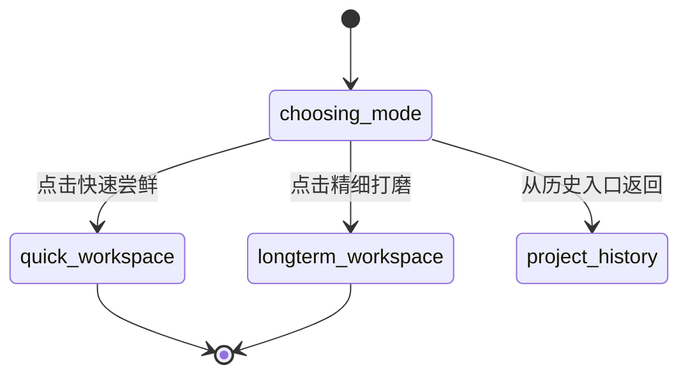
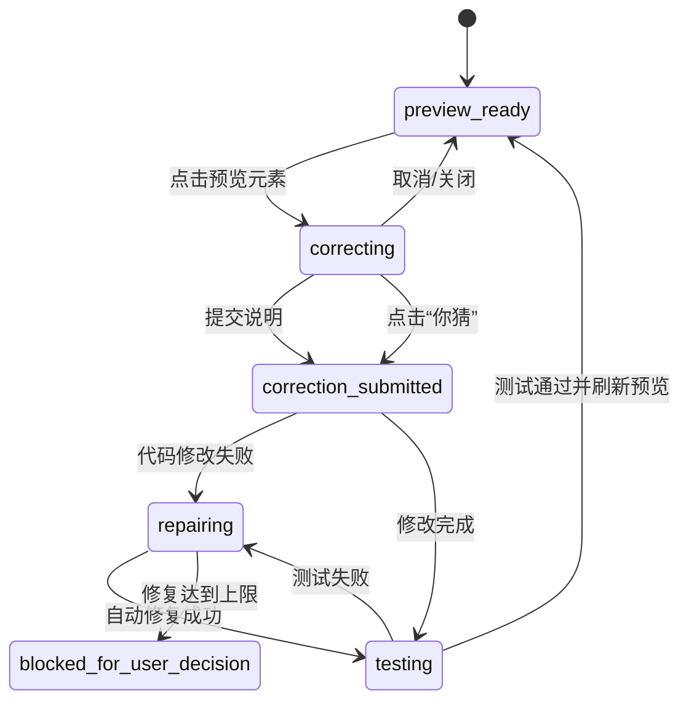
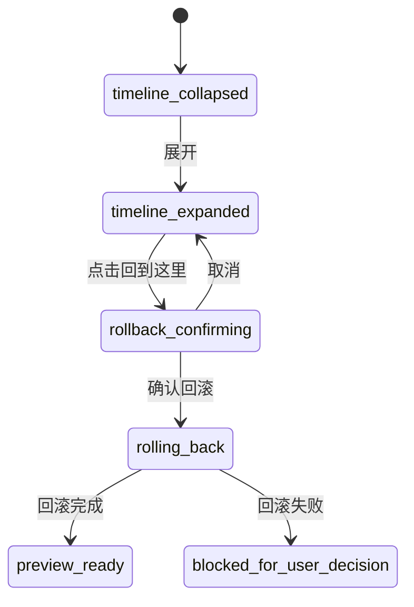
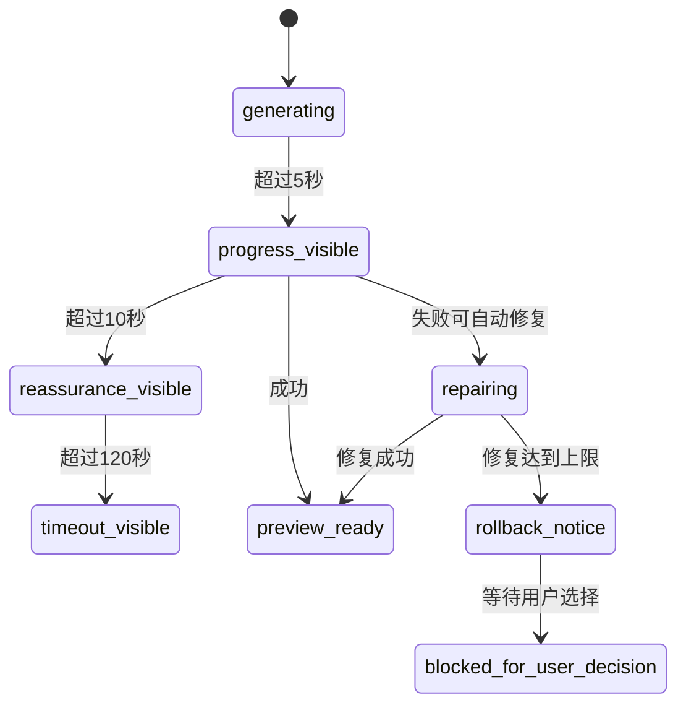

# 交互规格

> 项目：向导 Agent 多智能体协同开发平台  
> 文档ID：DOC-2.5  
> 版本：v1.0 | 日期：2026-07-10 | 状态：已确认  
> 依赖：DOC-2.2 `user-flows.md`、DOC-2.4 `design-system.md`、`wireframes/`

---

## 1. 文档目标

本文档定义 UX 层 4 个核心交互的可实现、可测试规格：

1. 模式选择
2. 点选纠错
3. 快照回滚
4. 等待反馈与异常反馈

每个交互均包含触发条件、状态流转、边界情况和 GWT 验收场景。后续 `test-plan.md` 与 `features/` 应直接引用本规格。

---

## 2. 统一交互状态

| 状态 | 含义 | 用户可见表现 |
|---|---|---|
| `idle` | 等待用户输入或选择 | 输入框可用，按钮可点击 |
| `choosing_mode` | 用户正在两道门选择页 | 显示快速尝鲜/精细打磨 |
| `clarifying` | 向导 Agent 正在澄清需求 | 对话区出现卡片选项或问题 |
| `generating` | 系统正在生成草图或 MVP | 显示等待反馈 |
| `preview_ready` | 预览区已有可交互产物 | 预览区可操作，点选纠错可用 |
| `correcting` | 用户正在提交点选纠错 | 被选元素高亮，弹窗显示 |
| `testing` | 系统正在回归测试 | 对话区显示检查中 |
| `repairing` | 系统正在自动修复 | 对话区显示修复中 |
| `rollback_confirming` | 用户正在确认回滚 | 回滚确认弹窗显示 |
| `blocked_for_user_decision` | 自动流程达到上限 | 向导 Agent 给出可选下一步 |
| `completed` | 项目已标记完成 | 可继续修改、升级或返回项目列表 |

---

## 3. 交互一：模式选择

### 3.1 触发条件

| 入口 | 条件 |
|---|---|
| 首次启动 | 本地无历史项目 |
| 历史项目列表 | 用户点击“新建项目” |
| 项目列表加载失败 | 用户选择降级入口“直接新建” |

### 3.2 状态流转



### 3.3 规则

| 规则 | 说明 |
|---|---|
| R-MODE-01 | 两个模式卡片必须同时可见，移动端可上下排列 |
| R-MODE-02 | 卡片整体可点击，不只标题或按钮可点击 |
| R-MODE-03 | 选择后立即创建项目上下文，记录模式 |
| R-MODE-04 | 进入工作区后不提供返回两道门入口 |
| R-MODE-05 | 快消型完成后可升级为长期迭代型，但长期迭代型不降级 |
| R-MODE-06 | 从历史项目列表进入两道门时允许返回项目列表；首次启动不显示返回 |

### 3.4 边界情况

| Case | 系统行为 |
|---|---|
| 用户双击模式卡片 | 只创建一个项目，第二次点击被忽略 |
| 项目创建失败 | 保留在两道门页，显示自然语言错误和重试 |
| 用户按 Enter/Space | 焦点所在卡片被选择 |
| 窄屏显示 | 卡片单列排列，不截断长文案 |
| 历史入口不可用 | 隐藏或禁用历史入口，不影响模式选择 |

### 3.5 GWT 场景

```gherkin
Feature: 模式选择

  Scenario: 首次启动选择快速尝鲜
    Given 用户首次启动平台且没有历史项目
    When 两道门选择页加载完成
    And 用户点击“快速尝鲜”卡片
    Then 系统创建快消型项目
    And 页面进入快消型工作区
    And 顶栏显示“快速尝鲜”模式标签

  Scenario: 选择后不能返回两道门
    Given 用户已经选择“快速尝鲜”
    When 用户进入快消型工作区
    Then 页面不显示返回两道门的入口
    And 用户可以通过“所有项目”返回项目列表

  Scenario: 键盘选择精细打磨
    Given 用户位于两道门选择页
    When 用户使用 Tab 聚焦“精细打磨”卡片
    And 用户按下 Enter
    Then 系统创建长期迭代型项目
    And 页面进入长期迭代型工作区
```

---

## 4. 交互二：点选纠错

### 4.1 触发条件

| 入口 | 条件 |
|---|---|
| 草图阶段 | 预览区已有可交互草图 |
| MVP 阶段 | MVP 已通过基础运行检查 |
| 迭代打磨阶段 | 用户继续提出修改 |

### 4.2 状态流转



### 4.3 规则

| 规则 | 说明 |
|---|---|
| R-CORR-01 | 用户点击预览元素后，系统必须高亮被选区域 |
| R-CORR-02 | 弹窗标题固定为“这里有什么问题？” |
| R-CORR-03 | 用户可输入说明，也可点击“你猜”提交无文本纠错 |
| R-CORR-04 | 提交后记录点击坐标、DOM 路径、截图上下文、用户文本 |
| R-CORR-05 | 修改后必须运行相关 GWT 回归测试 |
| R-CORR-06 | 测试通过前不替换当前健康预览 |
| R-CORR-07 | 同一区域连续两次被纠错后，向导 Agent 必须主动追问 |
| R-CORR-08 | Canvas/WebGL/Shadow DOM 内容无法精确命中时降级为区域框选 |

### 4.4 边界情况

| Case | 系统行为 |
|---|---|
| 用户点击 iframe 内链接 | 不执行顶部导航，拦截为点选纠错候选 |
| 用户关闭弹窗但未输入 | 记录为无文本不满意 |
| 用户输入超长说明 | 截断保存原文，向导 Agent 使用摘要 |
| 用户连续点击多个元素 | 只保留当前弹窗，旧弹窗自动关闭 |
| 修改生成失败 | 进入自动修复流程，不暴露技术日志 |
| 用户在修复中继续输入 | 输入进入消息队列，不打断当前修复 |

### 4.5 GWT 场景

```gherkin
Feature: 点选纠错

  Scenario: 用户点击元素并提交纠错说明
    Given 预览区已经展示可交互草图
    When 用户点击预览区中的金额显示区域
    Then 被点击区域高亮显示
    And 页面弹出“这里有什么问题？”输入框
    When 用户输入“金额前面要显示 ¥”
    And 用户点击“提交”
    Then 系统记录点击位置和用户说明
    And 向导 Agent 在对话区确认已收到修改意见

  Scenario: 用户不输入说明直接让系统猜
    Given 点选纠错弹窗已经打开
    When 用户点击“你猜”
    Then 系统记录点击位置
    And 修改意图标记为“用户不满意但未说明”

  Scenario: 同一区域连续纠错后主动追问
    Given 用户已经连续两次纠错同一区域
    When 用户第三次点击同一区域
    Then 向导 Agent 主动追问用户希望该区域如何呈现
    And 追问文案不包含技术术语
```

---

## 5. 交互三：快照回滚

### 5.1 触发条件

| 入口 | 条件 |
|---|---|
| 时间轴折叠态 | 用户点击时间轴节点或展开按钮 |
| 时间轴展开态 | 用户点击某个快照卡片的“回到这里” |
| 熔断流程 | 系统自动回滚到最近健康快照 |

### 5.2 状态流转



### 5.3 规则

| 规则 | 说明 |
|---|---|
| R-ROLL-01 | 每个快照必须包含预览截图、自然语言摘要、创建时间 |
| R-ROLL-02 | 点击历史快照必须先弹出确认，不直接回滚 |
| R-ROLL-03 | 回滚确认文案必须说明后续版本仍保留 |
| R-ROLL-04 | 回滚后旧版本之后的快照只作为存档保留 |
| R-ROLL-05 | 回滚完成后向导 Agent 必须告知用户“已经回到之前版本” |
| R-ROLL-06 | 系统只支持线性回滚，不提供分支概念 |
| R-ROLL-07 | 当前版本卡片不可显示“回到这里”，应显示“当前版本” |

### 5.4 边界情况

| Case | 系统行为 |
|---|---|
| 没有快照 | 时间轴显示空状态，引导用户先生成草图 |
| 快照超过 100 个 | 合并或归档最早中间快照，保留首尾关键节点 |
| 快照文件损坏 | 标记不可回滚，提供错误说明和其他可用快照 |
| 回滚过程中用户关闭应用 | 下次启动恢复到回滚前安全状态或完成回滚事务 |
| 用户回滚后继续修改 | 新修改沿当前时间线继续，不创建分支 |

### 5.5 GWT 场景

```gherkin
Feature: 快照回滚

  Scenario: 用户确认回滚到验证草图版本
    Given 时间轴中存在“验证草图 v1”和“MVP v1”两个快照
    When 用户展开时间轴
    And 用户点击“验证草图 v1”的“回到这里”
    Then 系统弹出回滚确认框
    And 文案说明后续版本仍会保留
    When 用户点击“确认回到这里”
    Then 预览区恢复为“验证草图 v1”
    And 向导 Agent 告知用户已经回到之前版本

  Scenario: 用户取消回滚
    Given 回滚确认框已经显示
    When 用户点击“取消”
    Then 系统关闭确认框
    And 当前预览版本不变

  Scenario: 当前版本不能回滚到自身
    Given 时间轴展开
    When 用户查看当前版本快照卡片
    Then 卡片显示“当前版本”
    And 不显示“回到这里”操作
```

---

## 6. 交互四：等待反馈与异常反馈

### 6.1 触发条件

| 场景 | 条件 |
|---|---|
| 常规等待 | 任意生成/测试/修复操作超过 5 秒 |
| 长等待 | 任意操作超过 10 秒 |
| 草图超时 | 验证草图生成超过 120 秒 |
| 自动修复 | 运行或测试失败后进入修复 |
| 熔断回滚 | 自动修复连续失败达到上限 |
| 裁判退回 | 裁判 Agent 判定退回 |
| 安全风险 | 安全问题多次修复失败 |

### 6.2 状态流转



### 6.3 规则

| 规则 | 说明 |
|---|---|
| R-WAIT-01 | 超过 5 秒必须显示当前正在做什么 |
| R-WAIT-02 | 超过 10 秒必须加入安全感说明 |
| R-WAIT-03 | 超过 120 秒必须提供继续等待或查看已生成部分 |
| R-WAIT-04 | 等待反馈不应阻塞用户继续输入 |
| R-WAIT-05 | 错误反馈不显示堆栈、函数名、HTTP 状态码 |
| R-WAIT-06 | 自动修复失败回滚后必须明确说明用户内容没有丢失 |
| R-WAIT-07 | 安全风险文案必须描述现实风险，不使用 XSS/SQL 注入等术语面向 P0 用户 |
| R-WAIT-08 | 裁判退回达到上限时，用户可选择继续修复、接受现状或补充说明 |

### 6.4 文案模板

| 场景 | 文案 |
|---|---|
| 生成中 | 我正在帮你生成可运行的版本。 |
| 安全等待 | 这个过程只发生在安全环境里，不会影响你的电脑文件。 |
| 草图超时 | 这次花的时间比预期更长，我还在处理中。你可以先看看已经生成的部分。 |
| 修改成功 | 改好了，你看看效果？不满意随时告诉我。 |
| 自动修复中 | 刚才的修改没有成功，我正在换个方式修好它。 |
| 熔断回滚 | 刚才的修改没有成功，我已经帮你回到上一个正常版本，你的内容没有丢失。 |
| 功能偏差 | 你之前提到想要按月统计，但当前页面里没有这个功能。你觉得现在这样可以吗？ |
| 安全风险 | 别人可能通过输入框获取你的私人数据。建议先不要交付这个版本。 |

### 6.5 边界情况

| Case | 系统行为 |
|---|---|
| 用户在等待中继续输入 | 消息进入队列，显示待处理数量 |
| 操作成功但等待卡片仍显示 | 成功后立即移除或改为完成提示 |
| 自动修复多次失败 | 触发熔断回滚，不继续无限重试 |
| 安全问题修复失败 | 强风险提示，建议不交付，但最终决定权仍在用户 |
| 网络断开 | 顶栏显示离线状态，允许查看已有预览和快照 |
| 沙箱无响应 | 提供刷新预览和回滚到最近快照 |

### 6.6 GWT 场景

```gherkin
Feature: 等待反馈与异常反馈

  Scenario: 生成超过 5 秒显示进度
    Given 系统正在生成 MVP
    When 生成耗时超过 5 秒
    Then 对话区显示等待反馈
    And 文案说明系统正在生成可运行版本

  Scenario: 生成超过 10 秒显示安全感文案
    Given 等待反馈已经显示
    When 生成耗时超过 10 秒
    Then 文案说明生成发生在安全环境里
    And 文案不包含技术错误信息

  Scenario: 草图生成超过 120 秒
    Given 系统正在生成验证草图
    When 生成耗时超过 120 秒
    Then 系统提示这次花的时间比预期更长
    And 提供“继续等待”和“查看已生成部分”两个选项

  Scenario: 自动修复失败后熔断回滚
    Given 编程 Agent 已经连续 3 次自动修复失败
    When 系统触发熔断回滚
    Then 项目恢复到最近健康快照
    And 向导 Agent 告知用户内容没有丢失
    And 用户可以选择继续尝试、接受当前或补充说明
```

---

## 7. 测试映射

| 交互 | 建议 Feature 文件 | 覆盖重点 |
|---|---|---|
| 模式选择 | `features/mode-selection.feature` | 两道门、模式标签、键盘选择、重复点击 |
| 点选纠错 | `features/point-correction.feature` | 高亮、弹窗、无文本纠错、回归测试 |
| 快照回滚 | `features/timeline-rollback.feature` | 展开时间轴、确认弹窗、线性回滚 |
| 等待反馈 | `features/waiting-feedback.feature` | 5s/10s/120s、自动修复、熔断回滚 |

---

## 8. 对架构层的要求

后续架构设计必须提供以下能力，否则 UX 规格无法落地：

- 稳定的项目模式字段：`quick` / `longterm`
- 可追踪的生成阶段状态机
- 预览区元素定位与上下文采集能力
- 快照创建、查询、回滚事务
- 消息队列或等效机制，支持等待中继续输入
- 自动修复计数和安全问题独立计数
- 用户最终裁量权记录
- `data-ai-id` 到测试和 Agent 操作的映射

---

## 9. 修订记录

| 版本 | 日期 | 修订内容 |
|------|------|----------|
| v1.0 | 2026-07-10 | 首版，定义 4 个核心交互的状态、规则、边界和 GWT 场景 |

