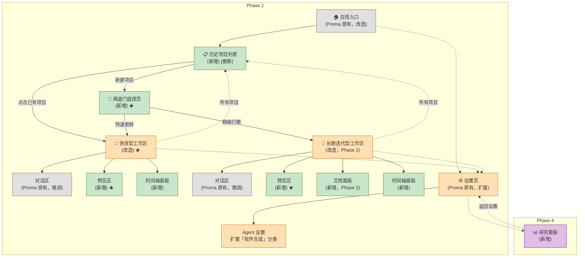

# 站点地图（Sitemap）

> 项目：向导 Agent 多智能体协同开发平台
> 文档ID：DOC-2.1
> 版本：v1.0 | 日期：2026-07-10 | 状态：已确认
> 依赖：`../01_PRD/prd.md`

---

## 1. 页面树

### 1.1 文本树

```
[应用入口] (Proma 原有，改造)
│
├── [历史项目列表] (新增，Phase 1) [推断]
│   ├── 项目卡片 × N (新增)
│   ├── "新建项目"按钮 (新增) ──→ 跳转至两道门选择页
│   └── 空状态引导 (新增，首次使用无项目时)
│
├── [两道门选择页] (新增，Phase 1) ← ★ 新增核心页面
│   ├── 快速尝鲜卡片 (新增) ──→ 进入快消型工作区
│   └── 精细打磨卡片 (新增) ──→ 进入长期迭代型工作区
│
├── [软件生成工作区] (Proma Agent 界面改造，Phase 1) ← ★ 改造核心
│   ├── [对话区] (Proma 原有，微调)
│   │   ├── 消息列表 (Proma 原有)
│   │   ├── 卡片选项 (新增，替代文本输入的快捷交互)
│   │   ├── 上下文指示器 (新增，显示当前阶段和模式)
│   │   └── 输入框 (Proma 原有)
│   │
│   ├── [预览区] (新增，Phase 1) ← ★ 新增核心区域
│   │   ├── 预览内嵌浏览器 (新增，沙箱 WebView)
│   │   ├── 点选纠错高亮层 (新增)
│   │   └── 预览控制栏 (新增：刷新、全屏、截图)
│   │
│   ├── [文档面板] (新增，仅长期迭代型，Phase 2)
│   │   ├── 文档树导航 (新增)
│   │   └── 自然语言概览视图 (新增，面向零基础用户)
│   │
│   └── [时间轴面板] (新增，Phase 1)
│       ├── 快照节点列表 (新增，按时间倒序)
│       ├── 预览缩略图 (新增，每个快照节点配图)
│       ├── 回滚确认弹窗 (新增)
│       └── 自然语言摘要 (新增，每节点一句描述)
│
├── [设置页] (Proma 原有，扩展)
│   ├── 通用设置 (Proma 原有)
│   ├── 渠道设置 (Proma 原有)
│   ├── Agent 设置 (Proma 原有，扩展)
│   │   └── "软件生成" 分类 (新增，Phase 1) ── 模型偏好、默认模式、沙箱配置
│   └── 关于 (Proma 原有)
│
└── [研究看板] (新增，Phase 4)
    ├── 核心指标概览 (新增：FIRT 中位数、Time-to-MVP 中位数、完成率、放弃率)
    ├── 用户行为分析 (新增：模式选择比例、纠错密度)
    ├── 工程质量分析 (新增：自动修复成功率、裁判通过率)
    └── A/B 实验对比 (新增，Phase 4)
```

### 1.2 Mermaid 图



> **图例**：⚪ 灰色 = Proma 原有 | 🟠 橙色 = Proma 改造 | 🟢 绿色 = 新增 | 🟣 紫色 = Phase 4 远期

---

### 1.3 分阶段能力边界

以下 UI 交互能力按 PRD §16 开发路线图分阶段实现。**页面/区域框架本身可在 Phase 1 搭建（确保路由完整），但具体交互深度按此表控制：**

| UI 能力 | Phase 1 基线 | Phase 2 增强 | Phase 3 完整 | Phase 4 |
|---------|-------------|-------------|-------------|---------|
| **点选纠错** | 点击元素→标记"不满意"，反馈回传向导 Agent | — | 气泡输入框 + 悬停高亮 + 连续猜不对追问 | — |
| **卡片选项** | 向导 Agent 发出 ≤3 个按钮式选项，用户点击选择 | — | 多类型卡片引擎（图文卡/选择卡/确认卡） | — |
| **心理防御文案** | 简单自然语言提示（如"正在处理…""已改好"） | — | PRD §13.6 全 10 种场景文案 | — |
| **进度指示器** | 操作 > 5s 时显示旋转图标 + 简短文字 | — | 分阶段进度文案 + 预估时间 | — |
| **升级确认对话框** | — | — | 快消型 → 长期迭代型升级入口 | — |
| **架构确认对话框** | — | ✅ 对话框形式，用户自然语言确认 | — | — |
| **Sprint 规划确认** | — | ✅ 对话框形式，用户自然语言确认 | — | — |
| **文档面板** | — | ✅ 文档树 + 自然语言概览 | — | — |
| **系统通知条** | 成功/错误/警告基础通知 | — | PRD §13.6 心理防御风格通知 | — |
| **裁判通知卡片** | — | 基础通过/退回提示 | 含偏差描述 + 用户操作选项（继续修改/接受现状） | — |
| **研究看板** | — | — | — | ✅ 全量埋点看板 |

> 以下 §2 各页面说明中的 Phase 标注指**页面框架的首个可用 Phase**。交互深度的分阶段细节以上表为准。

---

## 2. 页面说明

### 2.1 应用入口

- **页面 ID**：page-app-entry
- **用户可见名称**：无（用户看到的是 Proma 主窗口，无独立页面名）
- **类型**：Proma 原有，改造
- **Phase**：1
- **用途**：Proma 桌面应用的主窗口入口。本平台在此处增加路由判断：无历史项目 → 直接跳转两道门选择页；有历史项目 → 显示历史项目列表
- **改造内容**：修改启动路由逻辑，根据用户是否有历史项目决定跳转目标
- **可跳转到**：历史项目列表 / 两道门选择页（首次使用）
- **改造必要性**：Proma 原有入口直接进入 Agent 对话界面，而本平台需要在对话前完成模式选择。不改造入口路由则用户无从选择快消型/长期迭代型，PRD §4 的核心设计无法落地

---

### 2.2 历史项目列表 [推断]

- **页面 ID**：page-project-history
- **用户可见名称**：你的项目
- **类型**：新增
- **Phase**：1
- **用途**：回访用户查看、继续或管理之前创建的软件项目。首次使用无项目时显示引导卡片
- **何时进入**：应用启动后，检测到已有历史项目时自动显示；首次使用无项目时跳过，直接进入两道门选择页
- **页面内容**：
  - 顶部标题"你的项目" + "新建项目"按钮（突出显示）
  - 项目卡片网格（每卡片含：预览缩略图、项目名、模式标签「快速尝鲜 / 精细打磨」、项目状态「进行中 / 已完成」、最后修改时间）
  - 空状态：一个大卡片 + "告诉我你想做什么，我来帮你做出来"引导文案 → 点击进入两道门选择页
- **可跳转到**：点击已有项目 → 对应工作区（恢复上次状态）；点击"新建项目" → 两道门选择页
- **返回**：不提供返回入口（用户在工作区内可随时新建项目，无需回到此页）
- **状态覆盖**：
  - **空状态**（首次使用无项目）：大引导卡片 + "告诉我你想做什么，我来帮你做出来"文案，点击进入两道门选择页
  - **正常状态**：项目卡片网格，每卡片含预览缩略图、项目名、模式标签、最后修改时间
  - **加载状态**：进入页面时显示骨架屏（卡片占位形状 + 渐变动画），避免闪烁
  - **错误状态**：若项目列表加载失败（本地存储异常），显示"暂时无法加载你的项目"提示 + "重试"按钮；若持续失败，提供"跳过，直接新建项目"降级入口
- **新增必要性**：PRD §13 未详述回访体验，但零基础用户完成第一个项目后需要看到"自己做过的东西"。若启动后始终看到两道门，用户会困惑"我之前做的去哪了"
- **推断依据**：PRD §13.4 时间轴描述了项目内的版本管理，但缺少项目间的导航。一个让回访用户直接跳进两道门的设计会破坏用户对平台"帮我管理项目"的信任

---

### 2.3 两道门选择页

- **页面 ID**：page-mode-selection
- **用户可见名称**：（用户看到两个卡片，无显式页面标题）
- **类型**：新增
- **Phase**：1
- **用途**：用户选择产品模式——快速尝鲜还是精细打磨。这是 PRD §4 两道门设计的直接 UI 实现
- **何时进入**：首次启动后（无历史项目时）自动显示；或在历史项目列表中点击"新建项目"
- **页面内容**：
  - 居中布局，两个大卡片左右并列（移动端/窄窗口上下堆叠）
  - 左侧"快速尝鲜"卡片（蓝绿色系）：标题 + 图标 + 一句话说明"适合一次性小工具、试试想法。AI 自动搞定大部分细节，你只管看最终效果满不满意"
  - 右侧"精细打磨"卡片（紫色系）：标题 + 图标 + 一句话说明"适合想长期使用、持续改进的项目。AI 会在关键节点跟你确认计划，每一步都稳"
  - 鼠标悬停时卡片有轻微放大 + 阴影加深效果，说明文字展开更多细节
  - 底部小字："选好后也可以升级"（仅"快速尝鲜"卡片下方，打消用户怕选错的顾虑）
- **可跳转到**：选择"快速尝鲜" → 快消型工作区；选择"精细打磨" → 长期迭代型工作区
- **返回**：从历史项目列表进入时，提供"← 返回项目列表"按钮（左上角）；首次启动进入时不显示返回按钮（PRD §4：模式一经选择不提供运行时切换，但未选择前可以反悔）
- **新增必要性**：PRD §4 定义的两个核心产品模式必须有一个用户可理解的入口。Proma 无此类功能，必须新建

---

### 2.4 软件生成工作区（快消型）

- **页面 ID**：page-workspace-quick
- **用户可见名称**：（用户看到的是对话界面，无显式页面名；顶栏显示"项目名 · 快速尝鲜"）
- **类型**：Proma Agent 界面改造
- **Phase**：1
- **用途**：快消型项目的完整工作区。用户在左侧对话区与向导 Agent 交流，右侧预览区实时查看生成的软件
- **何时进入**：在两道门选择页选择"快速尝鲜"后进入；或从历史项目列表点击快消型项目进入
- **页面布局**：见 §4 布局对比表
- **可跳转到**：设置页（Proma 原有入口保留）；用户满意后通过对话区卡片选项「标记为完成」或完成项目后弹出升级确认对话框 → 可升级为长期迭代型或标记为"已完成"（快消型）；点击顶栏"所有项目"入口 → 返回历史项目列表
- **返回**：不提供返回两道门选择页的入口（模式一经选择不切换）
- **改造内容**：
  - 保留 Proma Agent 界面的消息列表和输入框，作为对话区
  - 在对话区右侧新增预览区（占用约 65% 窗口宽度，见 §4 布局对比表）
  - 在底部新增时间轴面板（默认折叠为窄条）
  - 屏蔽工作区切换器（本平台固定工作区）
- **改造必要性**：Proma Agent 界面仅有对话功能，无预览区、无时间轴。不改造则 PRD §5 快速验证循环的"预览即确认"无法实现——用户只能读 Agent 的文字描述，看不到软件运行效果

---

### 2.5 软件生成工作区（长期迭代型）

- **页面 ID**：page-workspace-longterm
- **用户可见名称**：（顶栏显示"项目名 · 精细打磨"）
- **类型**：Proma Agent 界面改造
- **Phase**：2（Phase 1 提供页面框架骨架，仅支持快消型完整流程；完整长期迭代型功能在 Phase 2 实现，详见 PRD §16）
- **用途**：长期迭代型项目的完整工作区。布局与快消型基本一致，增设文档面板用于查看自动生成的文档，架构确认和 Sprint 规划节点以对话框形式跳出
- **何时进入**：在两道门选择页选择"精细打磨"后进入；或从历史项目列表点击长期迭代型项目进入
- **页面布局**：见 §4 布局对比表
- **与快消型工作区的 UI 差异**（以下差异项均为 Phase 2 实现）：
  - 对话区与预览区之间多了可折叠的文档面板（参见 PRD [[../01_PRD/prd.md#7-文档体系]] 完整文档目录的 UI 入口）
  - 时间轴展开后信息更详细（展示更多文档快照节点，含关联的文档变更摘要）
  - 架构设计中需要用户确认时（参见 PRD [[../01_PRD/prd.md#6-agent-架构]]），架构设计师跳出对话框形式让用户确认设计方案（快消型无此节点）
  - Sprint 规划阶段（参见 PRD [[../01_PRD/prd.md#6-agent-架构]]），工程经理跳出对话框形式让用户确认 Sprint 计划（快消型无此节点）
- **可跳转到**：设置页、返回所有项目（底栏"所有项目"入口跳回历史项目列表）
- **改造内容**：同快消型工作区，额外增加文档面板、架构确认对话框和 Sprint 规划确认对话框
- **改造必要性**：长期迭代型需要完整的文档体系和用户确认节点（参见 PRD [[../01_PRD/prd.md#4-两种产品模式]] 模式对比表——长期迭代型用户确认节点为"设计 + Sprint + 预览"）。文档面板提供文档可见性入口，架构确认和 Sprint 规划对话框满足用户对关键决策的知情权

---

### 2.6 对话区

- **页面 ID**：region-chat-panel
- **用户可见名称**：无（用户看到的自然就是聊天界面）
- **类型**：Proma 原有，微调
- **Phase**：1
- **用途**：用户与向导 Agent 对话的唯一入口。用户通过自然语言描述需求、收到卡片选项（PRD §13.1"卡片选择代替文本输入"）、看到进度提示
- **改造内容**（相对 Proma Agent 对话界面）：
  - 新增**卡片选项**渲染：向导 Agent 可发出带按钮的卡片消息（如"日常开销 / 生意账目 / 你帮我决定"），用户点击替代打字
  - 新增**上下文指示器**：在对话区顶部显示当前阶段（"正在理解你的需求…""正在生成草图…""MVP 已就绪"）和模式标签
  - 新增**进度提示**：超过 5 秒的操作显示进度文案（PRD §13.6 心理防御文案）
  - 输入框保持不变
- **状态覆盖**：
  - **空状态**（首次进入工作区）：对话区显示向导 Agent 的首条问候消息，内容为友好的自我介绍 + 引导用户描述需求。上下文指示器显示当前模式标签
  - **回访恢复**（从历史项目列表进入）：对话区加载上次的对话历史（从最新消息开始显示，向上滚动查看历史）。预览区加载上次的快照版本。加载期间对话区显示骨架占位
  - **正常状态**：显示消息列表（用户消息 + 向导 Agent 回复 + 卡片选项 + 裁判通知卡片）
  - **加载状态**：向导 Agent 处理中时，输入框上方显示"正在思考…"；操作耗时 > 5 秒时进度指示器出现
- **改造必要性**：零基础用户不习惯打字描述需求（参见 PRD [[../01_PRD/prd.md#3-用户画像]] 恐惧点"怕操作太复杂"），卡片选择将开放式问题变为封闭式选择，降低交互门槛。上下文指示器让用户知道"系统在干嘛"——对应 PRD §3.4"怕等待焦虑"

---

### 2.7 预览区

- **页面 ID**：region-preview-panel
- **用户可见名称**：无（用户看到的就是生成的软件在运行）
- **类型**：新增
- **Phase**：1
- **用途**：运行并展示编程 Agent 生成的软件。用户在此区域内看到可交互的验证草图、MVP 和迭代版本。这是 PRD §2.2"预览即确认"的物理实现
- **何时可见**：验证草图生成后开始显示；在此之前预览区显示为空状态占位（"这里将展示你的软件预览"）
- **页面内容**：
  - 内嵌沙箱浏览器（WebView），加载编程 Agent 生成的 HTML/Web 应用
  - 点选纠错高亮层：覆盖在预览内容之上的透明交互层。用户在预览区任意元素上悬停时元素轻微高亮，点击后弹出纠错输入框"这里有什么问题？"
  - 控制栏（预览区顶部，半透明，鼠标移入时显示）：
    - 刷新按钮：重新加载当前版本
    - 全屏按钮：预览区占满整个窗口（临时隐藏对话区和时间轴）
    - 截图按钮：截取当前预览画面（用于系统自动快照，PRD §13.4）
- **交互细节**：
  - 点选纠错（PRD §13.5）：点击不满意元素 → 元素高亮 + 弹出气泡输入框 → 用户输入描述或直接关闭（表示"你猜"）→ 向导 Agent 接收位置 + 上下文 + 描述生成修改指令
  - 预览内容在每次修改后自动刷新，刷新时有短暂的加载指示
- **新增必要性**：PRD §2.2 的核心设计——用户只看预览不读文档。没有预览区，整个"预览即确认"的设计理念崩塌。这是本平台区别于普通 AI 聊天工具的最关键 UI 差异
- **技术约束**：iframe 沙箱安全策略、Canvas/WebGL 降级方案、导航限制和弹窗拦截详见 [[#7-技术约束与边界条件|§7.2 预览区沙箱约束]]
- **状态覆盖**：
  - **空状态**（草图生成前）：居中占位图文"这里将展示你的软件预览"，配合图标
  - **正常状态**：加载并展示编程 Agent 生成的 Web 应用
  - **加载状态**：生成/刷新时显示骨架屏 + "正在生成预览…" 文案；每次修改后自动刷新时有短暂旋转指示器
  - **错误状态——代码运行异常**：预览区显示错误占位（不展示原始报错信息），包含"预览加载失败"的自然语言提示 + "重试"按钮。系统自动触发异常自愈流程（参见 PRD [[../01_PRD/prd.md#6-agent-架构]]），不将技术错误细节暴露给用户
  - **错误状态——沙箱初始化失败**：预览区显示"预览环境正在准备中，请稍候…" + 重试按钮。若持续失败，通过系统通知条告知用户并提供"跳过预览，先完成需求描述"的降级选项
  - **边界状态——超时**：若生成过程超过 120 秒（参见 PRD [[../01_PRD/prd.md#5-快速验证循环]] FIRT 上限），显示"这次生成花了比预期更长的时间…" + 展示已生成的部分 + "继续等待 / 看看已有的" 两个选项

---

### 2.8 文档面板（仅长期迭代型）

- **页面 ID**：region-doc-panel
- **用户可见名称**：项目文档
- **类型**：新增
- **Phase**：2（文档体系在 Phase 2 实现，参见 PRD [[../01_PRD/prd.md#16-开发路线图]]；Phase 1 仅快消型精简文档，不涉及文档面板 UI）
- **用途**：展示系统自动生成的项目文档目录（参见 PRD [[../01_PRD/prd.md#7-文档体系]]），以自然语言概览而非技术文档的形式呈现给零基础用户
- **何时可见**：长期迭代型工作区中始终可见（可折叠），快消型无此面板
- **页面内容**：
  - 可折叠侧栏，位于对话区和预览区之间
  - 文档树导航：按 PRD §7.2 的目录结构展示（01_PRD / 02_UX_DESIGN / …），每个文档显示标题和最后更新时间
  - 自然语言概览视图（默认）：用户点击某文档后，不展示原始 Markdown，而是展示系统自动生成的"说人话版摘要"——用零基础用户能理解的语言概述文档内容
  - "查看原文"按钮（用户可选，不主动推荐）
- **折叠/展开**：点击侧边边缘的把手图标切换；默认折叠，有新文档生成时把手上有小红点提示
- **状态覆盖**：
  - **空状态**（项目初期文档尚未生成）：显示"项目文档正在生成中…"引导占位，文档树仅显示目录骨架（灰色不可点击）
  - **正常状态**：文档树展示已生成的文档，最新文档有"新"标记；点击文档展示自然语言概览
  - **加载状态**：文档内容加载中显示骨架占位
- **新增必要性**：长期迭代型需要文档体系支撑迭代（参见 PRD [[../01_PRD/prd.md#7-文档体系]]），虽然用户不确认文档（PRD §7.1），但文档面板给了用户一个"能看看系统做了哪些规划"的入口。用户不必看，但想看时能找到

---

### 2.9 时间轴面板

- **页面 ID**：region-timeline-panel
- **用户可见名称**：无（用户看到的是底部的时间节点列表）
- **类型**：新增
- **Phase**：1
- **用途**：展示项目关键节点的快照时间轴（PRD §13.4），用户可查看历史版本、预览缩略图、一键回滚
- **何时可见**：验证草图生成后开始有内容；在此之前显示为空状态
- **页面内容**：
  - 默认折叠为底部窄条（高约 48px），展示最近 3 个快照节点的小圆点 + 自然语言摘要
  - 展开后（点击或上滑）显示完整快照列表，每节点包含：
    - 预览缩略图（64×48px，自动截取）
    - 自然语言摘要（如"2 个页面，记账 + 查看记录"）
    - 时间戳（如"3 分钟前"）
    - 当前版本高亮标记
  - 点击任意快照节点 → 弹出回滚确认弹窗："确定回到这个版本吗？回到之后你还可以再切换回来。"
  - 确认回滚后 → 预览区加载旧版本 + 对话区追加一条系统消息"已回到 3 分钟前的版本。一切都在。"
- **交互细节**：
  - 仅支持线性回滚（PRD §13.4），不展示分支
  - 回滚后的节点仍保留在时间轴上（灰色显示），用户可再次点击回到它们
  - 快消型：时间轴信息精简（仅快照节点 + 时间）；长期迭代型：每个节点额外展示关联的文档变更摘要
- **新增必要性**：PRD §3.4 用户"怕搞坏东西"的恐惧需要时间轴 + 回滚来消除。Proma 无此功能。这是用户安全感的物理锚点——用户知道"搞坏了可以回去"
- **技术约束**：快照存储上限（100 个）及自动合并策略见 [[#7-技术约束与边界条件|§7.3 数据与存储约束]]；回滚确认弹窗与点选纠错弹窗的堆叠优先级见 [[#7-技术约束与边界条件|§7.4 交互边界约束]]。PRD §5.4 的决策标注机制：回滚时在确认弹窗中展示即将被回滚的决策项列表（原因、影响范围、可逆性等级），该功能见 [[#7-技术约束与边界条件|§7.3]]

---

### 2.10 设置页

- **页面 ID**：page-settings
- **用户可见名称**：设置
- **类型**：Proma 原有，扩展
- **Phase**：1
- **用途**：用户管理应用偏好。在 Proma 原有设置基础上新增"软件生成"分类
- **扩展内容**：
  - **"软件生成"设置分类**（新增）：
    - 默认模式偏好（快速尝鲜 / 精细打磨 / 每次询问）—— 影响两道门选择页是否显示
    - 预览区默认位置（右侧 / 底部）—— 宽屏用户偏好
    - 沙箱内存上限
    - 数据采集开关（默认开启，用户可关闭）
  - **数据管理**（新增）：导出项目数据（JSON/ZIP 格式）、删除项目（含二次确认）、数据保留策略说明（默认 30 天，参见 PRD [[../01_PRD/prd.md#14-数据采集与分析体系]]）
- **复用内容**：通用设置、渠道设置、关于等 Proma 原有设置项保持不变
- **扩展必要性**：平台增加了软件生成功能，需要对应的用户偏好设置。放在已有设置页中而非新建页面，减少用户的认知负担

---

### 2.11 研究看板

- **页面 ID**：page-research-dashboard
- **用户可见名称**：（仅研究者可见，普通用户不会进入此页面）
- **类型**：新增
- **Phase**：4
- **用途**：供课题组成员查看全量埋点数据（PRD §14），支撑科研分析和论文撰写
- **何时进入**：通过设置页「关于 → 连续点击版本号 5 次」解锁隐藏入口，弹出密码输入框（验证机制见 [[#7-技术约束与边界条件|§7.5 研究者路径约束]]）
- **如何退出**：通过面包屑导航或"← 返回设置"按钮回到设置页
- **页面内容**：
  - 核心指标概览：FIRT 中位数、Time-to-MVP 中位数、完成率、放弃率（带趋势图）。所有指标旁标注"数据覆盖率"（如"覆盖 87% 的用户"，见 [[#7-技术约束与边界条件|§7.5]]）
  - 用户行为分析：快消型/长期迭代型选择比例、纠错密度分布、放弃节点分布
  - 工程质量分析：自动修复成功率、裁判通过率（按模式分组对比）
  - A/B 实验对比（如有）
  - 每视图右上角提供"导出 CSV"按钮
- **Phase 1-3 临时方案**：研究看板上线前，研究者通过项目根目录 `logs/analytics.jsonl` 查看原始埋点数据
- **新增必要性**：PRD §14 定义的全量数据采集需要可视化出口。研究者不可能通过翻日志来分析数据

---

## 3. 全局 UI 元素

以下元素不属于某个特定页面，在多个页面或全局范围内出现：

| 元素 | 类型 | 说明 | Phase |
|-----|------|------|:----:|
| **顶栏** | 全局 | 工作区顶部固定条，左侧显示：项目名 + 模式标签（快速尝鲜/精细打磨）+ 上下文阶段指示器（如"正在生成草图…"）；右侧：「所有项目」入口（点击返回历史项目列表）+ 联网状态 | 1 |
| **系统通知条** | 全局 | 顶部滑入式通知条，显示成功/警告/错误消息。触发场景包括：操作完成（成功）、生成超时/自动修复失败（警告）、沙箱异常/存储异常（错误）。文案遵循 PRD §13.6 心理防御规范 | 1 |
| **点选纠错弹窗** | 全局（预览区内） | 用户在预览区点击不满意元素后出现的浮动气泡输入框。含输入框 + 关闭按钮（关闭 = "你猜"） | 1 |
| **升级确认对话框** | 全局 | 快消型项目 MVP 交付后弹出的模态对话框（PRD §4.4），询问是否升级为长期迭代型。用户选择「升级」→ 进入升级流程；选择「暂不升级」或关闭对话框 → 项目标记为"已完成"（快消型），可在历史项目列表中看到状态。Phase 3 实现 | 3 |
| **架构确认对话框** | 全局（仅长期迭代型，Phase 2） | 架构设计师完成设计后跳出，用户以自然语言确认方案（参见 PRD [[../01_PRD/prd.md#6-agent-架构]]）；快消型不出现 | 2 |
| **Sprint 规划确认对话框** | 全局（仅长期迭代型，Phase 2） | 工程经理制定 Sprint 计划后跳出，用户以自然语言确认（参见 PRD [[../01_PRD/prd.md#4-两种产品模式]] 模式对比表——长期迭代型确认节点含 Sprint）；快消型不出现 | 2 |
| **进度指示器** | 全局 | 操作耗时 > 5 秒时在对话区显示：旋转图标 + 心理防御文案（参见 PRD [[../01_PRD/prd.md#13-ux-与交互设计]]）；不阻塞用户继续输入 | 1 |
| **回滚确认弹窗** | 全局（时间轴面板内） | 用户点击时间轴历史节点时弹出，确认后执行回滚。含自然语言提示 | 1 |
| **裁判通知卡片** | 全局（对话区内） | 裁判退回或安全警告时，以对话消息形式呈现（而非技术日志），包含偏差描述和用户操作选项。文案遵循参见 PRD [[../01_PRD/prd.md#13-ux-与交互设计]] | 1 |
| **空状态占位** | 全局 | 各区域/面板无内容时的引导占位图 + 一句自然语言描述，不用"暂无数据"等技术用语 | 1 |

---

## 4. 布局对比：快消型 vs 长期迭代型

```
快消型工作区布局                        长期迭代型工作区布局
┌──────────────────────────────┐      ┌──────────────────────────────────────┐
│ [项目名] [快速尝鲜] [所有项目▼]  │      │ [项目名] [精细打磨] [所有项目▼]           │  ← 顶栏
├─────────────┬────────────────┤      ├───────┬──────────┬─────────────────┤
│ 对话区       │  预览区         │      │ 对话区 │ 预览区    │  预览区          │
│ (左侧)      │  (右侧)        │      │ (左侧) │(可折叠)   │  (右侧)         │
│             │                │      │       │ ← 文档面板 │                 │
│ ~35%宽      │  ~65%宽        │      │ ~30%宽│ 展开时15%  │  ~55%宽         │
│             │                │      │       │ 折叠时0%   │  折叠时~70%宽    │
├─────────────┴────────────────┤      ├───────┴──────────┴─────────────────┤
│ 时间轴面板 (底部窄条)          │      │ 时间轴面板 (底部，展开更详细，含文档变更摘要) │  ← 底栏
└──────────────────────────────┘      └──────────────────────────────────────┘
```

| 区域 | 快消型 | 长期迭代型 |
|------|--------|-----------|
| **顶栏** | ✅ 顶栏左侧：项目名 + 模式标签「快速尝鲜」；顶栏右侧：「所有项目」入口 | ✅ 顶栏左侧：项目名 + 模式标签「精细打磨」；顶栏右侧：「所有项目」入口 |
| **上下文指示器** | ✅ 顶栏内嵌显示当前阶段（如"正在生成草图…"） | ✅ 顶栏内嵌显示当前阶段（如"正在理解需求…"） + Sprint 编号（如"Sprint 1 进行中"） |
| 对话区 | ✅ 左侧，约 35% 宽度 | ✅ 左侧，约 30% 宽度 |
| 预览区 | ✅ 右侧，约 65% 宽度（主内容区） | ✅ 右侧，约 55% 宽度 |
| 文档面板 | ❌ 无 | ✅ 对话区与预览区之间。默认折叠（0px，对话~35%+预览~65%，同快消型布局）；展开时挤压两侧（对话~30%+面板~15%+预览~55%）（Phase 2） |
| 时间轴 | ✅ 底部窄条（默认高 48px，可展开） | ✅ 底部（默认同窄条，展开后节点信息更详细，含文档变更摘要） |
| 架构确认节点 | ❌ 无 | ✅ 对话框形式跳出（Phase 2） |
| Sprint 确认节点 | ❌ 无 | ✅ 对话框形式跳出（Phase 2） |

---

## 5. 与 Proma 现有页面的关系

本平台基于 Proma fork，以下梳理与 Proma 现有 UI 的关系：

| Proma 页面/组件 | 复用方式 | 说明 |
|-----------|---------|------|
| **Agent 对话界面** | 改造 | 保留消息列表和输入框，改造为软件生成工作区的对话区。新增卡片选项渲染、上下文指示器、进度提示 |
| **设置页面** | 扩展 | 保留全部原有设置项，新增"软件生成"设置分类 |
| **工作区选择器** | 屏蔽 | 本平台固定使用一个工作区（软件生成工作区），不提供多工作区切换入口。用户不需要理解"工作区"概念 |
| **渠道管理** | 直接复用 | 保留 Proma 的渠道（模型供应商）管理功能，不改动 |
| **MCP 管理** | 直接复用 | 保留，供高级用户扩展（非零基础用户使用路径，不主动暴露） |
| **Skills 管理** | 直接复用 | 保留，供研究者配置 Agent 能力 |
| **主窗口框架** | 改造 | 保留 Proma 的 Electron 窗口框架和菜单栏；新增底栏状态指示器；修改启动路由逻辑 |
| **通知系统** | 扩展 | 保留 Proma 的 Toast 通知，扩展为心理防御文案风格（PRD §13.6） |

### 屏蔽项说明

| 屏蔽项 | 原因 |
|--------|------|
| **工作区选择器** | 零基础用户不理解"工作区"。本平台只需一个固定工作区，多工作区切换只会造成困惑 |
| **代码/终端面板** | Proma Agent 可展示执行代码和终端输出——本平台对用户屏蔽，用户全程不接触代码（PRD §1.3） |
| **模型选择器** | 零基础用户不理解模型差异。系统根据 PRD §15.2 自动调度模型，用户不需要手动选择 |

---

## 6. 推断项清单

以下设计决策在 PRD 中未明确说明，基于合理推论得出，标注 `[推断]`：

| 推断项 | 推断依据 | 待确认 |
|-------|---------|:-----:|
| **历史项目列表位于两道门选择页之前** | PRD §4/§13.2 描述了首次启动 → 两道门的流程，但未涉及回访用户。若回访用户也先看到两道门会选择模式再看到项目列表，会困惑"我之前做的去哪了"。合理的流程是：回访用户先看到自己的项目，新建时才进入两道门 | 是 |
| **时间轴面板默认折叠为底部窄条** | PRD §13.4 描述了时间轴但未说明默认状态。时间轴是辅助功能（用户不频繁使用），默认占据大量屏幕空间会挤压预览区——而预览区才是用户最常关注的位置 | 是 |
| **首次使用（无历史项目）跳过历史项目列表** | PRD §13.2 描述首次启动直接看到两道门。跳过空列表减少一步无意义交互 | 否（可通过空状态引导卡片替代跳过，保留列表页的"品牌印象"） |
| **文档面板默认折叠** | PRD §7.1 强调"用户不需要确认文档"，且文档面板仅长期迭代型可见。默认折叠符合"不主动暴露文档"的原则，用户想看时才展开 | 是 |
| **设置页保留全部原有项 + 扩展而非重建** | Proma 已有成熟的设置页，新建独立设置页会增加开发成本和用户学习负担。在已有设置页中追加"软件生成"分类是最小侵入方案 | 是 |
| **研究看板通过设置页隐藏入口访问** | PRD §14 定义了研究看板但未说明入口位置。普通用户不应看到研究者工具，但研究者需要方便的访问路径。放在设置页（用户不会频繁访问的区域）作为隐藏入口是合理的折中 | 是 |

---

## 7. 技术约束与边界条件

以下边界条件影响页面交互设计，在后续 UX 文档（interaction-spec、wireframes）中需详细展开。在此处以约束形式先行记录，确保跨文档一致。

### 7.1 工作区布局约束

| 约束项 | 规则 |
|--------|------|
| **分隔线拖拽** | 对话区与预览区之间的分隔线**允许用户自由拖拽**调整比例，范围：对话区 20%~50%，预览区 50%~80%。拖拽后的比例不持久化（关闭项目后恢复默认）。分隔线最小步进 5px |
| **响应式断点** | 窗口宽度 < 900px 时，文档面板（如展开中）自动折叠。窗口宽度 < 700px 时，对话区与预览区切换为上下堆叠布局（对话在上，预览在下，各占 50%） |
| **预览区全屏** | 全屏模式下对话区和时间轴隐藏，预览区占满窗口。退出全屏后恢复原布局和比例 |
| **多窗口并发** | 系统为桌面单窗口设计。若检测到同一项目已在另一窗口打开（Electron 多窗口），新窗口锁定为"只读查看模式"并显示提示"该项目已在另一窗口编辑中"。不处理跨设备并发 |

### 7.2 预览区沙箱约束

| 约束项 | 规则 |
|--------|------|
| **iframe 导航限制** | 预览区 iframe 使用 `sandbox="allow-scripts allow-same-origin"` 属性，**禁止导航**（不含 `allow-top-navigation`、`allow-forms`）。用户点击 iframe 内链接时链接不生效——系统通过点选纠错高亮层拦截并提示"预览中的链接不可点击" |
| **原生弹窗拦截** | iframe 内部 `alert()`、`confirm()`、`prompt()` 调用被沙箱自动抑制。若需替代方案：生成的 web 应用中弹窗内容渲染为系统通知条消息 |
| **Canvas/WebGL 降级** | 点选纠错依赖 DOM hover 检测。对于 Canvas、WebGL、Shadow DOM 渲染的内容，改为"区域框选"模式（用户在预览区拖拽矩形框选不满意区域后描述问题）。该降级模式不区分 Phase，作为通用备选方案 |
| **预览超时** | 生成过程超过 120 秒时触发超时状态（PRD §5.2 FIRT 上限），显示已生成部分 + "继续等待 / 看看已有的" 两个选项 |

### 7.3 数据与存储约束

| 约束项 | 规则 |
|--------|------|
| **快照存储上限** | 每个项目保留最近 **100 个快照**（自动快照 + 用户手动快照），超出后自动合并最早快照（保留首尾，删除中间）。存储空间不足时系统通知条提示"存储空间不足，无法创建新快照"，不阻塞用户继续操作 |
| **项目列表性能** | 历史项目超过 50 个时启用虚拟滚动分页加载（每页 20 个）。项目名超 30 字符截断 + 省略号 + hover tooltip 显示全名 |
| **消息队列** | 用户在对话区快速连续发送多条消息时，消息按发送时间顺序排队处理。队列中消息在输入框上方以"待处理（2/5）"形式显示。对话区不阻塞用户输入，但 Agent 一次只处理一条 |
| **数据导出** | 设置页「软件生成 → 数据管理」提供"导出我的项目数据"和"删除项目"入口。研究看板提供"导出当前视图为 CSV"按钮 |

### 7.4 交互边界约束

| 约束项 | 规则 |
|--------|------|
| **弹窗堆叠** | 同一时刻最多显示 1 个模态弹窗。若新弹窗触发时已有弹窗显示，旧弹窗自动关闭（如点选纠错气泡被回滚确认弹窗覆盖——关闭气泡，不保存输入） |
| **键盘导航** | 所有页面支持基本键盘导航：Tab 切换焦点（焦点态有可见轮廓）、Enter/Space 确认、Esc 关闭弹窗/退出全屏/取消操作。Tab 顺序：顶栏 → 对话区（消息列表→输入框）→ 预览区控制栏 → 时间轴 → 回到顶栏 |
| **空闲超时** | 两道门选择页无空闲超时（用户可能需要时间阅读理解）。其他页面无全局空闲超时 |
| **网络离线** | 应用入口启动时检测网络状态。无网络时显示全屏提示"需要网络连接才能使用软件生成功能，请检查网络后重试"+"重试"按钮。工作区中网络断开时，顶栏联网状态变为红色，提示用户但允许继续查看已有预览 |

### 7.5 研究者路径约束

| 约束项 | 规则 |
|--------|------|
| **身份验证** | 研究看板通过设置页「关于 → 连续点击版本号 5 次」解锁隐藏入口，弹出密码输入框。密码为环境变量 `RESEARCH_DASHBOARD_PASSWORD` 的 SHA-256 哈希比对。连续 3 次错误锁定 1 小时 |
| **数据完整性标注** | 研究看板所有指标旁显示"数据覆盖率"（如"覆盖 87% 的用户"），标注因用户关闭数据采集导致的样本偏差。该标注在所有图表视图和导出数据中可见 |
| **Phase 1-3 临时方案** | Phase 4 研究看板上线前，研究者通过项目根目录 `logs/analytics.jsonl` 原始日志文件查看埋点数据，不提供 GUI |

---

> **文档结束。**
>
> 本 sitemap 是 DOC-2.1，定义了平台在 Proma 基础上的增量页面结构。后续 UX 文档（user-flows、wireframes、design-system、interaction-spec）均基于此 sitemap 展开。所有 `[推断]` 标记的决策在用户确认后移除标记。
>
> ### 修订记录
>
> | 版本 | 日期 | 修订内容 |
> |------|------|---------|
> | v0.1 | 2026-06-06 | 初稿 |
> | v0.2 | 2026-06-06 | 四维交叉审查修正：Phase 标注对齐 PRD §16、导航闭环修复、页面状态覆盖补充、Mermaid 图更新、PRD 引用格式规范化。布局顶栏回归 PRD §13.3 设计 |
| v0.3 | 2026-06-06 | 逻辑严密性攻击修正：新增 §1.3 分阶段能力边界表（解决 Phase 归属体系性问题）；新增 §7 技术约束与边界条件（沙箱安全、存储上限、并发策略、研究者验证、响应式布局、键盘导航、弹窗堆叠、消息队列等 20+ 边界约束）；文档面板默认折叠与展开宽度矛盾修正；研究看板补充身份验证机制+数据导出+覆盖率标注；设置页补充数据管理入口；预览区补充 iframe 安全约束和 Canvas 降级策略 |
| v0.4 | 2026-06-06 | 场景走查修正：升级确认对话框 Phase 统一为 3（消除 §3 与 §1.3 矛盾）；历史项目卡片新增项目状态标签（进行中/已完成）；对话区状态覆盖新增"回访恢复"状态；工作区补充"标记为完成"交互路径 |
