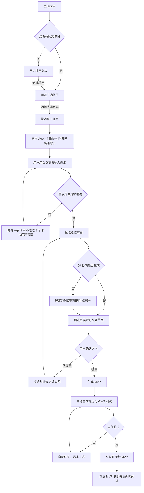
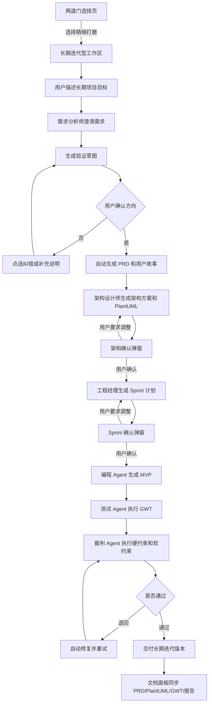
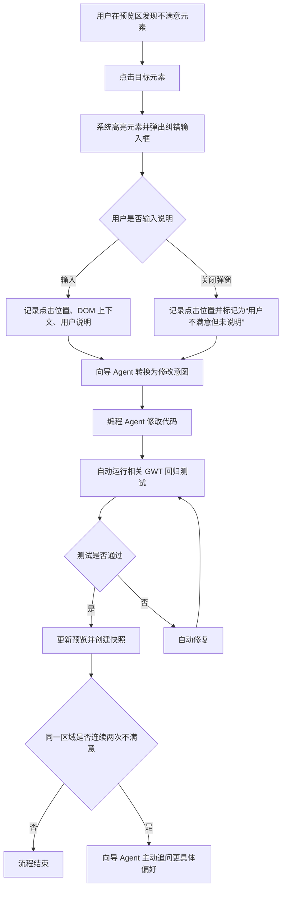
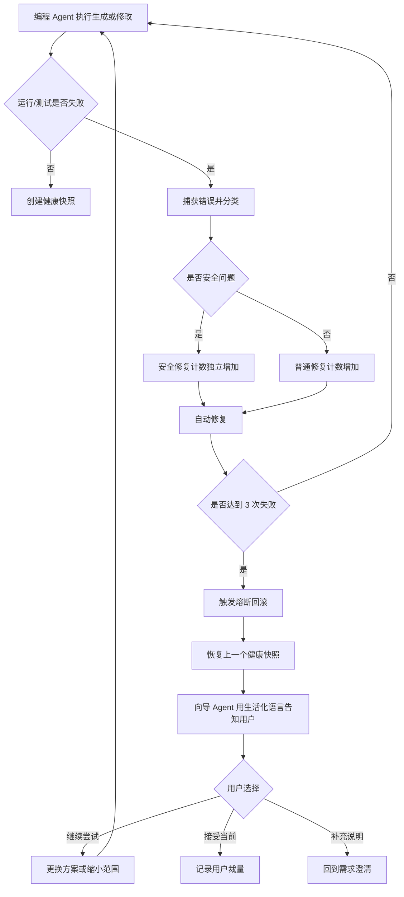
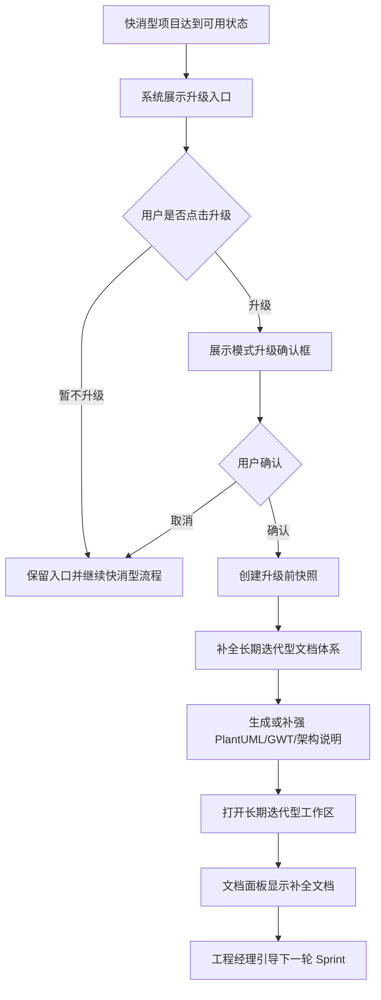

# 用户流程

> 项目：向导 Agent 多智能体协同开发平台  
> 文档ID：DOC-2.2  
> 版本：v1.0 | 日期：2026-07-10 | 状态：已确认  
> 依赖：DOC-2.1 `sitemap.md`、DOC-1.1 `user-stories.md`、DOC-1.2 `glossary.md`

---

## 1. 文档目标

本文档定义平台 5 条端到端用户旅程，用于约束后续线框图、交互规格、架构设计和 GWT 测试场景。

流程设计遵循 PRD v5.0 的核心原则：

- 零基础用户只确认预览，不确认文档。
- 快消型优先速度，长期迭代型优先完整工程约束。
- 所有高风险或不可逆操作必须有快照保护。
- 系统内部角色切换对用户透明。
- 自动修复达到上限后，决定权让渡给用户。

---

## 2. 流程总览

| # | 流程 | 覆盖故事 | 核心页面/组件 | Phase |
|---|------|----------|---------------|:----:|
| F-01 | 快消型首次使用 | U-01、U-02、U-03、U-05、U-06、U-09、PA-01、PA-02、PA-03 | 两道门选择页、快消型工作区、预览区、时间轴 | 1 |
| F-02 | 长期迭代型全流程 | U-01、GA-03、GA-04、PA-07、J-01、J-05 | 长期迭代型工作区、文档面板、确认弹窗 | 2 |
| F-03 | 点选纠错 | U-04、U-12、PA-04 | 预览区、点选纠错弹窗、对话区 | 1 / 3 |
| F-04 | 异常自愈与熔断回滚 | PA-04、PA-05、J-03、J-04 | 等待反馈、时间轴、裁判通知卡片 | 1 / 2 |
| F-05 | 快消型升级为长期迭代型 | U-08、GA-07、R-02 | 模式升级确认框、文档面板、时间轴 | 3 |

---

## 3. F-01 快消型首次使用

### 3.1 Mermaid 流程图

### 3.2 步骤说明

| 步骤 | 用户动作 | 系统响应 | 成功标准 | 异常/边界 |
|---|---|---|---|---|
| 1 | 打开应用 | 无历史项目时进入两道门选择页；有历史项目时进入项目列表 | 用户能清楚看到新建入口 | 项目列表加载失败时提供“直接新建”降级入口 |
| 2 | 点击“快速尝鲜” | 创建快消型项目并进入工作区 | 顶栏显示项目模式为快消型 | 选择后不提供返回两道门入口 |
| 3 | 输入自然语言需求 | 向导 Agent 分析需求 | 不暴露技术配置 | 输入太模糊时以卡片问题澄清 |
| 4 | 回答澄清问题 | 系统进入草图生成 | 澄清问题不超过 3 个 | 用户可选择“你帮我决定” |
| 5 | 等待验证草图 | 超过 5 秒显示等待反馈 | 用户知道系统正在处理 | 超过 120 秒展示已生成部分 |
| 6 | 操作草图 | 预览区可点击、可跳转、可标记不满意 | 草图可交互而非静态截图 | iframe 内导航被沙箱拦截 |
| 7 | 确认方向 | 系统生成 MVP | 创建草图快照 | 不满意则回到草图修正 |
| 8 | 试用 MVP | MVP 在预览区完整运行 | GWT 测试通过后交付 | 测试失败自动修复 |
| 9 | 查看时间轴 | 时间轴出现草图和 MVP 节点 | 节点有截图和自然语言摘要 | 无快照时显示空状态 |

---

## 4. F-02 长期迭代型全流程

### 4.1 Mermaid 流程图

### 4.2 步骤说明

| 步骤 | 用户动作 | 系统响应 | 成功标准 | 异常/边界 |
|---|---|---|---|---|
| 1 | 选择“精细打磨” | 进入长期迭代型工作区 | 模式标签清楚可见 | Phase 1 可只展示骨架和提示 |
| 2 | 描述项目目标 | 向导 Agent 按长期项目方式澄清 | 明确目标用户、核心功能、维护预期 | 不要求用户写 PRD |
| 3 | 确认草图方向 | 系统生成完整文档骨架 | 用户仍通过预览确认 | 文档面板默认折叠 |
| 4 | 查看架构确认弹窗 | 用户用自然语言确认或要求调整 | 不出现技术堆栈细节轰炸 | 用户可选择“按推荐方案继续” |
| 5 | 查看 Sprint 计划 | 用户确认第一轮范围 | Sprint 计划不超过 2 周 | 用户可缩小范围 |
| 6 | 等待 MVP | 系统生成代码、测试、裁判审查 | 文档和代码同步 | 退回上限为 3 次 |
| 7 | 试用版本 | 预览区展示可运行增量 | 文档面板可查自然语言概览 | 裁判建议改进不阻塞交付，但记录 |

---

## 5. F-03 点选纠错

### 5.1 Mermaid 流程图

### 5.2 步骤说明

| 步骤 | 用户动作 | 系统响应 | 成功标准 | 异常/边界 |
|---|---|---|---|---|
| 1 | 点击预览区元素 | 元素高亮，弹出“这里有什么问题？” | 不跳转、不误触发页面原行为 | Canvas/WebGL 降级为框选区域 |
| 2 | 输入问题描述 | 收集文字和点击上下文 | 修改意图可追溯 | 空输入视为“你猜” |
| 3 | 提交纠错 | 对话区出现简短确认 | 用户知道系统已收到 | 输入过长时摘要处理 |
| 4 | 等待修改 | 显示处理状态 | 不阻塞继续输入 | >5 秒显示心理防御文案 |
| 5 | 查看新版本 | 预览区刷新，时间轴新增节点 | 自动测试通过后才展示 | 测试失败进入自愈 |
| 6 | 再次点同一区域 | 系统识别连续猜错 | 主动追问更具体偏好 | 不用技术术语解释失败 |

---

## 6. F-04 异常自愈与熔断回滚

### 6.1 Mermaid 流程图

### 6.2 步骤说明

| 步骤 | 系统事件 | 系统响应 | 成功标准 | 异常/边界 |
|---|---|---|---|---|
| 1 | 代码运行或测试失败 | 捕获失败信息并隐藏技术细节 | 用户不看到堆栈日志 | 内部日志仍完整保存 |
| 2 | 自动修复开始 | 展示“正在尝试修复” | 最多 3 次 | 安全问题独立计数 |
| 3 | 修复成功 | 更新预览并创建快照 | 时间轴出现健康节点 | 记录自动修复成功 |
| 4 | 修复失败达到上限 | 回滚到最近健康快照 | 用户数据不丢失 | 无健康快照时退回草图前状态 |
| 5 | 通知用户 | 说明发生了什么、当前状态、可选下一步 | 文案生活化 | 安全问题必须说明风险 |
| 6 | 用户决策 | 继续尝试、接受当前、补充说明 | 决策写入记录 | 长期迭代型同步变更说明 |

---

## 7. F-05 快消型升级为长期迭代型

### 7.1 Mermaid 流程图

### 7.2 步骤说明

| 步骤 | 用户动作 | 系统响应 | 成功标准 | 异常/边界 |
|---|---|---|---|---|
| 1 | 标记快消型项目完成 | 展示升级入口 | 文案说明升级价值 | 不强制升级 |
| 2 | 点击升级 | 弹出确认框 | 说明会补全文档和进入长期维护 | 用户可取消 |
| 3 | 确认升级 | 创建升级前快照 | 可回滚到升级前状态 | 存储不足时阻止升级并提示 |
| 4 | 等待补全文档 | 生成 PRD、PlantUML、GWT、架构说明 | 不要求用户逐项确认 | 失败时回滚并保留快消型项目 |
| 5 | 进入长期迭代型 | 工作区出现文档面板和长期模式标签 | 原 MVP 可继续运行 | 时间轴保留升级前后节点 |
| 6 | 开始 Sprint | 工程经理生成下一轮计划 | 用户用自然语言确认 | 可缩小或延后范围 |

---

## 8. 对后续文档的约束

- `wireframes/` 必须覆盖上述流程中出现的关键页面和弹窗。
- `interaction-spec.md` 必须至少覆盖模式选择、点选纠错、快照回滚、等待反馈 4 类交互。
- `test-plan.md` 与 `features/` 必须为每条流程至少提供 1 个 GWT 场景。
- 架构设计必须显式支持快照、线性回滚、沙箱、裁判退回、用户最终裁量权。

---

## 9. 修订记录

| 版本 | 日期 | 修订内容 |
|------|------|----------|
| v1.0 | 2026-07-10 | 首版，补齐 5 条端到端用户流程，作为线框图和交互规格的前置输入 |

