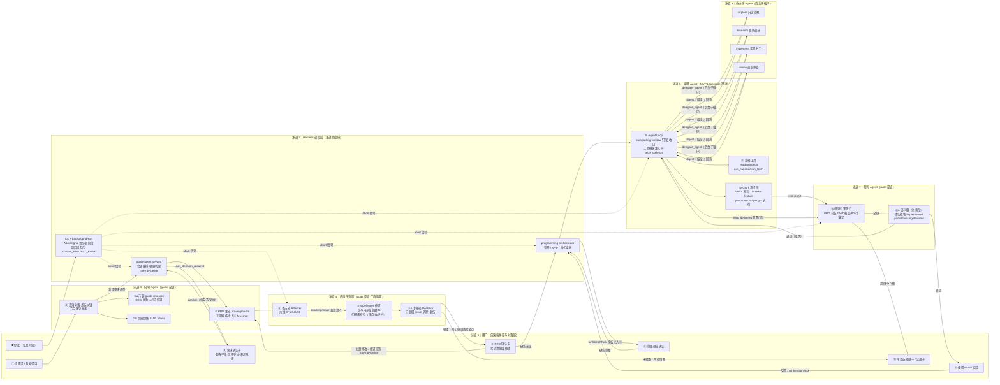
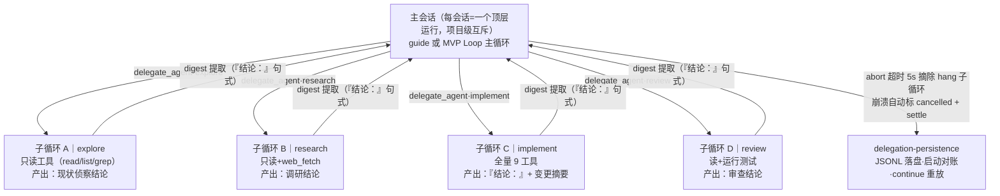

# 全流程 Agent 调用泳道图

> 文档 ID：DOC-3.7 | 日期：2026-09-02 | 状态：已绘制（对照 sprint2 分支 HEAD 代码实况）
> 依据：2026-08-30 组会决议 5「补画泳道图：画出整个流程中不同 Agent 之间的调用关系（含委派结构）」
> 关系：补充 `architecture.md` §3 总体架构（模块分层视角）与 `sequence-diagrams/`（IPC 时序视角）——
> 本文以 **Agent 角色** 为泳道，回答"谁在什么时候调用谁"。

---

## 0. 术语约定（决议 8）

| 术语 | 含义 | 代码对应 |
|---|---|---|
| 向导 Agent | 需求澄清/PRD 前移/确认卡的主对话 Agent（guide 渠道） | `guide-agent-service.ts` |
| 编程 Agent（=「编程 A」主技能） | MVP 生成的主 Agent 循环（code 渠道），**不是单个子工具** | `agent-loop.ts` + `agent-tools.ts`，由 `programming-orchestrator.ts` 编排 |
| 裁判 Agent | MVP 终审（规则引擎 + 语义腿，audit 渠道） | `judge-engine.ts` + `judge-semantic.ts` |
| 内审子流程 | PRD 生成后的 AC-Lite 攻击→修订→复核闭环（audit 渠道，独立于生成渠道做厂商隔离） | `prd-review.ts` + `prd-defender.ts` |
| 委派子 Agent | 编程 Agent 通过 `delegate_agent` 工具派出的**后台子循环**（非新会话） | `agent-collaboration.ts`（`DelegationRole`：explore/research/implement/review/custom） |
| Harness 调度层 | 主进程各编排服务（非独立"调度 Agent"；决议 9：优先换皮渲染，不重造调度轮子） | `ipc.ts` / `guide-agent-service.ts` / `programming-orchestrator.ts` / `category-routing.ts` |

---

## 1. 主流程泳道图（需求 → PRD → 内审 → 草图 → MVP → 裁判 → 交付/迭代）

**读图要点**：
- **两道用户过目门**：需求确认卡（③）与 PRD 确认卡（⑦）之间隔着内审闭环——先机器互搏（攻击→修订→复核），再请用户过目，不再把审查工作丢给编程 Agent（8/30 质询点 4 已纠正）。
- **内审渠道独立**（泳道 4）：audit 类别渠道与 PRD 生成渠道分属不同厂商时记 `vendor_isolated=true`；审查族回退 `routed-only`，绝不静默落到任意弱模型。
- **委派即后台子循环**（泳道 6）：编程 Agent 在 Loop 内经 `delegate_agent` 派出，子 Agent 最终回复以「结论：」开头供 digest 提取——**不是新建会话**（8/30 质询点 6 结论）。
- **裁判双段门禁**（泳道 7）：规则引擎不过就不跑语义腿（省 token）；语义腿跑 audit 渠道，与内审共用审查渠道路由但 prompt/维度刻意区分。

---

## 2. 委派结构细图（后台子 Agent 树）

委派生命周期：派发 → 落盘 → （超时 abort / 崩溃标记 cancelled+settle / 正常完成）→ 启动对账自动收口。

---

## 3. 渠道三角色路由（横切机制）

| 类别 | 归属角色 | 渠道 | 说明 |
|---|---|---|---|
| guide / prd / summary | 向导 | 用户主渠道 | 澄清、PRD、总结 |
| sketch / mvp | 编程 | 编程渠道 | 草图、MVP Loop |
| judge / audit | 裁判（审查） | audit 独立渠道（可配备用链） | 内审 + 终审语义腿；厂商隔离判定在 `guide-agent-service` L1220 |

---

## 4. 与导师架构建议的对照（8/30 质询点 6）

| 导师建议 | 当前实现 | 差距与方向 |
|---|---|---|
| 最上层设调度 Agent | 调度在 harness 服务层（`guide-agent-service` / `programming-orchestrator`），非 LLM 调度 Agent | 决议 9 采"换皮渲染"路线：每会话视作 Agent 由调度层统一调度，不动会话管理底层——图中泳道 2 即该调度层 |
| 把每个会话看作 Agent 调度，仅表层渲染 | 会话=顶层运行单位，项目级互斥已实现 | 渲染端已按会话维度组织（atoms family）；表层换皮继续演进 |
| 委派=后台子 Agent | ✅ 已按此实现（泳道 6/§2） | 无差距 |

---

## 5. 维护约定

- 本图随主流程变更同步更新（变更点涉及：确认卡出口、内审闭环、委派角色集、裁判门禁、渠道路由）。
- 模块级调用细节看 `sequence-diagrams/*.puml`；数据结构看 `data-model.md`；本文只回答角色间调用关系。
