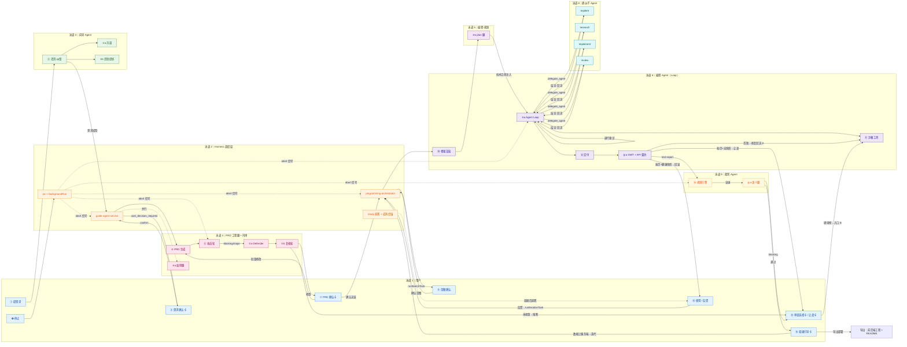
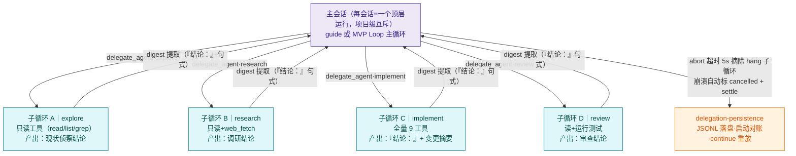
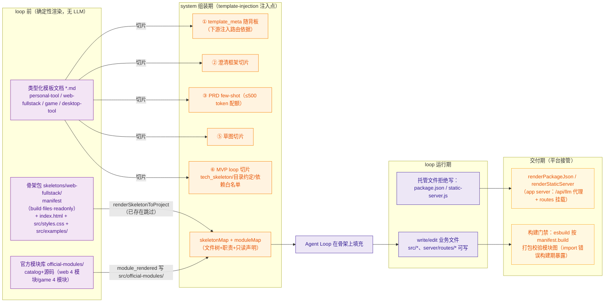

# 全流程 Agent 调用泳道图

> 文档 ID：DOC-3.7 | 日期：2026-09-02 初绘 | **2026-09-06 修订**（对照 sprint2 分支 HEAD 实况，补：plan 腿、修复回流入口 A/B、终轮退行守卫、API 契约探测、完整程序契约链、就绪引导卡与迭代路由）
> 依据：2026-08-30 组会决议 5「补画泳道图：画出整个流程中不同 Agent 之间的调用关系（含委派结构）」+ 2026-09-06 用户拍板「终点不是 MVP——完整程序 = 前后端分离」
> 关系：补充 `architecture.md` §3 总体架构（模块分层视角）与 `sequence-diagrams/`（IPC 时序视角）——
> 本文以 **Agent 角色** 为泳道，回答 "谁在什么时候调用谁"。

---

## 0. 术语约定（决议 8 + 2026-09-06 增补）

| 术语 | 含义 | 代码对应 |
|---|---|---|
| 向导 Agent | 需求澄清/PRD 前移/确认卡的主对话 Agent（guide 渠道） | `guide-agent-service.ts` |
| PRD 工程腿 | 向导群内的独立工程子代理：dual-form 产出 document+结构化字段+interface_spec 契约（prd 渠道） | `prd-engine-llm.ts` |
| 功能项加厚腿 | 与工程腿并行：薄功能项补 story/行为断言/优先级（三层守卫，接地守卫防编造） | `requirement-enricher.ts` |
| 内审子流程 | PRD 生成后的 AC-Lite 攻击 → 修订 → 复核闭环（audit 渠道，独立于生成渠道做厂商隔离） | `prd-review.ts` + `prd-defender.ts` |
| plan 腿（技术规划腿） | loop 前单轮规划：产出技术合同（目标文件/复用点/验证口径），**契约进任务输入+架构纪律**（数据留存必列 server/routes） | `loop-planner.ts` |
| 编程 Agent（主循环） | MVP 生成的主 Agent 循环（mvp 渠道），**不是单个子工具** | `agent-loop.ts` + `agent-tools.ts`，由 `programming-orchestrator.ts` 编排 |
| 修复回流 | 终验失败后的定向修复：入口 A（终验现场）+ 入口 B（blocked 卡「继续修」，消费 test-report.json） | `repair-loop.ts` |
| 裁判 Agent | MVP 终审（规则引擎 + 语义腿，audit 渠道） | `judge-engine.ts` + `judge-semantic.ts` |
| 委派子 Agent | 编程 Agent 通过 `delegate_agent` 派出的 **后台子循环**（非新会话） | `agent-collaboration.ts`（`DelegationRole`：explore/research/implement/review/custom） |
| 退行守卫 | 终轮「零 tool_use+正文退行」判传输事故：带反馈重试 1 轮，仍脏如实 turn_limit；learnings 源头过滤 | `output-integrity.ts`（`isDegenerateText`） |
| API 契约探测 | 终验侧按 interface_spec 无参 GET 端点逐个探测，404/5xx = 契约失活并入修复回流 | `api-contract.ts` |
| Harness 调度层 | 主进程各编排服务（非独立 "调度 Agent"；决议 9：优先换皮渲染，不重造调度轮子） | `ipc.ts` / `guide-agent-service.ts` / `programming-orchestrator.ts` / `category-routing.ts` |

---

## 1. 主流程泳道图（需求 → PRD → 内审 → 草图 → plan → MVP → 终验 → 交付/迭代/完整程序）

**读图要点（2026-09-06 增补）**：
- **两道用户过目门**：需求确认卡（③）与 PRD 确认卡（⑦）之间隔着内审闭环——先机器互搏（攻击 → 修订 → 复核），再请用户过目，不再把审查工作丢给编程 Agent（8/30 质询点 4 已纠正）。
- **契约先行（完整程序阶段 2）**：PRD 工程腿产出 interface_spec（数据留存信号词命中即必有，LLM 漏报由 `deriveInterfaceSpec` 确定性兜底）——契约随背板冻结，进 plan 任务输入与 loop 锚定；终验侧 `api-contract` 按契约探测存活，失活并入修复回流。**localStorage 禁令在护栏层锁死：「PRD 说刷新后仍在」不构成例外的理由**。
- **修复回流两入口**：入口 A = 终验首败现场（新鲜失败证据）；入口 B = blocked 卡「继续修」（消费 test-report.json，省一次注定失败的重验）。预算共享 test_repair_count（quick 1 / longterm 2），loop 内 edit-after-failure 预算 3 次。
- **熔断回滚诚实化**：回滚落点是终验失败前的快照，话术如实附加未通过断言清单（failureNote）；无健康快照才让渡 blocked。
- **迭代路由（12cdb87）**：修改确认门后 normalize 判 skip 且上次终验留有失败 → 走定向修复而非整版重摇；无失败快照才重摇。
- **终轮退行守卫**：零 tool_use+正文混入工具调用原文/退行重复 = 传输事故，反馈重试 1 轮，仍脏如实 turn_limit 交终验——垃圾收工轮不再骗到成功话术。
- **就绪引导卡**：ready 收敛发 next_steps 卡（数据上服务端/导出部署）；ready 直答带成熟度事实锚（路由数/data 建用/契约条数/AI 可用性），按差距引导。
- **委派即后台子循环**（泳道 8）：编程 Agent 在 Loop 内经 `delegate_agent` 派出，子 Agent 最终回复以「结论：」开头供 digest 提取——**不是新建会话**（8/30 质询点 6 结论）。
- **裁判双段门禁**（泳道 9）：规则引擎不过就不跑语义腿（省 token）；语义腿跑 audit 渠道，与内审共用审查渠道路由但 prompt/维度刻意区分。

---

## 2. 委派结构细图（后台子 Agent 树）

委派生命周期：派发 → 落盘 → （超时 abort / 崩溃标记 cancelled+settle / 正常完成）→ 启动对账自动收口。委派深度 1 层（子 agent 禁止再派）；审查族（六维+语义）默认委派子 agent 可视化。

---

## 3. 完整程序契约链（2026-09-06 新增；终点拍板：终点不是 MVP）

**前后端分离的契约流**——每个环节都有确定性的承载物，不依赖模型自觉：

```mermaid
flowchart LR
  classDef prd     fill:#fce4ec,stroke:#c2185b,color:#880e4f
  classDef plan    fill:#f3e5f5,stroke:#7b1fa2,color:#4a148c
  classDef code    fill:#ede7f6,stroke:#4527a0,color:#311b92
  classDef judge   fill:#fff8e1,stroke:#f9a825,color:#e65100
  classDef user    fill:#e3f2fd,stroke:#1976d2,color:#0d47a1
  classDef harness fill:#fff3e0,stroke:#f57c00,color:#e65100

  A["PRD 工程腿<br/>interface_spec 产出<br/>（信号词触发+漏报兜底）"]:::prd
  B["锚定注入<br/>renderBackplaneAnchor<br/>【后端 API 契约】段"]:::plan
  C["plan 腿<br/>架构纪律：filesToTouch<br/>必含 server/routes"]:::plan
  D["Agent Loop<br/>写 server/routes/*.js<br/>（文件名即 /api 前缀，热加载）"]:::code
  E["交付<br/>app server + /api/llm env<br/>+ data/ 目录"]:::code
  F["终验<br/>GWT ?mock=1 + API 契约探测<br/>404/5xx=失活→修复回流"]:::judge
  G["就绪引导卡<br/>数据上服务端 / 导出部署"]:::user
  H["前后端工程 + README<br/>（API 表·BLOMA_APP_LLM_* env）"]:::harness

  A -->|"随背板冻结 prd.json"| B
  B --> C
  C --> D
  D --> E
  E --> F
  F -->|"ready"| G
  G -->|"导出"| H
```

| 环节 | 确定性承载物 | 兜底机制 |
|---|---|---|
| 契约产出 | prd.json `interface_spec` | 信号词（历史/保存/记录/持久/刷新或重开后仍在/清空/收藏/回顾）→ `deriveInterfaceSpec` 派生 records 最小契约 |
| 契约可见 | 锚定【后端 API 契约】段 + plan 任务输入 | 聚焦模式不裁剪；plan 架构纪律字段 |
| 契约实现 | server/routes/*.js（文件名即 /api 前缀，热加载） | loop 护栏禁 localStorage 存业务数据 |
| 契约验证 | api-contract 无参 GET 探测（可达性语义：服务器不可达跳过） | 失败并入 failure_summary → 修复回流 |
| 数据持久 | data/ 目录（原子写） | 快照/回滚「先清空再复制」精确回时点（锁定测试） |
| 真实 AI | /api/llm 同源代理（OpenAI/anthropic 双协议，密钥只进服务器进程 env） | 未配置 503 llm_not_configured，前端失败态兜住；跨站预检 403 |

---

## 4. 工程模板体系（模板资产与注入时机，2026-09-06 增补）

工程模板是「确定性骨架 + 差异化注入」的两层机制：**模板资产** 由平台在确定性时机渲染/注入（不依赖模型自觉），**业务内容** 由编程 Agent 在模板上填充。对应泳道 6 的 C0（loop 前）、C1（注入消费）、C3（交付期接管）。

**模板资产清单**：

| 资产 | 位置 | 渲染/注入时机 | 消费者与守卫 |
|---|---|---|---|
| 骨架包（web-fullstack） | `main/templates/skeletons/web-fullstack/` | loop 前 `renderSkeletonToProject`（幂等：已存在跳过，迭代不覆盖） | 编程 Agent 填充实现；`src/examples/` 只读；构建门禁按 `manifest.build` 校验 |
| 官方功能模块库 | `main/templates/official-modules/` | loop 前渲染到 `src/official-modules/`（`module_rendered` 决策，`BLOMA_MODULES` 开关缺省开） | loop 按纪律复制改编（storage-state/modal-dialog/filter-list/form-validation；game：game-loop/fsm-state/input-control/aabb-collision） |
| 类型化模板文档 | `main/templates/{personal-tool,web-fullstack,game,desktop-tool}.md` | 注入点 ②③⑤⑥ 按 `template_meta.type` 切片 | 澄清框架 / PRD few-shot / 草图 pages / loop 目录约定 |
| 模板元信息 | 背板 `template_meta` | 注入点 ① 随背板落盘 | 下游全部注入点路由（GWT 必测类别差异化：game = 状态机/碰撞/胜负边界） |
| 平台托管文件 | `renderPackageJson` / `renderStaticServer` | 交付期渲染（loop 工具被 `agent-tools` 拒绝写） | app server（/api/llm 代理 + server/routes 挂载）与导出 |
| 外置提示词覆盖 | `~/.proma/prompts/{id}.md` | 文件存在即生效，改完即时生效（无需重启） | 对应引擎全量替换内置默认 |

**模板类型（TemplateType）路由**：personal_tool / web_fullstack / game（P1-9）——类型决定骨架选择、模板文档切片、GWT 必测类别与 few-shot 路由；类型由对话/描述推断（游戏/复刻/重制 →game）。

---

## 5. 渠道三角色路由（横切机制）

| 类别 | 归属角色 | 说明 |
|---|---|---|
| guide / prd | 向导 | 澄清、PRD 工程腿（prd 独立类别路由） |
| sketch / mvp | 编程 | 草图、MVP Loop、修复轮（mvp 渠道） |
| judge / audit | 裁判（审查） | 内审 + 终审语义腿；厂商隔离判定，审查族回退 routed-only |

---

## 6. 与导师架构建议的对照（8/30 质询点 6）

| 导师建议 | 当前实现 | 差距与方向 |
|---|---|---|
| 最上层设调度 Agent | 调度在 harness 服务层（`guide-agent-service` / `programming-orchestrator`），非 LLM 调度 Agent | 决议 9 采 "换皮渲染" 路线：每会话视作 Agent 由调度层统一调度，不动会话管理底层——图中泳道 2 即该调度层 |
| 把每个会话看作 Agent 调度，仅表层渲染 | 会话 = 顶层运行单位，项目级互斥已实现 | 渲染端已按会话维度组织（atoms family）；表层换皮继续演进 |
| 委派 = 后台子 Agent | ✅ 已按此实现（§2） | 无差距 |

---

## 7. 维护约定

- 本图随主流程变更同步更新（变更点涉及：确认卡出口、内审闭环、委派角色集、裁判门禁、渠道路由、修复回流、完整程序契约链）。
- 2026-09-06 修订对照实况：终轮退行守卫（output-integrity）、API 契约探测（api-contract）、修复回流入口 A/B（repair-loop）、迭代路由（skip+失败快照 → 定向修复）、就绪引导卡（ready_next_steps）均为本日落地。
- 模块级调用细节看 `sequence-diagrams/*.puml`；数据结构看 `data-model.md`；本文只回答角色间调用关系。
