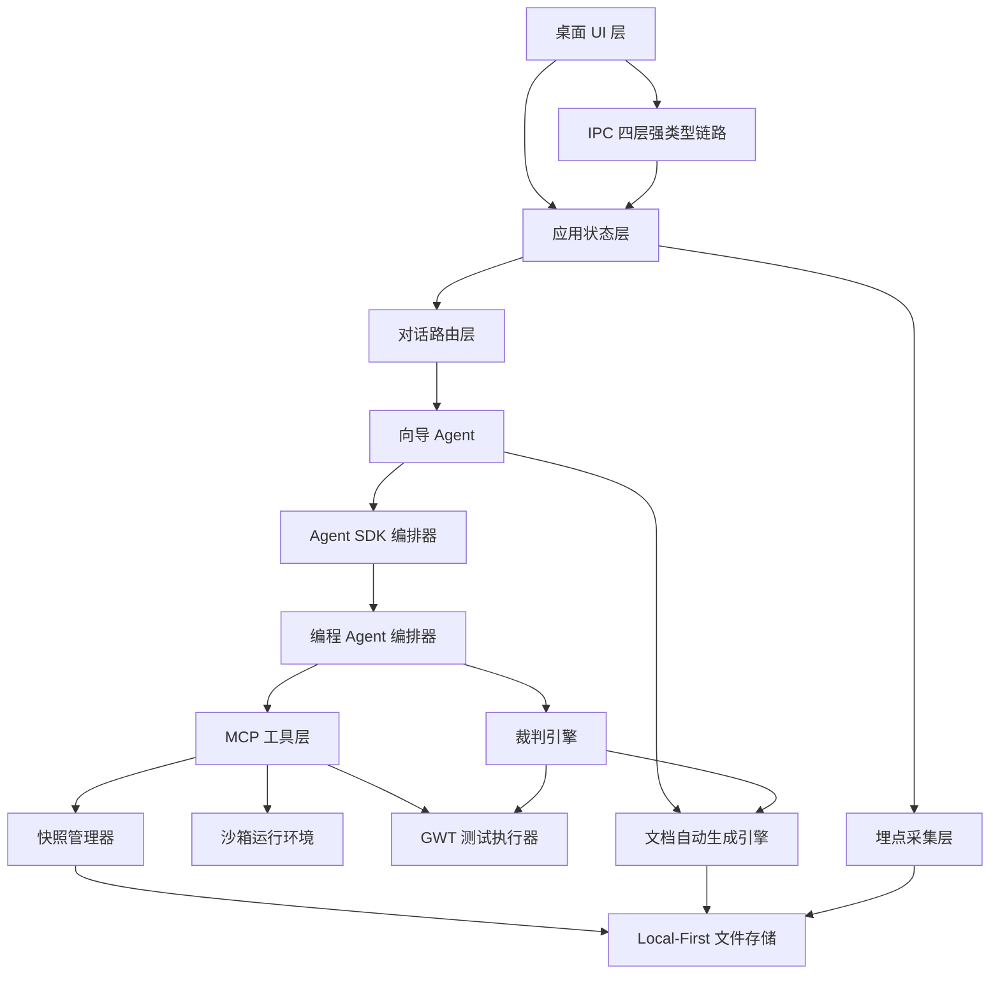
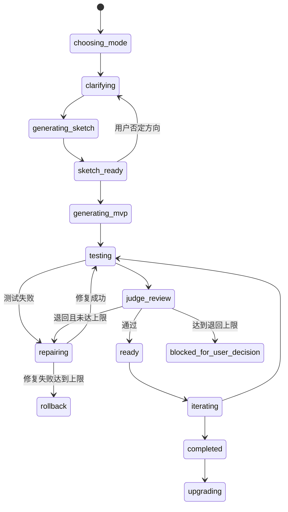

# 架构设计

> 项目：向导 Agent 多智能体协同开发平台  
> 文档 ID：DOC-3.1  
> 版本：v1.2 | 日期：2026-07-10 | 状态：已确认  
> 依赖：PRD v5.0、DOC-2.2 `user-flows.md`、DOC-2.5 `interaction-spec.md`、`proma-core-demo`

---

## 1. 架构目标

本平台基于 Proma fork，改造为面向零基础用户的软件生成桌面应用。架构目标如下：

- 支持两道门模式：快消型、长期迭代型。
- 支持三阶段生成：验证草图、MVP、迭代打磨。
- 支持向导 Agent 内部角色静默切换。
- 支持编程 Agent 在沙箱中生成、运行、测试和修复代码。
- 支持裁判 Agent 的硬约束和软约束门禁。
- 支持快照、线性回滚、熔断回滚。
- 支持全量埋点，为科研分析保留数据。
- 严格继承 Proma core 的三条底层约束：Agent SDK 编排、IPC 四层强类型链路、Local-First JSON/JSONL 存储。

---

## 2. Proma Fork 策略

| Proma 能力 | 策略 | 说明 |
|---|---|---|
| Electron 桌面壳 | 复用 | 保留窗口、菜单、基础生命周期 |
| Agent 对话界面 | 改造 | 改为软件生成工作区左侧对话区 |
| 设置页 | 扩展 | 增加软件生成、沙箱、数据管理、研究看板入口 |
| 渠道/API Key 管理 | 复用 | 继续使用 Proma 的模型供应商配置；API Key 必须经 Electron `safeStorage` 加密 |
| MCP 管理 | 复用 + 扩展 | 增加本平台专用 MCP Server |
| Skills 管理 | 复用 + 新增 | 新增 `software-builder` Skill |
| IPC 四层架构 | 复用 + 扩展 | 新增通道必须从 shared 常量到 renderer atoms 全链路对齐 |
| Jotai Agent 状态 | 复用 + 扩展 | Agent 流式输出和权限请求使用全局监听器，不随页面卸载 |
| Local-First 存储 | 复用 + 扩展 | 继续使用 `~/.proma/`、JSON、JSONL、工作区目录，不引入运行时数据库 |
| 多工作区切换 | 屏蔽 | P0 用户不理解工作区概念，平台固定一个软件生成工作区 |
| 终端/代码面板 | 默认屏蔽 | 面向 P0 用户不展示代码、日志和终端 |
| Toast 通知 | 扩展 | 加入心理防御文案和裁判通知样式 |

---

## 3. 总体架构



---

## 4. 分层职责

| 层 | 职责 | 主要模块 |
|---|---|---|
| UI 层 | 页面、组件、预览、弹窗、时间轴 | 两道门、工作区、文档面板、预览区 |
| 应用状态层 | 项目模式、阶段状态、消息队列、用户裁量 | ProjectState、WorkflowState |
| Agent 编排层 | 向导角色切换、编程任务编排、反馈路由 | DialogueRouter、GuideAgent、ProgrammingOrchestrator |
| IPC 层 | 主进程、预加载、渲染进程之间的强类型通信 | shared types、main ipc、preload bridge、renderer atoms |
| 工具执行层 | 生成代码、运行、测试、扫描、快照 | MCP Server、Sandbox、TestRunner、SnapshotManager |
| 质量门禁层 | 硬约束、软约束、退回策略 | JudgeEngine、HardConstraintChecker、SoftConstraintEvaluator |
| 文档层 | PRD、PlantUML、GWT、报告同步 | DocumentEngine、PlantUMLGenerator、GWTGenerator |
| 数据层 | 项目、会话、快照、埋点、偏好 | JSON 配置、JSONL 日志、工作区文件目录 |

---

## 5. 核心模块

| 模块 | 职责 | 输入 | 输出 |
|---|---|---|---|
| `ModeController` | 创建项目模式、处理模式升级 | 用户选择、项目状态 | `project.mode` |
| `DialogueRouter` | 根据阶段和模式选择向导角色 | 用户消息、项目状态 | 角色上下文、System Prompt |
| `GuideAgent` | 面向用户对话、澄清需求、生成规约 | 用户输入、上下文 | 用户回复、任务规约 |
| `AgentOrchestrator` | 管理 Agent SDK 生命周期、流式事件、权限回调和并发守卫 | 会话、渠道、模型、消息 | AgentEvent 流、会话 JSONL |
| `ProgrammingOrchestrator` | 编排编程 Agent 团队 | 任务规约、工程模板 | 代码、运行结果、测试结果 |
| `SketchEngine` | 生成验证草图 | 初步需求 | 草图代码、预览 URL |
| `MvpEngine` | 生成完整 MVP | 草图反馈、PRD | MVP 代码 |
| `SandboxRuntime` | 隔离运行生成代码 | 项目代码 | 预览、运行日志 |
| `ElementCapture` | 捕获点选纠错上下文 | 点击事件、DOM、截图 | 纠错上下文 |
| `DocumentEngine` | 同步 PRD、PlantUML、GWT、报告 | 对话、代码、测试 | 文档目录 |
| `JudgeEngine` | 执行裁判门禁 | 文档、代码、测试报告 | 通过/建议/退回 |
| `SnapshotManager` | 创建和回滚快照 | 项目文件、预览截图 | 快照记录、恢复结果 |
| `AnalyticsCollector` | 记录科研埋点 | 用户/Agent/系统事件 | JSONL 事件；研究导出可转 CSV/SQLite |

---

## 6. Proma Core 对齐约束

### 6.1 IPC 四层架构

新增任何平台能力，都必须沿 Proma 的 IPC 四层链路实现：

```text
Layer 1: shared/types.ts        统一类型 + IPC_CHANNELS 常量
Layer 2: main/ipc.ts            ipcMain.handle 注册和参数校验
Layer 3: preload/bridge.ts      contextBridge.exposeInMainWorld 白名单 API
Layer 4: renderer/atoms         Jotai atoms + window.electronAPI.* 消费
```

规则：

- IPC 通道名只能定义在 shared 层，不能在 main/preload/renderer 各写各的字符串。
- preload 只暴露白名单 API，渲染进程不能直接访问 Node.js API。
- 主进程 handler 必须校验参数，不能信任渲染进程输入。
- Agent 流式事件、权限请求必须使用全局监听器，在应用根层挂载，页面切换时不得卸载。

### 6.2 Agent SDK 编排生命周期

Agent 编排必须继承 Proma 的 Agent SDK 管理方式：

```text
用户输入 → 渠道查找 → API Key 解密 → 构建 SDK env
→ sdk.query() → SDKMessage 流 → AgentEvent 转换
→ EventBus/IPC 推送 → Jotai atoms → React UI
```

关键约束：

- `options.env` 按替换语义处理，构建 SDK env 时必须以 `process.env` 为底，再覆盖模型供应商变量，保留 `PATH/HOME/SHELL`。
- 同一 `sessionId` 不允许并行请求，使用 `activeSessions` 或等效集合做并发守卫。
- HTTP 429、5xx、529 和瞬时网络错误自动重试，最多 25 次、累计不超过 5 分钟，前 5 次静默（不通知 UI，避免频繁惊扰用户）。
- **0.3.185+ SDK 终止语义关键变更**：终端 result 到达后必须**主动 `break` for-await 循环**，触发 `iterator.return()` → `cleanup()`（内部 `Promise.race([waitForExit(), 2s])` 有界等待子进程退出）。若不主动 break，输出流不会结束，消费循环挂在 `next()` 上，每个会话结束白等 2 秒 drain timeout。orchestrator 的 `RESULT_DRAIN_TIMEOUT_MS` 应退化为永不触发的兜底，若日志频繁出现 `drain timeout`，说明 adapter 主动终止路径失效。
- 已收到的部分消息必须追加写入 JSONL，即使后续执行失败。

### 6.3 权限 Promise + Map 模式

工具权限沿用 Proma 的 `canUseTool()` 异步等待模式：

```text
SDK 请求工具权限
→ 创建 PermissionRequest
→ Promise resolve 存入 pendingRequests Map
→ IPC 推送到 renderer
→ 用户允许/拒绝
→ IPC 回 main
→ 取出 resolve 完成 SDK 权限决策
```

规则：

- 只读工具可直接放行。
- 危险工具在 `ask` 模式下必须等待用户决策。
- `safe` 模式下危险工具直接拒绝。
- 权限请求按 `sessionId` 入队，多个 Agent 会话不能互相覆盖。

### 6.4 Local-First 存储

运行时存储必须沿用 Proma 的文件结构，不引入 SQLite 作为产品依赖：

```text
~/.proma/
├── channels.json
├── conversations.json
├── conversations/{uuid}.jsonl
├── agent-sessions.json
├── agent-sessions/{uuid}.jsonl
├── agent-workspaces/{workspace-slug}/
│   ├── mcp.json
│   ├── skills/
│   ├── workspace-files/
│   ├── generated-projects/
│   ├── documents/
│   ├── snapshots/
│   └── analytics.jsonl
├── user-profile.json
└── settings.json
```

规则：

- 配置和索引用 JSON。
- 对话、Agent 会话、埋点使用 JSONL 追加写入。
- 项目源码、文档、快照使用文件系统目录。
- API Key 使用 Electron `safeStorage` 加密后写入 `channels.json`。
- SQLite 只允许作为研究导出后的离线分析格式，不进入运行时架构。

---

## 7. Agent 架构

### 7.1 向导 Agent

向导 Agent 是唯一面向用户的对话对象，内部按阶段切换角色。

| 内部角色 | 激活条件 | 用户可见性 |
|---|---|---|
| 需求分析师 | 始终激活 | 不暴露角色名 |
| UI/UX 顾问 | 有界面需求或草图反馈时激活 | 不暴露角色名 |
| 架构设计师 | 长期迭代型架构确认阶段；快消型后台自动决策 | 长期型以自然语言确认方案 |
| 工程经理 | 长期迭代型 Sprint 规划阶段；快消型后台自动决策 | 长期型以自然语言确认计划 |

### 7.2 编程 Agent

编程 Agent 不面向用户，按工程模板配置角色。

| 角色 | 快消型 | 长期迭代型 |
|---|---|---|
| 全栈开发 | 必选 | 必选 |
| 测试工程师 | 必选 | 必选 |
| 测试 Agent | 必选 | 必选 |
| 代码审查员 | 可选 | 必选 |
| 安全扫描器 | MVP 阶段起激活 | MVP 阶段起激活 |

### 7.3 裁判 Agent

裁判 Agent 是独立门禁，不参与修复执行。

| 检查 | 快消型 | 长期迭代型 |
|---|---|---|
| PRD 存在性 | 必须 | 必须 |
| GWT 存在性 | 必须 | 必须 |
| PlantUML 语法 | 可选/极简 | 必须 |
| 代码结构匹配 PlantUML | 不强制 | 必须 |
| 软约束逻辑一致性 | 核心项 | 全量 |

---

## 8. 状态机



---

## 9. 数据流

### 9.1 快消型主链路

1. 用户选择快消型。
2. `ModeController` 创建项目和会话。
3. `DialogueRouter` 激活需求分析师。
4. `GuideAgent` 澄清需求并生成草图任务。
5. `SketchEngine` 通过 MCP 工具生成草图代码。
6. `SandboxRuntime` 渲染预览。
7. 用户确认方向或点选纠错。
8. `MvpEngine` 生成 MVP。
9. `GWTGenerator` 生成测试。
10. `TestRunner` 执行测试。
11. `JudgeEngine` 检查核心门禁。
12. `SnapshotManager` 保存草图/MVP/修改快照。

### 9.2 长期迭代型主链路

1. 用户选择长期迭代型。
2. 向导 Agent 生成完整 PRD。
3. 架构设计师生成 PlantUML 和架构说明。
4. 工程经理生成 Sprint 计划。
5. 用户确认架构和 Sprint。
6. 编程 Agent 生成代码。
7. 测试 Agent 执行 GWT。
8. 裁判 Agent 执行硬约束和软约束。
9. 文档面板同步全部产物。

---

## 10. 沙箱方案

| 方面 | 方案 |
|---|---|
| 运行位置 | `~/.proma/agent-workspaces/{workspace-slug}/generated-projects/{project-id}` + Electron WebView/iframe |
| 文件权限 | 生成代码仅可访问项目沙箱目录 |
| 预览 | Web 项目通过本地临时端口或内嵌静态服务渲染 |
| iframe 属性 | `sandbox="allow-scripts allow-same-origin"`，禁止顶部导航 |
| 原生弹窗 | 拦截 `alert/confirm/prompt` 并转为系统通知 |
| 网络访问 | 默认允许项目所需请求；远期按模板限制 |
| 错误日志 | 内部保留，默认不向 P0 用户展示 |

---

## 11. 快照与回滚

快照包含：

- 项目源文件完整副本。
- 当前预览截图。
- 自然语言摘要。
- 文档目录副本。
- 决策标注和测试摘要。

触发时机：

- 验证草图生成后。
- MVP 生成后。
- 每轮用户确认修改后。
- 高风险修改前。
- 模式升级前。
- 熔断回滚前。

回滚规则：

- 只支持线性回滚。
- 回滚不删除后续快照。
- 回滚事务必须可恢复，避免半回滚状态。

---

## 12. MCP 与 Skill 扩展

### 12.1 MCP Server

本平台新增 MCP Server，提供以下工具：

| 工具 | 功能 |
|---|---|
| `create_project_sandbox` | 创建隔离项目目录 |
| `generate_sketch` | 生成验证草图 |
| `generate_mvp` | 生成 MVP |
| `run_project` | 启动沙箱预览 |
| `run_gwt_tests` | 执行 GWT 测试 |
| `capture_preview` | 截取预览图 |
| `create_snapshot` | 创建快照 |
| `rollback_snapshot` | 回滚快照 |
| `collect_dom_context` | 获取点选纠错上下文 |
| `run_security_scan` | 执行安全扫描 |

### 12.2 `software-builder` Skill

Skill 负责将向导 Agent 行为固定为本平台流程：

- 用 P0 用户能理解的语言澄清需求。
- 每轮最多 3 个澄清问题。
- 优先生成草图确认方向。
- 不向用户暴露技术日志。
- 点选纠错转化为具体修改任务。
- 自动维护 PRD/GWT/PlantUML 文档。

---

## 13. 非功能约束

| 类别 | 约束 |
|---|---|
| 响应 | FIRT 中位数目标 < 60 秒 |
| 交付 | Time-to-MVP 中位数目标 < 10 分钟 |
| 安全 | 生成代码不能越权访问用户文件系统 |
| 可恢复 | 高风险操作前必须有快照 |
| 可测试 | P0 功能必须有 GWT 场景 |
| 可观测 | 13 类关键埋点必须可记录 |
| 隐私 | 科研数据必须脱敏，不保存真实业务 payload |
| 存储 | 运行时不引入 SQLite；使用 JSON/JSONL/文件目录 |
| IPC | 新能力必须通过 shared → main → preload → renderer 四层类型链路 |

---

## 14. 架构风险

| 风险 | 影响 | 缓解 |
|---|---|---|
| FIRT 目标过紧 | 用户等待焦虑 | 草图阶段限制功能范围，允许部分生成 |
| Agent 幻觉生成不可运行代码 | MVP 失败率高 | 沙箱运行 + 自动修复 + GWT 收口 |
| 裁判过严导致循环退回 | 用户无法交付 | 退回次数上限 + 用户最终裁量权 |
| 快照占用空间过大 | 本地存储膨胀 | 100 个快照上限 + 中间快照合并 |
| P0 用户误解技术文档 | 认知负担增加 | 文档面板默认自然语言概览 |
| IPC 类型漂移 | 主进程和渲染进程调用不一致 | 所有通道从 shared 单一真相源定义 |
| Agent 流监听器卸载 | 页面切换导致流式输出或权限请求丢失 | 全局监听器在应用根层挂载，永不卸载 |
| SDK env 构建错误 | 子进程找不到 PATH/HOME/SHELL | SDK env 必须 merge `process.env` |

---

## 15. 修订记录

| 版本 | 日期 | 修订内容 |
|------|------|----------|
| v1.0 | 2026-07-10 | 首版，定义 Proma fork 策略、总体架构、模块边界、状态机、沙箱、快照、MCP 与 Skill 扩展 |
| v1.1 | 2026-07-10 | 按 `proma-core-demo` 修订：补充 IPC 四层、Agent SDK 生命周期、Promise+Map 权限、safeStorage、Local-First JSON/JSONL 存储，并移除运行时 SQLite 假设 |
| v1.2 | 2026-07-10 | 按 `proma-core-demo` 对齐修订：补充 0.3.185+ iterator.return() 清理链细节、精确化自动重试参数（25次/5分钟/前5次静默） |
