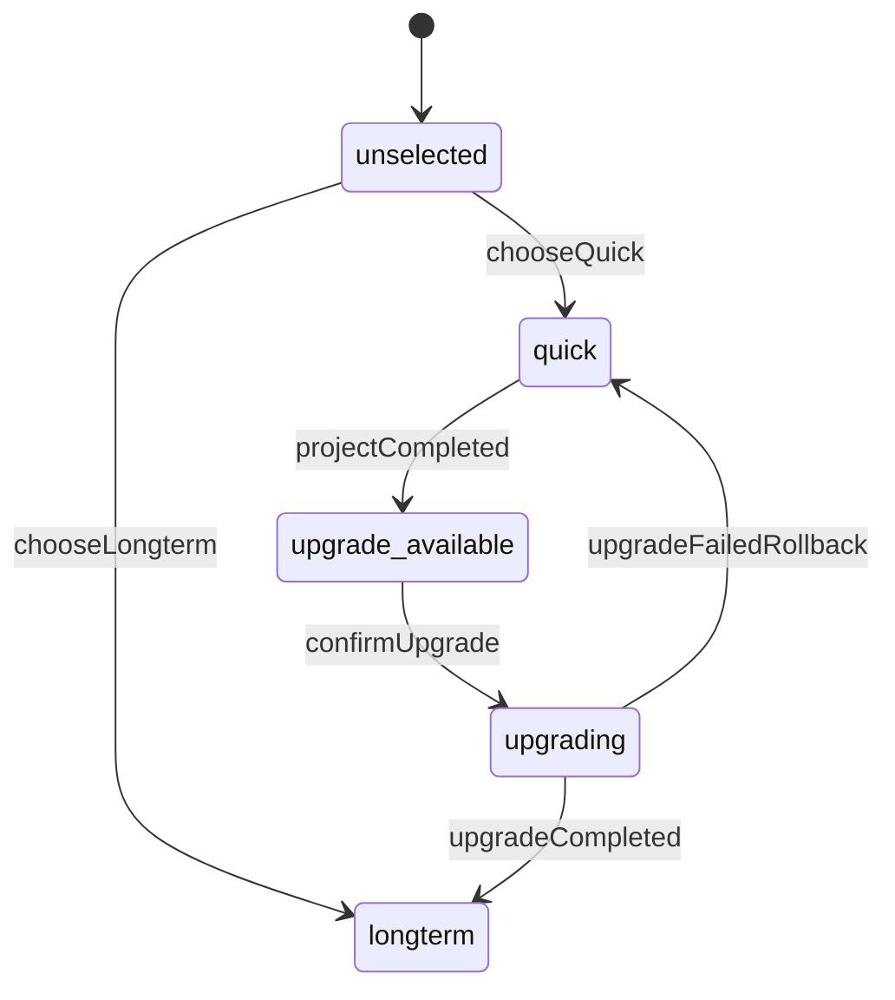
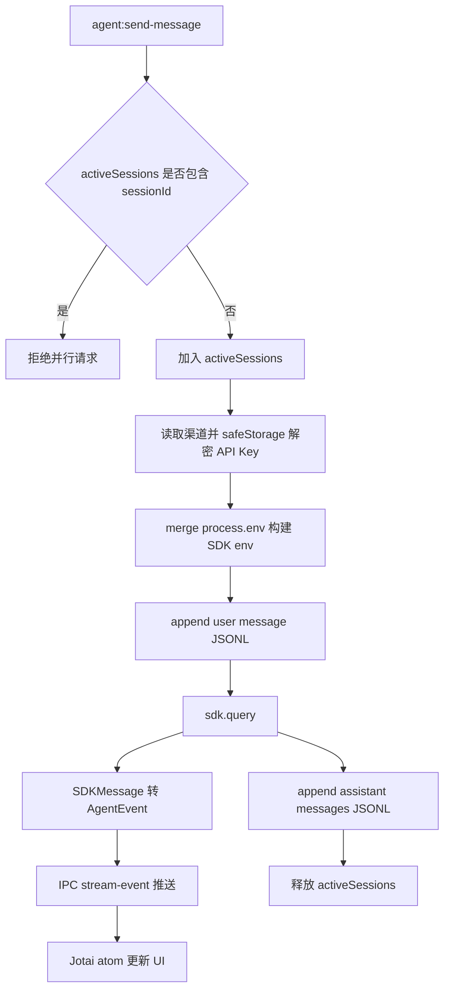
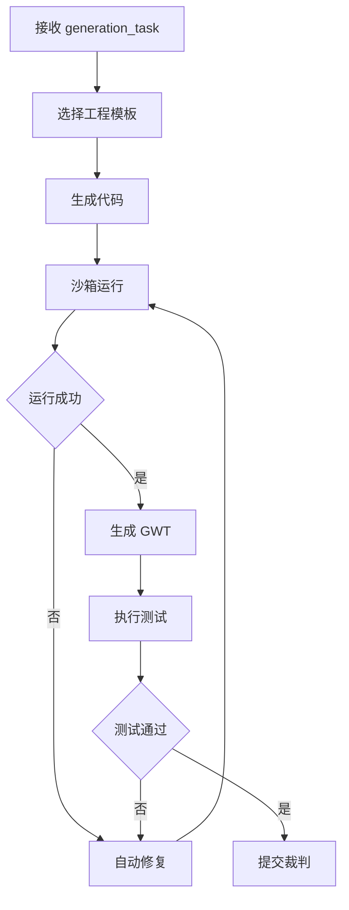
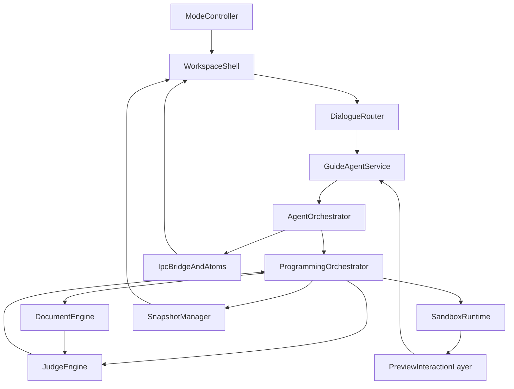

# 组件设计

> 项目：向导 Agent 多智能体协同开发平台  
> 文档ID：DOC-3.2  
> 版本：v1.2 | 日期：2026-07-10 | 状态：已确认  
> 依赖：DOC-3.1 `architecture.md`、DOC-2.5 `interaction-spec.md`、`proma-core-demo`

---

## 1. 模块总览

本文档定义 10 个核心模块的内部结构、状态和数据流。

| # | 模块 | 类型 | 核心职责 |
|---|---|---|---|
| 1 | `ModeController` | 应用模块 | 模式选择、模式升级 |
| 2 | `WorkspaceShell` | UI 模块 | 工作区布局和全局状态展示 |
| 3 | `DialogueRouter` | Agent 编排模块 | 阶段判断和角色切换 |
| 4 | `GuideAgentService` | Agent 服务 | 用户对话和规约生成 |
| 5 | `AgentOrchestrator` | Proma core 模块 | Agent SDK 生命周期、流式事件、权限、并发守卫 |
| 6 | `ProgrammingOrchestrator` | Agent 编排模块 | 编程 Agent 任务调度 |
| 7 | `SandboxRuntime` | 工具模块 | 运行、预览、错误捕获 |
| 8 | `PreviewInteractionLayer` | UI/工具模块 | 点选纠错上下文采集 |
| 9 | `DocumentEngine` | 文档模块 | PRD/PlantUML/GWT/报告同步 |
| 10 | `JudgeEngine` | 质量模块 | 硬约束、软约束、退回 |
| 11 | `SnapshotManager` | 文件存储模块 | 快照、时间轴、回滚 |
| 12 | `IpcBridgeAndAtoms` | Proma core 模块 | IPC 四层链路、Jotai 全局状态监听 |

---

## 2. 模块 1：ModeController

### 职责

- 处理两道门选择。
- 创建项目模式：`quick` / `longterm`。
- 管理快消型升级为长期迭代型。
- 阻止长期迭代型降级。

### 输入/输出

| 输入 | 输出 |
|---|---|
| 用户点击模式卡片 | `Project.mode` |
| 用户点击升级确认 | `ModeUpgradeEvent` |
| 项目完成状态 | 升级入口可见性 |

### 状态



### 关键规则

- 首次选择模式后不可运行时切换。
- 快消型升级前必须创建快照。
- 升级失败必须回滚到升级前状态。

---

## 3. 模块 2：WorkspaceShell

### 职责

- 渲染软件生成工作区框架。
- 管理对话区、预览区、文档面板、时间轴布局。
- 展示阶段指示器、模式标签、离线状态。

### 子组件

| 子组件 | 说明 |
|---|---|
| `WorkspaceHeader` | 项目名、模式标签、阶段指示、所有项目入口 |
| `ChatPanel` | 消息列表、卡片选项、输入框 |
| `PreviewPanel` | 沙箱预览、控制栏、点选纠错覆盖层 |
| `DocumentPanel` | 长期迭代型文档树和自然语言概览 |
| `TimelinePanel` | 折叠/展开时间轴 |

### 状态输入

- `Project.mode`
- `Workflow.stage`
- `Network.status`
- `DocumentPanel.expanded`
- `Timeline.expanded`

---

## 4. 模块 3：DialogueRouter

### 职责

- 判断当前用户输入应该交给哪个向导角色处理。
- 加载对应 System Prompt。
- 将用户反馈路由为确认、澄清、纠错、扩展、重启、接受现状等动作。

### 路由规则

| 条件 | 目标角色/动作 |
|---|---|
| 无项目模式 | 模式选择 |
| 初始需求 | 需求分析师 |
| 用户描述 UI 不满意 | UI/UX 顾问 + 需求分析师 |
| 长期迭代型架构阶段 | 架构设计师 |
| 长期迭代型 Sprint 阶段 | 工程经理 |
| 用户确认最终结果 | 标记完成 |
| 用户提出新功能 | 迭代打磨 |

### 输出

```json
{
  "route": "requirement_analysis",
  "active_roles": ["requirements_analyst", "ux_advisor"],
  "next_stage": "clarifying",
  "reason": "user provided initial product idea"
}
```

---

## 5. 模块 4：GuideAgentService

### 职责

- 面向用户生成自然语言回复。
- 提出不超过 3 个澄清问题。
- 产出草图任务、MVP 任务、文档同步任务。
- 将点选纠错上下文转为修改指令。

### 输入

- 用户消息。
- 项目状态。
- 最近对话摘要。
- 预览上下文。
- 文档状态。

### 输出

| 输出 | 说明 |
|---|---|
| `assistant_message` | 面向用户的自然语言回复 |
| `clarification_questions` | 卡片选项或开放问题 |
| `generation_task` | 给编程 Agent 的任务 |
| `document_update_request` | 文档同步请求 |

---

## 6. 模块 5：AgentOrchestrator

### 职责

- 接收 renderer 通过 IPC 发来的 Agent 请求。
- 查找渠道并解密 API Key。
- 构建 Agent SDK 运行环境。
- 管理 SDK 流式消息生命周期。
- 将 `SDKMessage` 转换为 `AgentEvent` 并推送到 renderer atoms。
- 管理同一 session 的并发守卫。
- 管理工具权限 `canUseTool()` Promise 等待。
- 将用户消息、助手消息追加写入 JSONL。

### 核心流程



### 关键规则

| 规则 | 说明 |
|---|---|
| `activeSessions` | 同一 `sessionId` 不允许并行请求 |
| SDK env | 必须以 `process.env` 为底，保留 `PATH/HOME/SHELL` |
| 自动重试 | 429/5xx/529 和瞬时网络错误自动重试，最多 25 次、累计不超过 5 分钟、前 5 次静默不通知 UI |
| 部分结果 | SDK 失败前收到的消息仍追加写入 JSONL |
| cleanup | 流结束或中断时必须触发 SDK iterator cleanup：收到 terminal result 后主动 `break` for-await 循环 → `iterator.return()` → `cleanup()`，避免子进程残留或 2s drain timeout |
| 权限 | `canUseTool()` 采用 Promise + Map 外部 resolve |

### 输入/输出

| 输入 | 输出 |
|---|---|
| `AgentSendInput` | `AgentStreamEvent` 流 |
| `PermissionResponse` | SDK `PermissionResult` |
| `channelId` | 解密后的 SDK env |

---

## 7. 模块 6：ProgrammingOrchestrator

### 职责

- 根据工程模板配置编程 Agent 团队。
- 调用草图/MVP 生成工具。
- 调度测试、自动修复、安全扫描。
- 将结果提交给裁判引擎。

### 内部流程



### 修复计数

| 计数器 | 上限 | 说明 |
|---|---:|---|
| `runtime_repair_count` | 3 | 运行失败自动修复 |
| `test_repair_count` | 3 | 测试失败自动修复 |
| `judge_return_count_quick` | 2 | 快消型普通裁判退回 |
| `judge_return_count_longterm` | 3 | 长期迭代型普通裁判退回 |
| `security_repair_count` | 3 | 安全问题独立计数 |

---

## 8. 模块 7：SandboxRuntime

### 职责

- 创建隔离运行目录。
- 安装或复用依赖。
- 启动项目预览。
- 捕获运行错误。
- 限制文件访问和预览导航。

### 接口

| 方法 | 输入 | 输出 |
|---|---|---|
| `create(projectId)` | 项目 ID | `~/.proma/agent-workspaces/{workspace}/generated-projects/{project}` |
| `writeFiles(files)` | 文件列表 | 写入结果 |
| `run(command)` | 启动命令 | 进程状态、端口 |
| `stop()` | 无 | 停止结果 |
| `getLogs()` | 无 | 内部日志 |
| `healthCheck()` | 无 | 健康状态 |

### 错误分类

- `dependency_error`
- `syntax_error`
- `runtime_error`
- `test_error`
- `security_error`
- `timeout_error`
- `sandbox_permission_error`

---

## 9. 模块 8：PreviewInteractionLayer

### 职责

- 拦截预览区点击。
- 识别 DOM 元素。
- 高亮选中区域。
- 打开点选纠错弹窗。
- 采集点击上下文。

### 上下文结构

```json
{
  "element_selector": "[data-ai-id='amount-label']",
  "text_content": "6",
  "bounding_rect": {"x": 520, "y": 210, "width": 80, "height": 32},
  "screenshot_region": "snapshots/region.png",
  "user_note": "金额前面要显示 ¥",
  "fallback_mode": false
}
```

### 降级策略

| 情况 | 降级 |
|---|---|
| Canvas/WebGL | 区域框选 |
| Shadow DOM 不可解析 | 记录坐标和截图 |
| iframe 跨域限制 | 记录点击坐标和预览截图 |
| 元素消失 | 提示用户重新点击 |

---

## 10. 模块 9：DocumentEngine

### 职责

- 从对话和代码中同步文档。
- 生成 PRD、用户故事、PlantUML、GWT Feature、测试报告摘要。
- 在文档检查点合并待处理事件。

### 文档检查点

| 检查点 | 同步内容 |
|---|---|
| 草图确认后 | PRD 草案、核心功能项 |
| MVP 生成前 | PRD 完整功能项、GWT 骨架 |
| MVP 测试后 | 测试报告、问题清单 |
| 每轮迭代后 | PRD 变更、GWT 更新、changelog |
| 模式升级后 | 长期迭代型完整文档目录 |

### 文档一致性优先级

可运行代码 > GWT 测试场景 > PlantUML > PRD。

---

## 11. 模块 10：JudgeEngine

### 职责

- 执行硬约束。
- 执行软约束。
- 输出通过、建议改进或退回。
- 管理退回上限。

### 判定规则

| 条件 | 判定 |
|---|---|
| 任一硬约束失败 | 退回 |
| 软约束为退回 | 退回 |
| 软约束为建议改进 | 放行并记录 |
| 全部通过 | 通过 |

### 输出结构

```json
{
  "verdict": "return",
  "hard_constraints": [{"id": "gwt_exists", "passed": false}],
  "soft_constraints": [{"id": "logic_consistency", "level": "pass"}],
  "user_visible_summary": "你希望做按月统计，但当前版本还没有这个功能。",
  "repairable": true
}
```

---

## 12. 模块 11：SnapshotManager

### 职责

- 创建快照。
- 生成预览截图。
- 生成自然语言摘要。
- 管理时间轴。
- 执行线性回滚。

### 快照结构

| 字段 | 说明 |
|---|---|
| `snapshot_id` | 快照 ID |
| `project_id` | 项目 ID |
| `kind` | sketch/mvp/iteration/pre-risk/upgrade |
| `summary` | 自然语言摘要 |
| `screenshot_path` | 预览截图 |
| `files_archive_path` | 项目文件副本 |
| `document_archive_path` | 文档副本 |
| `created_at` | 创建时间 |
| `health_status` | healthy/unhealthy |
| `index_entry_path` | 所属快照索引 JSON 文件位置 |

### 回滚事务

1. 锁定项目写入。
2. 创建回滚前安全快照。
3. 恢复目标快照文件。
4. 重启沙箱预览。
5. 更新当前指针。
6. 解锁项目。

---

## 13. 模块 12：IpcBridgeAndAtoms

### 职责

- 维护 IPC 四层强类型链路。
- 将主进程 Agent 流事件同步到 renderer Jotai atoms。
- 将权限请求按 session 入队。
- 保证监听器在应用根层挂载，页面切换不丢事件。

### 四层结构

| 层 | 文件/模块 | 职责 |
|---|---|---|
| Layer 1 | `shared/types.ts` | 类型定义、IPC channel 常量 |
| Layer 2 | `main/ipc.ts` | `ipcMain.handle` 注册和参数校验 |
| Layer 3 | `preload/bridge.ts` | `contextBridge.exposeInMainWorld` 暴露白名单 API |
| Layer 4 | `renderer/agent-atoms.ts` | Jotai atoms 消费 IPC 事件 |

### 关键 atoms

| Atom | 说明 |
|---|---|
| `agentSessionsAtom` | 所有 Agent 会话元数据 |
| `activeAgentSessionIdAtom` | 当前活跃会话 |
| `agentStreamStateFamily(sessionId)` | 每个会话独立的流式状态 |
| `agentMessagesFamily(sessionId)` | 每个会话消息 |
| `pendingPermissionRequestsAtom` | 按 sessionId 分组的权限请求队列 |

### 权限队列规则

- 权限请求必须带 `sessionId`。
- 多个会话的权限请求互不覆盖。
- 用户切到设置页时，权限请求仍保留在队列中。
- UI 响应后通过 IPC 回 main，由 `pendingRequests` Map resolve SDK Promise。

---

## 14. 模块依赖图



---

## 15. 修订记录

| 版本 | 日期 | 修订内容 |
|------|------|----------|
| v1.0 | 2026-07-10 | 首版，定义 10 个核心模块职责、状态、接口和数据流 |
| v1.1 | 2026-07-10 | 按 `proma-core-demo` 修订：新增 AgentOrchestrator 与 IpcBridgeAndAtoms，补充 SDK env、activeSessions、JSONL、全局监听器和权限队列 |
| v1.2 | 2026-07-10 | 按 `proma-core-demo` 对齐修订：精确化自动重试参数（25次/5分钟/前5次静默）、补充 iterator.return() 清理链细节 |
