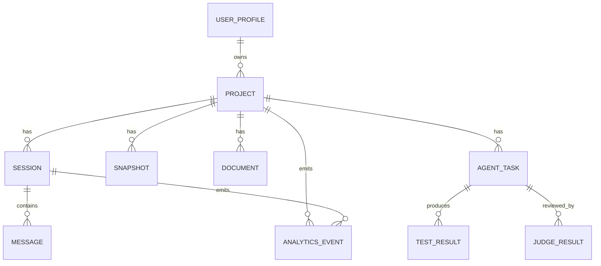

# 数据模型

> 项目：向导 Agent 多智能体协同开发平台  
> 文档ID：DOC-3.4  
> 版本：v1.1 | 日期：2026-07-10 | 状态：已确认  
> 依赖：DOC-3.1 `architecture.md`、DOC-3.2 `component-design.md`、`proma-core-demo`

---

## 1. 数据建模目标

本数据模型覆盖平台 Phase 1-4 所需的核心实体：

- 项目
- 会话
- 消息
- 快照
- 文档
- 任务
- 测试结果
- 裁判结果
- 埋点事件
- 用户偏好

设计原则：

- 优先本地存储。
- 项目文件和文档以文件系统为主，结构化索引用 JSON 文件。
- 会话、Agent 消息、埋点事件使用 JSONL 追加写入。
- 运行时不引入 SQLite；科研分析需要时从 JSONL 离线导出 CSV/SQLite。
- P0 用户数据与科研数据分离，科研数据必须脱敏。

---

## 2. Local-First 存储布局

本平台继承 Proma 的 `~/.proma/` 存储模型，并在 `agent-workspaces` 下扩展软件生成项目目录。

```text
~/.proma/
├── channels.json
├── conversations.json
├── conversations/
│   └── {conversation-id}.jsonl
├── agent-sessions.json
├── agent-sessions/
│   └── {session-id}.jsonl
├── agent-workspaces/
│   └── {workspace-slug}/
│       ├── mcp.json
│       ├── skills/
│       ├── workspace-files/
│       ├── generated-projects/
│       │   └── {project-id}/
│       ├── documents/
│       │   └── {project-id}/
│       ├── snapshots/
│       │   └── {project-id}/
│       └── analytics.jsonl
├── user-profile.json
└── settings.json
```

存储规则：

- `channels.json` 中的 API Key 必须使用 Electron `safeStorage` 加密。
- `agent-sessions/{session-id}.jsonl` 追加写入 Agent 消息和工具调用结果。
- `analytics.jsonl` 追加写入科研埋点事件。
- `generated-projects/{project-id}` 保存当前项目工作副本。
- `snapshots/{project-id}` 保存快照归档。
- JSON 索引文件只保存元数据和路径，不保存大体积正文。

---

## 3. 实体关系



---

## 4. `Project`

| 字段 | 类型 | 必填 | 说明 |
|---|---|:---:|---|
| `project_id` | string | 是 | 项目唯一 ID |
| `name` | string | 是 | 项目名称 |
| `mode` | enum | 是 | `quick` / `longterm` |
| `template_type` | enum | 是 | `web_fullstack` / `desktop_tool` / `personal_tool` / `ai_app` |
| `status` | enum | 是 | `active` / `completed` / `abandoned` / `archived` |
| `current_stage` | enum | 是 | 当前生成阶段 |
| `root_path` | string | 是 | 项目文件目录 |
| `workspace_slug` | string | 是 | Proma agent workspace 标识 |
| `sandbox_path` | string | 否 | 沙箱目录 |
| `current_snapshot_id` | string | 否 | 当前快照 |
| `created_at` | datetime | 是 | 创建时间 |
| `updated_at` | datetime | 是 | 更新时间 |
| `upgraded_from_project_id` | string | 否 | 模式升级来源 |

### `current_stage` 枚举

- `choosing_mode`
- `clarifying`
- `generating_sketch`
- `sketch_ready`
- `generating_mvp`
- `testing`
- `judge_review`
- `repairing`
- `ready`
- `iterating`
- `completed`
- `upgrading`
- `blocked_for_user_decision`

---

## 5. `Session`

| 字段 | 类型 | 必填 | 说明 |
|---|---|:---:|---|
| `session_id` | string | 是 | 会话 ID |
| `project_id` | string | 是 | 所属项目 |
| `summary` | string | 否 | 会话摘要 |
| `status` | enum | 是 | `active` / `waiting_for_user` / `completed` |
| `context_summary` | text | 否 | 压缩上下文 |
| `jsonl_path` | string | 是 | `agent-sessions/{session-id}.jsonl` |
| `created_at` | datetime | 是 | 创建时间 |
| `updated_at` | datetime | 是 | 更新时间 |

---

## 6. `Message`

| 字段 | 类型 | 必填 | 说明 |
|---|---|:---:|---|
| `message_id` | string | 是 | 消息 ID |
| `session_id` | string | 是 | 会话 ID |
| `role` | enum | 是 | `user` / `assistant` / `system` |
| `content` | text | 是 | 消息正文 |
| `message_type` | enum | 是 | `plain` / `question` / `card_options` / `status` / `judge_notice` |
| `metadata_json` | json | 否 | 结构化元数据 |
| `created_at` | datetime | 是 | 创建时间 |

消息不单独保存在数据库中，运行时以 JSONL 行格式追加写入：

```json
{"role":"assistant","content":[{"type":"text","text":"..."}],"timestamp":1783699200000}
```

---

## 7. `Snapshot`

| 字段 | 类型 | 必填 | 说明 |
|---|---|:---:|---|
| `snapshot_id` | string | 是 | 快照 ID |
| `project_id` | string | 是 | 项目 ID |
| `kind` | enum | 是 | `sketch` / `mvp` / `iteration` / `pre_risk` / `upgrade` / `rollback_guard` |
| `name` | string | 是 | 用户可见名称 |
| `summary` | string | 是 | 自然语言摘要 |
| `screenshot_path` | string | 是 | 预览截图 |
| `files_archive_path` | string | 是 | 源码副本 |
| `documents_archive_path` | string | 否 | 文档副本 |
| `health_status` | enum | 是 | `healthy` / `unhealthy` |
| `parent_snapshot_id` | string | 否 | 线性前序快照 |
| `index_path` | string | 是 | 快照索引 JSON 文件路径 |
| `created_at` | datetime | 是 | 创建时间 |

规则：

- 每个项目最多保留最近 100 个快照。
- 首个快照和当前快照不可自动清理。
- 回滚不删除后续快照。

---

## 8. `Document`

| 字段 | 类型 | 必填 | 说明 |
|---|---|:---:|---|
| `document_id` | string | 是 | 文档 ID |
| `project_id` | string | 是 | 项目 ID |
| `type` | enum | 是 | `prd` / `user_story` / `plantuml` / `gwt_feature` / `test_report` / `changelog` |
| `path` | string | 是 | 文件路径 |
| `version` | string | 是 | 文档版本 |
| `status` | enum | 是 | `draft` / `synced` / `stale` / `confirmed` |
| `last_sync_checkpoint` | string | 否 | 最近同步检查点 |
| `created_at` | datetime | 是 | 创建时间 |
| `updated_at` | datetime | 是 | 更新时间 |

---

## 9. `AgentTask`

| 字段 | 类型 | 必填 | 说明 |
|---|---|:---:|---|
| `task_id` | string | 是 | 任务 ID |
| `project_id` | string | 是 | 项目 ID |
| `session_id` | string | 是 | 会话 ID |
| `task_type` | enum | 是 | `sketch` / `mvp` / `revision` / `test` / `security_scan` / `document_sync` |
| `assigned_to` | enum | 是 | `guide` / `programming` / `test` / `judge` |
| `input_json` | json | 是 | 任务输入 |
| `output_json` | json | 否 | 任务输出 |
| `status` | enum | 是 | `pending` / `running` / `succeeded` / `failed` / `cancelled` |
| `repair_count` | integer | 是 | 修复次数 |
| `created_at` | datetime | 是 | 创建时间 |
| `updated_at` | datetime | 是 | 更新时间 |

---

## 10. `TestResult`

| 字段 | 类型 | 必填 | 说明 |
|---|---|:---:|---|
| `test_result_id` | string | 是 | 测试结果 ID |
| `task_id` | string | 是 | 关联任务 |
| `project_id` | string | 是 | 项目 ID |
| `feature_path` | string | 否 | Feature 文件路径 |
| `total_count` | integer | 是 | 总场景数 |
| `passed_count` | integer | 是 | 通过数 |
| `failed_count` | integer | 是 | 失败数 |
| `failure_summary_json` | json | 否 | 失败摘要 |
| `created_at` | datetime | 是 | 创建时间 |

---

## 11. `JudgeResult`

| 字段 | 类型 | 必填 | 说明 |
|---|---|:---:|---|
| `judge_result_id` | string | 是 | 裁判结果 ID |
| `task_id` | string | 是 | 关联任务 |
| `project_id` | string | 是 | 项目 ID |
| `verdict` | enum | 是 | `pass` / `suggest_improvement` / `return` |
| `hard_constraints_json` | json | 是 | 硬约束结果 |
| `soft_constraints_json` | json | 是 | 软约束结果 |
| `user_visible_summary` | string | 否 | 用户可见摘要 |
| `repairable` | boolean | 是 | 是否可自动修复 |
| `return_count_after` | integer | 是 | 本次后退回计数 |
| `created_at` | datetime | 是 | 创建时间 |

---

## 12. `AnalyticsEvent`

| 字段 | 类型 | 必填 | 说明 |
|---|---|:---:|---|
| `event_id` | string | 是 | 埋点事件 ID |
| `project_id` | string | 否 | 项目 ID |
| `session_id` | string | 否 | 会话 ID |
| `event_type` | enum | 是 | 13 类关键事件 |
| `payload_json` | json | 是 | 事件载荷 |
| `privacy_level` | enum | 是 | `raw` / `masked` / `research_safe` |
| `created_at` | datetime | 是 | 事件时间 |

埋点事件追加写入 `analytics.jsonl`，每行一个事件。研究导出时生成脱敏 CSV/SQLite，不影响运行时。

### 事件类型

| 枚举 | PRD 对应 |
|---|---|
| `project_created` | 项目创建 |
| `conversation_submitted` | 每轮对话提交 |
| `guide_role_switched` | 向导 Agent 角色切换 |
| `sketch_generated` | 验证草图生成 |
| `mvp_delivered` | MVP 交付 |
| `user_undo` | 用户主动撤销 |
| `point_correction` | 点选纠错 |
| `mode_upgraded` | 模式升级 |
| `programming_execution` | 编程 Agent 执行 |
| `self_repair_triggered` | 自修复触发 |
| `judge_verdict` | 裁判 Agent 判定 |
| `satisfaction_marked` | 用户满意度标记 |
| `project_finalized` | 项目完成/放弃 |

---

## 13. `UserProfile`

| 字段 | 类型 | 必填 | 说明 |
|---|---|:---:|---|
| `user_id` | string | 是 | 本地用户 ID |
| `knowledge_level` | enum | 是 | `zero_knowledge` / `conceptual` / `researcher` |
| `preferred_mode` | enum | 否 | 默认项目模式 |
| `preferred_explanation_style` | enum | 是 | `plain_language` / `concise` |
| `analytics_consent` | boolean | 是 | 是否允许科研数据采集 |
| `created_at` | datetime | 是 | 创建时间 |
| `updated_at` | datetime | 是 | 更新时间 |

---

## 14. `Channel`

渠道实体复用 Proma core。

| 字段 | 类型 | 必填 | 说明 |
|---|---|:---:|---|
| `id` | string | 是 | 渠道 ID |
| `name` | string | 是 | 渠道名称 |
| `provider_type` | enum | 是 | `anthropic` / `openai` / `deepseek` / `minimax` / `custom` 等 |
| `base_url` | string | 是 | API Base URL |
| `api_key` | string | 是 | `safeStorage.encryptString()` 后的 hex 字符串 |
| `models` | array | 是 | 模型列表 |
| `enabled` | boolean | 是 | 是否启用 |

规则：

- UI 永远不接收明文 API Key。
- 创建/更新渠道时传入明文，保存前加密。
- 调用 Agent SDK 前在 main 进程解密，明文不落盘。

---

## 15. `PermissionRequest`

权限实体复用 Proma core 的 Promise + Map 模式。

| 字段 | 类型 | 必填 | 说明 |
|---|---|:---:|---|
| `id` | string | 是 | 权限请求 ID |
| `session_id` | string | 是 | 所属 Agent 会话 |
| `tool_name` | string | 是 | 工具名 |
| `tool_input` | json | 是 | 工具参数 |
| `danger_level` | enum | 是 | `safe` / `warning` / `dangerous` |
| `created_at` | datetime | 是 | 创建时间 |

运行时 main 进程维护：

```ts
Map<requestId, { resolve, request }>
```

该 Map 不持久化。用户响应后立即 resolve 并删除。

---

## 16. 存储建议

| 数据 | 存储方式 |
|---|---|
| 项目源文件 | 文件系统 |
| 文档目录 | 文件系统 |
| 项目索引 | JSON |
| 会话索引 | JSON |
| 会话和消息 | JSONL |
| 快照元数据 | JSON |
| 快照文件副本 | 文件系统归档目录 |
| 埋点事件 | JSONL |
| 用户偏好 | `user-profile.json` |
| 渠道/API Key | `channels.json`，API Key 经 `safeStorage` 加密 |

---

## 17. 隐私与脱敏

| 数据类型 | 处理 |
|---|---|
| 用户原始输入 | 本地保留；科研导出时脱敏 |
| 业务 payload | 科研数据中不保留真实内容 |
| Token 消耗 | 可直接统计 |
| 错误类型 | 保留分类，不保留敏感堆栈 |
| 预览截图 | 默认属于项目数据，科研导出需用户许可 |
| API Key | 只在 main 进程解密，永不明文写入文件 |

---

## 18. 修订记录

| 版本 | 日期 | 修订内容 |
|------|------|----------|
| v1.0 | 2026-07-10 | 首版，定义项目、会话、消息、快照、文档、任务、测试、裁判、埋点、用户偏好实体 |
| v1.1 | 2026-07-10 | 按 `proma-core-demo` 修订：运行时存储改为 JSON/JSONL/文件目录，新增 Local-First 布局、Channel safeStorage、PermissionRequest，并移除 SQLite 运行时依赖 |
