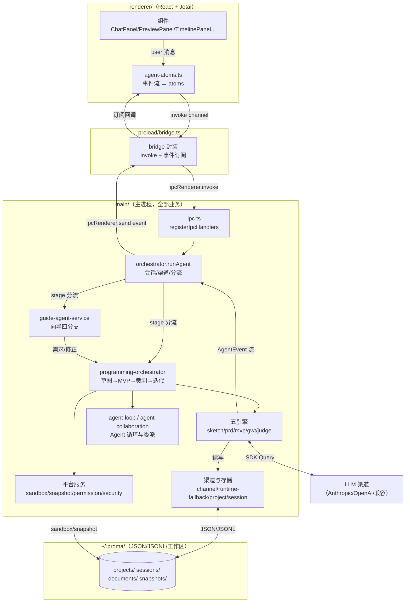
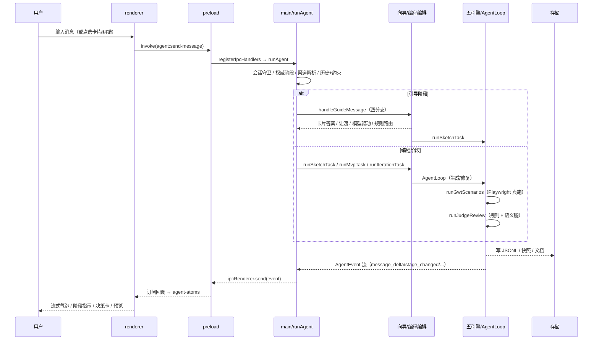
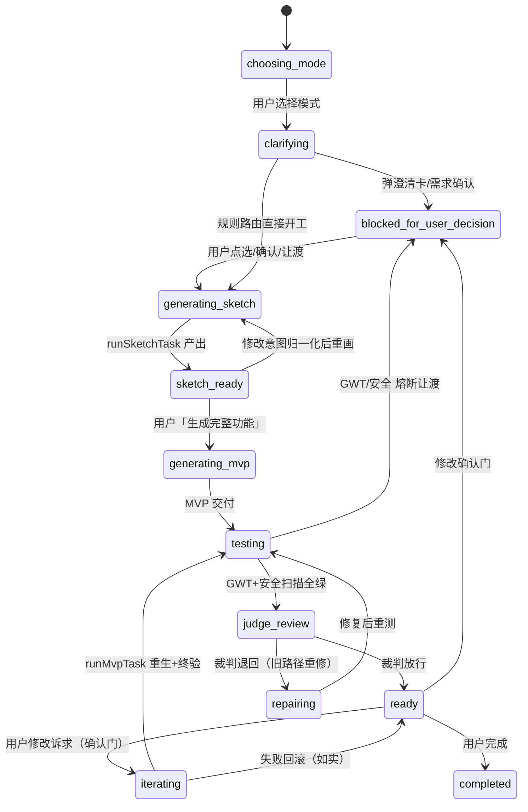

# Bloma 伪代码文档集 — 总索引

> **目的**：把 Bloma 代码库（约 2.5 万行）的**函数级 + 整体级**行为显式化为伪代码，
> 支撑三类使用场景：
> 1. **定位问题** —— 症状 → 可疑函数 → 检查点（见 `07-问题定位速查`）
> 2. **修改代码** —— 理解函数副作用、调用关系与降级链
> 3. **开发功能** —— 复用既有模式与 IPC/事件契约
>
> **分支与锚点基准**：主体锚点基于当前工作区（`test/delegation-s4-port` @ `afbfda79`）。
> 标注 `[sprint2]` 的模块（PRD 审查门 / 语义审查 / 委派化）位于 `origin/sprint2` @ `0c3230b`，
> **尚未合入当前分支**，需切换或合流后本地可见。
>
> **已删除模块**：`mvp-engine.ts` / `mvp-engine-llm.ts` / `repair-engine.ts` 已被 commit `c02e087`
> 「废旧管道转正」从代码库删除——**Agent Loop 是唯一运行时**。`02-五引擎.md` 从 git 历史
> `c02e087^` 读取其最后版本并标注 `[旧管道 c02e087^]`，仅作理解演进用，勿据此以为它们仍存在。

---

## 1. 文档导航

| 文档 | 覆盖范围 | 定位用途 |
|---|---|---|
| `00-总索引.md`（本文件） | 架构分层 / 端到端数据流 / 状态机 / IPC 链路 / 图例约定 / 函数索引总表 | 全局入口，先读这里 |
| `01-用户旅程与编排.md` | ★ 关键路径深描：`runAgent` → 向导四分支 → 需求确认/审查门 → 草图 → MVP loop → GWT → 裁判 → 迭代/恢复 | 理解一条消息从进来到落地的全链路 |
| `02-五引擎.md` | sketch / prd / mvp / gwt / judge 五引擎 + repair + prd-review + judge-semantic | 各生成/审查引擎的输入输出契约 |
| `03-Agent运行时.md` | agent-loop 主循环 / agent-collaboration 委派 / agent-tools 工具面 / SDK 封装 | Agent 循环与子 Agent 委派 |
| `04-渠道与存储.md` | 渠道管理 / 类别路由 / 模型解析 / 项目·会话 / 记忆蒸馏 / 文档引擎 / 恢复 | 配置、渠道与持久化 |
| `05-IPC与渲染层.md` | shared 契约 / ipc handler / preload 桥 / agent-atoms 事件映射 / 关键组件 | 前后端边界与 UI 事件流 |
| `06-安全与平台.md` | 权限 / CSP / 安全扫描 / 沙箱·快照 / 通知 / 加密存储 | 安全边界与平台服务 |
| `07-问题定位速查.md` | ★ 症状 → 可疑函数 → 检查点 速查表 | 从故障现象倒查代码 |

---

## 2. 伪代码图例与锚点约定

所有文档统一遵循以下格式，保证可跳回真实代码。

### 2.1 详细级函数（关键路径用）

```text
### <函数名> — <相对路径>:<行号>

- 输入：<参数 / 读取的存储 / 依赖的全局状态>
- 副作用：<事件发布 / 落盘 / 项目状态迁移 / 权限门 / 埋点>
- 返回值：<结构>

伪代码：
  <类 Python 结构化步骤，中文注释说明分支与降级链>
  # 关键分支 / 降级链用注释标出，如：
  #   降级链：委派 → 直连 → 规则门（失败不阻断主流程）
```

### 2.2 摘要级函数（非关键路径用）

```text
`<函数名>`（`<file>:<line>`）— <一句话职责>；调用 <子函数A>/<子函数B>
```

### 2.3 锚点与状态标记

- 锚点一律 `main/xxx.ts:123` / `renderer/xxx.tsx:123` 格式，可直接被编辑器定位。
- `[sprint2]` 前缀 = 该文件/函数只存在于 `origin/sprint2`，当前分支未检出。
- `[本地]` 后缀 = 仅本地/测试辅助（如 test-only 开关），非生产路径。
- 状态侧写：`(stage)` 表示该点把项目推入 `current_stage`；`→ event` 表示发布该 AgentEvent。

### 2.4 高频事件/类型速记

| 记号 | 含义 |
|---|---|
| `publish(ev)` | 主进程 → 渲染端流式事件（`AgentEvent`） |
| `stage_changed{stage}` | 更新项目阶段（驱动顶部 StageIndicator） |
| `user_decision_required{kind}` | 弹决策卡（kind: clarification / requirement_confirm / prd_review / retry …） |
| `permission_requested` | 工具权限门，渲染端弹窗决策后回传 |
| `mvp_ready / sketch_ready` | 产物就绪事件（带 preview_url） |
| `delegation_*` | 委派子 agent 生命周期（协作面板可视化） |

---

## 3. 架构总览（分层）



**分层铁律**（来自 README「Proma Core 对齐原则」）：
- Renderer 不直接访问 Node.js / 文件系统 / API Key / Agent SDK，一切经 preload 桥。
- API Key 只在 main 解密，`safeStorage` 加密存 `channels.json`。
- 运行时存储只放 `~/.proma/` 下 JSON / JSONL / 工作区文件目录；SQLite 仅科研导出。

---

## 4. 端到端数据流（一条用户消息的生命周期）



---

## 5. 工作流状态机（`shared/types.ts:124` `WorkflowStage`）



> 阶段迁移唯一权威源是 `findProject(project_id).current_stage`（`main/project-service.ts:282`）；
> 渲染端 `stage_changed` 事件仅作展示。见 `main/orchestrator.ts:167` runAgent 顶部的「权威阶段」解析。

---

## 6. IPC 四层链路

`shared/types.ts` → `main/ipc.ts` → `preload/bridge.ts` → `renderer`（atoms）

- **类型契约**：`shared/types.ts`（1167 行）是唯一契约源，所有 IPC 出入参类型在此定义。
- **handler 注册**：`main/ipc.ts:103` `registerIpcHandlers`，命令以 `agent:*` / `project:*` / `channel:*` / `settings:*` / `permission:*` 等前缀命名。
- **桥**：`preload/bridge.ts`（195 行）只做 invoke 封装 + 事件订阅转发，不承载业务。
- **事件流**：主进程 `AgentEvent`（`shared/types.ts:671`）经 `ipcRenderer.on` 到达 `renderer/agent-atoms.ts` 统一归约（事件类型 → atom 更新 / 决策卡 / DelegationFeed 等）。
- **决策回传**：卡片/权限回传走 `metadata.source='card_option'` + `selected_option_id` 或 `permission_response` 通道。

完整 handler 清单与事件→atom 映射见 `05-IPC与渲染层.md`。

---

## 7. 函数索引总表

> 收口阶段由 `00` 汇总各域文档尾部索引表生成。格式：`函数名 — 文件:行 — 所在文档章节`。

> 完整索引见各域文档尾部「本域函数索引」表。下表只列**详细级**核心函数。

| 函数 | 位置 | 文档 |
|---|---|---|
| `runAgent` | `main/orchestrator.ts:167` | 01 §2 |
| `handleGuideMessage` | `main/guide-agent-service.ts:260` | 01 §3 |
| `tryModelDrivenGuide` | `main/guide-agent-service.ts:369` | 01 §3.1 |
| `resolveRequirementConfirm` | `main/guide-agent-service.ts:647` | 01 §4 |
| `runPrdReviewGate` | `main/prd-review.ts:119` `[sprint2]` | 02 §6 |
| `runSketchTask` / `resolveSketch` | `main/programming-orchestrator.ts:109 / 207` | 01 §5 |
| `runMvpTask` / `runMvpViaAgentLoop` | `main/programming-orchestrator.ts:415 / 662` | 01 §6 |
| `runAgentLoop` | `main/agent-loop.ts:165` | 03 §2 |
| `runGwtScenarios` | `main/gwt-service.ts:50` | 02 §4 |
| `runAgentLoopPostTesting` | `main/programming-orchestrator.ts:1270` | 01 §7.1 |
| `runJudgeReview` / `evaluateOnce` | `main/programming-orchestrator.ts:1135 / 1216` | 01 §7.2 |
| `runSemanticJudgeReview` | `main/judge-semantic.ts` `[sprint2]` | 02 §7 |
| `runIterationTask` | `main/programming-orchestrator.ts:1345` | 01 §8 |
| `resumeBlockedFlow` | `main/programming-orchestrator.ts:1687` | 01 §9 |
| `startDelegation` | `main/agent-collaboration.ts:178` | 03 §3 |
| `waitForDelegations` | `main/agent-collaboration.ts:321` | 03 §3 |
| `runDelegatedReview` | `main/review-delegation.ts` `[sprint2]` | 03 §5 |
| `buildAgentTools` | `main/agent-tools.ts:213` | 03 §4 |
| `resolveChannelEnv` | `main/runtime-fallback.ts:155` | 04 §4 |
| `circuitBreakRollback` | `main/recovery-service.ts:245` | 04 §7 |
| `createProject` / `findProject` / `updateProject` | `main/project-service.ts:47 / 282 / 288` | 04 §5 |
| `syncDocuments` | `main/document-engine.ts` | 04 §8 |
| `setupGlobalAgentListeners` | `renderer/agent-atoms.ts:191` | 05 §5 |
| `canUseTool` | `main/permission-service.ts` | 06 §2 |
| `runSandbox` / `createSnapshot` | `main/platform-services.ts` | 06 §5 |
| `runSecurityScan` | `main/security-scan.ts` | 06 §4 |
