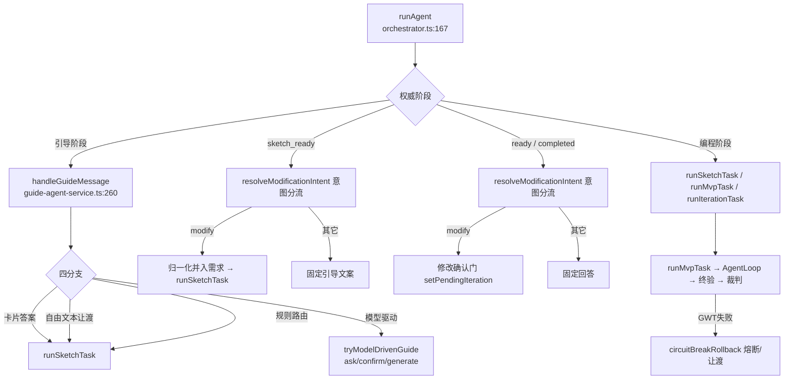

# 01 — 用户旅程与编排（关键路径深描）

> 覆盖一条用户消息从 `runAgent` 进入到落地的全链路。是整套伪代码的核心，
> 其余文档（02–06）是这里的函数展开。图例与锚点约定见 `00-总索引.md` §2。

---

## §1 总览：runAgent 分派树



**分派依据**：`orchestrator.ts:1169 shouldUseGuideAgent(stage)` 把 `choosing_mode/clarifying/blocked_for_user_decision` 归引导路径；其余阶段由 `runAgent` 顶部解析的**权威阶段**（`findProject(...).current_stage`）决定，渲染端上报阶段仅回退。

---

## §2 runAgent — `main/orchestrator.ts:167`

- **输入**：`AgentSendMessageInput`（content / session_id / project_id / mode / channel_id / current_stage / metadata）
- **副作用**：消息落盘 JSONL、`recordSessionActivity`、权限/渠道解析、事件流发布、阶段迁移
- **返回值**：`{ accepted, session_id, stream_started }`；同会话并发抛 `AGENT_SESSION_BUSY`

```text
runAgent(input):
  if activeSessions 已有 session_id:  throw AGENT_SESSION_BUSY      # 并发守卫
  activeSessions.set(session_id, {abortController})
  received = []

  try:
    # ---- 0. 权威阶段：以项目存储为准，渲染端上报仅回退 ----
    authoritativeStage = findProject(project_id).current_stage
      catch: authoritativeStage = input.current_stage

    # ---- 1. 渠道 + 类别 → env 统一收口 ----
    resolution = resolveChannelEnv(channelId, category=categoryForStage(authoritativeStage),
                                   projectId, sessionId)
    channel = resolution.channel;  env = resolution.env
    # 主渠道不可用 → runtime-fallback 已试切备用（落决策日志）；无可用 → 规则/模板降级
    maxTokens = channel?.max_tokens ?? 1200

    # ---- 2. 历史 + 约束扫描 ----
    recentHistory = loadConversationHistory(session_id, HISTORY_WINDOW_TURNS=10)
    sessionConstraints = scanSessionConstraints(session_id)        # 历轮全量约束扫描
    if sessionConstraints: captureConstraints(source='session_scan')
    constraintTurn = system 约束注入（若存在）
    history = recentHistory + constraintTurn

    # ---- 3. 用户消息落盘 + 会话索引维护 ----
    appendAgentMessage(session_id, user content)
    recordSessionActivity(session_id, project_id)
    persistAssistant = (text) => appendAgentMessage(session_id, assistant text)

    # ---- 4. 按权威阶段分流（顺序敏感） ----
    if env 不可用 且 规则路由能处理:
        走规则路由，persist 回复，发 completed 事件，return

    if shouldUseGuideAgent(authoritativeStage):
        guideOptions = { query: sdkQuery, env, history, signal, ... }
        await handleGuideMessage(input, streamPublisher, guideOptions, persistAssistant, persistSystem)
        persistTerminalMessage('completed'); 发 completed;  return

    if authoritativeStage == 'sketch_ready':
        intent = await resolveModificationIntent(content, ...)      # LLM 意图分类
        if intent == 'modify':
            description = refineModificationDescription(content)    # 清洗口语
            captureConstraints(extractConstraints(description))     # 约束走门
            existing = readLastSketchRequirements(project_id)
            normalization = await normalizeRequirementUpdate(existing, description,
                                                             constraints, query, env)
            requirements = applyNormalization(existing, normalization, nextRequirementId)
            if out_of_scope: addScopeExclusion()
            if via == 'llm': recordRequirementNormalization()
            recordSketchGenerated(); recordDecision(modification_gate)
            ack → persist + message_delta
            await runSketchTask(prompt=description, requirements, query)
            发 completed; return
        else:
            固定引导文案（点「生成完整功能」/「纠错」）；发 completed; return

    if authoritativeStage in ('ready', 'completed'):
        intent = await resolveModificationIntent(content, ...)
        if intent == 'modify':
            description = refineModificationDescription(content)
            setPendingIteration(project_id, {raw, description})     # 修改确认门（破坏性最大操作）
            recordDecision(modification_gate)
            发决策卡（忽略继续 / 我来补充说明 或类似）; return
        else:
            规则直答「已经生成好了」——不依赖模型服从，杜绝「还没好」幻觉
            发 completed; return

    # 其它编程阶段：直接交给编程编排（runMvpTask / runIterationTask 等按意图）
    ...
  finally:
    activeSessions.delete(session_id)
```

> **要点**：`resolveModificationIntent`（`orchestrator.ts:1287`）是 ready/sketch_ready 阶段的意图分流器，
> 用 LLM 判断输入是"修改诉求"还是"确认/进度/闲聊"；识别为修改才进重新生成，否则固定文案/引导。
> 修改确认门 `setPendingIteration`（`programming-orchestrator.ts:1498`）是迭代前的一道人工确认闸。

---

## §3 handleGuideMessage — `main/guide-agent-service.ts:260`

- **输入**：`AgentSendMessageInput` + `publish` + `model?: GuideModelOptions` + `persistAssistant` + `persistSystem`
- **副作用**：主题锚点 / 约束入库、决策日志、决策卡事件、runSketchTask 或需求确认弹窗
- **降级链**：卡片答案 → 自由让渡 → 模型驱动 → 规则路由（模型不可用时逐级下落）

```text
handleGuideMessage(input, publish, model, persistAssistant, persistSystem):
  project = findProject(project_id);  setProgrammingEventPublisher(publish)
  trackAnalytics('conversation_submitted')

  primaryIntent = readPrimaryIntent(session_id)          # 主题锚点：首条消息，不可被澄清覆盖

  captureConstraints(extractConstraints(input.content), source='guide_gate')   # 约束走门

  # ---- 分支 0：PRD 审查决策卡回传 [sprint2]（必须在普通卡片答案之前）----
  prdDecision = resolvePrdReviewCardAnswer(input)
  if 'override':   await resumePrdReviewOverride(input);  return   # 忽略问题开草图
  if 'supplement': consumePrdReviewSupplement(input); 提示打字补充;  return

  # ---- 分支 1：卡片答案（用户点选澄清选项）----
  cardAnswer = resolveCardAnswer(input, primaryIntent)
  if cardAnswer:
      recordDecision('clarification_answer')
      ack → persist + publish
      await runSketchTask(prompt=cardAnswer.prompt, requirements=cardAnswer.requirements, query=model?.query)
      return

  # ---- 分支 2：自由文本让渡（打字版「你帮我决定」，D1 修复）----
  autoDelegation = resolveAutoDelegation(input, primaryIntent)
  if autoDelegation:
      recordDecision('clarification_answer', source='free_text_auto')
      ack → persist + publish
      await runSketchTask(...);  return

  # ---- 分支 3：模型驱动（渠道可用）----
  if model:
      handled = await tryModelDrivenGuide(input, publish, model, primaryIntent, persistSystem, project)
      if handled: return

  # ---- 分支 4：规则路由（模型不可用/解析失败兜底）----
  route = routeDialogue(input.content, project)          # dialogue-router.ts:13
  if route.action == 'ask_clarification':
      stage → blocked_for_user_decision
      publishClarificationCard(route.questions.slice(0,3))       # 弹澄清卡
      return
  await runSketchTask(prompt=input.content, requirements=ensurePrimaryIntent(route.requirements, primaryIntent))
```

### 3.1 tryModelDrivenGuide — `main/guide-agent-service.ts:369`

- **输入**：`model`（含 query / env / history / signal / maxTokens）+ 首轮判定（`isFirstTurn = 历史无 assistant`）
- **副作用**：只把用户可读 `reply` 上屏落盘，模型 JSON 内部契约绝不暴露；弹澄清卡 / 需求确认弹窗 / 草图
- **返回值**：`true`（已处理）或 `false`（回退规则路由）

```text
tryModelDrivenGuide(input, publish, model, primaryIntent, persistSystem, project):
  isFirstTurn = 会话历史无 assistant 回复
  systemTurn = isFirstTurn ? (DEFAULT_GUIDE_SYSTEM_PROMPT + FIRST_TURN_RULE)
                           : DEFAULT_GUIDE_SYSTEM_PROMPT
  history = [systemTurn, ...model.history]

  accumulated = ''                     # 内部累积：模型流式吐原始 JSON
  try:
    for sdkMessage in model.query(content, {env, signal, sessionId, history, maxTokens, temperature}):
      if assistant: accumulated += extractText(blocks)
  catch: return false                  # 网络/模型不可用 → 规则路由

  parsed = parseGuideJson(accumulated) # 剥围栏/截大括号/白名单，见 3.2
  if !parsed: return false

  # 首轮护栏：模型无视规则直接 generate_sketch → 降级为澄清追问（不信提示词）
  if isFirstTurn and parsed.action == 'generate_sketch':
      发澄清追问 + 弹卡（routeDialogue 给得出选项就弹，否则纯文本）; return true

  # 澄清轮次熔断（D3）：连续 2 轮仍 ask_clarification → 转需求确认弹窗（不自动开工）
  if parsed.action == 'ask_clarification'
     and countTrailingClarificationRounds(session_id) >= 2:
      await startRequirementConfirmFlow(forceByRoundBreaker=true);  return true

  reply = parsed.reply.trim() || 兜底话术
  persist + publish(reply) + publish(message_completed)

  if parsed.action == 'ask_clarification':
      stage → blocked_for_user_decision
      publishClarificationCard(normalizeClarificationOptions(parsed.questions))
      return true

  if parsed.action == 'confirm_requirements':
      await startRequirementConfirmFlow(requirements, research_queries, forced=false)
      return true

  # generate_sketch：不经决策卡，直接草图（LLM 或模板降级）
  await runSketchTask(prompt=reply||content, requirements=ensurePrimaryIntent(parsed.requirements), query=model.query)
  return true
```

### 3.2 parseGuideJson — `main/guide-agent-service.ts:735`

`剥 ```json 围栏 → 截首尾 {} → JSON.parse → 按 action 白名单校验`。
三个动作各有字段约束：`generate_sketch`（requirements 1..5）、`ask_clarification`（questions 1..8，预截放宽便于坏选项纠偏）、`confirm_requirements`（requirements 1..5 + research_queries 0..2）。校验不过返回 `undefined` → 调用方回退规则路由。

### 3.3 辅助（摘要）

- `resolveCardAnswer`（`guide-agent-service.ts:231`）— 识别用户点选的澄清卡选项，返回 `{prompt, requirements}`；匹配不上返回 undefined。
- `resolveAutoDelegation`（`guide-agent-service.ts:249`）— 识别自由文本让渡（"你帮我决定"类），出口与卡片 auto 完全一致，仅 decision detail 标 `source='free_text_auto'`。
- `publishClarificationCard`（`guide-agent-service.ts:478`）— 弹 `user_decision_required{kind:'clarification'}`；有选项时落盘 `[decision-card]` 内部标记 + `recordDecision('clarification_card')`，保证事后可追溯弹过哪些选项。
- `routeDialogue`（`dialogue-router.ts:13`）— 确定性规则路由：按关键词/意图给 `ask_clarification`（带 questions）或 `generate_sketch`（带 requirements）。
- `countTrailingClarificationRounds`（`guide-agent-service.ts:135`）— 统计末尾连续澄清轮次，供熔断判断。

---

## §4 需求确认与 PRD 审查门

### 4.1 startRequirementConfirmFlow — `main/guide-agent-service.ts:596`

```text
startRequirementConfirmFlow(input, publish, model, requirements, researchQueries, persistSystem, forced):
  stage → blocked_for_user_decision
  research = await researchMarketSimilar(researchQueries)      # 市调：失败降级 available:false，增强不阻断
  persistSystem(`[decision-card] 需求确认：...`)              # 落盘留痕
  recordDecision(forced ? 'clarification_forced_confirm' : 'requirement_confirm_card')
  pendingRequirementConfirms.set(project_id, { request_id, session_id, mode, channel_id,
                                               requirements, research, query: model.query, publish })
  publish(user_decision_required{ kind:'requirement_confirm', requirements, research })
```

> **待决状态**：`pendingRequirementConfirms` Map 以 project_id 为键，`takePendingRequirementConfirm`（:575）取走即删，防重复消费。

### 4.2 resolveRequirementConfirm — `main/guide-agent-service.ts:647`（IPC `agent:confirm-requirements` 服务侧）

```text
resolveRequirementConfirm({ request_id, session_id, project_id, decision, requirement_ids? }):
  pending = takePendingRequirementConfirm(project_id)
  if !pending: return { started:false, prd_written:false }

  selected = pending.requirements.filter(id ∈ requirement_ids)
  requirements = (decision=='delegate' || selected空) ? pending.requirements : selected
  recordDecision('requirement_confirmed')

  prdWritten = false
  try:
      backplane = await resolvePrdBackplane({request_id, session_id, project_id, mode, channel_id, query}, requirements)
      syncDocuments(checkpoint='requirement_confirmed', backplane)     # PRD 前移落盘
      prdWritten = true
  catch:  # PRD 前移失败不阻断草图
      console.error; 发「需求已确认，开始画草图」; 发 message_completed

  # ---- PRD 裁判审查门 [sprint2]（PRD 落盘后、草图前）----
  if prdWritten and backplane:
      reviewEnv = pending.env 回退链：优先 resolveChannelEnv(category='prd')，失败用向导轮 env
      review = await runPrdReviewGate(backplane, confirmedRequirements=requirements,
                                      query, env=reviewEnv, projectId, requestId, publish)
      if review.verdict == 'needs_revision':
          发「裁判发现 N 个问题」+ message_completed
          publishPrdReviewCard(requirements, issues, outcome)       # 忽略继续 / 我来补充说明
          return { started:true, prd_written }
      # pass → 继续草图（话术「已通过裁判审查」）

  await runSketchTask(prompt='按确认的需求清单生成草图', requirements, query=pending.query)
  return { started:true, prd_written }
```

### 4.3 runPrdReviewGate — `main/prd-review.ts:119` `[sprint2]`

- **目的**：简化版 AC 对抗审计（六维攻击面 I-F-Z-U-L-G + PRD 权重），独立一次模型请求（审查者≠生成者）。
- **降级链**：委派审查（`review-delegation`）→ 直连 LLM → 确定性规则门；**永不阻断主流程**。

```text
runPrdReviewGate({ backplane, confirmedRequirements, query, env, sessionId, projectId, requestId, publish }):
  if !env: return ruleGateReview(backplane)              # 渠道不可用 → 规则门（不算 degraded）
  if delegatedReviewEnabled() and projectId/requestId/publish 齐备:
      delegated = await runDelegatedReview(goal, task=buildPrdReviewTask(backplane, confirmed), system=PRD_REVIEW_SYSTEM_PROMPT, ...)
      if delegated.ok and finalText:
          try:
              issues = parseReviewIssues(finalText)      # 剥头行/白名单校验
              return { verdict: deriveVerdict(issues), issues, mode:'llm', via:'delegation' }
          catch: 回退直连
  try:
      issues = await attackViaLlm({backplane, confirmedRequirements, query, env, ...})   # 内联 PRD 全文
      return { verdict: deriveVerdict(issues), issues, mode:'llm', via:'direct' }
  catch:
      return { ...ruleGateReview(backplane), degraded:true }

deriveVerdict(issues):  # 代码级裁决，不信任模型自报宽松结论
  blocking/major 任一存在 → 'needs_revision'，否则 'pass'

ruleGateReview(backplane):  # 确定性降级：只拦硬伤，宁松勿严
  定位空 → blocking；需求空 → blocking；描述 <4 字 → major；完全重复 → major

publishPrdReviewCard / resolvePrdReviewCardAnswer / resumePrdReviewOverride / consumePrdReviewSupplement:
  未过 → 弹卡（忽略继续 / 我来补充说明）；override → 按原需求开草图 + 留痕；supplement → 提示打字，pending 已消费
```

> 完整实现（含 `PRD_REVIEW_SYSTEM_PROMPT` 六维权重、`parseReviewIssues` 白名单、pending 决策卡机制）见 `02-五引擎.md` §6。

---

## §5 runSketchTask — `main/programming-orchestrator.ts:109`

- **输入**：`SketchTaskInput`（requirements 可选；无则单条 `F-001: input.prompt`）
- **副作用**：阶段迁移、模板回退留痕、权限门、沙箱启动、快照、埋点、`sketch_ready` 事件
- **降级链**（核心）：LLM 草图 → 确定性模板 `generateSketch`（`resolveSketch` 判定）

```text
runSketchTask(input):
  stage → generating_sketch
  requirements = input.requirements 或 [{id:'F-001', description: input.prompt}]
  { result:sketch, source, fallbackReason, ... } = await resolveSketch(input, requirements)
  updateProject({ sketch_source: source, sketch_generated_at })     # 供 sketch_confirmed 质量门读取

  if source == 'template' and fallbackReason:
      trackAnalytics('sketch_fallback', {reason, llm_error_code, llm_attempts})   # 模板回退必须留痕
      会话内如实说明（不假装模型参与）+ 落盘

  recordSketchGenerated(project_id, requirements)
  await allowAutomatedTool('run_project', ...)              # 权限门
  sandbox = await runSandbox({request_id, project_id})      # 静态服务器
  if sandbox.status != 'running' or no preview_url:
      publish error SANDBOX_RUN_FAILED;  throw new Error(`SANDBOX_RUN_FAILED:${category}`)

  await allowAutomatedTool('create_snapshot', kind='sketch')
  snapshot = await createSnapshot({kind:'sketch', include_documents:true, health_status:'healthy'})
  trackAnalytics('sketch_generated', { duration_ms = now - project.created_at })   # FIRT 时长
  stage → sketch_ready;  publish sketch_ready{ preview_url, snapshot_id, summary }
  return { preview_url, snapshot, summary }
```

### 5.1 resolveSketch — `main/programming-orchestrator.ts:207`（草图来源分流，降级链核心）

```text
resolveSketch(input, requirements):
  if !input.query:
      return { generateSketch(模板), source:'template', fallbackReason:'no_query' }
  resolution = resolveChannelEnv(channelId, category='sketch', projectId, sessionId)
  if !resolution.env or !resolution.channel:
      reason = decrypt_failed / model_not_found / no_channel
      return { generateSketch, source:'template', fallbackReason:reason }
  try:
      result = await generateSketchLlm({requirements, constraints=readProjectConstraints(), query, env, maxTokens})
      return { result, source:'llm' }
  catch error:
      # LLM 失败（超时/非HTML/网络）回退模板，不阻断草图产出
      return { generateSketch, source:'template', fallbackReason:'llm_failed', llmErrorCode, llmAttempts }
```

> **要点**：与 MVP「无模板兜底」不同，草图是低成本方向确认，**不能**因 LLM 故障卡死澄清流程；
> 模板回退通过 `sketchFallbackCopy`（:254）给用户如实话术。

---

## §6 runMvpTask — `main/programming-orchestrator.ts:415`

- **降级链**：Agent Loop 是**唯一运行时**（废旧管道方案 D1）——渠道不支持 tool use / 探测失败即抛错，无旧管道回退。
- **副作用**：记忆蒸馏触发点①、需求读取、自动命名、权限门、AgentLoop 生成、交付尾巴

```text
runMvpTask(input):
  stage → generating_mvp
  distillProjectMemorySafely({...})                      # T4-L3 蒸馏兜底触发点①（fire-and-forget，默认关）
  requirements = readLastSketchRequirements(project_id)
  await syncPrdCheckpoints(input, requirements)          # PRD/GWT 骨架同步
  try: await autoNameProject(input)                      # 需求确认后自动命名（LLM 起名 + 前缀剥离兜底），失败静默
  await allowAutomatedTool('generate_mvp', ...)          # 权限门
  return runMvpViaAgentLoop(input, await tryResolveAgentLoop(input))
```

### 6.1 tryResolveAgentLoop — `main/programming-orchestrator.ts:540`

探测渠道是否支持 tool use（`BLOMA_AGENT_LOOP` 开关 + 渠道能力位双条件），不支持/探测失败/无结论 → **抛错向上**（不再有旧管道回退分支）。

### 6.2 runMvpViaAgentLoop — `main/programming-orchestrator.ts:662`

```text
runMvpViaAgentLoop(input, loop):
  project = findProject;  backplane = readPrdBackplane;  editFormat = loop.model?.edit_format ?? 'diff'
  # 委派协作：注册父 loop 上下文（子 agent 工具按 role 裁剪，子轮次埋点）
  setChildToolsBuilder(buildAgentTools)
  registerParentLoopContext(input.session_id, { query, env, maxTokens, maxTurns, delegationMaxTurns,
                                                permissionMode, temperature, system, editFormat, publish, onChildTurn })
  recordDecision('agent_loop', { max_turns, edit_format, repair_budget_mapping })

  result = await runAgentLoop({ task=构建MVP任务, system, tools, query, env, maxTurns, ... })
    # 见 03-Agent运行时.md §2：for turn 1..maxTurns { 模型调用 → tool 执行 → 预算/熔断 }
  # 产物校验（文件存在、入口 html、运行命令）+ finalizeMvpDelivery
  return finalizeMvpDelivery(input, { fileCount, snapshotSummary, readySummary, previewUrl, viaAgentLoop:true, loopResult:result })
```

### 6.3 finalizeMvpDelivery — `main/programming-orchestrator.ts:448`

权限门 `run_project`/`create_snapshot` → `createSnapshot(kind:'mvp', include_documents)` → 埋点 `mvp_delivered` → `stage→testing`（+ `via_agent_loop` 持久化）→ `publish mvp_ready{preview_url, snapshot_id, run_command:'npm start'}`。

---

## §7 终验与裁判（Agent Loop 路径：只终验不重修）

### 7.1 runAgentLoopPostTesting — `main/programming-orchestrator.ts:1270`

```text
runAgentLoopPostTesting({ request_id, session_id, project_id, mode, preview_url, loop, query, channel_id }):
  stage → testing
  testResult = await runGwtScenarios({project_id, session_id, preview_url})   # Playwright 真跑 → 静态启发式兜底
  writeTestReport(...);  syncDocuments(checkpoint='mvp_tested')

  # 只终验不重修：GWT 首败即熔断回滚/让渡（loop 内修复预算已用尽）
  if testResult.failed_count > 0:
      outcome = await circuitBreakRollback(reason='终验未通过（Agent Loop 路径）')
      if outcome.rolled_back: throw CircuitBreakSettledError()
      publishBlockedDecision('test_repair', '测试未通过：...')
      return { verdict:'blocked', test_result }

  # 安全扫描终验（A3）：高危/严重同样只熔断不重修
  security = runSecurityScan(root_path)
  writeSecurityScanDocument(...)
  if !security.passed:
      outcome = await circuitBreakRollback(reason='安全终验未通过')
      if rolled_back: throw CircuitBreakSettledError()
      publishBlockedDecision('security_repair', '安全隐患反复修不好')
      return { verdict:'blocked', test_result }

  # 终审（M4-B loop-aware）：judge 感知 loop 结果；judge 级修复同样只终验不重修
  stage → judge_review
  judge = await runJudgeReview({ loop, repairInternalized:true, query, channel_id })
  return { verdict: judge.outcome, test_result, judge: judge.verdict }
```

### 7.2 runJudgeReview / evaluateOnce — `main/programming-orchestrator.ts:1135 / 1216`

```text
runJudgeReview(input):
  verdict = await evaluateOnce(input)                    # 规则先行 + 语义审查腿（异步）
  while verdict.verdict == 'return':
      project = findProject;  limit = quick?2 : longterm?3
      if judge_return_count < limit:
          recordDecision('judge_return')
          applyConstraintErrorDocRepair(...)             # 旧路径：重新生成 PRD/GWT 骨架（不改代码）
          verdict = await evaluateOnce(input)
      else:
          blocked_for_user_decision 让渡; return
  stage → ready;  return outcome

evaluateOnce(input):
  verdict = judgeOnce(input)                             # 规则引擎（确定性，judge-engine.ts:52）
  if verdict.verdict == 'return' or !input.query: return verdict
  # 语义审查腿 [sprint2]：规则全绿且 query 可用才跑，省一次 LLM
  env = resolveChannelEnv(category='prd', channel_id)?.env  (失败 → undefined)
  semantic = await runSemanticJudgeReview(backplane, artifact=readArtifactText(root_path),
                                          testSummary, query, env, projectId, requestId, publish)
  if semantic.skipped:  recordDecision('judge_semantic', skip_reason); return verdict
  if semantic.constraint and not passed:
      recordDecision('judge_semantic', findings)
      return { verdict:'return', hard_constraints:[...verdict.hard_constraints, semantic.constraint],
               soft_constraints, user_visible_summary: constraint.detail, repairable:true }
  return verdict
```

> 语义审查完整逻辑见 `02-五引擎.md` §7。规则引擎见 `main/judge-engine.ts:52`。
> **观察**：旧路径 `applyConstraintErrorDocRepair` 重修 PRD/GWT 骨架不改代码，与"产物不忠实"这一语义失败存在错配（见会话审查报告问题 #1）。

### 7.3 runGwtScenarios — `main/gwt-service.ts:50`

```text
runGwtScenarios({project_id, session_id, preview_url}):
  browserResult = await runBrowserGwt(...)      # Playwright 无头，逐条行为断言「模拟触发→断言状态变化」
  if browserResult: return browserResult        # 浏览器可用走真跑
  return runStaticScenarios(...)                # 静态启发式兜底（fetch HTML/JS + 正则关键词）
```

> 浏览器不可用（未装 chromium / 启动失败 / 导航失败）返回 null → 自动降级静态启发式。
> `gwt-runner.ts` 是真实执行器（per-assertion），详见 `02-五引擎.md` §4。

---

## §8 runIterationTask — `main/programming-orchestrator.ts:1345`

```text
runIterationTask(input):    # 已生成完成后，用户修改诉求 → 重新生成一版 MVP
  stage → iterating
  requirements = await mergeIterationRequirements(input, existing)   # 修改诉求归一化并入需求清单
  recordSketchGenerated(requirements)
  发「按你的新想法重新生成一版」
  try:
      mvp = await runMvpTask({...})               # 复用完整闭环
      await runAgentLoopPostTesting({ loop: mvp.loop_result })       # 只终验不重修
      distillProjectMemorySafely(...)             # 蒸馏触发点②（fire-and-forget）
      return mvp
  catch error:
      if isCircuitBreakSettled(error): throw error                  # 熔断已收尾，不再覆盖
      # 迭代失败如实回滚：回 ready（上一版 MVP 完整保留），如实告知，不编造成功
      stage → ready
      if not signal.aborted:
          setFailedIteration(project_id, prompt)  # 供「再试一次」一键重跑
          发 GENERATION_FAILED_COPY + retry 决策卡
      throw error
```

> `mergeIterationRequirements`（`programming-orchestrator.ts:1426`）：LLM 判定 revise / append / skip，
> 失败回退"清洗原文原样追加"，归一化是旁路增强，绝不阻断迭代。

---

## §9 resumeBlockedFlow — `main/programming-orchestrator.ts:1687`

- **目的**：`blocked_for_user_decision` 阶段的决策回传（accept / explain / continue / test_repair / security_repair / modify_confirm / prd_review 等），按决策类型恢复对应流程。
- **副作用**：阶段恢复、runMvpTask / runAgentLoopPostTesting / runSketchTask 续跑、决策日志。

```text
resumeBlockedFlow(input):     # 与 resolveBlockedDecision(:1646) 配套
  decision = resolveBlockedDecision(input)     # 识别卡片的 decision id + payload
  if decision == 'accept' / 'explain':         # 接受风险 / 解释后继续
      await runAgentLoopPostTesting(...) 或 runMvpTask 续跑
  if decision == 'modify_confirm':             # 修改确认门放行
      await runIterationTask(...)              # 进入 iterating 重生
  if decision == 'retry':                      # 迭代失败「再试一次」
      用 setFailedIteration 存的 prompt 重跑 runIterationTask
  if decision in ('test_repair','security_repair', ...):   # 让渡后的用户决策
      按情况走 runAgentLoopPostTesting / circuitBreakRollback / 清理
  # 每次恢复都透传 query/channel_id（语义审查腿依赖）
```

> `circuitBreakRollback`（`main/recovery-service.ts:245`）— 熔断回滚：停沙箱、恢复上次快照、收敛阶段；`rolled_back=true` 时调用方 `throw CircuitBreakSettledError()` 短路。详见 `04-渠道与存储.md` §6。

---

## 本域函数索引

| 函数 | 位置 | 章节 |
|---|---|---|
| `runAgent` | `main/orchestrator.ts:167` | §2 |
| `shouldUseGuideAgent` | `main/orchestrator.ts:1169` | §1/§2 |
| `resolveModificationIntent` | `main/orchestrator.ts:1287` | §2 |
| `handleGuideMessage` | `main/guide-agent-service.ts:260` | §3 |
| `tryModelDrivenGuide` | `main/guide-agent-service.ts:369` | §3.1 |
| `parseGuideJson` | `main/guide-agent-service.ts:735` | §3.2 |
| `resolveCardAnswer` | `main/guide-agent-service.ts:231` | §3.3 |
| `resolveAutoDelegation` | `main/guide-agent-service.ts:249` | §3.3 |
| `routeDialogue` | `main/dialogue-router.ts:13` | §3.3 |
| `startRequirementConfirmFlow` | `main/guide-agent-service.ts:596` | §4.1 |
| `resolveRequirementConfirm` | `main/guide-agent-service.ts:647` | §4.2 |
| `runPrdReviewGate` | `main/prd-review.ts:119` [sprint2] | §4.3 |
| `runSketchTask` | `main/programming-orchestrator.ts:109` | §5 |
| `resolveSketch` | `main/programming-orchestrator.ts:207` | §5.1 |
| `runMvpTask` | `main/programming-orchestrator.ts:415` | §6 |
| `tryResolveAgentLoop` | `main/programming-orchestrator.ts:540` | §6.1 |
| `runMvpViaAgentLoop` | `main/programming-orchestrator.ts:662` | §6.2 |
| `finalizeMvpDelivery` | `main/programming-orchestrator.ts:448` | §6.3 |
| `runAgentLoopPostTesting` | `main/programming-orchestrator.ts:1270` | §7.1 |
| `runJudgeReview` | `main/programming-orchestrator.ts:1135` | §7.2 |
| `evaluateOnce` | `main/programming-orchestrator.ts:1216` | §7.2 |
| `runGwtScenarios` | `main/gwt-service.ts:50` | §7.3 |
| `runIterationTask` | `main/programming-orchestrator.ts:1345` | §8 |
| `mergeIterationRequirements` | `main/programming-orchestrator.ts:1426` | §8 |
| `resumeBlockedFlow` | `main/programming-orchestrator.ts:1687` | §9 |
| `circuitBreakRollback` | `main/recovery-service.ts:245` | §9 |

