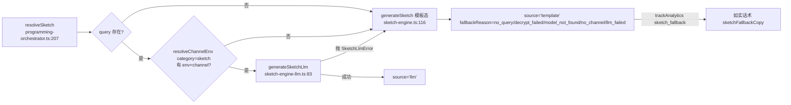
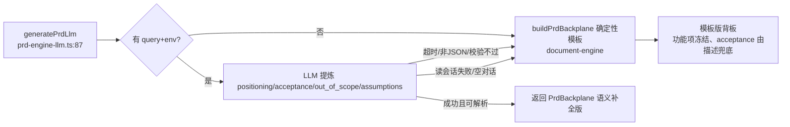
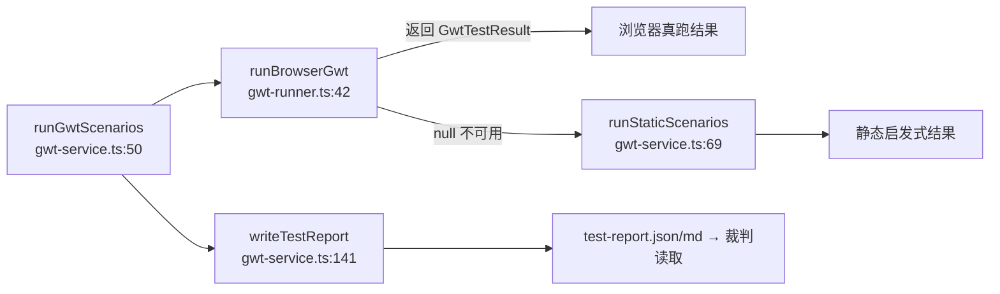
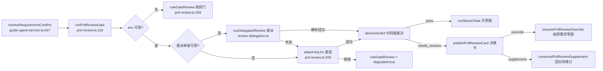
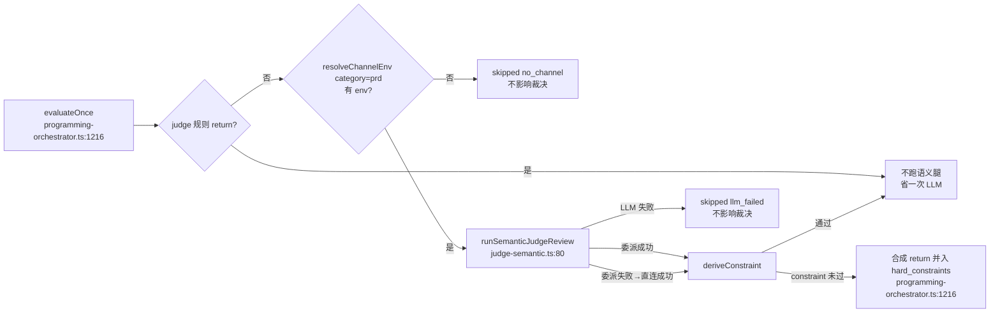
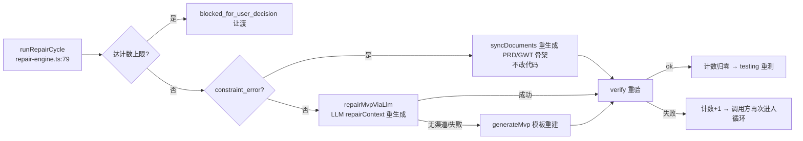

# 02 — 五引擎（生成与审查引擎内幕）

> 覆盖 Bloma 五个生成/审查引擎及其辅助模块：sketch（草图）/ prd（PRD 提炼）/
> mvp（MVP 骨架）/ gwt（测试执行）/ judge（裁判），外加 repair（修复）、
> prd-review（PRD 六维审查门）、judge-semantic（语义审查腿）与共享底座
> behavior-assertions（行为断言解析）。
>
> 图例与锚点约定见 `00-总索引.md` §2。每个引擎给出：**职责定位 / 输入输出契约 /
> 核心函数详细级伪代码 / 降级链**。文档间引用以 `01-用户旅程与编排.md` §x 为入口。
>
> **版本标注**：
> - `[sprint2]` 前缀 = 文件仅存在于 `origin/sprint2`（`prd-review.ts` / `judge-semantic.ts` / `review-delegation.ts`），当前分支未检出。
> - `[旧管道 c02e087^]` 前缀 = 文件在 commit `c02e087`「refactor(loop): 废旧管道转正——Agent Loop 唯一运行时」中被删除，锚点基于 `c02e087^` 版本；当前分支由 Agent Loop（`main/agent-loop.ts`）唯一运行时取代，此处保留旧逻辑供理解与参考。
> - 其余文件直接对应当前工作区（`test/delegation-s4-port`）。

---

## §0 五引擎总览与调用关系

```mermaid
flowchart TB
    subgraph 编排层["编排层（01 文档）"]
        RS[runSketchTask / resolveSketch]
        RM[runMvpTask / runMvpViaAgentLoop]
        RJ[runJudgeReview / evaluateOnce]
        RC[resolveRequirementConfirm<br/>guide-agent-service.ts:647]
        RT[runIterationTask / runAgentLoopPostTesting]
    end

    subgraph 生成引擎
        S1[sketch-engine.ts<br/>generateSketch 模板态]
        S2[sketch-engine-llm.ts<br/>generateSketchLlm LLM态]
        P[prd-engine-llm.ts<br/>generatePrdLlm]
        M1[旧管道 mvp-engine.ts<br/>generateMvp 模板态 c02e087^]
        M2[旧管道 mvp-engine-llm.ts<br/>generateMvpLlm c02e087^]
    end

    subgraph 审查引擎
        G[gwt-service.ts / gwt-runner.ts<br/>GWT 规划+真实执行]
        J[judge-engine.ts<br/>runJudge 规则引擎]
        JR[prd-review.ts [sprint2]<br/>PRD 六维审查门]
        JS[judge-semantic.ts [sprint2]<br/>语义审查腿]
        R[旧管道 repair-engine.ts<br/>runRepairCycle c02e087^]
    end

    subgraph 共享底座
        BA[behavior-assertions.ts<br/>parseBehaviorAssertion]
        DE[document-engine<br/>buildPrdBackplane / 骨架写盘]
    end

    RS --> S1 & S2
    RM --> M1 & M2
    RJ --> J
    RJ --> JS
    RC --> P
    RC --> JR
    P --> DE
    G --> BA
    J --> BA
    R --> M1 & M2
    R --> DE
```

**一句话定位**：sketch/mvp 是**生成侧**（LLM 优先、模板兜底）；gwt/judge/prd-review/judge-semantic 是**审查侧**（只判定不修改）；repair 是**修复侧**（读审查失败 → 针对性重生成）；behavior-assertions 是 GWT 与 judge 共用的解析底座。

---

## §1 草图引擎 sketch-engine（LLM 态 + 确定性模板双态）

### 1.1 职责定位

草图是**低成本方向确认**：产出「无交互纯外观」的单文件 HTML（内联 CSS 静态视觉稿），
让用户在「确认方向」阶段只判断"看起来像什么"，不判断"能不能点"。

双态实现：
- **LLM 态** `generateSketchLlm`（`main/sketch-engine-llm.ts:83`）——按需求清单+约束让模型生成真实产品外观，强约束「零交互」，后处理兜底剥离 `<script>`/`on*=`/内联 meta CSP；
- **模板态** `generateSketch`（`main/sketch-engine.ts:116`）——确定性模板，按功能项描述**启发式推断 UI 形态**（仪表盘/搜索/表单/列表/通用卡片）拼装静态外观，无任何 LLM 依赖。

来源分流由 `resolveSketch`（`main/programming-orchestrator.ts:207`，详见 01 §5.1）判定：
无 query / 渠道不可用 → 模板；LLM 失败（超时/非 HTML/网络）→ 模板回退，**绝不阻断草图产出**。

> 共享类型 `SketchRequirement`/`PrdBackplane`/`requirementStory`/`requirementAssertions`/
> `requirementPriority` 定义在 `main/sketch-engine.ts:13-97`，是五引擎的共同需求事实源。

### 1.2 输入/输出契约

| 态 | 输入 | 输出 | 失败语义 |
|---|---|---|---|
| LLM 态 | `GenerateSketchLlmInput{project_id, requirements, constraints?, query, env, sessionId, maxTokens?, timeoutMs?}` | `GenerateSketchLlmResult{files:[{path:'index.html'}], run_command:'node static-server', summary}` | 抛 `SketchLlmError`（携带逐次 `attempts` 明细），由 `resolveSketch` 回退模板 |
| 模板态 | `GenerateSketchInput{project_id, requirements, max_pages?}`（max_pages 夹到 1..3） | `GenerateSketchResult{files, run_command, summary}` | 同步纯函数，无失败路径 |

### 1.3 generateSketchLlm — `main/sketch-engine-llm.ts:83`

- **输入**：`GenerateSketchLlmInput`；依赖全局：`findProject(project_id).root_path`（写盘目标）
- **副作用**：流式累积模型文本；写盘 `{root_path}/index.html`；`console.log` 逐次尝试留痕；`loadPromptOverride('sketch-system')` 覆盖内置提示词；超时/取消经 `AbortController` 中止
- **返回值**：`GenerateSketchLlmResult`；失败抛 `SketchLlmError{attempts}`（`sketch-engine-llm.ts:49`）

```text
generateSketchLlm(input):
  timeoutMs = input.timeoutMs ?? 0           # 默认 0 = 不限时（2026-08-16 用户决策，停止按钮手动中止）
  prompt = buildPrompt(input.requirements, input.constraints)
  maxTokens = input.maxTokens ?? 16384;  truncated = false;  attempts = []

  for attempt in 0..<MAX_GENERATION_ATTEMPTS(=2):        # 首试 + 一次恢复重试
    selfController = new AbortController()
    timer = timeoutMs > 0 ? setTimeout(abort, timeoutMs) : undefined   # 超时预算按次发放（共享总预算会让重试只剩残余时间）
    accumulated = ''
    try:
      stream = input.query(prompt, { env, signal, sessionId,
                                     history: [system = loadPromptOverride('sketch-system') ?? DEFAULT_SYSTEM_PROMPT],
                                     maxTokens, temperature: categoryTemperature('sketch')=0.1 })
      for sdkMessage in stream:
        if assistant: accumulated += extractText(blocks)
    catch e:
      clearTimeout(timer)
      if selfController.signal.aborted: throw timeoutError()   # 超时语义
      throw e
    clearTimeout(timer)
    if selfController.signal.aborted: throw timeoutError()

    html = cleanSketchHtml(accumulated)      # 剥围栏 / 剥 <script> / 剥 on*= / 剥内联 meta CSP
    truncated = looksTruncated(html)         # 只有「已开始 <style> 但未闭合」才算截断；纯文本不算
    attempts.push({attempt, elapsed_ms, chars, truncated})
    if isHtmlDocument(html):                 # <style> + <html|body> + 以 </html> 闭合
      writeFileSync(join(root_path, 'index.html'), html)
      return { files:[{path:'index.html',content:html}], run_command:'node static-server', summary:'已按你的需求生成外观草图。' }
    if truncated: maxTokens = min(maxTokens * 2, 32768)       # 截断 → 加大 token 重试（绝不内容级修补）

  # 重试耗尽：按最后一种失败原因抛清晰错误（附逐次明细）
  if truncated: throw SketchLlmError('SKETCH_LLM_TRUNCATED', attempts)
  throw SketchLlmError('SKETCH_LLM_PARSE_FAILED', attempts)
```

> **要点**：
> - 生成失败**抛错向上**，由 `resolveSketch`（01 §5.1）捕获后回退确定性模板——草图不能因 LLM 故障卡死澄清流程；
> - `cleanSketchHtml` 兜底保证「零交互」铁律：剥离残留 `<script>`、内联 `on*=` 事件、与平台 CSP 冲突的内联 meta CSP（双 CSP 会拦截脚本）；
> - 时间限制由渲染端 WaitingFeedback + 停止按钮接管，引擎层无硬超时。

### 1.4 generateSketch — `main/sketch-engine.ts:116`（模板态）

- **输入**：`GenerateSketchInput{project_id, requirements, max_pages?}`；读取 `findProject(project_id)`
- **副作用**：写盘 `{root_path}/index.html`
- **返回值**：`GenerateSketchResult{files, run_command, summary}`

```text
generateSketch(input):
  project = findProject(input.project_id)
  requirements = normalizeRequirements(input.requirements)      # 空 → 兜底 [{id:'F-001', description:'把用户的想法整理成一个软件。'}]
  maxPages = clamp(input.max_pages ?? 3, 1, 3)
  pages = requirements.slice(0, maxPages)                        # 只展示前 maxPages 个功能区块
  html = renderSketchHtml(project.name, pages)
  writeFileSync(join(project.root_path, 'index.html'), html)
  return { files:[{path:'index.html', content:html}], run_command:'node static-server',
           summary:`已生成 ${pages.length} 个功能区块的外观草图。` }

renderSketchHtml(projectName, requirements):                    # sketch-engine.ts:146
  positioning = requirements[0]?.description ?? projectName      # F-001 描述即主题锚点
  for requirement in requirements:
    kind = inferUiKind(requirement.description)                  # 纯启发式（dashboard/search/form/list/generic）
    blocks += <section data-page="{id}">{blockTitle(desc)}</section> + renderUiBody(kind)
  # 整页 pointer-events:none; user-select:none —— 无交互，控件只看不动
  return 完整 HTML（topbar + hero + blocks + footer）
```

> `inferUiKind`（`sketch-engine.ts:239`）按关键词推断 UI 形态：统计/报表/趋势→dashboard；搜索/查询→search；
> 输入/添加/新增→form；列表/历史/明细→list；其余→generic。`escapeHtml`（`:299`）导出供 gwt/mvp 复用。

### 1.5 降级链



> 与 MVP「无模板兜底」不同，草图**必须有模板兜底**——低成本方向确认不能卡死澄清流程。
> 模板回退通过 `sketchFallbackCopy`（`main/programming-orchestrator.ts:254`）给用户如实话术。

### 1.6 辅助函数（摘要级）

- `buildPrompt`（`main/sketch-engine-llm.ts:159`）— 拼功能项清单（故事+行为断言，断言实体必须在界面可见）+ 用户约束段；约束说不做的界面元素一律不出现。
- `cleanSketchHtml`（`main/sketch-engine-llm.ts:197`）— 清洗模型 HTML：剥 markdown 围栏 / `<script>` 块 / `on*=` 事件 / 内联 meta CSP。
- `isHtmlDocument`（`main/sketch-engine-llm.ts:207`）— 判定输出是完整 HTML（`<style>` + `<html|body>` + `</html>` 结尾）；导出供恢复服务复用（T1 磁盘产物完整性校验）。
- `looksTruncated`（`main/sketch-engine-llm.ts:219`）— 判定模型输出被截断：有 `<style>` 但未闭合 / 以省略号或 `/* rest */` 结尾；只做结构判断不修补内容。
- `normalizeRequirements`（`main/sketch-engine.ts:133`）— 空需求兜底为单条 F-001 默认描述。
- `renderUiBody`（`main/sketch-engine.ts:248`）— 按 UI 形态渲染静态外观区块（无交互纯视觉占位）。
- `blockTitle`（`main/sketch-engine.ts:292`）— 功能项描述压缩为单行标题（>20 字截断）。
- `extractText`（`main/sketch-engine-llm.ts:227`）— 从 `MessageContentBlock` 提取文本块。

---

## §2 PRD 引擎 prd-engine-llm（需求对话 → PRD 背板语义补全）

### 2.1 职责定位

PRD 背板（`PrdBackplane`，`sketch-engine.ts:72`）是快消型的**唯一需求事实源**，供 MVP 生成、
GWT 派生与裁判校验复用同一份锚点。功能项（requirements）已由向导 Agent 在澄清阶段从对话
提取并冻结，本引擎**不重排、不改写功能项**（保住 F-001 主题锚点不变式，防"货不对板"），
只用 LLM 从对话中提炼确定性模板读不出的**语义信息**：
- `positioning`（产品定位一句话：目标用户+场景+价值）、
- `acceptance`（每功能项 2~4 条验收要点：正常路径 + 边界/异常各 ≥1）、
- `out_of_scope`（本轮明确不做的事，防下游擅自扩功能）、
- `assumptions`（后台决策假设，供 decisions 回溯）。

### 2.2 输入/输出契约

- **输入**：`GeneratePrdLlmInput{project_id, session_id, requirements, query, env, maxTokens?, signal?, timeoutMs?}`
- **输出**：`PrdBackplane | null`。**失败一律 `null`**（无 query / 模型不可用 / 超时 / 非 JSON / 校验不过），由调用方回退 `buildPrdBackplane` 确定性模板（`main/document-engine.ts`），**绝不阻断 MVP 生成链路**。
- 无渠道时 `name` 由调用方回填，此处占位。

### 2.3 generatePrdLlm — `main/prd-engine-llm.ts:87`

- **输入**：`GeneratePrdLlmInput`；读取 `readConversation(session_id)`（会话 JSONL 的可见 user/assistant 轮次）
- **副作用**：流式累积模型文本；内部 `AbortController` 超时（默认 0=不限时）+ 外部 signal 组合；`loadPromptOverride('prd-system')` 覆盖提示词
- **返回值**：`PrdBackplane | null`（优雅降级）

```text
generatePrdLlm(input):
  conversation = readConversation(input.session_id)
  if conversation 为空: return null                              # 无对话无话可提炼

  items = input.requirements 非空 ? input.requirements : [{id:'F-001', description:'一个可运行、可交互的功能页面'}]
  controller = new AbortController();  timer = timeoutMs>0 ? setTimeout(abort) : undefined
  signal = combineSignals(controller.signal, input.signal)       # 自建超时 + 外部取消任一触发即中止

  prompt = buildPrompt(items, conversation)                      # 冻结功能项 + 对话历史
  accumulated = ''
  try:
    stream = input.query(prompt, { env, signal, sessionId,
                                   history: [system = loadPromptOverride('prd-system') ?? DEFAULT_SYSTEM_PROMPT],
                                   maxTokens: input.maxTokens ?? 8192,
                                   temperature: categoryTemperature('prd')=0.1 })
    for sdkMessage in stream:
      if assistant: accumulated += extractText(blocks)
    if controller.signal.aborted: return null                    # 超时 → 优雅降级
    parsed = parsePrdJson(accumulated)                           # 剥围栏 → 截首尾 {} → JSON → 字段白名单
    if !parsed: return null
  catch: return null
  finally: clearTimeout(timer)

  acceptance = {}
  for item in items:
    acceptance[item.id] = parsed.acceptance[item.id]?.trim()
                        || `${item.description}：核心路径可交互，边界与异常输入不崩溃。`   # 单条兜底，保 GWT 可派生
  return { project_id, name:'', positioning: parsed.positioning.trim() || items[0].description,
           requirements: items, acceptance,
           out_of_scope: parsed.out_of_scope, assumptions: parsed.assumptions }
```

> **要点**：
> - `parsePrdJson`（`:150`）只做结构校验不纠错：剥 ```json 围栏 → 取首 `{` 到末 `}` → `JSON.parse` → 各字段类型过滤；解析失败返回 `undefined` → 调用方降级；
> - **不重排功能项**：`items` 原样透传，`acceptance` 以给定功能项 id 为 key 一一对应；
> - `readConversation`（`:199`）读取会话 JSONL，只收 user/assistant 可见轮次，剔除 `[terminal]`/system 标记。

### 2.4 降级链



> 模板版背板仍能产出 `requirements`（已冻结）与简单 `acceptance`，只是缺少对话级语义补全——降级不丢失功能项。

### 2.5 辅助函数（摘要级）

- `parsePrdJson`（`main/prd-engine-llm.ts:150`）— 稳健解析 LLM 输出 JSON，白名单字段类型过滤；失败返回 `undefined`。
- `buildPrompt`（`main/prd-engine-llm.ts:180`）— 拼冻结功能项清单 + 对话历史 + 提取任务要求。
- `readConversation`（`main/prd-engine-llm.ts:199`）— 读会话 JSONL 的可见轮次，转为「用户/助手：文本」行。
- `combineSignals`（`main/prd-engine-llm.ts:219`）— 组合自建超时 signal 与外部取消 signal（等价 `AbortSignal.any`）。
- `getSystemPrompt`（`main/prd-engine-llm.ts:83`）— 返回 `loadPromptOverride('prd-system') ?? DEFAULT_SYSTEM_PROMPT`。
- `extractText`（`main/prd-engine-llm.ts:233`）— 提取文本块。

---

## §3 MVP 引擎 mvp-engine / mvp-engine-llm `[旧管道 c02e087^]`

> **现状声明**：以下文件在 commit `c02e087`「废旧管道转正——Agent Loop 唯一运行时」被删除，
> 锚点基于 `c02e087^` 版本。当前分支 MVP 生成由 Agent Loop（`main/agent-loop.ts`，见 01 §6）
> 唯一运行时承载，**无模板兜底、无旧管道回退**。保留本节供：理解双契约输入 / 修复引擎对接 /
> 路径白名单安全模型 / 截断重试语义。

### 3.1 职责定位

从已确认需求生成正式 MVP 项目目录（对齐 api-spec §12.3 `generate_mvp`，输出 `files + run_command +
assumptions + risks`）。两态：
- **模板态** `generateMvp`（`main/mvp-engine.ts:36`）——确定性五文件骨架（`package.json` / `static-server.js` / `index.html` / `src/app.js` / `src/styles.css`），自包含纯前端，`npm start` 静态服务器启动，不依赖外部安装；
- **LLM 态** `generateMvpLlm`（`main/mvp-engine-llm.ts:125`）——模型输出 `{files:[{path,content}], run_command, assumptions, risks}`，**无模板兜底**（生成失败抛错向上；模板仅保留在 repair-engine 自动修复）。

### 3.2 输入/输出契约

| 态 | 输入 | 输出 | 失败语义 |
|---|---|---|---|
| 模板态 | `GenerateMvpInput{project_id, prd_path?, requirements?, template_type?}` | `GenerateMvpResult{files, run_command:'npm start', assumptions, risks}` | 同步纯函数 |
| LLM 态 | `GenerateMvpLlmInput{project_id, backplane, query, env, signal?, sessionId, maxTokens?, timeoutMs?, sketchHtml?, memory?, repairContext?}` | `GenerateMvpLlmResult{files, run_command, assumptions, risks}` | 抛错（超时/截断/非 JSON/空 files/路径非法/文件超限） |

**LLM 态关键约束**：
- **文件路径白名单**（`mvp-engine-llm.ts:69`）：模型可写仅 `index.html` + `src/*.js` + `src/*.css`（精确单层匹配）；`package.json`/`static-server.js` 为**系统接管文件**（`SYSTEM_FILES`，content 忽略、由系统写固定版）；
- **双契约输入**：PRD 背板（行为契约）+ UX 契约草图全文（视觉基准，不降采样），仲裁规则写死「行为优先、保持审美」；
- 系统提示词为 **Sisyphus 6 段式 + Hephaestus 常识补全**（TASK / EXPECTED OUTCOME / REQUIRED INPUTS / MUST DO / MUST NOT DO / CONTEXT），并注入硬块与反模式段（`prompts/shared.ts`）。

### 3.3 generateMvpLlm — `main/mvp-engine-llm.ts:125`

- **输入**：`GenerateMvpLlmInput`；读取 `findProject(project_id).root_path`（写盘目标）
- **副作用**：流式累积模型文本（最多 2 次尝试）；写盘 `package.json`/`static-server.js`（系统版）+ 白名单校验后的模型文件；`loadPromptOverride('mvp-system')` 覆盖提示词
- **返回值**：`GenerateMvpLlmResult`；失败抛 `Error`（`MVP_LLM_TIMEOUT` / `MVP_LLM_TRUNCATED` / `MVP_LLM_PARSE_FAILED` / `MVP_LLM_INVALID_OUTPUT` / `MVP_LLM_PATH_REJECTED` / `AGENT_CANCELLED`）

```text
generateMvpLlm(input):
  selfController = new AbortController();  timer = timeoutMs>0 ? setTimeout(abort) : undefined
  signal = combineSignals(selfController.signal, input.signal)
  try:
    prompt = buildPrompt(input.backplane, input.repairContext, input.sketchHtml, input.memory)
    maxTokens = input.maxTokens ?? 16384;  lastAccumulated='';  truncated=false

    for attempt in 0..<MAX_GENERATION_ATTEMPTS(=2):          # 首试 + 一次恢复重试
      accumulated = streamAccumulate(input, prompt, maxTokens, attempt, lastAccumulated, truncated, signal, selfController)
      if input.signal?.aborted: throw AGENT_CANCELLED        # 外部取消优先
      parsed = parseMvpJson(accumulated)
      if parsed:
        if parsed.files 为空: throw MVP_LLM_INVALID_OUTPUT（模型未返回任何文件）
        if parsed.files.length > MAX_FILES(=10): throw MVP_LLM_INVALID_OUTPUT（超上限）
        modelFiles = validateFilePaths(parsed.files)
        if !modelFiles: throw MVP_LLM_PATH_REJECTED          # 路径穿越/绝对路径/白名单外 → 整批拒绝
        finalFiles = [package.json=renderPackageJson(project.name),   # 系统接管，忽略模型 content
                      static-server.js=renderStaticServer(),
                      ...modelFiles.map(sanitizeModelFile)]  # sanitize：剥内联 meta CSP（平台 CSP 是唯一真相源）
        for file in finalFiles: mkdir + writeFileSync(join(root_path, file.path))
        return { files:finalFiles, run_command: parsed.run_command?.trim() || 'npm start',
                 assumptions: parsed.assumptions ?? [], risks: parsed.risks ?? [] }

      # 解析失败：区分截断与格式错误，决定重试策略
      truncated = looksTruncated(accumulated)                # 结构判断（括号深度/引号闭合/省略号结尾）
      lastAccumulated = accumulated
      if truncated: maxTokens = min(maxTokens*2, 32768)      # 截断 → 加大 token 全新重生成（内容不修补）

    if truncated: throw MVP_LLM_TRUNCATED
    throw MVP_LLM_PARSE_FAILED
  finally: clearTimeout(timer)

streamAccumulate(...):                                        # mvp-engine-llm.ts:197
  history = buildRetryHistory(...)                            # 截断→全新 system；格式错误→system+原prompt+坏输出回灌续问
  queryPrompt = (attempt==0 || truncated) ? prompt : RETRY_FEEDBACK_PROMPT
  stream = input.query(queryPrompt, { env, signal, sessionId, history, maxTokens, temperature:0.1 })
  for sdkMessage: if assistant: accumulated += extractText(blocks)
  if selfController.signal.aborted: throw MVP_LLM_TIMEOUT    # 自建 controller 先触发 → 超时语义
  return accumulated
```

> **要点**：
> - `validateFilePaths`（`:436`）— `isUnsafePath`（含 `..`/绝对路径/盘符）或白名单不匹配的非系统文件 → 返回 `null` 整批拒绝；系统接管文件**单文件忽略不整批拒绝**；
> - `sanitizeModelFile`（`:463`）— 剥模型写入 index.html 的内联 meta CSP（P1 修复：双 CSP 取交集会把内联脚本/eval 拦死）；
> - `DEFAULT_MAX_TOKENS=16384`（2026-08-16 线上实锤：三文件 JSON 8192 必溢出、隐性截断还骗过检测）。

### 3.4 generateMvp — `main/mvp-engine.ts:36`（模板态，摘要级）

`generateMvp`（`main/mvp-engine.ts:36`）— 渲染确定性五文件骨架并写盘：`renderPackageJson`（`:74`，slugify 项目名）、`renderStaticServer`（`:98`，带路径穿越防护 + CSP 网络隔离 `connect-src none`）、`renderIndexHtml`（`:139`，每功能项一个 `.feature` 卡片 + 添加表单）、`renderAppJs`（`:187`，localStorage 增删条目）、`renderStylesCss`（`:243`）；返回 `run_command:'npm start'` 与固定 assumptions/risks。

### 3.5 降级链

```mermaid
flowchart LR
    A[generateMvpLlm<br/>mvp-engine-llm.ts:125] --> B{首试解析成功?}
    B -->|是| OK[落盘 finalFiles 含系统文件+模型文件]
    B -->|否| C{截断?}
    C -->|是| D[maxTokens*2 重试一次]
    C -->|否| E[RETRY_FEEDBACK_PROMPT 带反馈重试]
    D -->|仍失败| F[抛 MVP_LLM_TRUNCATED / PARSE_FAILED]
    E -->|仍失败| F
    F -->|无模板兜底| G[调用方抛错向上 → 修复引擎 runRepairCycle [旧管道] 或 Agent Loop 修复预算]
```

> **注意**：旧管道里 `generateMvpLlm` 失败抛错 → `runRepairCycle` 用 `repairMvpViaLlm`（repairContext 注入）重生成 → 仍失败回退 `generateMvp` 模板重建（见 §8）。当前分支废旧管道转正后，此兜底不复存在，Agent Loop 是唯一运行时。

### 3.6 辅助函数（摘要级）

- `streamAccumulate`（`main/mvp-engine-llm.ts:197`）— 单次生成：流式累积 + 超时/取消语义区分（自建 controller 先触发=超时，外部 signal=取消）。
- `buildRetryHistory`（`main/mvp-engine-llm.ts:239`）— 截断走全新重生成（不加脏输出）；格式错误把坏输出作为 assistant 轮次回灌续问。
- `looksTruncated`（`main/mvp-engine-llm.ts:259`）— 括号深度/引号闭合扫描判断 JSON 是否被截断。
- `buildPrompt`（`main/mvp-engine-llm.ts:294`）— 拼装双契约 prompt：定位 + 功能项（故事/断言/优先级）+ 范围外 + 用户约束（T4-L1）+ 生成护栏 + UX 契约草图全文 + 仲裁规则 + 修复上下文 + 记忆段。
- `renderMemorySection`（`main/mvp-engine-llm.ts:377`）— T4-L3 对话性记忆三段合并 ≤12 条，冲突时以背板/约束/草图为准。
- `parseMvpJson`（`main/mvp-engine-llm.ts:402`）— 稳健解析模型 JSON（剥围栏 → 首尾大括号 → 过滤非法 files 条目）。
- `validateFilePaths` / `isUnsafePath`（`main/mvp-engine-llm.ts:436/450`）— 模型可写白名单校验与路径安全扫描。
- `sanitizeModelFile`（`main/mvp-engine-llm.ts:463`）— 剥 index.html 内联 meta CSP。
- `normalizeRequirements`（`main/mvp-engine.ts:69`）— 空需求兜底单条 F-001 默认描述。

---

## §4 GWT 引擎 gwt-service / gwt-runner（用例规划 + 真实执行）

### 4.1 职责定位

GWT（Given/When/Then）服务负责**用例规划 + 测试执行 + 报告写盘**：
- **骨架写盘**由 DocumentEngine（checkpoint `mvp_before_generation`）产出 `features/*.feature`，本模块不写骨架；
- **执行**：`runGwtScenarios`（`main/gwt-service.ts:50`）优先走 **Playwright 真实执行器**（`main/gwt-runner.ts:42`，逐条行为断言「模拟触发 → 断言状态变化」）；浏览器不可用 → 自动降级**静态启发式**（`runStaticScenarios`，fetch HTML/JS + 正则关键词）；
- **报告写盘**：`writeTestReport`（`gwt-service.ts:141`）唯一写盘 `test-report.json`/`test-report.md`（schema 对齐 api-spec §12.4），供裁判读取。

逐条行为断言的解析底座是 `behavior-assertions.ts`（§9）。

### 4.2 执行链总览



### 4.3 runGwtScenarios — `main/gwt-service.ts:50`（摘要级，入口见 01 §7.3）

`runGwtScenarios`（`main/gwt-service.ts:50`）— 执行 GWT 场景：`runBrowserGwt` 优先，返回 `null` 则 `runStaticScenarios` 兜底；返回 `GwtTestResult{total_count, passed_count, failed_count, failure_summary, unverified?}`。

### 4.4 runBrowserGwt — `main/gwt-runner.ts:42`（Playwright 真实执行器）

- **输入**：`RunGwtInput{project_id, session_id, preview_url?}`；读取 `readLastSketchRequirements(project_id)`
- **副作用**：动态 `import('playwright')` 拉起 chromium 无头；`browserAvailable` 模块级缓存（首次失败后置 false，后续修复验证不再重复尝试启动）；收集页面 `pageerror`（运行时报错）
- **返回值**：`GwtTestResult | null`（不可导入 / chromium 未装 / 启动失败 / 导航失败 / 无 preview_url → `null`）

```text
runBrowserGwt(input):
  if disabledForTests: return null          # [本地] 测试 seam：单测固定走静态兜底
  if browserAvailable === false: return null   # 首次失败缓存，避免重复尝试启动
  if !input.preview_url: return null
  try:
    chromium = await import('playwright')    # 动态导入：不进 esbuild 主进程 bundle
    browser = await chromium.launch({ headless: true })
  catch: browserAvailable = false; return null
  browserAvailable = true
  try: return executeScenarios(browser, input)
  catch: return null                        # 导航/执行异常 → 降级静态
  finally: await browser.close()

executeScenarios(browser, input):           # gwt-runner.ts:86
  scenarios = planScenarios(readLastSketchRequirements(project_id))   # 每个功能项每条断言各成一个场景
  page = await browser.newPage()
  pageErrors = [];  page.on('pageerror', push)                        # 捕获未捕获异常
  try:
    await page.goto(preview_url, { waitUntil:'domcontentloaded', timeout:10_000 })
    for scenario in scenarios:
      errorsBefore = pageErrors.length
      reason = await runScenario(page, scenario)                      # 逐条断言执行
      if reason === undefined: passedCount += 1; continue
      runtimeError = pageErrors.length>errorsBefore ? `页面运行时报错：${pageErrors[errorsBefore]}` : undefined
      failure_summary.push({ scenario: scenarioName(item.id, assertion), reason: runtimeError ?? reason })
    return { total_count, passed_count, failed_count, failure_summary }
  finally: await page.close()
```

### 4.5 runScenario — `main/gwt-runner.ts:128`（单条断言执行）

- **输入**：`page` + `ScenarioPlan{item, assertion, plan}`（`plan` 来自 `parseBehaviorAssertion`）
- **副作用**：页面键盘事件派发 / 控件点击；150ms 交互生效等待；页面状态快照（元素签名→位置 + 可见元素数 + 全文）
- **返回值**：`undefined` = 通过；`string` = 失败原因（「触发→预期效果→实际」三层，供裁判退回与修复定位）

```text
runScenario(page, scenario):
  if plan.presenceFallback 或 无 trigger 或无 effect:
    # 存在性兜底（默认断言/解析不出）：渲染文本含功能项故事，或页面有交互控件
    renderedText = readRenderedText(page)
    if renderedText.includes(requirementStory(item)) or hasInteractiveControl(page): return undefined
    return `页面缺少功能入口：${requirementStory(item)}`

  before = capturePageState(page)            # 元素签名+坐标 + visibleCount + 全文
  triggerError = dispatchTrigger(page, plan.trigger)
  if triggerError: return triggerError        # 如「找不到可点击的控件」
  await page.waitForTimeout(150)             # CSS transition / rAF 后再采样
  after = capturePageState(page)
  return checkEffect(scenario, before, after)

checkEffect(scenario, before, after):       # gwt-runner.ts:204 效果探针
  fail(actual) = `断言未满足：${assertion}（预期${describeEffect(effect)}，实际${actual}）`
  # 位移类：按「元素签名→坐标」逐一比对，水平/垂直位移 ≥2px 判通过
  move-right/left  : 任一元素 x 增量 ≥2 / ≤-2 → 通过，否则 fail('没有任何元素发生水平位移')
  move-up/down     : 任一元素 y 增量 ≤-2 / ≥2 → 通过，否则 fail('没有任何元素发生垂直位移')
  hide             : before 有元素 sig 不在 after → 通过，否则 fail('没有元素消失或隐藏')
  show             : after 有新元素 → 通过，否则 fail('没有新元素出现')
  add-item         : after.visibleCount > before.visibleCount → 通过，否则 fail('可见元素数没有增加')
  text-change      : after.text !== before.text → 通过，否则 fail('页面文字没有任何变化')
```

> **要点**：`dispatchTrigger`（`gwt-runner.ts:174`）按键类派发 `keydown+keyup` 到 `document` 与 `activeElement`；点击类按文本/语义 class 找控件，找不到返回失败原因。`capturePageState`（`:154`）上限采样 500 个元素防超大 DOM 拖垮探针。

### 4.6 runStaticScenarios — `main/gwt-service.ts:69`（静态启发式兜底）

- **输入**：`RunGwtInput`；读取 `readLastSketchRequirements(project_id)`；同源 fetch `preview_url` 的 HTML 与 `src/app.js`
- **副作用**：网络 fetch（2s 超时）
- **返回值**：`GwtTestResult`（含 `unverified` 信息性字段）

```text
runStaticScenarios(input):
  requirements = readLastSketchRequirements(project_id)
  html = preview_url ? fetchHtml(preview_url) : undefined        # 2s 超时，失败 undefined
  appJs = preview_url ? fetchAppJs(preview_url) : undefined      # 同源 /src/app.js
  artifact = html + appJs
  functionalEntry = html!==undefined && appJs!==undefined && hasInteractiveEntry(html, appJs)

  for scenario in planScenarios(requirements):
    if plan.presenceFallback 或 无 effect:
      # 存在性断言：需求原文转义匹配（模板产物）或整体交互入口（LLM 产物）一票通过
      ok = html!==undefined && (html.includes(escapeHtml(description)) || functionalEntry)
      ok ? passedCount+=1 : failure_summary.push({scenario, reason: html===undefined?'预览不可访问':`页面缺少功能入口：${description}`})
    else:
      # 行为断言：效果关键词出现在产物全文 → 静态确认
      keywordHit = plan.effect.keywords.some(kw => artifact.includes(kw))
      keywordHit ? passedCount+=1 : (unverified.push(name); passedCount+=1)   # 未命中 → 待评估不计失败
  return { total_count, passed_count, failed_count, failure_summary, ...(unverified.length?{unverified}:{}) }
```

> **要点**：行为断言关键词未命中 → **待评估不计失败**（防 SVG/canvas/@keyframes 等不落关键词的合法实现被误退回）；真实行为判定交给浏览器执行器——它不可用时**宁可放过不可误杀**。

### 4.7 辅助函数（摘要级）

- `planScenarios`（`main/gwt-runner.ts:68`）— 组装逐断言执行计划：每个功能项每条 `behavior_assertion` 各成一个 `{item, assertion, plan}` 场景。
- `scenarioName`（`main/gwt-runner.ts:82`）— 场景名 `${itemId} ${assertion}`，judge 按此前缀对账运行证据。
- `capturePageState`（`main/gwt-runner.ts:154`）— 页面状态快照：元素签名→位置 + 可见元素数 + 全文（效果探针比对基础）。
- `dispatchTrigger`（`main/gwt-runner.ts:174`）— 派发触发器：按键派发到 document（keydown+keyup）；点击按文本/语义 class 找控件。
- `checkEffect`（`main/gwt-runner.ts:204`）— 效果探针：按效果种类比对前后状态，返回失败原因或 `undefined`（通过）。
- `readRenderedText` / `hasInteractiveControl`（`main/gwt-runner.ts:257/262`）— 读取渲染后 innerText / 检测页面是否有交互控件。
- `setBrowserGwtDisabledForTests`（`main/gwt-runner.ts:31`）— `[本地]` 测试 seam：单测强制走静态兜底路径。
- `hasInteractiveEntry`（`main/gwt-service.ts:133`）— 判定页面是否提供可交互功能入口（控件 + 脚本逻辑），供 gwt 与 judge 共用；兜底覆盖「LLM 措辞与需求原文不同」导致的假阴性。
- `writeTestReport` / `readTestReport`（`main/gwt-service.ts:141/155`）— 唯一写盘 `test-report.json/md` / 读取最近报告（供裁判）。
- `fetchHtml` / `fetchAppJs`（`main/gwt-service.ts:180/116`）— 同源拉取预览 HTML 与 `src/app.js`（2s 超时）。

---

## §5 裁判引擎 judge-engine（规则引擎 runJudge）

### 5.1 职责定位

裁判**只判定、不修改代码**。`runJudge`（`main/judge-engine.ts:52`）读磁盘产物 + PRD 背板 +
GWT 测试报告 + Agent Loop 元数据，输出 `JudgeVerdict{verdict: pass|suggest|return, hard_constraints,
soft_constraints, user_visible_summary, repairable}`。

约束体系：
- **硬约束**（任一失败 → `return` 退回，`repairable:true`）：
  ① PRD 背板存在且核心功能项非空；
  ② 每个功能项至少有 1 个 GWT 场景覆盖（P0 严格）；
  ③ P0 行为断言可满足性（存在性基线 + 运行证据优先 + 静态确认兜底，见 5.3）。
- **软约束**（失败 → `suggest` 不退回）：测试结果全过；精致度代理（UX 契约存在时：产物规模 ≥ 草图 50% + 草图 class 覆盖率 ≥ 30%）。
- **M4-B loop-aware**：loop 未正常收尾（`turn_limit`/`budget_exhausted`/`cancelled`）→ 硬约束失败且 `repairable:false`——产物即使"能跑"也不放行，**绝不凭模型自述放行**。

### 5.2 runJudge — `main/judge-engine.ts:52`

- **输入**：`JudgeInput{project_id, mode, test_result?, loop?}`；读取：`readPrdBackplane`、`readGwtFeatureIds`、产物全文 `readArtifactText`、`index.html`、`src/app.js`
- **副作用**：纯函数无副作用（只判定）；产出约束对象供上层决策
- **返回值**：`JudgeVerdict`

```text
runJudge(input):
  # ---- M4-B loop-aware 分支（在磁盘读判之前）----
  if input.loop && input.loop.status != 'completed':
    return { verdict:'return',
             hard_constraints:[{name:'Agent Loop 完成状态', passed:false,
                                detail:`自动生成未正常收尾（${loopStatusLabel(status)}，${turns} 轮）`}],
             soft_constraints:[], user_visible_summary:`自动生成没有正常收尾，需要你决定怎么处理。`,
             repairable:false }                       # 不信模型自述：产物能跑也不放行

  project = findProject;  backplane = readPrdBackplane;  requirements = backplane.requirements
  featureIds = readGwtFeatureIds(project_id)

  # ── 硬约束①：背板存在 ──
  prdPresent  = { name:'PRD 核心功能项', passed: requirements.length>0, detail: 含N个/还没有功能项 }

  # ── 硬约束②：GWT 覆盖（每个功能项都应有 feature 骨架）──
  missingGwt = requirements.filter(item => !featureIds.includes(item.id))
  gwtCoverage = { passed: missingGwt.length===0, detail: 全部有/缺少 GWT 场景：... }

  # ── 硬约束③：P0 行为断言可满足性（§8.1 行为门禁，见 5.3）──
  artifact = readArtifactText(root_path)   # index.html + src/*.js|css 拼接
  codeConsistency = evaluateBehaviorAssertions(requirements, indexHtml, appJs, artifact, input.test_result)

  # ── 软约束 ──
  soft = []
  if input.test_result:
    soft.push({ name:'测试结果', passed: failed_count===0, detail: 全过/仍 N 项未通过 })
  refinement = evaluateRefinementProxy(project_id, backplane.ux_contract, indexHtml, artifact)   # UX 契约存在时才判
  if refinement: soft.push(refinement)

  hardFailed = hard.filter(!passed)
  if hardFailed: return { verdict:'return', ..., user_visible_summary: 各失败 detail 拼接, repairable:true }
  softFailed  = soft.filter(!passed)
  if softFailed: return { verdict:'suggest', ..., repairable:false }
  return { verdict:'pass', ..., user_visible_summary:'核心功能都已对齐，可以继续。', repairable:false }
```

### 5.3 evaluateBehaviorAssertions — `main/judge-engine.ts:149`（硬约束③三档判定）

- **输入**：`requirements`、`indexHtml`、`appJs`、`artifact`（全文）、`testResult?`
- **返回值**：`JudgeConstraint`

```text
evaluateBehaviorAssertions(requirements, indexHtml, appJs, artifact, testResult):
  functionalEntry = hasInteractiveEntry(indexHtml, appJs)
  failedScenarios = testResult?.failure_summary ?? []

  # 0) 存在性基线：任何功能项既无原文匹配又无整体交互入口 → 退回（保留改造前防线）
  missingEntry = requirements.filter(item => !(indexHtml.includes(escapeHtml(item.description)) || functionalEntry))
  if missingEntry: return { passed:false, detail:`页面缺少入口：${ids}` }

  # 1) 运行证据优先（§8.1）：行为脚本报告里该断言的场景失败 → 退回（P3「车不位移」在此关门）
  for item in p0Items(= requirementPriority(item)=='P0'):
    for assertion in requirementAssertions(item):
      if failedScenarios.some(f => f.scenario.startsWith(`${item.id} `) && f.scenario.includes(assertion)):
        runtimeFailed.push(`${item.id} ${assertion}`)
  if runtimeFailed: return { passed:false, detail:`行为断言未通过（运行验证）：${...}` }

  # 2) 静态启发式（无运行证据时的兜底确认）：关键词命中 → 确认；未命中 → 待评估不退回
  for item in p0Items:
    for assertion in requirementAssertions(item):
      plan = parseBehaviorAssertion(assertion)
      if plan.presenceFallback 或 无 effect: continue            # 非行为断言不算静态确认数
      behavioral += 1
      plan.effect.keywords.some(kw => artifact.includes(kw)) ? confirmed+=1 : pending.push(`${item.id} ${assertion}`)
  return { passed:true, detail: behavioral>0
            ? `P0 行为断言 ${confirmed}/${behavioral} 静态确认${pending?'；待评估：'+pending:''}`
            : '功能项在页面中有对应入口' }
```

> **三档降级**：运行证据（浏览器真跑失败）→ 退回；无运行证据 → 静态关键词确认；关键词未命中 → **待评估不退回**
> （防 SVG/canvas/@keyframes 等不落关键词的合法实现被误杀，由行为脚本/人工兜底）。

### 5.4 降级链：规则 → 语义腿

```mermaid
flowchart LR
    A[evaluateOnce<br/>programming-orchestrator.ts:1216] --> B[judgeOnce=runJudge 规则引擎<br/>judge-engine.ts:52]
    B -->|verdict=return 或 无 query| C[返回规则裁决<br/>不跑语义腿]
    B -->|规则全绿且有 query| D[runSemanticJudgeReview<br/>judge-semantic.ts:80 [sprint2]]
    D -->|skipped| C
    D -->|constraint 未过| E[合成 return 并合并 hard_constraints]
    D -->|通过| C
```

> `evaluateOnce`（01 §7.2）负责编排：**规则先行**——规则 return 或渠道不可用时省一次 LLM 调用；
> 语义审查腿只在规则全绿后把关「做没做对」，详见 §7。

### 5.5 辅助函数（摘要级）

- `evaluateRefinementProxy`（`main/judge-engine.ts:223`）— 精致度软约束：UX 契约存在时比较①产物规模 ≥ 草图 50% ②草图 class 覆盖率 ≥ 30%；失败 → suggest 不退回。
- `extractCssClasses`（`main/judge-engine.ts:250`）— 提取 HTML 内联 `<style>` 与 class 属性的 CSS 类名（去重）。
- `loopStatusLabel`（`main/judge-engine.ts:264`）— loop 异常终止态 → 用户可读标签（turn_limit/budget_exhausted/cancelled）。
- `readGwtFeatureIds`（`main/judge-engine.ts:278`）— 读 `documents/{project_id}/features/` 下 `.feature` 文件 id 列表。
- `readArtifactText`（`main/judge-engine.ts:288`）— 拼接 `index.html` + `src/*.js|css` 全文（供关键词检查）。
- `readProjectHtml` / `readProjectAppJs`（`main/judge-engine.ts:304/314`）— 读产物根目录 HTML / `src/app.js`（单文件失败返回空串）。

---

## §6 PRD 六维审查门 prd-review `[sprint2]`

### 6.1 职责定位

PRD 裁判审查门——**简化版 AC 对抗审计**（方法论来源：用户指定的 ac-audit skill，运行时按用户要求精简为单轮、秒级、独立一次模型请求）。在 `resolveRequirementConfirm`（01 §4.2）中 **PRD 落盘后、草图前**执行：
- **审查者 ≠ 生成者**（AC 铁律）：独立一次模型请求，绝不并进 PRD 生成调用自查；
- **只判定不修复**：不提供修复方案（修复是用户与向导的事）；
- **永不阻断主流程**：未过 → 弹决策卡（忽略继续 / 我来补充说明），用户主权定夺。

裁决规则（**代码级**，不信任模型自报宽松结论）：issues 中存在 `blocking`/`major` → `needs_revision`；否则 `pass` → 草图。

### 6.2 PRD_REVIEW_SYSTEM_PROMPT — 六维攻击面 + PRD 权重

`main/prd-review.ts:89`。保留的 AC 精髓：六维攻击面 + 严重度分级 + 每条 issue 必须引用 PRD 原文证据 + 判定边界速记 + 禁编造/禁提修复方案 + 诚实降级标注 `simplified_ac`。砍掉：多轮循环 / Defender 修复循环 / 双 Arbiter / Prober / 金丝雀 / 重叠度实测 / 指纹回显 / dry-run 副本（PRD 不被修改）。

| 维度 | 权重 | 攻击面 |
|---|---|---|
| **F 保真** | 30% | PRD 是否忠实于【用户确认的需求清单】——缺项、改偏、擅自加戏 |
| **U 可懂** | 20% | 歧义、一义多解、未定义术语 |
| **L 闭环** | 15% | 功能路径不闭环（如只有添加没有查看/删除） |
| **G 护栏** | 15% | 无可客观度量的验收（「要快」「要好用」）、缺失边界情形 |
| **I 自洽** | 10% | 条目间相互矛盾 |
| **Z 可造** | 10% | 违反工程常识（「零延迟」「无限容量」） |

严重度：`blocking`（无法开工/核心缺失）> `major`（会做错方向）> `minor` > `suggestion`。
火力纪律：blocking/major 合计通常 0~3 个；把整份需求说得一无是处通常是过度攻击，不是严格。
某维找不到缺陷 → 记入 `clean_dimensions`，**禁止编造**。
判定边界速记：换名不矛盾（归 U）；「很难但有可能」只标 suggestion；需求文档不要求给实现方案。

### 6.3 runPrdReviewGate — `main/prd-review.ts:119`

- **输入**：`{backplane, confirmedRequirements, query, env, sessionId, signal?, maxTokens?, projectId?, requestId?, publish?}`
- **副作用**：可能派发委派子 agent（`runDelegatedReview`，协作面板 DelegationFeed 可视化）；`recordDecision` 由调用方/卡片处理记录
- **返回值**：`PrdReviewOutcome{verdict: pass|needs_revision, issues, mode: llm|rules, via?: delegation|direct, degraded?}`
- **降级链**：委派审查 → 直连 LLM → 确定性规则门（`degraded:true`）；**永不抛错**

```text
runPrdReviewGate(opts):
  if !opts.env:
    return ruleGateReview(backplane)                    # 渠道不可用 → 规则门（不算 degraded——如实降级）

  # ① 委派审查（默认，DelegationFeed 可视化；解析失败/委派失败落直连）
  if delegatedReviewEnabled() and projectId/requestId/publish 齐备:
    delegated = await runDelegatedReview({ goal:`裁判六维审查 PRD：${backplane.name}`,
                                           task: buildPrdReviewTask(backplane, confirmedRequirements),
                                           system: PRD_REVIEW_SYSTEM_PROMPT, query, env, sessionId,
                                           projectId, requestId, publish })
    if delegated.ok and delegated.finalText:
      try:
        issues = parseReviewIssues(delegated.finalText)          # 剥头行/白名单校验
        return { verdict: deriveVerdict(issues), issues, mode:'llm', via:'delegation' }
      catch: console.error('委派审查输出不可解析，回退直连')

  # ② 直连单次请求（内联 PRD 全文 + 用户确认清单）
  try:
    issues = await attackViaLlm({backplane, confirmedRequirements, query, env, sessionId, signal, maxTokens})
    return { verdict: deriveVerdict(issues), issues, mode:'llm', via:'direct' }
  catch:
    console.error('LLM 审查失败，降级规则门')
    return { ...ruleGateReview(backplane), degraded:true }      # 规则门 + degraded 标记（与无渠道区分）
```

> **委托方视角**：`runDelegatedReview`（`main/review-delegation.ts` `[sprint2]`）是委派化封装——目标=「裁判六维审查 PRD」，
> 任务=审查任务体，system=攻击提示词；子 agent 用只读工具查证，最终文本交给 `parseReviewIssues` 解析。

### 6.4 deriveVerdict — `main/prd-review.ts:170`（代码级裁决）

- **输入**：`issues: PrdReviewIssue[]`
- **返回值**：`'pass' | 'needs_revision'`

```text
deriveVerdict(issues):
  return issues.some(issue => issue.severity === 'blocking' || issue.severity === 'major')
       ? 'needs_revision'    # 任一 blocking/major → 退回
       : 'pass'              # 只有 minor/suggestion → 放行（宁松勿严，不拦小瑕疵）
```

> **要点**：**不信任模型自报的宽松结论**——无论模型输出多少 issue、自评多自信，代码只认严重度字段；
> `minor`/`suggestion` 不构成退回，保证审查门不会因琐碎意见卡住用户。

### 6.5 ruleGateReview — `main/prd-review.ts:268`（确定性规则门降级）

- **输入**：`backplane: PrdBackplane`
- **返回值**：`PrdReviewOutcome{mode:'rules', issues, verdict}`（由 `deriveVerdict` 收口）
- **降级语义**：LLM 不可用时**只拦硬伤，宁松勿严**——规则门不追求全面，只求把结构性空壳拦下

```text
ruleGateReview(backplane):
  issues = []
  positioning = backplane.positioning?.trim()
  if !positioning:
    issues.push({dimension:'F', severity:'blocking', location:'positioning',
                 claim:'PRD 缺少产品定位', evidence:['positioning 为空']})
  requirements = backplane.requirements ?? []
  if requirements.length === 0:
    issues.push({dimension:'F', severity:'blocking', location:'requirements',
                 claim:'PRD 没有任何功能项', evidence:['requirements 为空数组']})
  seen = Map<description, id>
  for item in requirements:
    description = item.description?.trim()
    if description.length < 4:
      issues.push({dimension:'U', severity:'major', location:item.id,
                   claim:`功能项「${item.id}」描述过短，无法理解要做什么`, evidence:[description||'（空）']})
    duplicated = seen.get(description)
    if duplicated and description.length >= 4:
      issues.push({dimension:'I', severity:'major', location:item.id,
                   claim:`与 ${duplicated} 描述完全相同，疑似重复项`, evidence:[description]})
    else: seen.set(description, item.id)
  return { verdict: deriveVerdict(issues), issues, mode:'rules' }
```

> 规则面有限：定位空 / 需求空 → blocking；描述 <4 字 / 完全重复 → major。这些是结构性硬伤，
> 规则门可确定检出；语义级缺陷仍靠 LLM 攻击面（有渠道时）。

### 6.6 parseReviewIssues — `main/prd-review.ts:233`（稳健解析）

- **输入**：`text`（模型/委派最终文本）
- **副作用**：无；解析失败**抛错**（由调用方回退直连或规则门）
- **返回值**：`PrdReviewIssue[]`

```text
parseReviewIssues(text):
  cleaned = text 剥 ```json 围栏 + trim
  start = cleaned.indexOf('{');  end = cleaned.lastIndexOf('}')
  if start<0 or end<=start: throw PRD_REVIEW_PARSE_FAILED（无 JSON 对象）
  try: parsed = JSON.parse(cleaned.slice(start, end+1))
  catch: throw PRD_REVIEW_PARSE_FAILED（JSON 解析失败）

  dimensions = {I,F,Z,U,L,G};  severities = {blocking,major,minor,suggestion}
  for raw in parsed.issues（非数组→[]）:
    dimension/severity/claim 校验：维度∈白名单 且 严重度∈白名单 且 claim 非空，否则丢弃
    issues.push({dimension, severity, location: item.location?.trim().slice(0,80),
                 claim: claim.slice(0,200), evidence: 字符串数组前 3 条})
  return issues
```

> 白名单校验防御模型幻觉（乱编维度/严重度/空 claim 一律丢弃）。

### 6.7 审查未过 → 决策卡与回传

- `publishPrdReviewCard`（`main/prd-review.ts:299`）— 未过：写 `pendingPrdReviews` Map（project_id 为键）+ `recordDecision(prd_review)` + 发 `user_decision_required{kind:'prd_review'}` 决策卡（问题摘要说人话，最多列 3 条；选项=忽略继续 `PRD_REVIEW_OPTION_OVERRIDE` / 我来补充说明 `PRD_REVIEW_OPTION_SUPPLEMENT`）。
- `resolvePrdReviewCardAnswer`（`main/prd-review.ts:379`）— 识别卡片回传（`metadata.source==='card_option'` 且 selected_option_id 命中本卡选项且存在 pending），否则返回 `undefined` 放行常规路径。
- `resumePrdReviewOverride`（`main/prd-review.ts:393`）— 用户选择忽略：`takePendingPrdReview` 取走 pending → `recordDecision(prd_review_overridden)` → 按原需求 `runSketchTask` 开草图（用户主权，不硬拦）。
- `consumePrdReviewSupplement`（`main/prd-review.ts:427`）— 用户选择补充：取走 pending 返回，调用方提示打字补充，需求修订后重新走确认流程。
- `takePendingPrdReview` / `hasPendingPrdReview`（`main/prd-review.ts:70/76`）— pending 取走即删（防重复消费）/ 存在性判断（防重启丢失后误拦截）。

### 6.8 降级链总览



> 委派 → 直连 → 规则门逐级下落；**永不阻断主流程**（最坏情况 = 规则门 + degraded 标记，PRD 仍可过）。

### 6.9 辅助函数（摘要级）

- `buildPrdReviewTask`（`main/prd-review.ts:177`）— 审查任务体（委派与直连共用）：PRD 全文（背板 JSON）+ 用户确认清单（F 维对照基准）。
- `attackViaLlm`（`main/prd-review.ts:205`）— 直连攻击轮：`PRD_REVIEW_SYSTEM_PROMPT + task` 单次请求（maxTokens 2048 / temperature 0.1），流式累积后 `parseReviewIssues`。
- `makeReviewEvent`（`main/prd-review.ts:443`）— 组装 `AgentEvent`（message_delta/message_completed）供 override 路径上屏。

---

## §7 语义审查腿 judge-semantic `[sprint2]`

### 7.1 职责定位

MVP **语义审查腿**——审「生成的产物是否忠实实现了 PRD 的每个功能项」（语义级做偏/做漏/做错），
与 prd-review（审 PRD **文档质量**的六维 AC 审计）刻意区分。定位与边界：
- 归**裁判域**：只判定、不修复、不提修复方案；结果合成进 `runJudgeReview` 的既有裁决流（退回计数 / 修复循环 / 让渡，见 01 §7.2），**不另立门禁**；
- **规则先行**：judge 规则引擎 `return` 时本腿不跑（省一次 LLM 调用）——规则硬伤先修，语义审查只在规则全绿后把关「做没做对」；
- **防误杀**：不确定 → `unverified`（不算失败）；证据必须引用产物代码；LLM 失败/无渠道 → **跳过并留痕，绝不阻断交付**。

### 7.2 runSemanticJudgeReview — `main/judge-semantic.ts:80`

- **输入**：`{backplane, artifact, testSummary?, query, env, sessionId, signal?, projectId?, requestId?, publish?}`
- **副作用**：可能派发委派子 agent（只读工具自查产物，不受 24k 内联截断限制）；`console.error` 留痕
- **返回值**：`SemanticJudgeResult{constraint: JudgeConstraint|null, findings, skipped, skipReason?: 'no_channel'|'llm_failed', via?: 'delegation'|'direct'}`
- **降级链**：无 env → skipped(`no_channel`)；委派 → 直连 → LLM 失败 → skipped(`llm_failed`)；**永不抛错**

```text
runSemanticJudgeReview(opts):
  if !opts.env:
    return { constraint:null, findings:[], skipped:true, skipReason:'no_channel' }   # 无渠道跳过（不算失败）

  # ① 委派审查（默认，DelegationFeed 可视化）：子 agent 用只读工具自行查证产物
  if delegatedReviewEnabled() and projectId/requestId/publish 齐备:
    delegated = await runDelegatedReview({ goal:`裁判语义审查产物 vs PRD：${backplane.name}`,
                                           task: buildDelegatedJudgeTask(backplane, testSummary),
                                           system: SEMANTIC_JUDGE_SYSTEM_PROMPT, query, env, sessionId,
                                           projectId, requestId, publish })
    if delegated.ok and delegated.finalText:
      try:
        findings = parseSemanticFindings(delegated.finalText, backplane.requirements ?? [])
        return { constraint: deriveConstraint(findings, requirements), findings, skipped:false, via:'delegation' }
      catch: console.error('委派审查输出不可解析，回退直连')

  # ② 直连（内联产物，截断 ARTIFACT_CHAR_LIMIT=24000 字符并在 prompt 如实标注）
  try:
    findings = await judgeViaLlm({backplane, artifact, testSummary, query, env, sessionId, signal})
    return { constraint: deriveConstraint(findings, requirements), findings, skipped:false, via:'direct' }
  catch:
    console.error('LLM 语义审查失败，跳过（不影响裁决）')
    return { constraint:null, findings:[], skipped:true, skipReason:'llm_failed' }
```

> **委派 vs 直连的关键差异**：委派版任务（`buildDelegatedJudgeTask`，`:131`）只内联 PRD 功能项
> （含优先级与行为断言），产物改为**子 agent 用 read_file/list_files/grep 只读自查**（物理不可改文件），
> 不受 24k 内联截断限制；直连版（`judgeViaLlm`，`:151`）把产物全文内联进 prompt，超长截断前 24000 字符。

### 7.3 deriveConstraint — `main/judge-semantic.ts:228`（严重度代码级推导）

- **输入**：`findings: SemanticFinding[]`、`requirements: SketchRequirement[]`
- **返回值**：`JudgeConstraint | null`（合成进 `JudgeVerdict.hard_constraints`）
- **严重度推导**（代码级，不信任模型自报结论）：

| 功能项优先级 | 状态 | 严重度 | 说明 |
|---|---|---|---|
| P0 | `missing` / `deviated` | **blocking** | 核心功能未实现/做偏 → 退回 |
| P0 | `partial` | **major** | 核心功能只实现一部分 |
| P1 | `missing` / `deviated` | **major** | 重要功能缺失/做偏 |
| P1 | `partial` | major | 重要功能不完整 |
| P2 | 任一非 implemented | 备注（notes） | 不构成失败 |
| 任意 | `unverified` | 备注（notes） | 无法从代码判断，待人工确认，不算失败 |
| 任意 | `implemented` | — | 跳过不计 |

```text
deriveConstraint(findings, requirements):
  priorityById = Map(item.id -> requirementPriority(item))       # 缺省 P0 仅 F-001，其余 P2
  blocking=[]; major=[]; notes=[]
  for finding in findings:
    priority = priorityById.get(finding.requirement_id) ?? 'P2'
    if finding.status == 'implemented': continue                 # 已实现不计
    if finding.status == 'unverified':
      notes.push(`${id} 无法从代码判断（待人工确认）`); continue
    label = `${finding.requirement_id} ${statusLabel(finding.status)}`    # 未实现/做偏了/只实现一部分
    if priority=='P0' and (status=='missing' or status=='deviated'): blocking.push(label)
    elif priority=='P0' or priority=='P1':                       # P0 partial 或 P1 任一非 implemented
      major.push(label)
    else: notes.push(label)                                      # P2 只备注
  failed = blocking.length>0 or major.length>0
  parts = [] + 核心功能未实现/做偏：{blocking} + 重要功能不完整：{major} + （备注：{notes}）
  return { name:'语义忠实性（裁判审查）', passed: !failed, detail: ... }
```

> **要点**：`parseSemanticFindings`（`:198`）先做白名单防御——未知功能项 id（模型幻觉）与未知状态丢弃；
> 证据字段截断 160 字符。模型报告「implemented」也以**它读到的代码**为准，测试全过不代表语义没偏。

### 7.4 降级链



### 7.5 辅助函数（摘要级）

- `buildDelegatedJudgeTask`（`main/judge-semantic.ts:131`）— 委派版任务：PRD 功能项（含优先级与断言）+ 指引子 agent 用只读工具自查产物 + 可选测试摘要。
- `judgeViaLlm`（`main/judge-semantic.ts:151`）— 直连判定轮：内联 PRD 功能项 + 产物代码（超长截断如实标注）+ 测试摘要，maxTokens 2048 / temperature 0.1。
- `parseSemanticFindings`（`main/judge-semantic.ts:198`）— 稳健解析：白名单状态校验（implemented/partial/missing/deviated/unverified）+ 未知 id 丢弃。
- `statusLabel`（`main/judge-semantic.ts:263`）— 状态 → 用户可读文案（missing=未实现 / deviated=做偏了 / partial=只实现一部分）。

---

## §8 修复引擎 repair-engine `[旧管道 c02e087^]`

> **现状声明**：文件在 `c02e087` 被删除，锚点基于 `c02e087^`。当前分支 Agent Loop 有内置修复预算
> （见 01 §7.1「只终验不重修」），本引擎逻辑保留供理解**修复分类 / 计数上限 / 模板兜底**契约。

### 8.1 职责定位

自动修复循环（self-healing，闭环 ATK-Z-001）——**读 GWT/检查失败 → 分类 → 修复 → 重验**。
修复分两档，LLM 优先、模板兜底：
- `dependency_error` / `syntax_error` / `runtime_error` / `test_error` / `security_error` → 有模型句柄时把失败原因作为 `repairContext` 交给 LLM 针对性重新生成 MVP；失败/无渠道回退确定性模板重建（`generateMvp`）；
- `constraint_error` → 重新生成 PRD/GWT 骨架（文档层面，不改代码，A2-10 硬约束退回对接）。

计数：`runtime_repair_count` / `test_repair_count` / `security_repair_count` 各 ≤3，成功归零；达上限进入 `blocked_for_user_decision`（让渡）。

### 8.2 runRepairCycle — `main/repair-engine.ts:79`

- **输入**：`RepairCycleInput{request_id, session_id, project_id, category, publish, verify, query?, channel_id?, signal?, error?}`
- **副作用**：阶段迁移（`repairing` / `blocked_for_user_decision` / `testing`）+ `stage_changed`/`repairing` 事件 + `self_repair_triggered`/`programming_execution` 埋点 + 计数写盘（`updateProject`）
- **返回值**：`RepairCycleResult{repaired, blocked, attempt, stage}`

```text
runRepairCycle(input):
  kind = repairKind(category)                 # test_error→test / constraint_error→constraint / security_error→security / 其余 runtime
  limit = test→3 / security→3 / runtime→3     # TEST_REPAIR_LIMIT=SECURITY_REPAIR_LIMIT=RUNTIME_REPAIR_LIMIT=3
  attempt = getRepairCount(project_id, kind) + 1

  updateProject(project_id, { current_stage:'repairing' })        # 进入 repairing 并广播
  publish('stage_changed', {stage:'repairing'})
  publish('repairing', {attempt, category, user_visible_summary: REPAIR_CATEGORY_SUMMARY[category]})
  trackAnalytics('self_repair_triggered', {attempt, category})    # 埋点

  # 达上限 → 让渡（熔断回滚由调用方接入）
  if kind != 'constraint' and getRepairCount(project_id, kind) >= limit:
    updateProject(project_id, { current_stage:'blocked_for_user_decision' })
    publish('stage_changed', {stage:'blocked_for_user_decision'})
    return { repaired:false, blocked:true, attempt, stage:'blocked_for_user_decision' }

  patch = await applyRepairPatchWithLlm({request_id, session_id, project_id}, category,
                                        {query, channel_id, signal, error})
  trackAnalytics('programming_execution', {action:'repair', category, patch: patch.summary})

  check = await input.verify(project_id)                          # 修复后重新校验（调用方注入）
  if check.ok:
    # 修复成功：计数归零，回到 testing 重测
    updateProject(project_id, { current_stage:'testing', [kind]_repair_count: 0 })
    publish('stage_changed', {stage:'testing'})
    return { repaired:true, blocked:false, attempt, stage:'testing' }

  # 修复失败：计数 +1，返回让调用方再次进入循环（security 独立计数，不计入普通退回）
  updateProject(project_id, { [kind]_repair_count: attempt })
  return { repaired:false, blocked:false, attempt, stage:'repairing' }

repairKind(category):                         # repair-engine.ts:241
  test_error→'test' / constraint_error→'constraint' / security_error→'security' / 其余→'runtime'

getRepairCount(project_id, kind):             # repair-engine.ts:72
  constraint→恒 0（文档层修复不计数）
  security→project.security_repair_count ?? 0
  runtime/test→project.runtime_repair_count / project.test_repair_count ?? 0
```

### 8.3 applyRepairPatch / applyRepairPatchWithLlm — `main/repair-engine.ts:144 / 181`

- **输入**：`{request_id, session_id, project_id}` + `category`（+ LLM 选项）
- **副作用**：`syncDocuments(checkpoint='mvp_before_generation')` 重生成骨架（constraint_error）；或 `generateMvp` 模板重建写盘
- **返回值**：`{patched:true, summary}`（模板补丁永不失败）

```text
applyRepairPatchWithLlm({req,sess,proj}, category, opts):
  if category == 'constraint_error':
    return applyRepairPatch(...)              # 文档层面，直接模板（无 LLM 语义）
  llmResult = await repairMvpViaLlm(...)      # LLM 分析失败原因并重生成（repairContext 注入）
  return llmResult ?? applyRepairPatch(...)   # LLM 失败/无渠道 → 模板重建兜底

applyRepairPatch({req,sess,proj}, category):
  requirements = readLastSketchRequirements(project_id)
  if category == 'constraint_error':
    syncDocuments({checkpoint:'mvp_before_generation'})            # 重新生成 PRD + GWT 骨架（文档层面，不改代码）
    return { patched:true, summary:'已重新生成 PRD 与 GWT 骨架' }
  generateMvp({project_id, requirements})                          # 模板化重建：确定性产物不含注入/XSS 类危险模式
  return { patched:true, summary:`已按模板重建 MVP（N 个文件）` }

repairMvpViaLlm(...):                         # repair-engine.ts:196
  if !opts.query: return null
  resolution = resolveChannelEnv({channelId, category:'mvp', projectId, sessionId})
  if !resolution.env or !resolution.channel: return null           # 主/备用渠道均不可用 → 模板兜底
  backplane = readPrdBackplane(project_id)                          # 修复与生成同一份事实源（读冻结 prd.json）
  sketchHtml = readUxContractSketch(project_id, backplane)
  try:
    await generateMvpLlm({ backplane, query, env, sessionId, maxTokens, signal, sketchHtml,
                           memory: readProjectMemory(project_id),      # T4-L3 对话性记忆
                           repairContext:{ category, error: opts.error?.summary ?? REPAIR_CATEGORY_SUMMARY[category] } })
    return { patched:true, summary:`已分析错误原因并重新生成 MVP（${category}）` }
  catch: return null
```

### 8.4 降级链



### 8.5 辅助函数（摘要级）

- `getRepairCount`（`main/repair-engine.ts:72`）— 读取对应类别修复计数（constraint 恒 0，security 独立）。
- `repairKind`（`main/repair-engine.ts:241`）— `RepairCategory` → 内部 `RepairKind`（runtime/test/constraint/security）。
- `applyRepairPatch`（`main/repair-engine.ts:144`）— 模板化补丁库：constraint_error 重生成骨架；其余模板重建。
- `applyRepairPatchWithLlm`（`main/repair-engine.ts:181`）— 修复补丁 LLM 优先入口，失败回退模板。
- `repairMvpViaLlm`（`main/repair-engine.ts:196`）— LLM 分析失败原因并重生成 MVP（复用 mvp-engine-llm 的 repairContext 注入）。

---

## §9 行为断言解析 behavior-assertions（GWT 与 judge 共享底座）

### 9.1 职责定位

把「按右方向键→车辆 x 坐标增加」这类行为断言解析为**可执行的触发器 + 效果**，供三处复用：
- `gwt-runner` 浏览器行为探针（模拟触发 → 断言状态变化）；
- `gwt-service` 静态兜底关键词存在性检查；
- `judge-engine` 读运行证据 + 静态确认。

**领域无关**：只认动作词表（移动/隐藏/新增…），不认领域实体（车/记账/合成器）。
解析不出触发器或效果 → `presenceFallback`（存在性检查兜底，与 `hasInteractiveEntry` 语义同构），
**绝不因「看不懂断言」退回产物**（防误伤）。

### 9.2 parseBehaviorAssertion — `main/behavior-assertions.ts:48`

- **输入**：`assertion: string`（normalizer 提示词产出形态「<触发>→<效果>」，如「点击保存按钮→列表新增一条记录」）
- **副作用**：无（纯解析）
- **返回值**：`AssertionPlan{assertion, trigger?, effect?, presenceFallback}`

```text
parseBehaviorAssertion(assertion):
  text = assertion.trim()
  match = ARROW_RE.exec(text)                 # ARROW_RE = /^(.+?)(?:→|->|=>|之后就|之后|的时候|时|后)(.+)$/
  if !match: return { assertion:text, presenceFallback:true }        # 无箭头 → 存在性兜底
  trigger = parseTrigger(match[1]);  effect = parseEffect(match[2])
  if !trigger or !effect: return { assertion:text, presenceFallback:true }   # 任一侧解析不出 → 兜底
  return { assertion:text, trigger, effect, presenceFallback:false }         # 触发器+效果都成功才是行为探针

parseTrigger(raw):                              # behavior-assertions.ts:59
  # 按键类：按右/按左/按上/按下/按空格/按回车/按esc/按退格 → KeyboardEvent.key
  右→ArrowRight 左→ArrowLeft 上→ArrowUp 下→ArrowDown 空格→' ' 回车→Enter esc→Escape 退格→Backspace
  单字符键（「按 W 键」「按 1」）→ 该字符大写
  # 点击类：点击/单击/点按/按下/点 + [「引号]目标[」引号]? + (按钮|键|控件|图标)?
  clickMatch 且 target 长度 ≤12 → { kind:'click', target }

parseEffect(raw):                               # behavior-assertions.ts:85
  # 位移类（含关键词表供静态启发式）：
  向右/右移 + 增加/移动/前进 → move-right   keywords=[translate,transform,left,right,top,bottom,margin,grid,flex]
  向左/左移 + 减小/移动/后退 → move-left    keywords=同上
  向下/下移 + 增加/移动/下降 → move-down    keywords=同上
  向上/上移 + 减小/移动/上升 → move-up      keywords=同上
  隐藏/消失/关闭/收起 → hide                keywords=[hidden,display,visibility,opacity,remove,classList]
  显示/出现/展开/弹出 → show                keywords=[display,visibility,opacity,classList,style]
  新增/添加/多一条/保存一条/入账 → add-item  keywords=[appendChild,insertAdjacentHTML,createElement,innerHTML,push(,unshift(]
  文字/内容/数值/状态...变化/变为 → text-change keywords=[textContent,innerText,innerHTML,value]
  都不匹配 → undefined（presenceFallback）
```

### 9.3 辅助函数（摘要级）

- `parseTrigger`（`main/behavior-assertions.ts:59`）— 解析触发器：按键（方向/空格/回车/esc/退格/单字符）或点击（按钮文本/语义 class 提示）。
- `parseEffect`（`main/behavior-assertions.ts:85`）— 解析效果：八类（四向位移 / 显隐 / 条目增减 / 文本变化），每类带静态启发式关键词表。
- `describeEffect`（`main/behavior-assertions.ts:117`）— 效果种类 → 用户可读动词（GWT 骨架 When/Then 与失败原因共用）。
- `describeTrigger`（`main/behavior-assertions.ts:132`）— 触发器 → 用户可读动词（GWT 骨架 When 用）。

---

## 本域函数索引

| 函数 | 位置 | 章节 |
|---|---|---|
| `generateSketchLlm` | `main/sketch-engine-llm.ts:83` | §1.3 |
| `generateSketch` | `main/sketch-engine.ts:116` | §1.4 |
| `buildPrompt`(sketch) | `main/sketch-engine-llm.ts:159` | §1.6 |
| `cleanSketchHtml` | `main/sketch-engine-llm.ts:197` | §1.6 |
| `isHtmlDocument` | `main/sketch-engine-llm.ts:207` | §1.6 |
| `looksTruncated`(sketch) | `main/sketch-engine-llm.ts:219` | §1.6 |
| `normalizeRequirements`(sketch) | `main/sketch-engine.ts:133` | §1.6 |
| `renderSketchHtml` | `main/sketch-engine.ts:146` | §1.4 |
| `inferUiKind` | `main/sketch-engine.ts:239` | §1.4 |
| `renderUiBody` | `main/sketch-engine.ts:248` | §1.6 |
| `blockTitle` | `main/sketch-engine.ts:292` | §1.6 |
| `escapeHtml` | `main/sketch-engine.ts:299` | §1.4 |
| `generatePrdLlm` | `main/prd-engine-llm.ts:87` | §2.3 |
| `parsePrdJson` | `main/prd-engine-llm.ts:150` | §2.5 |
| `buildPrompt`(prd) | `main/prd-engine-llm.ts:180` | §2.5 |
| `readConversation` | `main/prd-engine-llm.ts:199` | §2.5 |
| `combineSignals` | `main/prd-engine-llm.ts:219` | §2.5 |
| `generateMvpLlm` | `main/mvp-engine-llm.ts:125` [旧管道 c02e087^] | §3.3 |
| `streamAccumulate` | `main/mvp-engine-llm.ts:197` [旧管道 c02e087^] | §3.3/3.6 |
| `buildRetryHistory` | `main/mvp-engine-llm.ts:239` [旧管道 c02e087^] | §3.6 |
| `looksTruncated`(mvp) | `main/mvp-engine-llm.ts:259` [旧管道 c02e087^] | §3.6 |
| `buildPrompt`(mvp) | `main/mvp-engine-llm.ts:294` [旧管道 c02e087^] | §3.6 |
| `parseMvpJson` | `main/mvp-engine-llm.ts:402` [旧管道 c02e087^] | §3.6 |
| `validateFilePaths` / `isUnsafePath` | `main/mvp-engine-llm.ts:436/450` [旧管道 c02e087^] | §3.6 |
| `sanitizeModelFile` | `main/mvp-engine-llm.ts:463` [旧管道 c02e087^] | §3.6 |
| `generateMvp` | `main/mvp-engine.ts:36` [旧管道 c02e087^] | §3.4 |
| `renderPackageJson` / `renderStaticServer` | `main/mvp-engine.ts:74/98` [旧管道 c02e087^] | §3.4 |
| `renderIndexHtml` / `renderAppJs` / `renderStylesCss` | `main/mvp-engine.ts:139/187/243` [旧管道 c02e087^] | §3.4 |
| `runGwtScenarios` | `main/gwt-service.ts:50` | §4.3 |
| `runStaticScenarios` | `main/gwt-service.ts:69` | §4.6 |
| `hasInteractiveEntry` | `main/gwt-service.ts:133` | §4.7 |
| `writeTestReport` / `readTestReport` | `main/gwt-service.ts:141/155` | §4.7 |
| `fetchHtml` / `fetchAppJs` | `main/gwt-service.ts:180/116` | §4.7 |
| `runBrowserGwt` | `main/gwt-runner.ts:42` | §4.4 |
| `planScenarios` | `main/gwt-runner.ts:68` | §4.7 |
| `scenarioName` | `main/gwt-runner.ts:82` | §4.7 |
| `executeScenarios` | `main/gwt-runner.ts:86` | §4.4 |
| `runScenario` | `main/gwt-runner.ts:128` | §4.5 |
| `capturePageState` | `main/gwt-runner.ts:154` | §4.7 |
| `dispatchTrigger` | `main/gwt-runner.ts:174` | §4.7 |
| `checkEffect` | `main/gwt-runner.ts:204` | §4.5/4.7 |
| `setBrowserGwtDisabledForTests` | `main/gwt-runner.ts:31` | §4.7 [本地] |
| `runJudge` | `main/judge-engine.ts:52` | §5.2 |
| `evaluateBehaviorAssertions` | `main/judge-engine.ts:149` | §5.3 |
| `evaluateRefinementProxy` | `main/judge-engine.ts:223` | §5.5 |
| `extractCssClasses` | `main/judge-engine.ts:250` | §5.5 |
| `loopStatusLabel` | `main/judge-engine.ts:264` | §5.5 |
| `readGwtFeatureIds` | `main/judge-engine.ts:278` | §5.5 |
| `readArtifactText` | `main/judge-engine.ts:288` | §5.5 |
| `runPrdReviewGate` | `main/prd-review.ts:119` [sprint2] | §6.3 |
| `deriveVerdict` | `main/prd-review.ts:170` [sprint2] | §6.4 |
| `buildPrdReviewTask` | `main/prd-review.ts:177` [sprint2] | §6.9 |
| `attackViaLlm` | `main/prd-review.ts:205` [sprint2] | §6.9 |
| `parseReviewIssues` | `main/prd-review.ts:233` [sprint2] | §6.6 |
| `ruleGateReview` | `main/prd-review.ts:268` [sprint2] | §6.5 |
| `publishPrdReviewCard` | `main/prd-review.ts:299` [sprint2] | §6.7 |
| `resolvePrdReviewCardAnswer` | `main/prd-review.ts:379` [sprint2] | §6.7 |
| `resumePrdReviewOverride` | `main/prd-review.ts:393` [sprint2] | §6.7 |
| `consumePrdReviewSupplement` | `main/prd-review.ts:427` [sprint2] | §6.7 |
| `takePendingPrdReview` / `hasPendingPrdReview` | `main/prd-review.ts:70/76` [sprint2] | §6.7 |
| `makeReviewEvent` | `main/prd-review.ts:443` [sprint2] | §6.9 |
| `runSemanticJudgeReview` | `main/judge-semantic.ts:80` [sprint2] | §7.2 |
| `buildDelegatedJudgeTask` | `main/judge-semantic.ts:131` [sprint2] | §7.5 |
| `judgeViaLlm` | `main/judge-semantic.ts:151` [sprint2] | §7.5 |
| `parseSemanticFindings` | `main/judge-semantic.ts:198` [sprint2] | §7.5 |
| `deriveConstraint` | `main/judge-semantic.ts:228` [sprint2] | §7.3 |
| `statusLabel` | `main/judge-semantic.ts:263` [sprint2] | §7.5 |
| `runRepairCycle` | `main/repair-engine.ts:79` [旧管道 c02e087^] | §8.2 |
| `applyRepairPatch` | `main/repair-engine.ts:144` [旧管道 c02e087^] | §8.3 |
| `applyRepairPatchWithLlm` | `main/repair-engine.ts:181` [旧管道 c02e087^] | §8.3 |
| `repairMvpViaLlm` | `main/repair-engine.ts:196` [旧管道 c02e087^] | §8.3/8.5 |
| `getRepairCount` / `repairKind` | `main/repair-engine.ts:72/241` [旧管道 c02e087^] | §8.5 |
| `parseBehaviorAssertion` | `main/behavior-assertions.ts:48` | §9.2 |
| `parseTrigger` / `parseEffect` | `main/behavior-assertions.ts:59/85` | §9.3 |
| `describeEffect` / `describeTrigger` | `main/behavior-assertions.ts:117/132` | §9.3 |
