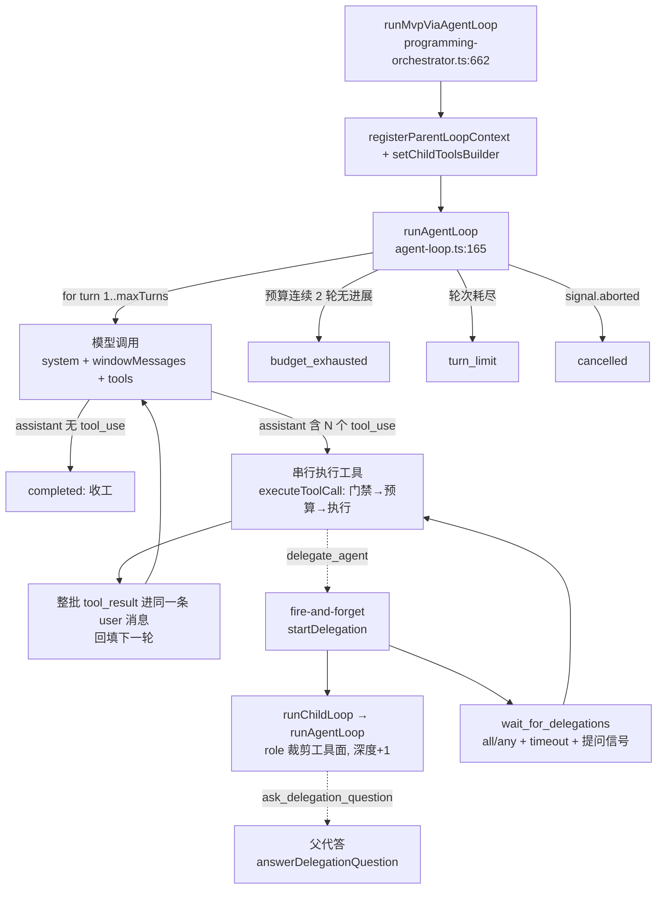
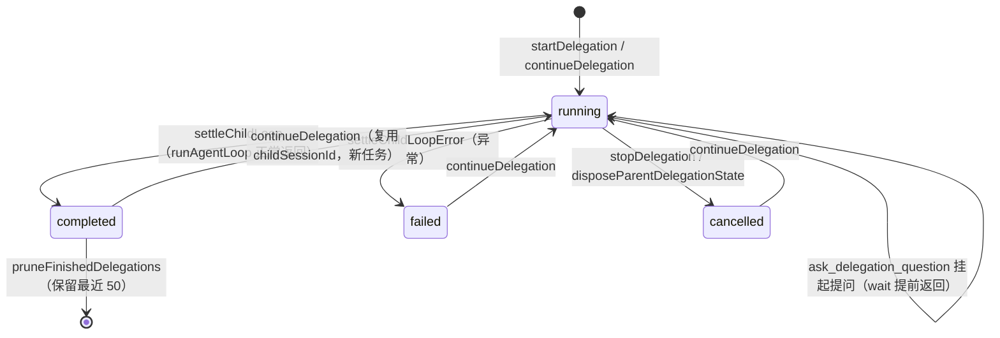

# 03 — Agent 运行时（Loop 主循环 / 委派协作 / 工具面）

> 覆盖 Agent Loop 的执行器与子 Agent 委派体系：`agent-loop.ts`（观察-行动主循环）、
> `agent-collaboration.ts`（委派注册表与生命周期）、`agent-tools.ts`（按 role 裁剪的工具面）、
> `review-delegation.ts` `[sprint2]`（审查委派运行时）。
> 图例与锚点约定见 `00-总索引.md` §2；编排层如何驱动 Loop 见 `01-用户旅程与编排.md` §6。
> `[sprint2]` 文件在 `origin/sprint2`，当前分支未检出，用 `git show origin/sprint2:main/review-delegation.ts` 读取。

---

## §1 总览：观察-行动循环与委派协作



**分层铁律**：`agent-collaboration.ts` **不 import** `agent-tools.ts`——子 agent 工具集由
`setChildToolsBuilder` 注入（编排层注入 `buildAgentTools({ role })`）；父 loop 运行上下文
（query/env/背板 system/maxTokens/权限）由 `registerParentLoopContext` 注册，`startDelegation`
按父 sessionId 取用。Layer 间靠依赖注入解耦，避免循环依赖。

**关键不变式（上游 Proma 实证）**：
- 同一轮响应含多个 tool_use 时**串行执行**，全部 tool_result 打包进**同一条** user 消息返回
  ——并发提交不完整批次会触发 400 `invalid_request_error`。
- 工具异常不崩循环：任何执行错误转 `is_error` tool_result 回给模型自纠，死循环由预算/轮次兜底。
- 取消即终止 loop，不再发起下一次模型调用；会话 JSONL 停在最后一条完整轮次上。
- 委派仅 1 层深度、每父并行 ≤ 4、tool-call 幂等；子 agent 只在 running 时向主 agent 冒泡提问。

---

## §2 runAgentLoop — `main/agent-loop.ts:165`（详细级）

- **输入**：`AgentLoopInput`（`agent-loop.ts:74`）——`system`（背板锚定提示词，PRD 注入防漂移）、
  `task`（初始 user 消息）、`tools: AgentLoopTool[]`、`query: SDKQuery`、`env`、`sessionId`、
  `projectId`、`requestId`、`maxTokens`、`maxTurns`（建议 quick=24 / longterm=40）、
  `toolBudget?`（按工具名计数静态预算）、`permissionMode`（自动化管线恒 `allow-all`）、
  `delegationDepth?`（缺省 0）、`temperature?`、`signal`、`publish`、`onTurn?`
- **副作用**：`message_delta` / `tool_call_started` / `tool_call_completed` 事件流；
  `appendLoopMessage` 落盘 JSONL（assistant 轮 + user tool_result 轮，tool_result 超 4096 字符截断）；
  `onTurn` 回调（PR3 埋点 `agent_loop_turn`：工具清单 + usage）；`tool_call_completed` 带
  detail 白名单透传（M4-C：委派标识/状态字段，丢弃长文本）
- **返回值**：`AgentLoopResult`（`agent-loop.ts:101`）——`{ status, turns, finalText, toolCalls }`，
  `status ∈ completed | turn_limit | budget_exhausted | cancelled`

```text
runAgentLoop(input):
  definitions = tools → {name, description, input_schema}            # 只把 ACI 定义给模型
  toolByName = Map(tools);  budgetUsed = {};  toolCalls = []
  messages = [ {role:'user', content: task} ]
  ctx = { projectId, sessionId, requestId, signal, state: createToolState(delegationDepth) }
  consecutiveBudgetStallTurns = 0

  for turn in 1..input.maxTurns:
    if signal.aborted: return {status:'cancelled', turns, finalText, toolCalls}

    # ---- 1. 模型调用（带 tools；messages 全量透传，system 提取由查询层负责）----
    cleaner = createWhitespaceArtifactCleaner()    # 网关脏增量清洗（ds 渠道 "\n\n" 空白工件）
    emitText = (t) => publish('message_delta',{text:t}); textParts.push(t)
    try:
      for sdk in input.query('', {
            env, signal, sessionId, maxTokens, temperature?,
            messages: [ {role:'system',content:system} ] + windowMessages(messages, 8, 8),
            tools: definitions }):
        if sdk.type=='assistant' and sdk.message:
          for block in sdk.message.content:
            if block.text:  emitText(cleaner.push(block.text) 逐个放行)
            else:          flushTextRun(); assistantBlocks.push(block)   # tool_use 块
        elif sdk.type=='result': stopReason, usage 记录
      flushTextRun()                             # 收口挂起空白 + 文本整段化
    catch error:
      if isLoopCancelled(error, signal): return cancelled
      throw error                                # 非取消性查询错误：向上抛（真伪终验收口）

    turns = turn; finalText = textOfBlocks(assistantBlocks)
    appendLoopMessage(sessionId, 'assistant', assistantBlocks)         # JSONL 落盘
    turnToolUses = assistantBlocks 中 type=='tool_use'
    toolCalls += [{name, turn}];  onTurn?.({turn, toolCalls, usage})

    # ---- 2. 无 tool_use = 模型声明收工（真伪由外部强制终验，不信模型自述）----
    if turnToolUses 空: return {status:'completed', turns, finalText, toolCalls}

    # ---- 3. 工具执行：串行 + 整批 tool_result 进同一条 user 消息（不变式）----
    resultBlocks = []
    for use in turnToolUses:                      # 串行，绝不并发
      if signal.aborted: return cancelled
      publish('tool_call_started', {tool, turn, input_summary: summarizeJson(use.input)})
      outcome = await executeToolCall(input, toolByName, budgetUsed, use, ctx)   # §2.1
      budgetStallThisTurn |= outcome.budgetExhausted
      publish('tool_call_completed', {
        tool, turn, status: error?/budget?/ok, duration_ms,
        output_summary: outcome.output.slice(0,500),
        ...(outcome.detail ? { detail: sanitizeToolDetail(outcome.detail) } : {}) })  # 白名单
      resultBlocks.push({ type:'tool_result', tool_use_id:use.id, content:outcome.output,
                          ...(outcome.isError ? {is_error:true} : {}) })
    appendLoopMessage(sessionId, 'user', resultBlocks)                # JSONL 落盘
    messages.push(assistant轮, user轮)

    # ---- 4. 预算/熔断：连续 2 轮撞预算（无进展）才终止，给模型收尾机会 ----
    consecutiveBudgetStallTurns = budgetStallThisTurn ? +1 : 0
    if consecutiveBudgetStallTurns >= 2: return {status:'budget_exhausted', ...}

  return {status:'turn_limit', turns, finalText, toolCalls}          # 轮次耗尽兜底
```

> **要点**：收工判断只看「本轮无 tool_use」，模型是否真完成任务由外部终验（`runAgentLoopPostTesting`，
> 见 01 §7.1）把关——本模块不感知 13 阶段状态机，阶段仍由编排层权威控制（陷阱 3 规避）。

### 2.1 executeToolCall — `main/agent-loop.ts:302`（详细级）

- **输入**：`input`、`toolByName`、`budgetUsed`、`use {name, input?, id?}`、`ctx`
- **副作用**：写 `ctx.toolCallId`（委派等有副作用工具的幂等键）；`budgetUsed` 计数
- **返回值**：`ToolOutcome`（`agent-loop.ts:52`）——任何失败都转 error 回给模型，绝不抛

```text
executeToolCall(input, toolByName, budgetUsed, use, ctx):
  tool = toolByName.get(use.name)
  if !tool: return {output:'未知工具「name」。可用：…', isError:true}
  ctx.toolCallId = use.id;  toolInput = use.input ?? {}

  # 权限门（loop 是无人值守自动化，仅支持 allow-all；非 allow-all 直接拒绝进 is_error）
  #   原因：canUseTool 在 ask 模式下落 pending 等 UI 会造成永久挂起（取消信号也无法中断）
  if input.permissionMode != 'allow-all':
    return {output:'权限拒绝：本次运行不允许执行「name」。…', isError:true}
  try:
    permission = await withAbort(canUseTool(name, toolInput, sessionId, 'allow-all', projectId), signal)
    if permission.behavior == 'deny':
      return {output:'权限拒绝：…', isError:true}
  catch: return {output:'权限检查失败：…', isError:true}      # 与 AbortSignal 竞速防挂死

  # 静态预算（按工具名计数）：超限软着陆，标记 budgetExhausted（loop 据此计连续无进展轮）
  budget = input.toolBudget?[name]
  if typeof budget == 'number':
    if (budgetUsed[name] ?? 0) >= budget:
      return {output:'「name」调用预算已用尽（上限 budget 次）…', budgetExhausted:true}
    budgetUsed[name] += 1

  try: return await tool.execute(toolInput, ctx)               # 工具实现（agent-tools）
  catch error: return {output:'工具执行出错：…', isError:true}  # 异常不崩循环，回模型自纠
```

### 2.2 withAbort — `main/agent-loop.ts:358`

`把 promise 与 AbortSignal 竞速`：signal 已 abort 立即 reject `AGENT_CANCELLED`；中途 abort 也
reject（once 监听，settle 后移除）。用于把「可能永不 settle 的等待」（如 ask 权限 pending）纳入取消范围。

### 2.3 windowMessages — `main/agent-loop.ts:140`

- **输入**：`messages`、`textWindowTurns`、`toolRounds`；返回窗口化后仍保序的 messages
- **规则**：首轮 task 恒保留；后向扫描——tool 轮按 `toolRounds*2` 条预算保留（相邻成对，**绝不拆
  tool_use→tool_result 配对**），纯文本轮按 `textWindowTurns` 保留。
- **已知取舍（对抗审查 M2）**：硬窗口会丢弃早期轮次工具结果——longterm=40 轮下第 1 次
  `run_gwt_tests` 失败的断言细节可能在 8 轮后出窗。当前最小改动固定窗口；后续优先方案是
  「钉住首个 test_failed 轮」。

### 2.4 类型与辅助（摘要）

- `createToolState`（`agent-loop.ts:161`）— 初始化工具共享状态 `{test_failed:false, edits_after_test_failure:0, repair_round:0, delegation_depth}`。
- `isToolTurn`（`agent-loop.ts:127`）— 判断轮是否为工具轮（content 为块数组且含 tool_use/tool_result）。
- `createWhitespaceArtifactCleaner`（`agent-loop.ts:396`）— 网关脏增量清洗：纯空白增量先挂起，后继以空白开头 → 词间工件丢弃；否则如实放行（流结束/遇工具块收口）。防 ds 渠道「每词一段」污染。
- `isLoopCancelled`（`agent-loop.ts:425`）— 取消判定：signal.aborted / AbortError / 含 `AGENT_CANCELLED`。
- `sanitizeToolDetail`（`agent-loop.ts:459`）— `tool_call_completed` detail 白名单（`delegation_id / child_session_id / role / goal / status / pending_question / error`），防敏感/超长字段泄漏。
- `appendLoopMessage`（`agent-loop.ts:476`）— loop 轮次 JSONL 落盘；tool_result 超 4096 字符截断，全文走事件流。
- `loopCancelled`（`agent-loop.ts:376`）— 组装 cancelled 结果。
- 常量：`BUDGET_STALL_TURNS=2`（:115）、`TEXT_WINDOW_TURNS=8`（:118）、`TOOL_WINDOW_ROUNDS=8`（:120）、`JSONL_TOOL_RESULT_CHAR_LIMIT=4096`（:109）、`EVENT_SUMMARY_CHAR_LIMIT=500`（:112）。

---

## §3 委派协作体系 — `main/agent-collaboration.ts`

**内部状态**：`delegations: Map<delegationId, DelegationRecord>`、`parentContexts: Map<parentSessionId, DelegationParentContext>`、
单例 `childToolsBuilder`（未注入时抛错，防止静默空转）。

**核心常量**：`MAX_RUNNING_DELEGATIONS_PER_PARENT=4`（:38）、`DEFAULT_DELEGATION_WAIT_TIMEOUT_MS=600_000`（:44）、
`DELEGATION_GOAL_CHAR_LIMIT=200`（:32）、`DELEGATION_RESULT_CHAR_LIMIT=50_000`（:35）、`MAX_FINISHED_DELEGATIONS=50`（:41）。

### 3.1 生命周期状态机



### 3.2 startDelegation — `main/agent-collaboration.ts:178`（详细级）

- **输入**：`parent: ToolContext`（主 loop 的 ctx，含 `sessionId/projectId/state.delegation_depth`）、
  `args: DelegateAgentArgs {task, role?, expectedOutput?, title?}`
- **副作用**：registry 写入 `delegations`；`delegation_started` 事件（父上下文在册时）；**fire-and-forget**
  派生子 loop 后台独立运行；已终结记录修剪
- **返回值**：`StartDelegationResult {delegation_id, child_session_id, role, goal, status}`
- **降级链**：父上下文缺失 / 深度超限 / 并行超限 → **抛错**给模型（is_error 工具结果，模型自纠，
  不崩主循环）

```text
startDelegation(parent, args):
  task = assertNonBlank(args.task, 'task')
  role = args.role ?? 'custom'
  assertCanCreateDelegation(parent.state.delegation_depth)     # 深度 ≥1（已是子 agent）拒绝
  parentCtx = parentContexts.get(parent.sessionId)
  if !parentCtx: throw '未找到父循环上下文… 委派工具只在主 agent loop 内可用'
  if runningDelegationCount(parent.sessionId) >= 4: throw '并行委派已达上限（4），先 wait 或 stop'

  delegationId = randomUUID();  goal = truncate(task, 200)
  childSessionId = randomUUID()
  record = { delegationId, parentSessionId, childSessionId, projectId, role, goal,
             status:'running', startedAt: now, abort:new AbortController(),
             completion, resolveCompletion, askSignal:createAskSignal() }
  delegations.set(delegationId, record)
  pruneFinishedDelegations()                                    # 只保留最近 50 条已终结记录
  publishDelegationEvent(parent.sessionId, 'delegation_started', record)

  prompt = buildDelegationPrompt({role, task, expectedOutput})
  # fire-and-forget：立刻返回，不阻塞当前轮；子 loop 独立 sessionId/requestId 后台跑
  void runChildLoop({parent, parentCtx, record, prompt, role}).then(
    settleChildLoop,        # 正常结束 → completed
    settleChildLoopError)   # 异常 → failed

  return { delegation_id, child_session_id, role, goal, status: record.status }
```

### 3.3 runChildLoop — `main/agent-collaboration.ts:242`

```text
runChildLoop({parent, parentCtx, record, prompt, role}):
  childRequestId = randomUUID()
  maxTurns = max(1, min(parentCtx.delegationMaxTurns, parentCtx.maxTurns))   # 子轮次受双上限约束
  return runAgentLoop({
    system:   buildChildSystemPrompt(parentCtx.system, role),   # 父背板 + role 行为 + 边界
    task:     prompt,
    tools:    childToolsBuilder(parent.projectId, role, parentCtx.editFormat),  # 按 role 裁剪
    query/env/maxTokens/permissionMode/temperature: 继承父上下文,
    sessionId: record.childSessionId,  projectId: parent.projectId,
    requestId: childRequestId,
    delegationDepth: parent.state.delegation_depth + 1,          # 深度 +1（≥1 禁止再委派）
    signal:   record.abort.signal,                               # stop_delegation 中止子循环
    publish:  parentCtx.publish,
    onTurn:   parentCtx.onChildTurn ? wrap(加上 child {sessionId, requestId, role}) : undefined })
```

### 3.4 waitForDelegations — `main/agent-collaboration.ts:321`（详细级）

- **输入**：`parent: ToolContext`、`args: WaitForDelegationsArgs {delegationIds?, strategy?:'all'|'any', timeout_ms?}`
- **副作用**：阻塞当前 loop 轮直到收敛/超时/提问冒泡；超时**不抛错**（返回当前状态，父 agent 决定继续等或停止）
- **返回值**：`DelegationSummary[]`（当前各委派状态快照）
- **同步/超时语义**：三条 race 出路——① 收敛（all 用 `Promise.all(completions)` / any 用 `Promise.any(completions)`）、
  ② **提问冒泡**（任一 `askSignal` resolve 即提前返回，父 agent 代答后重建 signal 再 wait）、③ 超时

```text
waitForDelegations(parent, args):
  ids = args.delegationIds ?? listDelegations(parent.sessionId).map(id)   # 缺省=当前全部
  records = ids.map(findDelegation; 不存在 → throw '未找到当前会话下的委派')
  if records 空: return []                                                # 无委派立即返回

  timeoutMs = args.timeout_ms ?? 600_000
  timeout = promise(600s 后 resolve 'timeout'; timer.unref 不阻塞进程退出)

  # 提问信号不参与收敛判定，仅作 race 提前出路：子 agent 提问挂起 → 父代答，而不是干等超时
  questionSignals = records.map(r => r.askSignal.promise)
  if args.strategy == 'any':
    await race( [Promise.any(records.completion), Promise.any(questionSignals), timeout] )
  else:  # all（缺省）
    await race( [Promise.all(records.completion), Promise.any(questionSignals), timeout] )
  return records.map(getDelegationSummary)
```

### 3.5 委派生命周期收尾（摘要）

- `settleChildLoop`（`agent-collaboration.ts:224`）— 子 loop 正常结束：落 `resultSummary`（头行
  「子代理状态：…」+ 正文，≤50000 字符）、置 `completed`、`resolveCompletion()` 解除 wait 阻塞、发
  `delegation_completed`；**非 running 状态不覆盖**（如已被 stop）。
- `settleChildLoopError`（`agent-collaboration.ts:233`）— 异常：落 `error`、置 `failed`、resolve + 发
  `delegation_failed`。
- `stopDelegation`（`agent-collaboration.ts:358`）— 中止单个子循环：`abort.abort()`、置 `cancelled`、
  主动 `resolveCompletion()` 解除 wait 阻塞；已终结的委派 no-op，返回当前摘要。
- `stopDelegations`（`agent-collaboration.ts:372`）— 批量停止；`delegationIds` 缺省 = 当前全部。
- `disposeParentDelegationState`（`agent-collaboration.ts:388`）— 父 loop 收尾一次性清理（审计 P1-2/P2-4）：
  **先** `stopDelegations`（running 子委派不中止会在后台偷跑耗 token，且父结束后无人收集 → 孤儿+泄漏），
  再清空该父会话的 tool-call 幂等缓存，最后 `unregisterParentLoopContext`。父 loop 结束（正常/异常/用户停止）必调。
- `getDelegationSummary`（`agent-collaboration.ts:278`）— 组装对外摘要；`findDelegation`（:291）/`listDelegations`（:297）— 按父会话过滤查询。
- `publishDelegationEvent`（`agent-collaboration.ts:306`）— 委派生命周期事件发布（M4-C 协作视图数据源）；父上下文在册时经 publish 发，已 unregister 静默跳过（事件流断供不阻塞 registry）。

### 3.6 提问冒泡与父代答

- `askDelegationQuestion`（`agent-collaboration.ts:407`）— 子 agent 挂起提问协调函数：问题记入
  `record.pendingQuestion` + resolve `askSignal`（wait_for_delegations 提前返回）+ 发 `delegation_question`
  事件；返回 Promise，父 `answerDelegationQuestion` 回答时 resolve（答案回传子 loop）。**abort 兜底**：
  子循环被停止时 resolve 占位答复（`[子代理已被停止，未收到回答]`），让子 loop 正常收尾不永久挂起。
- `answerDelegationQuestion`（`agent-collaboration.ts:437`）— 父代答：校验 pendingQuestion 存在，
  回答回传挂起点并清空字段；**重建 askSignal**（审计 P1-1：Promise 只能 resolve 一次——沿用已 resolve
  的旧 signal 会让下一次 wait 立即假提前返回），之后再次提问产生新 signal。

### 3.7 续跑与幂等

- `continueDelegation`（`agent-collaboration.ts:465`）— 让已终结委派继续：重置 `running`、复用
  `childSessionId`（同一独立 JSONL 追加轮）、新任务 prompt 重启子 loop；running 中拒绝；复用并行上限
  门禁（审计 P2-5，绕检查即可突破 4 上限）；goal/startedAt 跟随本次任务（P2-6，事件不再显示旧 goal）。
- `delegateAgentOnce`（`agent-collaboration.ts:528`）— 按 `(sessionId, toolCallId)` 幂等创建委派：
  同一次 tool_use 的重放/重试只 create 一次；**toolCallId 缺失不走缓存**（审计 P3-7：`anonymous` 兜底键
  会让同 session 多个无 id 调用错误复用第一个结果）。
- `assertCanCreateDelegation`（`agent-collaboration.ts:546`）— 深度 ≥1 抛「协作子会话不能继续创建新的子会话（深度限制 1 层）」。
- `buildChildSystemPrompt`（`agent-collaboration.ts:583`）— 父背板 system + `<delegation_context>`
  （role 行为说明 `ROLE_INSTRUCTIONS`:574 + 边界：只做本任务 / 不能再委派 / 不向用户提问）。
- `buildDelegationPrompt`（`agent-collaboration.ts:596`）— 子任务 prompt：`协作子任务（role=…）：task + 期望输出`。

---

## §4 buildAgentTools — `main/agent-tools.ts:213`（工具面构建）

- **输入**：`BuildAgentToolsOptions {projectId, editFormat?:'diff'|'whole', role?:'parent'|DelegationRole, onRepairRound?}`
- **副作用**：写项目文件（write_file/edit_file，落盘前护栏）；启动/停止沙箱（run_preview）；跑 GWT/安全扫描；
  委派生命周期（delegate/wait/stop/answer/continue）；事件 detail 透传
- **返回值**：`AgentLoopTool[]`，**按 role 裁剪**（见 §4.1）

**通用约束**（代码注释提炼）：
- **路径沙箱**：`resolveInsideProject`（`agent-tools.ts:146`）——`resolve(join(root, path))` 必须仍在 root
  内（防 `../` 逃逸）；拒绝绝对路径/Windows 盘符前缀。
- **可写范围**：`isWritablePath`（`agent-tools.ts:165`）——`SYSTEM_FILES`（package.json/static-server.js）
  平台接管不可写；`src/` 子树 + 白名单后缀 `.html/.js/.css` 可写。
- **网络出口仅 web_fetch**：SSRF 防护 + 2MB 上限 + ACI 截断（`net-guard`，见 06 §3）。
- **快照不进工具集**：create_snapshot/rollback_snapshot 由编排层控制，模型无权决定检查点。
- **修复预算口径**（PR3 §4.4，同构旧 test_repair_count ≤3）：GWT 首次失败后 edit/write 共享 3 次预算，
  第 4 次起软着陆提示收尾。

### 4.1 按 role 裁剪矩阵

| role | 工具面 | 说明 |
|---|---|---|
| `parent`（主 agent，缺省） | 16 个：read/list/grep/web_fetch/write/edit/run_preview/run_gwt_tests/run_security_scan + delegate/wait/get/stop×2/answer/continue | 全量读写 + 委派全生命周期 |
| `explore` / `research`（只读） | `[read_file, list_files, grep, web_fetch, ask_delegation_question]` | 只读子 agent：可查公网、可向主冒泡提问，**无写/跑测试/委派** |
| `implement` / `review` / `custom`（子 agent） | 9 个 + `ask_delegation_question` | 全量读写但**无委派/代答/续跑工具**（深度限制双保险） |

> 角色裁剪代码见 `agent-tools.ts:785`（explore/research）与 `:789`（其余子角色）与 `:804`（parent）。
> 委派深度限制由工具面 + `assertCanCreateDelegation` 双保险物理保证。

### 4.2 validateAndWrite — `main/agent-tools.ts:237`（写工具护栏）

```text
validateAndWrite(root, rel, content, ctx):
  if !isWritablePath(rel): return notWritableError(rel)        # 可写范围前置
  if 扩展名 == '.html':
    err = checkHtmlStructure(content)                          # 结构标签配平 + </html> 结尾
    if err: return {output: err + '请修正后重新提交完整内容', isError:true}
  if 扩展名 == '.js':
    syntax = await jsSyntaxChecker(content)                    # node --check（mjs 优先，cjs 兜底）
    if !syntax.ok: return {output:'JS 语法校验未通过，已拒绝写入…', isError:true}
  budget = guardRepairBudget(ctx)                              # 修复预算门（校验通过后才烧预算）
  if budget: return budget                                     # 第 4 次起 budgetExhausted
  finalContent = (.html ? stripMetaCsp(content) : content)     # 剥离模型自写 meta CSP（平台 CSP 唯一真相源）
  mkdir + writeFileSync(abs, finalContent)
  return {output:'已写入 rel（N 字节）[剥离 meta CSP 提示]', detail:{path, bytes}}
```

### 4.3 各工具职责（摘要）

| 工具 | 位置 | 职责 |
|---|---|---|
| `read_file` | `agent-tools.ts:263` | 读项目文件窗口（默认 100 行带行号）；越界返回最近可用窗口 |
| `list_files` | `agent-tools.ts:296` | 列文件（深度 ≤4，最多 200 条，跳 node_modules/.git/dist） |
| `grep` | `agent-tools.ts:320` | 正则搜索，只返回 `file:line`（≤50 命中，不返回行内容） |
| `web_fetch` | `agent-tools.ts:370` | 抓公网网页转纯文本（SSRF 防护 + 重定向终态复检 + 2MB 上限 + max_chars 截断） |
| `write_file` | `agent-tools.ts:435` | 整文件覆盖写入（走 §4.2 护栏） |
| `edit_file` | `agent-tools.ts:457` | diff 模式：old_string 唯一命中才替换；whole 模式（弱渠道能力位）：整文件重写 |
| `run_preview` | `agent-tools.ts:508` | 启动/重启沙箱并健康探活；成功回 `preview_url` 写 `ctx.state.preview_url`，失败回错误分类+日志尾部 |
| `run_gwt_tests` | `agent-tools.ts:529` | 执行行为断言；失败置 `ctx.state.test_failed=true`、`repair_round+=1`、触发 `onRepairRound`（PR3 埋点 self_repair_triggered） |
| `run_security_scan` | `agent-tools.ts:561` | 静态安全扫描；高危/严重列 file:line 与修复建议（见 06 §4） |
| `delegate_agent` | `agent-tools.ts:585` | fire-and-forget 委派（经 `delegateAgentOnce` 幂等包 `startDelegation`） |
| `wait_for_delegations` | `agent-tools.ts:621` | 阻塞等待收敛（见 §3.4；detail 透传 summaries） |
| `get_delegation_results` | `agent-tools.ts:648` | 非阻塞读状态摘要（不做等待） |
| `stop_delegation` / `stop_delegations` | `agent-tools.ts:677` / `:695` | 停止单个/批量委派子会话 |
| `ask_delegation_question` | `agent-tools.ts:714` | 子 agent 冒泡提问（`ctx.state.delegation_depth < 1` 拒绝——只在子会话可用） |
| `answer_delegation_question` | `agent-tools.ts:736` | 父代答子 agent 挂起问题 |
| `continue_delegation` | `agent-tools.ts:759` | 已终结委派用新任务重启同一子会话 |

> 工具输出一律按 SWE-agent ACI 规范：截断、结构化、空输出显式反馈（「执行成功，无输出」）。
> 辅助：`checkJsSyntaxViaNode`（:90，mjs/cjs 双解析）、`runNodeCheck`（:108）、`checkHtmlStructure`（:126）、
> `stripMetaCsp`（:138）、`resolveInsideProject`（:146）、`collectProjectFiles`（:177）、
> `formatDelegationSummaries`（:845）、`normalizeDelegationRole`（:824）。

---

## §5 审查委派运行时 — `main/review-delegation.ts:58` `[sprint2]`

- **目的**（用户拍板：协作过程可视化）：PRD 六维审查与 MVP 语义审查不再平台直连 LLM 静默完成，
  而是经委派体系派生独立子 agent（**role='research'，物理只读工具面**），生命周期事件流入
  DelegationFeed/CollaborationPanel 实时可见，子会话 JSONL 可回放审查过程。
- **role 选择**：`research`（read/list/grep/web_fetch + ask，只读）而非 `review`（带写工具）——裁判铁律
  「只判定不修复」用工具面物理保证，而非提示词约束。
- **运行开关**：`delegatedReviewEnabled`（`review-delegation.ts:36`）——`BLOMA_DELEGATED_REVIEW !== '0'`（缺省开启）。
- **降级链**：委派（默认）→ 直连 LLM（各审查模块既有路径）→ 规则门——**任何一环失败不阻断主流程**。

### 5.1 runDelegatedReview — `main/review-delegation.ts:58`（详细级）

- **输入**：`{goal, task, system, query, env, sessionId, projectId, requestId, publish, timeoutMs?}`
- **副作用**：派生子审查 agent（独立子会话，role=research）；`delegation_started/completed/failed` 事件
  （经合成父上下文发布，事件载荷携带**真实** session/project 归属渲染端）；finally 强制清理（防孤儿）
- **返回值**：`DelegatedReviewOutcome {ok, finalText?, delegationId?, failure?: 'disabled'|'timeout'|'failed'|'bad_status'|'empty'}`
  ——任何异常返回 `failure`（**不抛错**），调用方据此降级直连

```text
runDelegatedReview(opts):
  if !delegatedReviewEnabled(): return {ok:false, failure:'disabled'}
  setChildToolsBuilder((p, role, ef) => buildAgentTools({projectId:p, role, editFormat:ef}))  # 防御性注册（幂等）

  # 合成父键：与真实 loop 的父上下文注册完全隔离，事件归属靠闭包里的真实 id
  parentKey = `review-${randomUUID()}`
  parent = { projectId, sessionId: parentKey, requestId, signal: (无), state: createToolState() }

  try:
    registerParentLoopContext(parentKey, {
      query, env, maxTokens:2048,
      maxTurns: 8, delegationMaxTurns: 8,              # REVIEW_DELEGATION_MAX_TURNS
      permissionMode:'allow-all', temperature:0.1, system, editFormat:'diff',
      publish: (type, payload) => opts.publish({event_id, session_id:opts.sessionId,
                                                project_id:opts.projectId, type, payload, created_at}) })
    started = startDelegation(parent, { task, role:'research', expectedOutput:'按任务要求输出严格 JSON 裁决' })
    summaries = await waitForDelegations(parent, { strategy:'all',
                                                   delegationIds:[started.delegation_id],
                                                   timeout_ms: timeoutMs ?? 120_000 })   # REVIEW_DELEGATION_TIMEOUT_MS

    summary = summaries[0]
    if !summary:                 return {ok:false, delegationId, failure:'empty'}
    if summary.status == 'running': return {ok:false, delegationId, failure:'timeout'}   # 超时未收敛，如实报
    if status != 'completed' or !result_summary:
      return {ok:false, delegationId, failure: failed? 'failed' : 'bad_status'}
    body = result_summary 剥掉「子代理状态：completed（N 轮，M 次工具调用）」头行
    if !body: return {ok:false, delegationId, failure:'empty'}
    return {ok:true, delegationId, finalText: body}
  catch error:
    console.error('[review-delegation] 委派审查异常，降级直连:', error)
    return {ok:false, failure:'failed'}
  finally:
    stopDelegations(parentKey)            # 超时残留的 running 子会话强制停止（防后台偷跑，审计 P1-2 精神）
    unregisterParentLoopContext(parentKey)
    disposeParentDelegationState(parentKey)   # 收尾幂等，异常忽略
```

> **调用方接线**：`runPrdReviewGate`（`main/prd-review.ts:119` [sprint2]）优先尝试委派审查，`ok && finalText`
> 时 `parseReviewIssues` 解析出 issues 走代码级裁决 `deriveVerdict`；失败回退直连 LLM（`attackViaLlm`），
> 再失败回退确定性规则门。详见 `01-用户旅程与编排.md` §4.3 与 `02-五引擎.md` §6。
> MVP 语义审查腿（`runSemanticJudgeReview`）走同一运行时。

---

## 本域函数索引

| 函数 | 位置 | 章节 |
|---|---|---|
| `runAgentLoop` | `main/agent-loop.ts:165` | §2 |
| `executeToolCall` | `main/agent-loop.ts:302` | §2.1 |
| `withAbort` | `main/agent-loop.ts:358` | §2.2 |
| `windowMessages` | `main/agent-loop.ts:140` | §2.3 |
| `createToolState` | `main/agent-loop.ts:161` | §2.4 |
| `isToolTurn` | `main/agent-loop.ts:127` | §2.4 |
| `createWhitespaceArtifactCleaner` | `main/agent-loop.ts:396` | §2.4 |
| `isLoopCancelled` | `main/agent-loop.ts:425` | §2.4 |
| `sanitizeToolDetail` | `main/agent-loop.ts:459` | §2.4 |
| `appendLoopMessage` | `main/agent-loop.ts:476` | §2.4 |
| `startDelegation` | `main/agent-collaboration.ts:178` | §3.2 |
| `runChildLoop` | `main/agent-collaboration.ts:242` | §3.3 |
| `waitForDelegations` | `main/agent-collaboration.ts:321` | §3.4 |
| `settleChildLoop` | `main/agent-collaboration.ts:224` | §3.5 |
| `settleChildLoopError` | `main/agent-collaboration.ts:233` | §3.5 |
| `stopDelegation` | `main/agent-collaboration.ts:358` | §3.5 |
| `stopDelegations` | `main/agent-collaboration.ts:372` | §3.5 |
| `disposeParentDelegationState` | `main/agent-collaboration.ts:388` | §3.5 |
| `getDelegationSummary` | `main/agent-collaboration.ts:278` | §3.5 |
| `findDelegation` / `listDelegations` | `main/agent-collaboration.ts:291` / `:297` | §3.5 |
| `publishDelegationEvent` | `main/agent-collaboration.ts:306` | §3.5 |
| `askDelegationQuestion` | `main/agent-collaboration.ts:407` | §3.6 |
| `answerDelegationQuestion` | `main/agent-collaboration.ts:437` | §3.6 |
| `continueDelegation` | `main/agent-collaboration.ts:465` | §3.7 |
| `delegateAgentOnce` | `main/agent-collaboration.ts:528` | §3.7 |
| `assertCanCreateDelegation` | `main/agent-collaboration.ts:546` | §3.7 |
| `registerParentLoopContext` / `unregisterParentLoopContext` | `main/agent-collaboration.ts:160` / `:164` | §3.1 |
| `setChildToolsBuilder` | `main/agent-collaboration.ts:155` | §1/§3.1 |
| `buildChildSystemPrompt` / `buildDelegationPrompt` | `main/agent-collaboration.ts:583` / `:596` | §3.7 |
| `buildAgentTools` | `main/agent-tools.ts:213` | §4 |
| `validateAndWrite` | `main/agent-tools.ts:237` | §4.2 |
| `read_file` | `main/agent-tools.ts:263` | §4.3 |
| `list_files` | `main/agent-tools.ts:296` | §4.3 |
| `grep` | `main/agent-tools.ts:320` | §4.3 |
| `web_fetch` | `main/agent-tools.ts:370` | §4.3 |
| `write_file` | `main/agent-tools.ts:435` | §4.3 |
| `edit_file` | `main/agent-tools.ts:457` | §4.3 |
| `run_preview` | `main/agent-tools.ts:508` | §4.3 |
| `run_gwt_tests` | `main/agent-tools.ts:529` | §4.3 |
| `run_security_scan` | `main/agent-tools.ts:561` | §4.3 |
| `delegate_agent` | `main/agent-tools.ts:585` | §4.3 |
| `wait_for_delegations` | `main/agent-tools.ts:621` | §4.3 |
| `get_delegation_results` | `main/agent-tools.ts:648` | §4.3 |
| `stop_delegation` / `stop_delegations` | `main/agent-tools.ts:677` / `:695` | §4.3 |
| `ask_delegation_question` | `main/agent-tools.ts:714` | §4.3 |
| `answer_delegation_question` | `main/agent-tools.ts:736` | §4.3 |
| `continue_delegation` | `main/agent-tools.ts:759` | §4.3 |
| `resolveInsideProject` | `main/agent-tools.ts:146` | §4 |
| `checkJsSyntaxViaNode` | `main/agent-tools.ts:90` | §4.2 |
| `checkHtmlStructure` | `main/agent-tools.ts:126` | §4.2 |
| `runDelegatedReview` | `main/review-delegation.ts:58` [sprint2] | §5.1 |
| `delegatedReviewEnabled` | `main/review-delegation.ts:36` [sprint2] | §5 |
