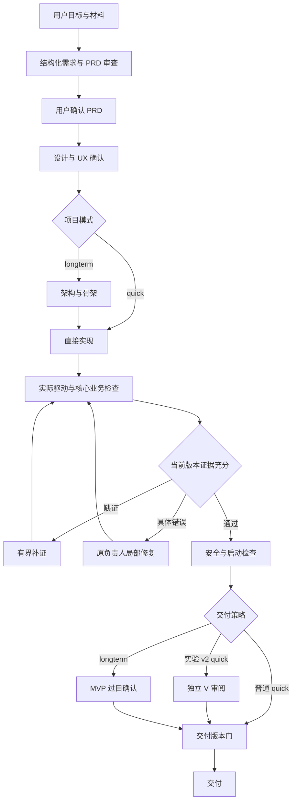

# Bloma 全流程代码审查与修复（2026-10-22）

## 结论与范围

现有流程的基本分工合理：先确认需求和设计，执行者实现，宿主执行确定性验证，实验 v2 quick 再经独立 V 审阅，longterm 经工程验证和 MVP 过目后交付。主要问题在运行与证据的边界：模型循环已结束不代表宿主检查也结束；单个门禁通过不代表最后交付时仍是同一版本；场景 PASS 不代表专项能力也通过。

本次从 `sprint2 / f351782` 开始，结合主进程、IPC/preload、renderer 状态、需求/UX 确认、Agent 委派、桌面制作、验证/恢复、文件持久化、模型预算与实验控制进行风险审查，并执行全部正式 Vitest 测试目录、独立脚本测试、构建和隔离 Electron 启动检查。这里的“全面”指覆盖这些模块和关键链路，不表示对每行代码或所有生成软件作出无缺陷证明。

起始工作树已有 `production-workflow-v2-20261020.md` 的两行补充；本轮保留原样，未纳入修复提交。未执行付费模型调用，未重跑或修改历史实验样本，也未推送远端。

## 已修复的问题

| 编号 | 优先级 | 触发与影响 | 修复和反例验证 |
| --- | --- | --- | --- |
| R1 | P1 | 预览协议只检查 `target.substring(root.length)`，同长度的外部目录也能满足边界条件；非法 URL 编码和已删除项目会抛异常 | 改用 `path.relative` 检查实际父子关系；目录默认页再次 realpath 检查；异常返回 400/404。真实临时目录和 junction 反例覆盖 |
| R2 | P1 | JSON 原子 rename 失败后直接覆盖旧索引，项目、会话、渠道文件仍可能被截断 | JSON 与文本共用 `writeTextFileAtomic`，重试耗尽保留旧文件并上抛，移除两套替换/临时文件语义；包含真实 Windows deny-delete 句柄验证 |
| R3 | P1 | 用户取消或累计实验时限到达后，核心驱动、专项探针、交付检查仍可能继续并返回 PASS | `AbortSignal` 穿透工具、核心执行器、语音/文件/模型探针与启动冒烟；异步返回后再检查取消；桌面路由在交付检查阶段保留累计实验 deadline；真实进程树取消验证通过 |
| R4 | P1 | 核心检查后，启动程序可能修改源码；旧检查仍被用于交付或发 MVP 卡 | 交付检查前后比对源码和完整 PRD scope 指纹；变化或不可读时保留产物、结束为 incomplete，实验记录明确失败边界，不重新签发旧证据 |
| R5 | P1 | MVP pending 和 V 审阅主要绑定生成目录，PRD 在目录外变化时旧确认可能继续有效 | MVP 和 V 同时绑定 PRD scope、源码版本；需求、业务模型或设计语义变化使旧证据失效；确认后的核心检查也经过最终版本门 |
| R6 | P2 | 启动冒烟继承宿主环境和真实业务数据路径；异常分支清理不统一；正常启动探针临时数据累积 | 为启动冒烟注入最小环境及独立 APP_DATA_DIR；统一 finally 清理自有进程和临时数据；正常启动探针也清理临时目录；实测取消后后代进程消失、数据目录已移除 |
| R7 | P2 | 联合探针发送 WM_CLOSE 后，程序正常退出先于探针输出，可能被误报崩溃 | 非零退出立即失败；退出 0 必须等到有界的探针关闭证据，不能仅凭退出码通过；同时覆盖正常关闭与无证据退出 |
| R8 | P2 | 指纹跳过所有点号名称，隐藏的 Python/JS 等执行代码变化不使验证过期 | 仅跳过明确的依赖、缓存和历史目录；隐藏执行源码进入指纹；补回归反例 |
| R9 | P2 | 核心验证 unverified 的反馈直接要求修源码，缺证可能诱导无效重写 | 失败请求局部修复；未知先核对登记和场景回读、补真实证据，复现功能错误后才修改；共享原有两次恢复上限 |
| R10 | P2 | 语音/文件专项探针失败或麦克风证据缺失时，逐项功能状态仍可能显示 passed；阻塞也可能覆盖已复现失败 | 把专项证据合并到对应功能项，失败优先于阻塞，阻塞优先于未知；未经采集实测的麦克风项保持 unverified，与总结果相符 |

R1/R2 修复前的三个回归反例确实失败，日志为 `run-artifacts/review-20261022-counterexamples.log`。其余问题有新增定向回归和实际 Windows 进程清理证据。README 的两个不存在的 E2E npm 命令已替换为现存的 sprint2/sprint3 验收入口。

实现入口：R1 在 `main/delivery/preview-scheme.ts`；R2 在 `storage/json-store.ts`；R3/R4 在 `main/desktop/desktop-route.ts`、`core-delivery.ts`、`core-verification.ts` 及专项探针；R5 在 `mvp-confirm.ts`、`quick-production-review.ts`；R6/R7 在 `launch-smoke.ts`、`normal-startup-verification.ts`；R8 在 `verification-fingerprint.ts`；R9/R10 在 `core-delivery.ts` / `core-verification.ts`。

工程提交：`b900c7d`（预览/持久化）、`9cfee5a`（取消/启动资源/证据绑定）、`80f1e8c`（交付版本门与累计时限）、`f8e981a`（逐功能专项证据）。源码基线为 `f8e981a`，本报告和 README 单独固化。

## 全流程合理性

图表示职责关系；longterm 的契约驱动/安全检查实际位于 `dispatcher-finalize.ts`，通用核心检查在最终交付路径执行，不是图中每个框都对应一次独立模型调用。

- **确认门保留合理。** PRD 确认范围，UX 确认设计，longterm 的 MVP 确认成品，三者对象不同。quick 跳过架构/契约工程链已有清晰分支，不应把“quick”理解为无需证明业务功能。
- **执行完成和质量通过应继续分离。** 委派结束允许下游读取其输出，但不自动证明其功能。V 只读审阅，宿主裁定事实；外部 GUI/Q 仍须独立采集。
- **有界恢复合理。** 保留累计尝试记录，渠道/环境错误不应反复触发产品改写。此次补齐取消与证据版本边界，没有扩大恢复次数。
- **文件快照和指纹有明确边界。** 它们保证受控工具的版本和审计一致性，不是操作系统安全沙箱；不能据此宣称不可信生成程序无法访问本机。

## 冗余与收敛顺序

| 当前重叠 | 判断 | 后续收敛方式与验收条件 |
| --- | --- | --- |
| 实现者调用 `run_project_driver`，交付前 `ensureCoreDelivery` 再执行，longterm 确认时还会再查核心 | 确有重复执行，但最终检查提供新鲜度，不宜直接删掉 | 复用版本化 verification receipt：键包含需求/源码/验收脚本、解释器/依赖、执行环境和隔离输入。只重跑变更、缺失或未知项；证明持久化失败/取消后旧 PASS 不复活 |
| longterm 契约 driver 与 CORE_CHECK scenarios 分别描述功能覆盖 | 两个清单容易漏同步，也重复执行相同脚本 | 共用场景注册与执行结果，分别投影工程契约和逐功能证据；保持既有项目可读、失败优先级和未覆盖功能拒绝交付 |
| 启动冒烟与 native normal-startup probe | 有部分启动成本重叠，但覆盖不同：窗口/响应/关闭与原生桥/首屏 | 共享启动 fixture 和证据产物，保留两组独立判据；不可用“活着”替代原生桥就绪或 GUI 业务正确 |
| quick、longterm、MVP confirm 的交付分支 | 同类 gate 与状态提交散落在路由中，未来新增模式容易漏接 | 提取纯 `DeliveryPolicy` 与单一状态提交入口，按 mode/protocol 生成 gate 列表，先用现有矩阵回归锁住行为再搬移 |
| `agent-loop.ts`、`shared/types.ts`、`guide-pipeline.ts`、`desktop-route.ts`、`launch-smoke.ts` 较大 | 是职责集中和测试入口压力，不是按行数拆文件的理由 | 按执行/反馈/状态提交职责拆；Python 窗口探针从大段字符串迁到受版本管理的模板资产；保留原导出兼容面 |

本轮已经合并了 JSON/文本的原子持久化边界，统一了启动检查的资源清理出口。其他结构性收敛需要先具备完整的证据复用契约，不能只为减少代码行数削弱检查。

## 可扩展方向

1. **能力验证注册表（优先）。** 将语音、LLM、文件操作探针从 `core-verification.ts` 的分支改为 `CapabilityVerifier` 注册项。接口明确适用条件、所需权限、超时、输入指纹、逐功能结果及产物路径；新增能力无需再修改交付路由。验收重点是未注册/环境缺失仍为 unknown，不能把模型标签当实测。
2. **统一交付策略与验证证据图（优先）。** gate 依赖和 proof key 显式化。新模式通过策略装配，复用执行结果并保留确定性失败传播。依赖变化只使受影响证据过期，非目标功能不能因邻近能力词被强加专项探针。
3. **独立 GUI 场景适配器。** 将 pywebview 原生桥、驱动协议和外部 GUI 评分接入同一可替换接口，保留各自 scope。平台执行生成脚本只能证明脚本运行；外部 Q 和真正的用户业务链质量必须有独立观测。
4. **统一无人值守运行上下文。** 包含 run generation、截止时间、取消信号、累计资源、owned processes、临时目录和终态提交，避免各工具重复处理“主循环已停、后台探针仍跑”。本次已补主交付链；其他后端接入应沿用同一约束。
5. **流程遥测按用途投影。** 用户只看制作/补证/修复/交付，工程日志保留 gate 与原因，科研数据保存请求账本、样本终态、质量与成本各轴。已有 ledger/experiment/report 模块可作为扩展底座，不新增第二套“成功”统计口径。

## 验证证据

证据均在 `run-artifacts/review-20261022-*`。正式测试使用临时 PROMA_HOME；没有操作用户已有项目、提示词或渠道。

- 审查基线：单测 273 文件 / 2532 项通过；集成、回归和验收合计 30 文件 / 149 项通过。
- 持久化/预览定向回归：5 文件 / 83 项通过。
- 第一批桌面修复回归：67 文件 / 726 项通过；后续交付版本门回归 3 文件 / 111 项，以及最终门禁/进程回归 3 文件 / 76 项通过。以上集合重叠，不能相加当作独立覆盖数。
- 独立 `scripts/*.test.mjs`：13 项通过。
- 真实 Windows 子进程树清理：3 项通过，含启动冒烟取消和 driver timeout/cancel 的后代进程退出。
- TypeScript、renderer/main/preload 构建、docs:check 通过；最终构建的隔离 Electron `S0-UI-007` 启动冒烟通过。它证明加载到 renderer URL，不代表完整交互或真实模型生成业务验收。
- 最终四个正式测试目录合并执行：**303 文件 / 2699 项全部通过**，日志 `review-20261022-full-final.log`。最后的逐功能专项证据修复在该全量运行期间完成，另执行相关 **3 文件 / 82 项通过**（含 core-verification 27 项及模型实验回归），日志 `review-20261022-capability-status-final.log`。这两组覆盖重叠，不能相加或把前一组称作最后提交的全量重跑。
- 最后源码 `f8e981a` 的 `typecheck`、完整构建和隔离 Electron 冒烟再次通过，日志分别为 `review-20261022-typecheck-complete.log`、`review-20261022-build-complete.log`、`review-20261022-electron-smoke-complete.log`。文档检查日志 `review-20261022-docs-final.log`。

本次测试中的模型调用为替身。没有新增付费模型效果、成本、真实语音硬件或外部业务 GUI/Q 结论。供应商当前额度与价格未联网核实；不能沿用旧记忆把它们当作当前事实。

## 记忆维护

Proma 主记忆仍停留在 2026-10-10，Codex registry 的工程快照为 2026-10-13，均不能当作当前源码状态。按当前环境的记忆写入规则，本次仅写 `C:\Users\17359\.codex\memories\extensions\ad_hoc\notes\` 中的一份增量说明，记录最新源码、验证与后续方向；未直接覆盖权威记忆、registry 或 Proma/Codex 旧副本，亦未配置后台同步。
