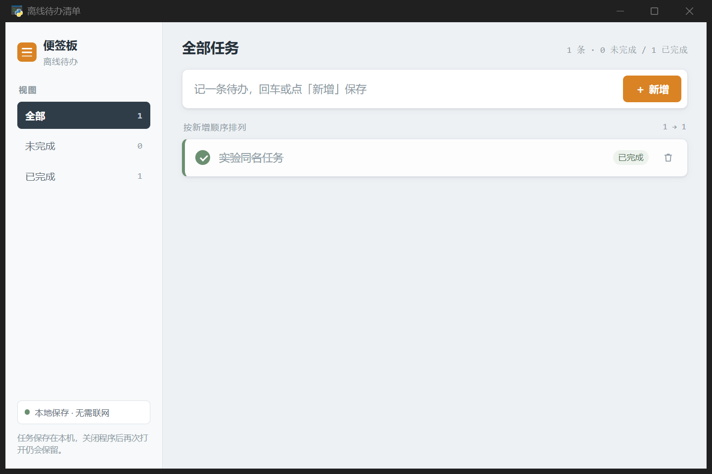

# r4 G11 正式实验结果（2026-10-21）

本组已按用户明确授权执行并收口。**制作流程超时、未完成正式交付；留下的产物通过固定六项独立业务验收，Q=1。** 两个结论分开记录，不能把业务分数改写为流水线交付成功。

## 运行条件与结果

| 项目 | 实际结果 |
| --- | --- |
| Run | `production-v2-L1-quick-20261020-r4-G11` |
| 平台版本 | 隔离分支 `codex/experiment-readiness-20261020`，提交 `54b378cc677a45349051e1aad677896fbc049a01` |
| 模型 | D/E 实际均为 GLM 5.3 Flash Coding Plan；固定 V=DeepSeek Flash，本轮未执行到V |
| 业务起点 | L1 quick、已确认6项功能及原PRD/UX、固定6项外部验收；运行中未人工修改产物或冻结条件 |
| 开始/终态（北京时间） | 12:29:49.632 → 13:29:50.288 |
| 原生终态 | `timeout`，原始reason=`cancelled`；由封存的1小时共享期限触发，非操作者主动叫停 |
| 运行墙钟 | 3,600,656ms，约60分钟；含模型、工具及等待，不是纯推理时间 |
| 正式交付/Time-to-ready | 未形成，`time_to_ready_ms=null` |
| 请求 | 126逻辑 / 126物理；D 23、E 103；无V请求 |
| 使用量 | 126笔都有收尾；125笔usage完整、1笔未知，无活跃请求或孤立收据 |
| 实现者 | 2个真实子会话；不同执行会话物理HTTP峰值2，首个峰值12:34:48.247 |
| HTTP重叠累计 | 835,398ms，约13分55秒；仅计算完整物理区间、至少两个不同执行会话同时在途，包含网络等待，不等同CPU并行时间 |
| 监督收尾 | 相关本地进程已退出，无强制清理；包装脚本exit 0仅表示完成收尾，不代表产物交付 |
| 其他五组 | 未启动 |

已知用量：非缓存输入584,258、缓存读取5,423,424、输出185,402，缓存创建0。合计仅为已报告部分；最后一笔未知未补0，不计算完整平均token、完整成本或供应商账单。准备/通道预检消耗与正式执行分开保留。

## 交接阶段的实际阻塞

调度者自行登记5项任务，前两项由worker-1完成业务实现/逻辑检查，worker-2承担界面；后续GUI检查及整体验收存在依赖。记录显示：

1. 界面实现者尝试写根目录`test_ui.py`时超出其登记写入范围，被宿主拒绝。没有放宽门禁；后续改用内联脚本检查。
2. 内部自测曾出现“UI无innerHTML”静态检查失败、一次180秒超时，以及测试辅助类缺少delete方法/时序问题等。后续真实界面复测产生通过记录，不能把这些早期失败全部解释为产品业务失败。
3. worker-2在13:24:48及13:28:29的交接仍是`completion=incomplete`，列有上述早期内联命令的失败/超时。后续不同内联命令的成功没有取代这些key对应的记录。worker-1另有旧版本凭据stale，交接为unverified。
4. T-04相关依赖在13:25:21、13:26:21、13:26:53、13:28:38四次被`EXPERIMENT_DEPENDENCY_UNRESOLVED`拒绝；最终未进入固定V，随后触达共享期限。

具体交接条目保存在 `outputs/experiment-r4-G11-20261021/handoff-settlements.json`。这证明本次活跃交接证据未收敛；尚未把原因泛化成“所有旧失败都应忽略”。后续需区分测试脚本错误、版本失效、明确被替代的验证与真实未修复失败，保留历史同时裁决当前义务；不能通过清空失败或无条件采用最后一个PASS制造绿色结果。

## 独立业务验收

监督者确认进程退出后，使用全新数据目录、真实WebView2控件动作及完整进程树重启进行；未直接调用业务方法替代界面操作，未让实现者参与修复或评分。

| 固定场景 | 最终结果 |
| --- | --- |
| add-trim：新增标题去首尾空格 | 通过 |
| empty-rejection：空串/空白不能新增且不改变已有项 | 通过 |
| toggle-isolation：同名任务状态隔离及取消完成 | 通过 |
| filters：全部/未完成/已完成切换 | 通过 |
| delete-isolation：只删除指定同名任务 | 通过 |
| restart-persistence：重启后内容、状态及删除结果保留 | 通过 |

首轮适配器使用旧`data-view=open`，产物实际为`active`。首轮5项通过，filters为harness pending、Q=null。保留其完整review、日志和官方未完成评分；之后只在新适配器中加入open→active控件映射，业务动作、期望值和原6项suite未改，产物源码未改。第二轮另用全新数据重跑6/6通过，源码前后哈希一致。

官方评估只补入原来pending的filters，既有5项结果锁定并保留首轮证据；没有覆盖已判定结果。最终`evaluation_evidence_valid=true`、product_quality=1、product_success=true，原生run_outcome仍是timeout。映射修订与两个适配器SHA256见 `adapter-selector-revision.json`，原封存适配器未改写。

产物实测画面：

## 证据与后续边界

- 主结果：`outputs/experiment-r4-G11-20261021/result-final.json`；首轮未完成结果为同目录`result.json`，两者均保留。
- 正式报告：`C:\Users\17359\AppData\Local\Bloma\production-v2-L1-20261020\pilot-r4-independent\G11\final-model-report-complete.json`。
- 监督结果：同根`supervised-r4-G11/result.json`；原生日志/末屏/收据位于`pilot-r4-runs/G11/`。
- 独立验收：同根`pilot-r4-independent/G11/attempt-1/`与`attempt-2-selector/`。
- 原始请求与事件仍位于r4 G11独立home；原r1/r2/r3、被冻结的输入及主项目列表不改写。

本轮只有G11一个样本，不计算六组配对D/R/G或模型效率优劣，也不把约60分钟称为成功Time-to-MVP。其余五组保持未启动，应先复查交接证据收口与测试错误分类，再用新版本/新cohort继续；不在已结束的r4 G11上追加实现后重写本次结果。
