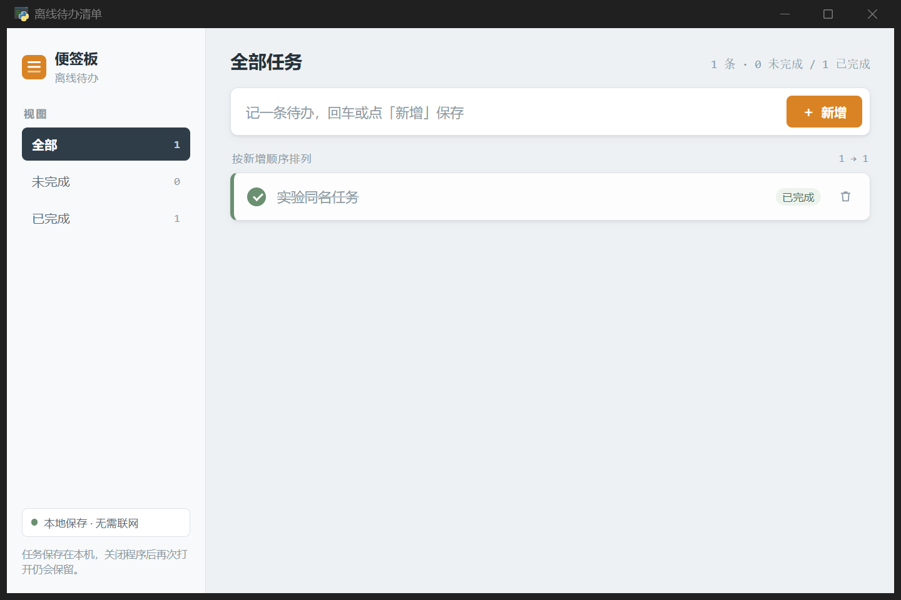

# 交接修复后 r5a G11 结果（2026-10-21）

**本轮未形成正式交付：V 已真实执行，结论 unverified，实验以 `EXPERIMENT_GATE_EXHAUSTED` 失败收口。留下的产物通过固定六项独立 WebView2 业务验收，Q=1。** 业务验收通过和流水线交付失败分别保留，不互相覆盖。

## 运行与收尾

| 项目 | 本次实测 |
| --- | --- |
| Run | `production-v2-L1-quick-20261021-r5a-G11` |
| 运行时 | `codex/handoff-recovery-fix` / `8224ac088b9103cddeca231596ae9a99940290f9`；封存的73个运行文件及驱动哈希复核一致 |
| 输入 | `4566f020f5d27f0cdac677a569b6518b15e64c757b5e0a9e54f70bfb19325489`；沿用原冻结业务输入 |
| 模型 | D/E 实际 GLM 5.3 Flash Coding Plan；V 实际 DeepSeek Flash，绑定与账本一致 |
| 原生实验开始 → 结束（北京时间） | 17:53:13.365 → 18:45:02.572 |
| 墙钟耗时 | 3,109,207ms，约51分49秒；含工具、网络与等待，不是纯推理时间 |
| 权威终态 | failed；reason=`EXPERIMENT_GATE_EXHAUSTED`，phase=`quick-verifier`，非共享期限超时 |
| 正式交付 / Time-to-ready | 未形成；time_to_ready_ms=null |
| 请求 | 114逻辑 / 114物理：D25、E75、V14；预检14次另计 |
| 账本 | 114笔终态收据，114笔usage完整；0活跃、0孤立、0缺失用量 |
| 实现者 | 两个实际执行子会话；不同执行会话物理HTTP峰值2，首次峰值17:59:04.227 |
| 并发累计 | 至少两个不同执行会话同时在途578,615ms，约9分39秒；包含网络等待，不等于CPU并行时间 |
| 本地收尾 | supervisor、driver、Electron均已退出；local_processes_settled=true，forced_cleanup=false |
| 其他五组 | started_at均为空，模型请求均0；未启动 |

原生driver报告 outcome 为 `operator-stopped`。它在实验已经产生 failed 终态后，由监督器写入 STOP 做 `terminal-cleanup` 而得到该包装标签；并非人工叫停。保留原标签、监督结果和权威 run_finished，不将其误写为操作者干预或产品完成。原项目存储仍可能显示 active/generating_mvp，配置仍可显示 running，均不代表进程活跃或实验成功。

已报告用量：非缓存输入383,138、缓存读取3,887,676、输出129,718，缓存创建0，总计4,400,532 tokens。这里是提供方报告的token，不推算 Coding Plan 账单、精确剩余额度或人民币成本。准备预检与正式实现阶段独立记录。

## 修复是否在真实运行中生效

worker-1 在18:08:53正常结束，但交接仍有两个 stale 凭据，completion=incomplete。worker-2 在18:28:20正常结束，交接仍保留3项失败和测试辅助错误，同样 incomplete。18:28:38，调度者成功续接 worker-1 执行依赖 T-02/T-03 的集成和 GUI 核验任务 T-04，随后实际读代码、写 test_gui.py、登记核验与交付材料。

这直接证明此次真实运行越过了 r4 的交接阻塞点，历史失败未被清空；不证明所有后续任务或所有模型都会收敛。5次持久化交接记录见 `handoff-settlements.json`，派工及终态见 `terminal-evidence.json`。

18:40:58和18:41:42，实现者尝试创建计划写入范围之外的 `00_SCAFFOLD/contract.json`，均被宿主拒绝；调度者在子问题里口头授权没有改变登记范围。18:43:13重登记计划被 `EXPERIMENT_PLAN_ALREADY_DISPATCHED` 拒绝。实验未放宽权限，也未由监督者代写。此处暴露出调度反馈、工具前置条件与冻结写入计划之间的恢复问题，应在新版本另行排查；它不是本轮最终 run_finished 的直接原因。

## 正式核验与 V

宿主 `00_VERIFY/core-verification.json` 记录 status=passed，覆盖9个逻辑场景及6个GUI场景，六项功能 verification=passed。18:43:57实现阶段完成。18:44:27固定 V 开始，18:45:02结束，14次真实 DeepSeek Flash 请求均结清，读到了核心报告、需求功能及相关源码，前后源码指纹一致，结论为 **unverified**。

V 列出两项尚未解除的疑点：

1. 正常启动的 pywebview.api 桥就绪时序未被现有驱动模式测试覆盖；UI boot 在请求前设置 booted，若首次调用失败，后续 pywebviewready 可能不再重试。V认为正常启动首屏可用性证据不足。这是本轮审阅提出的风险，独立六项驱动验收不能证明正常桥路径无此风险。
2. UI 调用 add_task 未带当前 view，桥回包默认为 all；前端随后 refreshView 重新拉取作兜底。V未观察到业务错误，但认为回包契约一致性未解决，未给通过。

完整原始结论见 `verifier-review.json`。没有把 V 的风险推断改写成已经独立复现的产品缺陷，也没有用外部Q=1覆盖 V。正式门禁保持拒收，本轮没有 delivered 事件。

## 独立业务验收

确认运行进程退出及114笔账本收尾后，使用新的 APP_DATA_DIR，通过真实 WebView2 DOM 控件操作，按固定suite逐项验证，并完整关闭进程树、重新启动同数据产物。

| 固定场景 | 最终结果 |
| --- | --- |
| add-trim：新增标题去首尾空格 | 通过 |
| empty-rejection：空串/空白不能新增且列表不变 | 通过 |
| toggle-isolation：同名任务独立完成与取消完成 | 通过 |
| filters：全部/未完成/已完成筛选 | 通过 |
| delete-isolation：只删除指定同名任务 | 通过 |
| restart-persistence：重启保留标题、状态及删除结果 | 通过 |

首轮封存适配器读取 `data-id`，新产物实际使用 `data-task-id`；已完成筛选值由旧 done 变为 completed。首轮empty-rejection通过，其他5项因选择器或后续缺失状态pending，Q=null。完整首轮和其官方未完成评分保留。

另存 selector-v2 适配器，只修改3处行标识选择器及done→completed映射，业务动作、断言和六项suite不变；全新数据重跑6/6通过。官方评估锁定首轮已通过的empty-rejection，只补入5项pending，最终 evaluation_evidence_valid=true、product_quality=1、product_success=true。两个适配器哈希及差异见 `adapter-selector-revision.json`。两轮前后源码哈希一致，未修改被测产物。

## 证据与下一步边界

- 仓库证据：`outputs/experiment-r5a-20261021/` 下 result.json（首轮不完整）、result-final.json、supervision-result.json、terminal-evidence.json、parallel-evidence.json、handoff-settlements.json、verifier-review.json、core-verification.json 及适配器修订记录。
- 原始监督与驾驶证据：`C:\Users\17359\AppData\Local\Bloma\production-v2-L1-20261020\supervised-r5a-G11`、`pilot-r5a-runs/G11`。
- 独立验收与官方评分：同根 `pilot-r5a-independent/G11/attempt-1`、`attempt-2-selector`、`final-model-report-incomplete.json`、`final-model-report-complete.json`。
- r4及更早样本、运行树、封存输入保持原状；主项目列表仍为空。主工作区既有制作流程文档未提交修改保持不动。

本轮能证明交接修复使该样本实际进入后续集成与V，不能宣称正式交付成功、因果提速或六组效果已经建立。下一步应先排查正常桥启动证据、V疑点裁决及冻结写入范围的恢复机制；本监控不自动修被测程序、不重跑付费样本、不启动其余五组。运行与独立验收均已收口，停止本轮监控。
