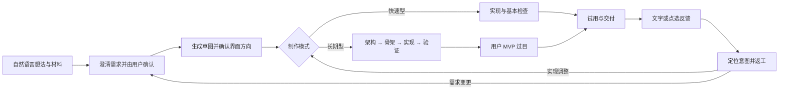

# Bloma 组会汇报速查稿

日期：2026-10-11；配合 [8–10 分钟口述稿](group-meeting-script-20261011.md)。工程截止 `51b8735`。以下公式和对照设计是拟统一的实验口径，不表示全部指标已接入报告。

## 1. 流程图与确认节点

该图是汇报用的逻辑流程，不逐一表示所有路由、重试和恢复状态。快速型保留 PRD、UX 确认，减少架构/骨架/工程化 verify 阶段；长期型增加 MVP 确认。停止、阻塞和权限请求可触发例外处理。会话分支保留当前程序，文件恢复使用版本入口。

## 2. 技术点与价值对应

| 技术 | 具体做法 | 要解决的问题 |
| --- | --- | --- |
| 需求与材料可追踪 | 原始输入、PRD 背板、功能 ID、材料 ID/哈希/范围、完整需求上下文 | 多次转述遗漏需求，生成者与验证者理解不一致 |
| 有状态编排 | 阶段表、合法推进、角色委派、工具按阶段装配、看门狗和 checkpoint | 反复委派、工具无法兑现任务、挂死和重验 |
| 桌面执行与驱动 | 项目 Python 环境；默认骨架 v2；逻辑 `/call`、DOM `/eval`；受控执行工具 | 有代码但无法启动、只看文本判断成功 |
| 验收证据分级 | PRD 到场景映射、真实驱动、入口/安全/启动证据；standard/strict | 假绿，以及静态误报不合理消耗修复预算 |
| 可靠状态与遥测 | JSON/JSONL、草稿 revision、提交身份、显式恢复、运行代次、轮级 usage | 输入丢失、重复派发、旧事件覆盖新运行、难以归因 |

平台自身是 Electron；生成软件当前默认是 Python + pywebview/WebView2 + 本地 HTML/CSS/JS。快速型允许较少工程流程，旧 tkinter 产物仍有兼容支持。HTML 界面不代表重开 Web 生成路线。

## 3. 指标定义、分母与采集状态

先固定试验单位：**参与者 × 任务 × 条件的一次完整试验**。固定参考任务和验收要求，记录模型/版本、运行环境、模式、验收策略、资源上限和是否有人手工改代码。各组使用同一个时间起点和独立验收规则。

| 指标 | 定义/计算 | 当前状态与限制 |
| --- | --- | --- |
| Time-to-MVP | `独立验收通过时刻 − 统一试验开始时刻` | 有阶段时长和状态记录；研究端起止点及独立验收终点待统一。失败/超时任务另列，不能只报成功样本均值 |
| FIRT，首次可交互结果时间 | `首个可交互界面就绪时刻 − 同一开始时刻` | 草图相关状态和展示已有；需验证就绪及交互能力。只能查看的草图另标，不能冒充可交互或 MVP |
| 成功闭环率 | `限额内通过固定任务验收的试验数 / 有效试验总数` | 可读取项目/交付/失败记录；单独的 completed 状态不足以确定。有效性和排除规则在实验前规定 |
| 映射覆盖率 | `有适用验证场景的参考需求数 / 全部适用参考需求数` | 长期型已采集 mapped 等字段；需要共同参考集合，不能忽略未映射项 |
| 验证通过覆盖率 | `满足对应场景要求的参考需求数 / 全部适用参考需求数` | 长期型已有 passed 聚合；固定参考集合仍需实验侧对齐。所有 P0 通过并不自动保证所有 UI 体验无缺陷 |
| 总 token / 单位任务 token | 去重汇总整个试验输入/输出/重试/子会话；单位值为 `总 token / 通过独立验收的固定关键任务数` | 段级/轮级 usage 已采集；供应商明细可能缺失，须区分报告值/估计值。零通过时单位值无定义，单列失败成本 |
| 交互与认知负担 | 任务级澄清轮次、修改轮次、同一误解重复解释；固定评分题与访谈 | 消息和部分交互事件已有；误解/新增需求需编码，问卷与受试者数据待开展 |
| 意图修正成功率 | `独立复核满足原修改意图的纠错任务数 / 有效纠错任务数` | 点选及反馈链路已有；任务级意图标签、复核和统一统计待补，不用点击次数替代成功 |

时间建议报告成功条件下的 p50/p90，同时报告成功率、超时/未完成数量和观察时长。需要从失败样本估计总体完成时间时，再明确时间截尾和分析方法，不把失败任务时间写成 0。

总 token 是资源消耗代理；金额需要供应商实际计费项和价格信息，不能凭缺失字段计算精确费用。单位任务的分母使用固定参考关键任务，不能让模型增加需求条目来改变分母。比较组之间既报告每次试验成本，也报告成功任务成本，并保留失败成本。

### 过程诊断指标

- 现有同阶段返工段占比：`attempt_index > 1 的运行段数 / 有 attempt_index 的运行段数`。这是代理指标，不等于项目首次通过率，也不一定都是修复行为。
- 若需要首次通过率：按 `(项目, 阶段)` 去重，计算第一次尝试即通过的阶段数，占有有效首次尝试的阶段数。
- 失败类别：业务失败、测试/映射失败、安全失败、基础设施问题、预算耗尽、取消、无法判断。研究报告避免将网络失败都算成业务质量失败，也避免直接删除这些试验。
- 轮次、工具失败次数、阶段时长 p50/p90、重试 token 占比解释成本。旧字段缺失保持“未知”，不填零。

### 现有报告的口径提醒

`scripts/quality-report.mjs` 已汇总阶段终态、返工段、轮数/时长、驱动场景、交付与探索降级。其目前展示的通过覆盖分母是 `mapped`，属于**已映射需求内部的通过比例**，不能直接替代上述“全部适用需求”的通过覆盖率。

该脚本数据窗读取 `timestamp`，当前 `trackAnalytics` 写入 `created_at`；正式时间窗与起止事件应先统一字段。段级 `duration_ms` 本身仍可作为过程记录。演进质量和手工改代码/门禁覆盖仍有占位或缺少自动观测。本次只核对并说明，没有修改统计实现或运行真实用户数据的全量统计。

## 4. 对照试验建议

以下为讨论方案，不宣称已招募、随机分组或取得显著结果。

1. **整体流程比较**：普通对话工具与 Bloma 完成同一类任务，观察效率、成功、资源和交互负担。这能评价完整系统的用户支持效果；若执行工具或部署支持不同，需明确它们也是条件差异。
2. **指令结构比较**：在同一运行与工具条件下，比较自由描述、目标/输入输出/约束/验收结构化描述、向导渐进澄清。保留各条件全部澄清成本，检验需求组织方式的作用。
3. **控制项**：同一模型版本、任务集合与难度、环境、总资源预算、验收策略；匹配参与者开发经验。多 Agent 所有子会话与重试计入总预算。条件/任务顺序适当随机或平衡，避免练习顺序影响结果。
4. **共同验收**：参考关键任务在生成前确定，业务/UI/数据检查由实验侧复核。不能由各组生成者自行定义成功；适用需求变更单独记录，避免分母漂移。
5. **先小规模预实验**：检查任务难度、日志完整性和失败分类，再决定正式样本量与分析方案。整体系统差异不能单独归因为多 Agent、结构化提示或点选纠错，需要后续消融。

立项书提到的原生对话框对照属于整体流程条件；这里补充相同执行面下的机制比较，以便回答“什么样的自然语言组织方式有效”。界面差异明显，不应把实验称为受试者双盲。

## 5. 最近推进与可引用数字

- Git 进展：2026-10-01 至 `51b8735` 共 125 次提交，60 修复、48 功能，详见 [阶段总结](git-summary-20261001-20261011.md)。只作工程推进背景，不衡量研究效果。
- 平台回归：235 文件/2202 单测通过记录，集成 8 例；全量运行早于最后 UI 细节，之后有定向复验、最终类型/构建与 7 项真实 Electron 检查。图标批另有 8 项定向检查。不能说完整 HEAD 又重跑了全部单测。
- 真实生成样例：固定 quick 记账项目在 DeepSeek 链路 completed/delivered；独立 WebView2 6 项检查含启动、样例显示、实际保存、负数拒绝、CSV 导出、重启留存。
- 样例报告中的约 176 秒是最终续跑耗时，**不作 Time-to-MVP 数字**。真实样例数量不足以给出所有任务、长期型或所有模型的成功率结论。
- 新标准验收、预算和短输出约定已实施；其对平均耗时、token、闭环率和用户理解的实际提升仍待同口径真实试验。

## 6. 常见问题的回答

**为什么要多 Agent？** 目前是把澄清、实现与验证职责分开，并让工具和上下文匹配任务，以便控制过程和定位失败。是否比单 Agent 更有效需要相同条件下的对照/消融；更多角色也会增加协调和上下文成本。

**验收越多越可靠吗？** 真实业务操作和数据验证很有价值；启发式检查有误报和额外成本。因此采用证据分级、默认标准与可选严格策略，并评估收益与摩擦。安全扫描和测试通过不构成无缺陷或完整安全证明。

**2202 个测试说明生成的软件都通过了吗？** 这是平台工程回归用例数。产物质量需要各任务的驱动、UI、数据与独立验收证据；两类测试分别说明。

**目前能说效率明显提升吗？** 可以报告局部链路跑通、修复了已复现问题；还不能报告受试者效率提升或统计显著性。下一步统一口径并做预实验。

**科研贡献准备落在哪里？** 聚焦非专业用户需求表达、渐进意图规约和可验证开发之间的关系，用效率、质量、资源与交互负担衡量适用边界。系统架构是实验载体，潜在贡献需要数据支持。

## 7. 核对依据

研究定位参考立项书《智能化软件工程与多Agent协同开发平台》，以当前桌面实现校正早期 [科研计划](research-plan.md) 的旧流程/指标名。现状主要核对入口：

- [PRD 确认与 UX 接线](../../main/guide/prd-confirm.ts)、[桌面路径与快速型分支](../../main/desktop/desktop-route.ts)、[阶段表](../../main/desktop/dispatcher-phases.ts)。
- [验收收口](../../main/desktop/dispatcher-finalize.ts)、[运行与交付遥测](../../main/desktop/dispatcher-telemetry.ts)、[记录时间字段](../../main/delivery/track-analytics.ts)、[质量报告](../../scripts/quality-report.mjs)。
- [附件与真实生成验证](attachment-batch-c-20261009.md)、[验收首批修复](acceptance-batch1-20261010.md)、[通透画室验证](ui-studio-implementation-20261011.md)、[提示词现状与缺口](prompt-audit-20261009.md)。

本稿没有新做文献综述或引用外部实验结论，没有执行新的模型任务、修改应用或更新项目记忆。
