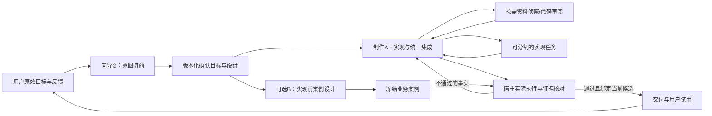

# Bloma 研究方向修订与多 Agent 实施规划

版本：v2讨论与实施基线；启动：2026-10-29；修订：2026-10-30（Asia/Shanghai）。用户明确允许质疑、推翻旧立项假设，按更合理的方案推进。本轮落地的是旧面板改造；下列新增协作/研究能力仍按里程碑实施，不代表已启动真实模型试验或受试者招募。

对照原文：`C:\Users\17359\OneDrive\Desktop\项目\智能化软件工程与多Agent协同开发平台.md`，SHA-256 `651a3d1915106d01e4712605e11e1dcaa47fc68c1a0caa3de4c7d022fe19e300`。已读完整四阶段及十个案例，原文件保持不动。也核对仓库旧 `research-plan.md` 和当前源码，当前工程入口以本文件、模板审计记录及Git为准。

当前优先级已由用户纠正为实际生成质量：工程主线见 [多Agent生成质量方案](multi-agent-generation-quality-plan-20261030.md)。本文件保留为后续研究背景，不要求先做受试者实验或科研设计再改进生成闭环。

## 1. 修订后的研究主张

研究非专业用户如何通过**可验证的意图协商与受约束的软件构建**，把含糊目标逐步变为可用软件；多Agent是待检验的执行机制之一。工作标题可用“面向非专业用户的意图协商与按需协作式软件构建”，不以Agent数量、提示词人格或调度图复杂度作为贡献本身。

G与A是待验证的职责划分，不把两个常驻独立Agent当硬前提；若单一执行体分阶段使用提示/工具能达到同等质量且成本更低，就合并执行体。首期复用现有向导G与制作A：G帮助用户表达和核对目标，A负责工程实现和集成。它们可以使用同一个模型；职责、会话与权限独立不要求厂商不同。进一步检验何时需要专业子任务、何时单负责人更好，以及独立案例设计的收益与误报。

## 2. 对原立项书的保留、质疑和替换

| 原文安排/假设 | 判断 | 修订后的做法 |
| --- | --- | --- |
| 为非专业人员降低自然语言开发门槛 | 保留为研究对象 | 同时量化目标保持、业务完成、成本和用户负担，不能只看代码生成/启动 |
| 向导把人话转成工程指令，再传给编程Agent | 保留职责，收紧协议 | 保留原始输入、确认/修订与来源；工程目标可追溯到用户，不把向导加的功能当用户意图 |
| 四阶段按1周/1周/2周/1–2个月推进 | 作为历史教学安排，不再作为当前工程日程 | 现有平台已超过入门MVP；改用可验收里程碑，不倒退重做基建/重写整个系统 |
| 十个梯度任务全做一遍 | 作为开发团队教学/流程探查材料 | 正式研究只选择少量有明确构造的匹配任务；不让课题组训练过的学生直接冒充零基础受试者 |
| 学习某个指定客户端、固定模型版本 | 有时间局限 | 记录实际工具/模型/协议版本，研究贡献不绑定Cherry Studio/Claude Code或某一历史模型；不凭旧价格配置预算 |
| 分析泄露源码 | 替换 | 使用公开、许可/版本可核对的仓库和官方材料，才能提供可复现的架构依据 |
| 第四阶段推翻重写MVP | 不采纳为当前默认工程动作 | 基于缺陷、耦合和实验变量增量重构，保留可运行基线、旧数据与对照版本 |
| “无侵入式静默埋点” | 保留低干扰，拒绝隐瞒采集 | 在告知/同意的研究流程内自动记录必要事件，明确退出/撤回及数据范围，不记录Key |
| 裸聊天 vs 完整Bloma可说明协作有效 | 只足以研究整体产品效果 | 工具、模板、自动运行、验收和交互都不同，不能把差异单独归因于向导或多Agent；增加匹配工具链的机制对照 |
| 双盲或分组对照 | 原表述不够准确 | 用户看得到界面差别，不能承诺参与者双盲。可以随机分组、对产物评审/标注者隐藏条件，并如实报告无法盲的部分 |
| 更少对话/Token就更好 | 推翻为单一成功标准 | 有用澄清可能增加轮次却减少后续返工；应与目标保持、质量、人工劳动和费用共同解释 |
| 最高效驱动模型生成“零Bug代码”、寻找唯一最佳语言范式 | 替换 | 研究指定任务和条件下哪些交互/协作机制降低已定义缺陷、偏离和成本；允许负结果，不宣称所有任务通用最优或零缺陷 |

研究方法应交代假设、测量、随机化/分配、样本依据、任务和分析，而不是先指定成功结论。这里参考[ACM SIGSOFT实验标准](https://www2.sigsoft.org/EmpiricalStandards/docs/standards)，并据本课题资源取舍；下文数字阈值尚未预登记，不伪称已经有统计功效或实验结果。

## 3. 研究问题与可证伪假设

| 问题 | 操纵因素 | 主要观察 | 可能的反例/负结果 |
| --- | --- | --- | --- |
| RQ1：意图协商何时值得？ | 同一制作工具链，直接制作 vs G协商后交给A | 预先定义业务目标完成、遗漏/扭曲/擅自扩展、确认和修正负担 | 明确小任务可能被多余澄清拖慢；用户确认不自动等于完全理解 |
| RQ2：按需协作何时优于主负责人？ | 同G/A和预算，主负责人独立 vs 允许有边界的专业子任务；再比较等预算的主负责人额外推理 | 合并后的最终质量、总墙钟时间/费用、协调/重复阅读/冲突 | 依赖密集、小任务或同文件修改可能无收益甚至变差 |
| RQ3：独立案例设计如何影响质量和代价？ | 保持制作模型/目标一致，已有A验收准备 vs A+B设计；若资源允许，加等预算A二次设计消融 | 统一外部标准下的缺陷、B误报/过度约束、总修复和验收代价 | B可能设计错误预期或过度限制，增加误报和成本 |

主研究先做RQ1；RQ2/RQ3在工程预试可用后各自做受控消融，不把三者塞成一次难以归因的大实验。裸聊天对照可作为整体产品效用的补充研究，单独命名和解释。

METR的2025年实证研究将“感觉更快”与实际任务计时分开，研究对象是熟悉成熟仓库的开发者、特定时期的工具。它提醒我们测量而非预设收益，不能直接外推至2026年的模型或本课题非专业用户。[论文](https://arxiv.org/abs/2507.09089)

## 4. 目标协作架构与现状

图是目标职责和数据流，不是每轮都启动所有分支；宿主、命令进程、模板组件和看门狗并不因此算作LLM Agent。现有主负责人已承担调度/实现，不额外增加必经调度模型。

| 职责 | 输入/权限与输出 | 当前状态与下一步 |
| --- | --- | --- |
| G 意图协商 | 用户原话/材料/版本化目标；澄清关键不确定性和确认变更，不直接给新需求发PASS | 已有lean-guide/确认链；优先改善需求来源、假设和实际效果记录，不恢复旧六维会议流水线 |
| A 制作与集成 | 确认目标/设计、工程读写、受管命令和实际观察；统一集成与修复 | 已有持续Pi、组件准备及验证闭环；仍是工程唯一集成负责人 |
| R 专业侦察/审阅 | 限定问题、受控只读材料和稳定候选；返回证据、具体缺陷/未知项 | 已有explore/research/review工具面；新增可复用任务契约/按需预设，不默认每轮启动 |
| V 视觉/交互审阅 | 候选版本绑定的真实截图/参考图，真实视觉输入；返回可见问题与操作建议 | 有view_image底座，但父debug截图不能直接让子会话越权读；需补材料授权和版本失效测试。视觉意见不能替代业务断言 |
| W 实现子任务 | 明确接口、独占write_paths，返回改动/未验项；默认无shell | 已有最多2并发、子任务不能再委派和主命令屏障；先按文件分工，再评估独立执行环境，不把通用worktree开关当已验证方案 |
| B 业务案例设计 | 实现前只见确认目标/设计，另模型/明确预算；不改用户需求和产品实现 | 已有项目配置、冻结GUI案例及宿主执行；优先记录误报和未覆盖，跨CLI/API需专门契约，不冒称已支持 |
| H 宿主验证 | 绑定需求/源码/环境/GUI/资源的实际证据 | 已有；确定性裁决、未知保持未知，模型说通过不能替代它 |

首期制作子任务继续继承A模型、共享物理请求/输出/费用保护，不开放无预算的任意跨渠道覆盖。B是另一个已授权来源，不能用旧“裁判”配置替代。不同会话、同一模型仍是多Agent；单模型不等于单Agent。

每次专业委派至少明确：问题/退出条件、确认范围、源码/设计身份、可见材料摘要、读写/命令边界、共享预算、取消和失效条件、结果证据。只在独立信息压缩、独立错误假设或真正可分割工作上拆分。当前子任务不能独立跑测试，相关权限要先完成环境/进程/数据隔离再开放。

## 5. 分层实验条件

| 层次 | 建议条件 | 可得结论与限制 |
| --- | --- | --- |
| E0 工程预试 | 固定任务、受控服务、非专业场景反例；核对G/A交接、材料、权限、取消/重开和证据 | 证明链路可用，不能代替真实生成、受试者研究或因果收益 |
| E1 主机制研究 | C0：同界面基本能力/制作A/工具/模板/验收，直接表达与制作；C1：同条件加入G的意图协商 | 研究协商机制；固定制作模型、环境、任务质量标准与资源上限。记录G本身额外成本 |
| E2 协作消融 | 在同G/A下，禁止专业委派 vs 允许明确策略的按需委派；再与同预算的A额外推理对照 | 研究上下文分工/并行是否有净收益。按需策略和触发条件先冻结，不能成功后重新定义哪些任务“适合” |
| E3 B设计消融 | 同制作与工具链，A准备 vs A+B准备，使用相同外部结果评价 | B的内部测试会不同；不能直接比较两组各自“内部通过率”。增加B后的缺陷发现多，既可能更严格也可能是误报 |
| E4 产品整体效用（可选） | 普通聊天工具 vs 完整Bloma，清楚说明工具/自动化/模板/引导差别 | 可比较整体体验，不把差异全归因于向导或多Agent；与E1/E2机制结论分开 |

所有条件用同一套预登记、独立于生成结果的外部业务标准评估。B冻结案例是内部干预，不能同时充当只有B组才有的最终评判标准；B引入用户未确认的要求要记录为偏离/误报。候选源码、任务、模型/渠道、预算、测试和人工介入完整保留。

实验单元、随机分配和分析方法在预试后冻结。首期可用按背景分层的组间设计；若改成交叉设计，必须使用匹配但不同的任务、平衡顺序并考虑学习/携带效应。不能把同一参与者反复修复或同一产物复跑算成多个独立成功样本。正式样本数量应说明依据；原文“数十人”不是自动足够。

## 6. 任务、指标和采集

保留原十案作教学资源，但重组为三类正式任务：①明确小工具（文件/记录）检验协商开销；②含糊的多对象管理任务检验澄清与意图保持；③跨资料/图片/外部API任务检验信息探索和可分割协作。案例9可作为定向调试材料。网页任务要走已验证的新流程交付能力，不能恢复已退役旧web线；两组产物形态与验收环境必须一致。

不让正式受试者先完成全套Agent编程训练。按实际编程/AI经验筛选，而非仅按学院；课题组开发者和经过训练的试用者用于工程/可用性预试，不能混入零基础组不加说明。预试用于发现流程问题和估计分布，不直接宣布效果成立。

| 指标 | 操作定义/记录边界 |
| --- | --- |
| 主指标：已验证业务闭环完成 | 在预登记时间/资源上限内通过统一外部必需案例；失败、未完成、未知都保留，另记人工救援 |
| 意图保持与修正 | 任务目标/用户确认版本与产物的遗漏、扭曲、擅自扩展；用事前标注规约及多名评审核对，真实用户新增意图单独记版本，不能所有变化都判为错误 |
| Time-to-verified-MVP | 从参与者开始任务到实际可运行且达到统一业务标准；区分首个草图/可试用版本，失败保留时限/删失信息，不只分析成功者 |
| 用户劳动与认知负担 | 主动操作/阅读等待、困惑/恢复、访谈和选定问卷；用户看得到界面不同，如实采用可行的评审盲法，不称双盲 |
| 成本与重复工作 | 全链路物理请求、可核对费用或未决责任、G/A/子任务/B分项；重复查找/返工与必要澄清分开，轮次少不自动等于更好 |
| 质量/误报/介入 | 隐藏外部案例与缺陷核对、B错误预期、人工帮助的原因/时点；同模型自测绿色不等于独立质量结论 |

新增采集只针对明确RQ：原始输入引用 → G的提取/疑问/确认 → A的目标版本 → 委派输入/可见材料/写入租约 → 模型物理请求/费用 → 候选与检查 → 用户反馈。模型计量、用户UI事件和确定执行事件分别记录；未知不填0，不重置历史预算。不给零基础用户展示内部计量/框架锚点来代替产品操作。

研究采集在告知、自由同意和可退出的安排下低干扰进行；“静默”只描述不打断交互，不是秘密记录。原始对话、代码/文件和可识别路径设定最小采集/脱敏/访问与保留范围；学校/导师的伦理要求按正式研究流程确认，不把本规划写成已获批准。[SIGSOFT人类参与者伦理标准](https://www2.sigsoft.org/EmpiricalStandards/docs/supplements?supplement=EthicsHumanParticipants)

## 7. 工程实施顺序与退出条件

| 里程碑 | 本批工作 | 退出条件/决策 |
| --- | --- | --- |
| M0 旧面板语义收敛（本轮） | 只留需求沟通/界面制作；删除旧裁判/内审及兼容UI和角色配置分支，验收设计与协作数量分离 | 实际UI/IPC保存/重开通过，无模型调用；退役角色输入拒绝，旧路由不参与当前选路；实现记录见flow-routing-ui-20261029.md |
| M1 可观测G/A交接 | 目标版本/原文引用/澄清原因、每次实际选路来源/模型和协作触发记录，区分候选默认与真实调用 | 从用户目标能追到候选、委派、费用及结果；未知事件明确，零调用/错误反例不可变成通过 |
| M2 少量按需预设 | 资料侦察、稳定候选代码审阅；明确触发、输入/输出/权限/预算，维持两并发和主集成 | 本机并发、材料越权、取消、旧结果失效和费用共享检查；不靠永久多角色流水线完成小任务 |
| M3 视觉与案例质量 | 授权真实截图、来源/版本绑定；B误报/覆盖事实记录 | 换图/过期图/跨会话/伪装完成拒绝；不把点评或模型自述当业务PASS |
| M4 研究就绪 | E0预试、统一外部任务包、实验开关/随机化/数据字典与分析草案 | 冻结协议和版本，界面/量测无缺口；真实渠道、账号范围及完整预算明确后才启动收费实跑 |
| M5 正式研究 | 先E1，再根据资源分别开展E2/E3，E4独立解释 | 报告完整失败集、效应及不确定性/限制；负结果可以说明何时不该增加协作 |

M1–M5是新规划，不因本文生成而自动实现/招募/付费。执行型子Agent、更多并发、跨模型专业角色和开放互聊只在证据显示当前边界阻碍任务且隔离/预算齐备后再做，当前不迁移Pi底座或恢复历史六组实验。

## 8. 当前决定

首期采用“G协商 + A持续制作/集成 + H真实证据 + 少量按需专业任务”的可消融路线，B保持独立、可选且受预算约束。先让用户能理解并相信当前行为，再用可分辨变量的研究决定是否增加协作。原立项书的教学价值保留，过时产品指令、普遍最优/零Bug承诺和无法归因的实验解释不再作为当前规划依据。

用户于本轮进一步明确不必兼容旧版本：旧裁判/内审从当前配置面与选路面直接移除，不保留折叠入口或旧角色模型选择。保留当前研究所需的两类流程默认值，不承诺旧调用者/旧路由配置继续工作；内部项目历史记录不是新的现役Agent。原立案书仍作可追溯输入，未被直接覆盖。
