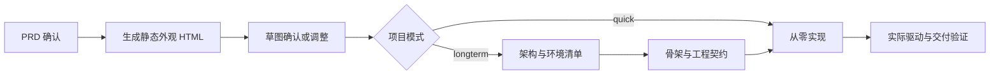

# PRD 后流程核查：UX → 架构 → 实现交接（2026-10-12）

后续状态：本文记录的是核查基线上的断点；用户授权后的修复与回归结果见 [后流程修复报告](post-prd-flow-repair-20261013.md)。不要把历史反例当作当前尚未修复的结论。

范围：用户要求检查下一流程。本轮核查源码与实际输入装配，使用上一轮真实 PRD 的只读副本做离线重放，未确认原项目、未调用真实模型、未启动生成软件、未修改生产流程或提示词。

基线 d23b5d3；实际 PRD 来源为 `run-artifacts/prd-model-2026-10-12T13-37-48-936Z-acdec3/prd-preconfirm.json`（12 项需求、21 条规则、45 个场景）。副本项目及模拟确认只在测试新建的临时 home；原文件 SHA 在每个检查后保持一致。

## 当前实际流程

代码入口：`prd-confirm.ts:369` 调用 runUxConfirmGate；`ux-confirm.ts:390` 确认后调用 enterDesktopLine；`desktop-route.ts:220–225` quick 直接 desktop-implement，longterm 从 desktop-arch 起跑。不是所有项目都有独立架构/骨架阶段。

## 结论

**当前最薄弱的是 UX 设计与确认，而非所有需求在后续交接中被截断。** 新需求模型尚未进入 UX 生成输入；反馈存在实质丢失；确认意图与需求版本、停止信号没有可靠关联。架构/骨架的前置门也只验证文件存在，语义与格式问题会延迟暴露。

### 1. UX 调整反馈被丢弃（已复现）

- `ux-sketch.ts:71` 只有 previousSummary 与 feedback 同时存在才把反馈写入模型 prompt。
- `ux-confirm.ts:115/357` 传入 pending.sketchSummary，但生产路径没有为它生成/保存内容。
- 正常“有要调整的 → 输入意见 → 重画”路径只传递未赋值的摘要。第二轮仍按原功能清单生成，模型看不到本轮意见，也拿不到上一版 HTML。
- 既有单测手工提供 previousSummary，因此只证明人工构造的条件成立，没有覆盖真实缺摘要路径。

重放意见“把方案列表放到左侧，正文放到右侧，保留历史切换入口”，两次生成均执行，但第二次 prompt 不含这句话。不存在“模型看到了意见却不听”的证据；本次证明输入装配先丢了意见。

### 2. 否定开工被识别为确认（已复现，优先处理）

- `ux-confirm.ts:28–31` 的 isUxResumeIntent 直接 includes 匹配“开工”等词，没有否定处理。
- `guide-pipeline.ts:471` 用 `classifyUserDesktopIntent(...) === 'continue' || isUxResumeIntent(...)`。第二项不仅会命中“不要开工”，也能覆盖第一项的停止判断。
- 在 UX 等调整反馈态，重放该真实判定表达式，输入“不要开工”返回继续，并由 tryResumeUxAdjustAsConfirm 调用确认/桌面入口。

这是中文确认意图的确定性错误，修复不能仅换按钮文案或给模型追加提示。

### 3. UX 未消费完整需求模型（已复现）

`ux-sketch.ts:56–81` 只向模型传 positioning、id、priority、description、story；不传 requirements_model、行为断言、体验状态或完整 PRD。重放实际 12 项/45 场景 PRD，UX prompt 不含 O-001、W-001、BR-005、AC-045。

模板兜底显示每项最多三条断言，不等于正常模型生成得到这些断言。当前产物被明确设计成“纯静态外观”，没有结构化的页面/动作/状态/功能/场景映射，也没有覆盖核查。这是当前旧设计的能力边界；不能据此把静态草图当成已经验证交互设计。

### 4. 调整达到上限会直接开工（已复现，现有策略）

`ux-confirm.ts:339–355` nextRound 超过 UX_SKETCH_ADJUST_LIMIT=3 时，记录熔断后直接调用 resumeUxConfirmConfirmed。重放到上限的调整请求，桌面入口实际被调用，没有等待本轮新的确认。

此前代码明确采用“超限按当前版本开工”策略；本轮不擅自改用户交互设计。建议将预算耗尽与确认分开：暂停重画并展示现状/残留意见，由用户或已明确授权的策略选择采用、继续或退出。次数不能替代对当前版本的认可。

### 5. 已确认草图没有绑定 PRD 版本（已复现）

- `ux-sketch.ts:199` 仅复制当前 ux-sketch.html 为 confirmed.html，没有 PRD 指纹、草图版本、设计关联清单。
- `resumeUxConfirmConfirmed` 不复核当前 PRD 是否仍确认、是否与绘制草图时相同；`enterDesktopLine` 也没有补这项检查。
- 离线模拟 UX 挂起期间 PRD 重整并清除 user_confirmed_at，旧 UX 确认仍调用桌面入口。该检查证明条件缺失，不声称真实案例已经发生过并发需求修改。

此外，UX 阶段的任何调整文本均作为重画反馈；添加功能/改业务规则与单纯布局反馈没有分流回 PRD。若修好反馈传递而不补范围判定，草图可能承诺新功能，工程仍按旧 PRD 实现。

### 6. 停止信号在交接中断开，停止后的 UX 仍可能出卡（已复现）

- `ux-confirm.ts:390–393` 调用 enterDesktopLine 时漏传 pending.signal。
- `desktop-route.ts:479` 没有 input.signal 时创建新 AbortController。离线截取实际交接参数，pending 有取消信号，桌面输入没有。
- `runUxConfirmGate` 在生成结束/模板回退后没有统一的 aborted 门控。以已 aborted 的信号运行，仍写入草图并发布 UX 确认卡。

本轮使用桌面入口桩避免启动真实工程，证明信号装配错误；没有宣称已验证所有停止方式或进程回收路径。

### 7. 草图质量门和文字降级不充分（已复现）

- parseSketchHtml 只检查 HTML 开头和 `</html>`；完整空 HTML 可以通过。没有功能覆盖、状态反馈、布局可用性的核查。
- 预览失败时旁白说文字方案在下方卡片，但实际 payload 只有 kind/title/questions 四按钮，没有具体布局、需求映射或文字方案。
- 静态草图并非运行软件；平台注入的点选纠错脚本也不构成业务交互验证。无需把“允许点选元素”误当作原型可完成用户任务。

### 8. 架构与骨架前置门只有存在性（已复现）

- `dispatcher-phases.ts:154–170` 要求 architecture.md 与 env-checklist.json；`192–205` 要求 contract.json 与驱动骨架。
- `dispatcher-gate.ts:145` verifyPhaseArtifacts 只调用 exists；`dispatcher-finalize.ts:151` 非 verify 阶段据此收口。不存在额外的前置 JSON/架构内容验证。
- 临时目录中放空 architecture.md、非法 JSON 环境清单，推进架构门仍 advance；非法 contract.json 加空驱动骨架，推进实现门仍 advance。
- 契约真正解析是在 `dispatcher-finalize.ts:204` 的验证阶段。最终会拒绝非法契约，不宜说系统完全不校验；问题是检查太晚，前面的阶段会继续消耗工程预算。

尚未看到强制的“对象/流程 → 模块职责 → 状态与数据边界 → 规则验证位置”架构关联检查。任务书有模块化要求，但不等于门禁已确认模型正确。

## 已核实的正向接线

- readDesktopRequirementsDigest 实际调用设置 maxItems=全部需求、maxDescriptionChars=Number.MAX_SAFE_INTEGER，不按展示默认 24 项/140 字截断。
- 它注入行为断言、可信验收、验证哈希、约束、范围、假设和完整 PRD 正文。buildDispatcherSystemPrompt / buildDesktopChildBaseSystem 均消费同一摘要。
- 对真实 PRD 副本装配架构与实现子任务书，O/W/BR/AC 编号均存在。因此不能笼统归因为“新模型在整个工程链丢失”；目前以正文表达传递，未形成 UX 的结构化设计关联。
- confirmed.html 能把确认时的草图副本传给工程角色；问题在于它没有绑定对应需求版本。
- requirementEvidenceHash 已包含业务模型与假设，后续验证有版本绑定基础；不是所有版本保护都缺失。

工程契约目前的 covers 指向 F-id，未直接要求覆盖每个新 AC 场景。45 场景进入正文不等于已强制声明/执行45个独立检查；这是后续验收接线需要继续核查的边界。

## 上游参照与建议顺序

对照此前只读副本 `orphiczhou/Proma-Easy` p1-quick-engineering 固定 df23df7d121d349e6a58365f3207e9b0047c59c5，不把该快照说成刚联网更新的分支最新值：

- nanju-router-prompt.ts:463 要求 prototype 完整读取 PRD，逐故事对照；598 段要求实际渲染/截图及 P0 交互检查。不能把提示词要求当作本轮已验证其真实原型质量。
- nanju-router-gate.ts:1274 在架构推进前解析已存在的工程契约；验收规格也前置冻结。适合吸收“提前暴露问题”的思路，不能照搬全套平台/工具或把原型模拟当真实软件能力。

建议实施顺序：

1. 修确定性控制错误：反馈必须传递、上一版设计必须可读、否定/停止优先、取消信号不断链、预算耗尽不隐式确认。
2. 形成轻量 UX 设计模型：流程 → 场景/页面 → 用户动作 → 状态反馈 → F/BR/AC 关联；外观 HTML 是它的视图。简单工具可很短，复杂业务才展开状态与历史。
3. 绑定 PRD 指纹、设计版本与确认内容；设计期业务范围变化回 PRD 重整/确认，布局变化留在 UX。
4. 架构/骨架门前移格式和关联检查，把模块职责、数据边界与验收位置对齐；quick 也需要在实现前整理这些事实，不必新增一套繁重的独立文档阶段。

是否把静态草图升级为可交互原型是设计取舍，不是修控制错误的必需前提。先让设计能完整表达用户任务与失败状态，再按验证收益决定哪些交互需要演示。

## 本轮证据与边界

`run-artifacts/post-prd-audit-probe.test.ts` 使用当前真实源码、实际 PRD 只读副本、SDK 输出桩和桌面入口桩；9 项检查均复现所述行为。**探针通过表示断点被复现，不表示系统健康或已修复。** `post-prd-audit-probe.json` 保存结论；日志 `post-prd-audit-probe.log`；模型调用0、原PRD SHA不变、临时数据清理。

生产代码和真实配置未改；本提交仅固化核查报告。本轮没有真实 UX 模型生成、页面视觉/交互验收或完整软件生成，不据此评价已生成产品的当前质量。
