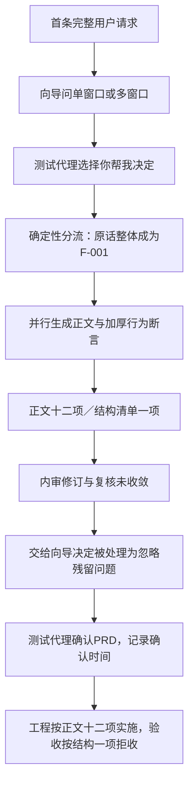

# PRD 产出链路核查（2026-10-12）

范围：按用户要求先查产出过程。只读核对源码、这次复杂案例的实际提示词副本、决策记录、确认PRD和内审提交参数；离线重放宿主修订校验。没有修改提示词、没有续跑项目、没有新模型调用。

对象：平台运行源码67ef7af；项目096b2e04-dd8d-48ae-9500-6c0d03128ed2；运行目录 `run-artifacts/generation-quality-complex-2026-10-12T10-15-08-350Z-7e926a/`。

## 核心结论与归因修正

**本单进入PRD模型前，代码已将用户完整原话包装成唯一F-001。** 不是已证明“模型先把十二条结构化需求压成一条”。PRD模型后来在正文中列出了F-001～F-012，宿主的结构化清单仍沿用原来一项。机器与人看的需求在PRD确认之前就已分裂。

因此修正上轮报告的归因：架构和验收文档中的十二个编号有PRD正文来源，不宜描述成完全由架构阶段凭空新造。真正断点更早：让渡分流绕过功能提炼、冻结了未拆解的原话；文档生成与结构字段未校验同源；内审看不到完整字段、修订部分丢失；确认只是点击事实，未拦截结构冲突。

旧工艺样例曾有同类“全文塞F-001”现象，但本轮未重新逐条重放旧会话，不能声称两次运行每个分支完全相同。本次是同类新复杂案例，加入固定数值和异常输入，不是旧请求逐字复刻。

## 实际路径

### 1. 原话保存与主题读取

`main/platform/sessions/session-service.ts:440` 的 readPrimaryIntent 读取首条非空、非问候、非让渡的user文本，直接返回完整文本，不做主题摘要或功能抽取。

本单原始驾驶回读2276个UTF-16字符；后续F-001描述2274字符，主要是空白归一。功能内容并未因压缩而消失，而是被塞入一个功能对象，失去了独立需求边界。

### 2. 为什么没有生成正常功能清单

向导第一次guide_decide是ask_clarification，问“单窗口桌面应用／多窗口并排对照／你帮我决定”。本单没有走confirm_requirements的模型功能清单输出分支。

`main/guide/stages/clarify-flow.ts:508` 的 resolveAutoDelegation 在有primaryIntent时传空数组给 ensurePrimaryIntent；后者在451行把完整主题前置成F-001。`guide-pipeline.ts:560` 捕获这条让渡路径后直接调用runPrdPipeline，没有再调用模型提炼功能项。

18:15:41的clarification_answer记录source=card_auto，requirements只有一个F-001。所谓“已冻结功能项”此时实际是一整段原话。

其他入口有所不同：模型confirm_requirements或generate_sketch可以携带功能清单；普通卡片答案也会把方向描述与主题拼成清单。不能据此说所有项目都只有一项；可以确定本单让渡入口没有完成拆解。

### 3. PRD 与需求加厚各自做什么

`main/guide/pipeline.ts:59` 的 resolvePrdBackplane 并行调用两条模型腿：

| 模型腿 | 输入 | 输出与宿主约束 |
|---|---|---|
| PRD正文/元数据生成 | 冻结功能项、完整user/assistant对话、材料上下文、少量样例、命名指令 | document、定位、acceptance、假设、范围、体验/形状等；输出协议没有把requirements作为可替换清单消费 |
| 需求加厚 | 同一冻结清单与用户原话 | story、priority、behavior_assertions；要求同id、同数量，不可新增/删除，每项0～3条断言 |

`prd-engine-llm.ts:302` 的 buildBackplaneFromParsed 将 `requirements: items` 原样保留；acceptance仅按输入id取值。正文另行接受模型的document字符串，只清洗换行与校正已知优先级，未核对正文编号集合与结构化集合。

合并阶段仍按冻结清单逐项加厚。此单记录formatDropped=2、groundingDropped=0，最终只有一条“方案A/B互不串扰”的结构化断言。输入只有一个巨型项目、加厚又禁止拆分，本身不足以形成十二组业务的独立验收边界。

实际确认PRD：requirements=[F-001]、acceptance键=[F-001]，但正文十二个三级功能标题明确为F-001～F-012。这不是仅在示例或日志中碰巧提到编号。

### 4. 实际提示词来源

本次实际使用隔离home的本地覆盖副本，运行前后的SHA一致：

- guide-system.md：4201字符，raw SHA `2a59b0d8abbaf03b73c5683ef2969b9e62ed60f0d8e639ef73049d3b6f1e2b24`。
- prd-system.md：8410字符，raw SHA `1d6ab575eecdf202165eb91e1e21f81e767fade88d6eef54663479b538e6d2f3`。

`prompt-config.ts:30` 的读取会去BOM、trim，非空本地覆盖全量替代内置默认。PRD getSystemPrompt 在覆盖后另追加产品命名指令，CAP/key_tasks按开关追加。因此“只改源码DEFAULT_SYSTEM_PROMPT”不能保证当前使用的基础提示词更新。

覆盖稿本身要求功能id与输入一一对应、文档与结构同源，向导稿也允许复杂任务有更多功能项；这单仍被代码让渡路径绕开功能提炼。另有口径冲突：guide_decide工具描述写“3～5条”，向导稿却说数量由任务决定。它是需要整理的约束，不足以单独解释这单为什么只有一项。

### 5. 内审拿到的“全文”并不完整

| 内审环节 | 真正传入的背板字段 |
|---|---|
| Attacker buildPrdReviewTask（prd-review-prompts.ts:123） | name、positioning、requirements、out_of_scope、constraints，共五项 |
| Defender buildDefenderTask（prd-defender.ts:322） | 上述五项加assumptions，共六项 |
| Recheck buildRecheckTask（prd-review-prompts.ts:190） | 又仅五项，不含assumptions |

攻击与复核标题写“PRD全文”，但没有传prd_document、acceptance、assumptions、ux、shape等。复核说“顶层不存在assumptions”只能说明任务投影没提供它，不能证明真实PRD没有该字段。真实确认PRD有七条assumptions。

这种字段省略也使审查者不能直接对照正文的十二个功能编号与机器清单的一项。

### 6. 修订曾产出正确细则，宿主没有保留

两次真实write_prd_draft工具参数均增加F-002以补材料来源/旧轮次继续修改，并提交更明确的assumptions。第一稿已经写出：逐项四舍五入后把差额配平到最大占比材料，保证用量总和等于批次量；还补了模型错误、超时和导入字段规则。

`prd-defender.ts:267` 构造cleaned时继承original.assumptions，未采纳draft.assumptions。宿主可以返回ok，但这些字段更新被静默丢弃。修改F-001描述被禁止；每轮至多新增一个id，也不能承担对十二个功能的大规模结构重整。

离线调用当前同版本validateDefenderDraft，使用实际提交参数重放：两稿均accepted=true；assumptions分别从提交9条、13条，回落为原始7条，preserved=false。没有模型调用、没有改项目文件。这是已复现的宿主处理行为，不仅是根据模型“我已修复”推测。

反复复核不收敛后，只有converged=true的revisedBackplane才会替换正式稿；本单未收敛，所以最后确认的是原稿，未采用中间补过的F-002。不能把“修订模型提出正确配平”直接等同于最终程序必然正确，但可以确定该细则未成功传入正式PRD。

### 7. “让向导决定”与“确认无误”实际判定

18:17:45测试代理点prd_review_delegate_all。代码走 `resumePrdReviewOverride`（prd-review-card.ts:190），记录prd_review_overridden及三个ignored_issues，直接发原背板的确认卡，并没有再次让模型完成修订。按钮语义与实际“忽略残留问题”的处理不一致。

18:17:48测试代理点确认。`markPrdUserConfirmed`（prd-store.ts:161）检查requirements是数组，然后写user_confirmed_at；没有检查正文/结构id一致、需求拆解覆盖或未解决的结构性问题。之后EARS改写只处理既有P0断言，不改变需求数量。

本次确认是测试代理按驾驶策略代点，日志中的“用户确认”不能解释成真人独立审阅证明。自动驾驶也没有在确认前校验同源性，这是测试控制缺口；但正常用户阅读正文看到十二项，不能被要求承担发现隐藏结构JSON只保存一项的责任。

## 当前证据边界

- 已确认上述代码分支、提示词覆盖SHA、实际决策时间线、正文与结构冲突、两次修订字段丢失。
- 原始PRD/加厚模型的成功JSON响应没有完整独立留档。不能断言原始响应是否包含额外requirements字段，也不能逐字判断两条格式丢弃断言的质量；能确定当前解析/构造不会用模型新requirements重建清单。
- 本次核查没有改提示词或生成逻辑。后续修复应先明确原话、主题、功能清单的不同职责及各入口的必经提炼步骤，再讨论提示词；同时让审查输入、可写修订域、实际落盘与确认门一致。

证据：该运行目录的prd-production-audit.json、prd-defender-writeback-replay.json、confirmed-prd.json、case-context.json、对应agent-sessions决策与write_prd_draft参数。
