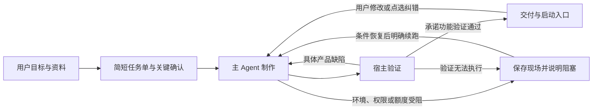

# Bloma 完整流程缩减计划

状态：计划完成，尚未实施。日期：2026-10-23。源码基线：`sprint2 / 250aab8`。

本计划依据当前实际接线，覆盖需求、草图、实现、验证、交付、纠错与恢复。目标是只保留能直接帮助做对产品、避免损失、证明结果的机制；减少模型准备工作和人为仪式。本轮仅提交计划，不改变运行策略，不启动付费实验。

核对入口：[需求整理](C:/Users/17359/OneDrive/Desktop/guide-agent-platform-sprint0/main/guide/pipeline.ts)、[需求后置链](C:/Users/17359/OneDrive/Desktop/guide-agent-platform-sprint0/main/guide/stages/prd-pipeline.ts)、[草图确认](C:/Users/17359/OneDrive/Desktop/guide-agent-platform-sprint0/main/guide/ux-confirm.ts)、[视觉管线](C:/Users/17359/OneDrive/Desktop/guide-agent-platform-sprint0/main/guide/ux-visual-pipeline.ts)、[桌面交付路由](C:/Users/17359/OneDrive/Desktop/guide-agent-platform-sprint0/main/desktop/desktop-route.ts)、[交付策略](C:/Users/17359/OneDrive/Desktop/guide-agent-platform-sprint0/main/desktop/delivery-policy.ts)、[Pi执行内核](C:/Users/17359/OneDrive/Desktop/guide-agent-platform-sprint0/main/agent/loop/pi-runtime.ts)。

## 1. 最终取舍

默认只走一条生产链：**确认目标 → 制作 → 真实验证与局部修复 → 交付**。

- 一个主 Agent 连续负责实现、集成和修复，复用现有 Pi 会话。
- 界面产品默认只生成一份草图；无需界面的任务跳过。外观确认嵌在制作开始处，不再形成独立文档生产线。
- 默认不安排独立模型做 AC、审美投票、市场灵感、架构评审或交付总结。
- quick / longterm 不再决定两套生产流水线。长期项目体现为持续修改同一项目，不体现为强制增加文档和阶段。
- 验收只保留与本次承诺功能、真实运行和必要风险有关的检查，由宿主统一执行。
- 删除平台步骤，不删除用户功能。用户明确要求的每项能力仍须登记结果，不能用“只做核心”悄悄砍业务范围。

必须保留六件事：原始需求与范围、操作权限和数据保护、会话与纠错不丢、预算与停止、真实运行证据、诚实交付状态。

## 2. 缩减后的完整流程

### 2.1 确认目标

1. 保存用户原话、附件及追加意见，整理一份简短任务单：做什么、必需能力、使用与数据约束、不做什么、完成后应看到什么。
2. 信息充分就直接给任务单；不要求首轮必须问满若干问题。只有答案会改变成品或造成明显损失时才问，优先一次合并关键疑问。
3. 普通技术选择由 Agent 结合项目和环境决定。配色、布局、包名或内部技术细节不自动变成用户问卷。
4. 用户确认任务单，或在明确目标和边界后明确说“直接做”，即可进入制作。已经确认的目标不再换一份长 PRD 重复确认。
5. 不凭空补删除、账号、导出、联网等功能再交给审查角色要求用户定夺。合理假设少量明示；影响范围的新增能力必须有用户依据。

默认没有独立的需求清单确认、全文PRD确认、AC残留问题确认三层套叠。正式PRD、EARS和完整需求图谱只在用户确有文档交付需求时生成。

关键歧义没有答案时保持待确认；超时不等于批准，不在超时后自动重跑需求管线或代替用户确认。材料仍在解析时显示实际进度，不把缺失材料当成用户没有需求。

### 2.2 制作

- 有界面且界面方向尚未确定：生成一份可直接预览的静态HTML，用户看图确认或给修改意见。用户已认可现有界面、明确提供设计或明确授权直接实现时，复用该方向，不强制重新画图。
- 不要求草图同轮输出完整页面/流程/交互/正常边界异常/F-W-AC关联。默认不做两套构思、视觉模型裁判、改稿比较和胜者投票。
- 草图失败只说明失败并保留现场；完整HTML可复用，元数据修补不重画，预览发布失败不重调模型。不得把文字需求单当作草图，也不得凭失败稿开工。
- 主 Agent 直接使用文件、依赖、运行与验证工具。架构选择、骨架复用、必要环境探测是制作中的工作，不再各自启动一轮主会话和推进仪式。
- 先完成一个真实主使用路径，再补齐本次承诺的其余能力。独立且能减少总工作量的任务才允许委派，不按角色名称强制分工。
- 已有成熟平台组件直接复用。只有项目特有且尚无证据的技术风险才做最小探针；不反复研究已支持的起窗、桥接和环境安装。

用户决策默认最多两类：目标/范围确认，以及必要的界面方向确认。涉及新增付费、外发、破坏性操作等仍按现有授权边界处理，不按步骤机械多问一遍。

### 2.3 验证与修复

一个宿主验证入口统一消费本次目标、实际入口与当前产物，汇总已有检查，避免每个阶段重复跑一套。

| 必留检查 | 最低要求 |
| --- | --- |
| 正常启动 | 从交付入口真实启动；桌面产品出现可用窗口，不能用导入模块或截图代替 |
| 承诺功能 | 每项本次必需能力至少有可观察的行为结果；界面操作需要实际操作证据，不能只看后台函数通过 |
| 数据行为 | 需求涉及留存、修改或删除时，验证相应保存/重开、影响范围及必要失败保护；无数据功能不强塞这套检查 |
| 特殊能力 | AI、语音、网络、文件处理等按本次实际依赖检查；替身、协议检查与真实能力效果分别标注 |
| 安全与范围 | 密钥不进入产物和日志，写入与执行受授权范围约束；复用现有扫描和工具守卫 |
| 版本一致 | 证据对应当前目标、产物、环境和验证规则；变更后旧通过不能直接沿用 |

保留功能ID与行为结果的最小关联，不要求把每项能力展开成全套对象、规则、流程、三类状态和多份JSON。没有证据的必需能力仍是待验证，不能因为删了映射表就变成完成。

主 Agent 可以编写测试和驱动；宿主独立执行、检查真实退出与结果，并绑定版本。预期结果来自已确认目标或固定样例，不能从当前实现反推预期。已有独立GUI规则继续有效；不再强制所有项目在编码前用另一轮模型铺出全量GUI测试套件。需要实际定位控件的规则在实现后绑定，但预期业务结果不能因此改变。

新增验证硬门必须同时具备生产执行入口、可用的观察方式和失败恢复出口。只有校验器、没有实际观察器的能力不能先塞进默认链；能力不足应尽早说明，未验证保持未验证，也不能擅自缩减用户范围来过门。

产品错误带具体输入、预期、实际和位置返回同一主会话局部修复。环境缺失、额度耗尽、验证器异常分别说明原因，不伪装成产品缺陷，不换执行者从头通读。只有发生变更、出现新失败或证据失效时才重验相关部分；复用仍新鲜的完整通过记录，最终交付再核对版本。

### 2.4 交付与继续修改

- 用户得到启动入口、实际产物、简短的完成/验证/限制说明；报告由运行事实投影，不再单独请求模型美化交付总结。
- 默认取消 longterm 独立MVP确认卡及其专用推进流程。验证通过后提供成品试用与修改入口，后续反馈沿原项目继续。
- 必需能力未完成、关键运行未验或环境受阻时，保留产物并报告未完成，不标为完整交付。部分交付须明确范围，不能静默降级。
- 文字修改、草图点选和成品点选最终都变成一条带稳定身份的修改请求。保留收件、待发存储和接收回执；未确认收到不得显示“已提交成功”。
- 纯外观或局部缺陷不重跑需求提炼、PRD审查和全部架构。用户确实改变业务范围时，只更新任务单的相关内容，重新确认受影响的范围与验证预期。

## 3. 全链路删减清单

“移出默认链”表示停止自动调用；仍被旧项目或冻结实验引用的实现先隔离保留，不能直接删除共享模块。

| 当前设计 | 处理决定 | 缩减后承接 |
| --- | --- | --- |
| 固定澄清轮数、固定问题数量、技术选项问卷 | 删除硬性配额 | 只问关键歧义，信息充分立即推进 |
| 自动市场搜索、灵感建议与候选功能勾选 | 移出默认链 | 用户提出调研或创意需求时按需调用普通工具 |
| 候选清单→整理→加厚→完整PRD→重复确认 | 合并 | 一份任务单、一处范围确认；不改变用户原话 |
| 六维AC、Defender整稿重写、复核、残留问题卡 | 移出默认链 | 用户明确要求审计，或具体高风险决策需要第二意见时做有界、定向审查 |
| EARS、章节完备性、术语纪律和形式化图谱 | 删除默认硬门 | 格式属于用户文档需求时再启用；真实范围矛盾仍处理 |
| 双候选、截图裁判、再改稿再比较 | 移出默认链 | 用户明确需要设计探索时启用；普通草图只出一份 |
| 草图全量F/W/AC状态映射与状态说明页 | 删除默认生产协议 | 草图负责视觉与主操作；行为预期留在任务单和实际验收 |
| 独立架构、骨架阶段与长任务书 | 合并进制作 | 同一 Agent 复用组件并记录必要决策；专项风险才做探针 |
| 强制L1派工、按角色拆子会话、跨模型争论 | 删除默认强制性 | 主 Agent 直接执行，独立任务才委派 |
| 让模型输出PHASE_ADVANCE推进标记 | 从新普通生产链移除 | 宿主按任务确认、执行结果和验证事实推进 |
| 多入口重复core/启动/验证检查 | 合并调度和结果 | 一次验证入口，复用当前有效的底层检查与证据 |
| 专用测试阶段、全库泛化验收仪式 | 合并 | 按本次承诺能力与风险执行真实检查，不靠测试数量定质量 |
| 普通生产额外独立LLM交付审阅 | 不新增 | 当前它只在特定v2实验配置启用；不得把未启用机制算作本次省下的调用 |
| longterm MVP确认、自动生成长交付报告 | 删除新默认强制性 | 成品可启动、结果有证据，用户直接试用与继续修改 |
| 纠错专用回炉与重复需求管线 | 合并 | 统一收件与修复入口，区分局部修改和真正范围变更 |
| 权限、密钥、预算、取消、幂等、恢复、证据绑定 | 保留 | 宿主代码强制；删重复提示，不删真正的控制 |
| 历史冻结实验及其独立研究评分 | 保留隔离 | 不改历史样本、条件、账本或结果，不自动启动新实验 |

当前事实：quick 已直接进入实现；普通桌面主执行已改成 Pi，主 Agent 已能直接写入；结构化需求整理默认已跳过旧加厚调用。此次收益重点在仍活跃的需求审查、草图和多入口验证，以及 longterm 的额外阶段，不能把既有改造再次计为收益。

## 4. 最小数据与提示词

### 一处需求权威，四类必要记录

1. **需求**：沿用项目需求存储，保留原话/材料引用、必需能力ID与描述、可观察结果、约束/范围外、已接受版本。正式PRD正文可按需导出，不再与结构数据各自生成一套。
2. **工作现场**：沿用 Pi 原生会话、工具结果及应用会话身份。用户补充和已完成工作必须可恢复；不再用角色换人和多阶段摘要重建上下文。
3. **验证事实**：宿主保存执行入口、目标与产物版本、检查结果和未验证原因。继续使用已有证据存储，不新造一套“通过证书”。
4. **交付入口**：现有启动声明与产物路径，以及简短使用说明。删除仅供阶段推进的重复文档要求，保留真正被启动器消费的字段。

附件快照、密钥配置、费用账本和必要故障日志属于基础设施，继续保留。历史复杂需求模型只读兼容，不强行重写成新模型，也不以空数组或虚假豁免骗过旧校验。

### 提示词只承载当前任务

- 稳定system保留身份、授权边界、诚实报告和工具使用的必要约定。
- 当前任务只注入已接受目标、相关变更、当前阻塞及权威文件入口。原始长资料完整保存，按任务读取；不在system、用户任务、子任务、重试消息中重复整份PRD。
- 工具字段与权限由schema和宿主解释，不在每份任务书重写教程。环境事实通过现有探测结果提供，不由模型反复推断。
- 删除“必须用某个术语”、固定开场白、固定成功话术、完整方法论手册和旧网页版提示。
- 参数/协议错误做一次有针对性的纠正。重试沿用有效产物，不整稿回灌、整稿重写，也不附加一层新的通用提示词。

## 5. 状态、额度与异常

用户界面只呈现准备、制作、验证、已交付；等待用户、受阻和取消是运行状态，不另造业务阶段。失败卡只说明发生什么、保留了什么、下一步是什么。

- 每个已授权工作范围共享模型物理请求、输出、货币和运行时限控制；重试、换渠道、子会话、压缩与恢复都不能隐形清账。需求版本变化也不能自动重置已批准额度。
- 不通过提高现有上限获得“更高成功率”。金额未配置时如实显示，不宣称存在人民币硬保护。
- 固定额度、认证或永久配置错误不重试；暂时传输故障遵循受控退避。产品修复只在有具体失败和可执行下一步时继续。
- 取消、进程重启、落盘失败后保存已完成结果与待处理意见；结果不确定的副作用先检查，不能自动重做。
- 验证错误、缺能力、缺证据始终不能变成PASS。失败后可以交还产物，但不能发“全部完成”的通知。

## 6. 源码迁移范围与实施顺序

分批提交；每批让新入口与其消费者一起工作，不制造“生产者不再输出、门禁仍要求”的死锁。

| 批次 | 主要工作与对应入口 | 本批完成标准 |
| --- | --- | --- |
| B0 固定边界 | 以本基线保存路由/门禁清单和零付费回放；定义一个项目工作流版本，旧项目缺省仍走旧兼容路径，实验配置不变 | 能明确识别新普通生产、旧项目、冻结实验；不自动推进或花费 |
| B1 合并需求链 | `guide-pipeline`、`prd-pipeline`、`pipeline`、`requirement-confirm`、`prd-confirm`、`review/prd`；定义精简需求投影并同步必要消费者 | 新项目一次范围确认；无默认调研、加厚、AC或完整PRD重写；原话与必需能力不丢 |
| B2 单稿草图 | `ux-sketch`、`ux-visual-pipeline`、`ux-confirm`、`model/ux-design`、`project/ux-binding`、`gui-acceptance-preparation`及预览消费者 | 一份HTML可预览、可修改；不再要求全量设计JSON；确认与GUI规则以需求版本及实际HTML绑定，不能依赖已删除的状态图谱 |
| B3 连续制作 | `desktop-route`、`dispatcher-loop/phases/prompt/gate`、`production-agent`及Pi会话绑定 | 新默认合并架构/骨架/实现的编排；一个主会话，宿主推进，不要求模型写推进标记或专用阶段文档 |
| B4 统一验证交付 | `delivery-policy`、`dispatcher-finalize`、`core-verification`、`capability-verifiers`、验证凭据、启动冒烟、`delivery-state`、MVP确认消费者 | 只有一个验证与交付入口；复用真实底层检查，必需能力未知时不交付；旧MVP卡不被自动代确认 |
| B5 统一修改与清理 | `correction-session/outbox`、composer收件、草图/成品点选、向导回传及展示文案 | 普通修改不回到完整前置链；收据和待发意见不丢；不再出现旧网页/审查成功/文字兜底草图话术 |
| B6 收口 | 核对引用和默认调用图，移除已无消费者的旧策略、提示词及测试；更新运行说明与构建 | 剩余兼容代码只在明确的旧入口可达；不遗留一排相互覆盖的实验开关 |

工作流版本用于选择新旧任务语义，不增加第二个执行引擎；新普通生产仍使用 Pi。新接口定形优先复用现有类型和存储，计划中的小需求单不另立一份可编辑权威。

B2必须同时改GUI准备和UX绑定：把旧design_hash的依赖迁移到新需求/草图绑定，原已冻结套件可继续校验旧绑定；不能只删草图映射却自动豁免GUI，也不能暗改旧套件预期。

B3必须处理会话scope：旧原生会话的阶段隔离不得随意打通；新工作流采用制作任务范围连续工作。旧项目不自动换scope续跑，已完成的工具结果不能因迁移重做。

只有新普通项目使用新默认链。旧项目继续按原承诺和确认状态工作；若用户要求切换，迁移沿用已确认内容、重新校验受影响证据，不重新索取相同确认、不自动启动收费执行。冻结实验永不随默认策略变更。

## 7. 必须通过的验收

| 场景 | 验收事实 |
| --- | --- |
| 目标完整的普通请求 | 没有无意义追问、灵感、AC或架构排队；正常无故障回放中，非UI准备至多1次必要整理模型调用，UI至多再加1次单稿调用，均不含实际实现请求 |
| UI稿与非UI任务 | UI只出一个默认候选并实际渲染；无UI不生成草图；失败不能用需求列表替代，未确认方向不被冒充已确认 |
| 原话与范围 | 原始资料完整保留，追加条件能传到实现；不能因精简只实现少数功能再宣布全部完成 |
| 实际产品 | 固定计算工具、本地留存工具、带AI客户端工具等代表样例，分别经正常启动、用户路径、重开留存或实际协议入口验证；费用与外部效果另列边界 |
| 反例有效性 | 故意改错预期、破坏关键行为或更换产物版本必须失败；空测试、截图、mock、声明或旧PASS不能替代缺失证据 |
| 失败归因 | 网络/额度/环境/产品/验证器故障分别到达正确出口；停止后无额外请求或自动换人循环 |
| 修改与恢复 | 局部修改只处理相关文件；新需求有差异记录；中断和重启不丢意见、不重复副作用、不清空费用、不复活旧授权 |
| 旧项目与实验 | 原确认义务、套件、历史会话和样本可读取；不会因新默认链变更被代确认或被重新计费 |

按受影响范围跑有意义的单测、集成、类型与构建；真实界面链用隔离home和数据验证，不只看renderer或函数替身。上述模型调用数量首先是机制回放目标，不保证真实模型首次输出总能合格；物理重试、辅助请求和真实耗时必须另外如实计入。

## 8. 如何判断缩减确实有效

优先观察首次有效写入时间、首次可用界面/主路径时间、承诺功能的真实通过情况、用户被打断次数、总物理请求、实报token、实际费用及未报告用量。减少流程不以增加未验证项为代价。

先用固定输出回放和本地真实产品反例验证机制；效果评估再用相同需求、模型、环境与独立验收对照。保留失败和取消记录，费用单位分别记录，不能把Proma积分、人民币和Codex额度百分比直接混算。

本计划不启动新付费生成或对照实验。代码测试通过只说明机制范围，不能宣称已证明更快、更省或产物更好。

## 9. 上线、回退与完成定义

- 每批完成验证后本地提交；未另行授权不推送，不重启用户正在工作的实例。
- 上线先核对源码、构建与依赖一致，隔离启动验证后再用于新项目。遇到回归可停止新任务，保留现场，回退对应代码/项目策略；不得回滚用户工程数据或用旧凭据自动宣布完成。
- 新需求格式尚不能被旧版本读取时，先停止新写入并保留新项目，补齐只读兼容后恢复；不能强制回写旧格式或让旧执行器从头重做。迁移与回退都先验证文件、会话和证据仍一致。
- 旧状态、代码和文案只有确认无生产/历史消费者后才删除。保留历史读取不是保留默认负担，不为清代码而损坏旧项目。
- 最终完成需同时满足：默认链真正缩短；移出的机制没有暗中继续调用；必需能力与真实验收仍有承接；恢复/纠错/费用边界仍可靠；交接文档与实际生效入口一致。

本计划取代此前对普通生产“继续增加默认审查与阶段”的方向建议，不追溯修改既有实验协议和历史验证结论。实施从B0开始，B1与B2优先消除当前最主要的开工前负担。
