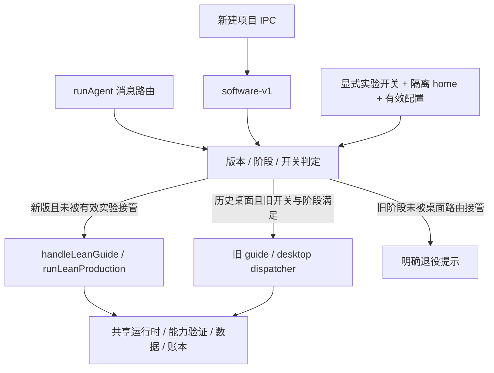

# 批次 A：旧流程依赖清单与退役边界

核对日期：2026-10-27，Asia/Shanghai。源代码基线 `sprint2 / 607425a`；本批新增扫描器、范围清单与报告，不修改应用执行逻辑。

本页的 885/101 等统计是批次 A 快照，原始版本保留在 Git `e380fee`。后继 B/C/D 已实施能力桥接、长期里程碑与旧执行器退役；2026-10-28 又退出 lean-v1 制作、删除无消费者辅助并修正声明文件检查，见 [继续清理记录](workflow-cleanup-20261028.md)。当前数字以机器清单为准，不能用 A 的历史数字代表当前依赖。

对应用户指令“先实行一”：执行 [近期计划](workflow-retirement-modes-capabilities-20261027.md) 的 A 批次，形成可复查依赖和迁移/删除条件。**本批直接删除批准数为 0；未删除文件、切换真实项目流程或恢复任何实验。**

## 1. 实际扫描结果

机器清单：[workflow-retirement-source-20261027.json](../../outputs/workflow-retirement-source-20261027.json)。范围规则：[scope JSON](workflow-retirement-scope-20261027.json)。工具：[扫描器](../../scripts/audit-workflow-retirement.mjs)。

- 扫描 Git 已跟踪的 885 个 JS/TS/TSX 源文件，解析 3627 条相对模块依赖和 38 条现存资源依赖；没有未解析的相对导入。
- 重点覆盖 101 个模块，记录运行时导入者、类型导入者、测试导入者、源码字符串引用、资源引用、函数调用位置及 SHA-256。未列入重点范围的文件默认保留，不能视为可删。
- 101 个重点模块均有非测试的直接运行时导入者；97 个从应用入口具有模块加载可达性。另外 4 个是实验 aggregate/matrix/report/snapshot，由实验 CLI 等消费，不能因不在主窗口入口图内就删掉。
- 发现 8 个计算式动态导入/require，涉及原生测试子进程、LLM 探针、离线/付费验收脚本及崩溃夹具。它们明确列入人工复核项。
- AST 解析区分 type-only、混合导入、re-export、字面量动态导入和 require。**模块加载可达不代表某个流程分支在运行；调用位置索引也不解决别名或动态控制流。** 没有以“零引用”自动批准删除。
- 首轮把 CSS/图片/音频标为 TypeScript 解析器未解析，已按实际文件存在性分离为 38 条资源依赖；不能据此声称代码丢失。扫描器初次语法错误已修复，最终通过自检和完整扫描。

扫描器只读取 Git 源文件和显式请求的元数据，不导入应用模块，不执行模型/产物。扫描前后核对全部输入哈希，源文件变化时失败；报告绑定扫描器、scope 和完整源输入摘要，可再次验证。Git revision 仅标记快照；文档提交本身不会使相同代码清单失效。

## 2. 真正的流程入口与条件



| 路由事实 | 位置 | 退役影响 |
| --- | --- | --- |
| 新建统一选择 software-v1 | `main/ipc/projects.ts:56` | 保持新项目默认值，不能把 mode 当 workflow version。 |
| modern guide 在旧主体前返回 handleLeanGuide | `main/guide/stages/guide-pipeline.ts:72–74` | 可分离旧主体，但 facade、共享类型和确认恢复接口先留。 |
| modern build/继续消息提前进入 runLeanProduction | `main/desktop/desktop-route.ts:241–245,325–328` | desktop-route 是混合桥，不能整删。 |
| 无 workflow_version 不自动视为新版；未知版本拒绝 | `main/desktop/workflow-policy.ts:6–19` | 迁移必须显式，不把未知/损坏版本兜底为新版成功。 |
| 旧桌面分流还取决于 BLOMA_DESKTOP_DISPATCH 与已知阶段/品类 | `desktop-route.ts:108–121`、`dispatcher-switch.ts` | 开关 off 不会关闭 modern 主线。旧注释中“off 即所有桌面代码零入口”不能作为当前结论。 |
| 未被桌面接管的旧生成阶段先命中 web 退役响应 | `main/orchestration/stages/agent-dispatch.ts:260,349–363` | 旧代码存在不等于旧网页生成仍可用；查看/导出/启动需要分别保留。 |
| readExperiment 先要求 BLOMA_DISPATCH_EXPERIMENT 严格为 1 | `dispatch-experiment.ts:143–155` | 配置文件存在不等于参与路由。 |
| 实验还验证隔离 home、配置身份和 running 时的 runtime hash | `dispatch-experiment.ts:81–86,147–153` | 有效配置可排除 modern；执行层还检查实验 state。不能通过关闭开关或改版本把冻结实验悄悄变成新项目。 |

补充：UX 返回需求时，`ux-confirm.ts:returnToPrd` 根据 lean_brief 返回 handleLeanGuide 或旧 runPrdPipeline。删旧 PRD 链之前必须替换这个回流出口以及旧确认卡恢复入口，不能只改正向开工路径。

## 3. 分类清单与具体处置

| 分类 | 数量 | 本批决定 | 删除前条件 |
| --- | ---: | --- | --- |
| modern_workflow_keep | 14 | 保留新需求、制作、验收、试用、独立设计和评估主线 | 不属于本次旧流程删除目标。 |
| mixed_bridges_split_first | 14 | 先拆分共享接口/路由，再处理旧主体 | 完成下方 D0，消除新版及 lean-v1 的依赖。 |
| legacy_guide_candidate | 11 | 列为迁移后退役候选 | 旧入口、回流、确认恢复及 review 消费者有去向。 |
| legacy_desktop_candidate | 14 | 列为迁移后退役候选 | 历史项目继续编辑、MVP 卡、阶段/契约/实验消费者有去向。 |
| frozen_experiment_separate | 13 | 实验执行与历史读报分开处理 | 保留只读配置/事件/失败证据，明确执行退役行为。 |
| shared_capability_keep_migrate | 22 | 保留能力；B 批次迁接口 | 新主线资源发现、准备、实际验证及交付资源契约接通。 |
| history_data_and_user_access_keep | 12 | 保留存储、查看、导出、启动、预算和凭据边界 | 不以旧流程名义删除这些职责。 |
| retired_web_guard_keep_until_compatibility_decided | 1 | 保留明确退役响应 | 新迁移入口完成前不恢复旧生成，也不留下无响应入口。 |

全部 101 个文件及其直接消费者在机器清单 modules 中；此表的“候选”不是已验证死代码。

### 3.1 必须先拆分的共享点

| 文件/符号 | 当前消费者与语义 | 处理方式 |
| --- | --- | --- |
| `production-agent.ts:productionAgentTools` | `lean-production.ts:183` 与旧 dispatcher 都调用；装配执行工具及受限协作工具 | 抽出通用工具装配后迁调用者。`buildProductionAgentPrompt/productionTurns/usesProductionAgent` 才是旧阶段策略；不能按文件整删。 |
| `dispatcher-completion.ts:guardDispatcherCompletion` | 新主线 beforeComplete（`lean-production.ts:228`）与旧循环都消费 | 保留等待真实子任务完成的宿主条件，先迁出再删旧命名桥。 |
| `dispatcher-loop.ts:buildDesktopChildTools/buildDesktopEnvProbeTool` | 新主线保留的 **lean-v1 非 software 分支** 及其子任务构造消费；software-v1 正常分支使用 buildSoftwareAgentTools | 拆出 fallback 工具或先迁移 lean-v1。不能把静态 import 误报为 software-v1 正在运行旧 dispatcher。 |
| `dispatcher-phases.ts:getDesktopPhase` | desktop-route 在现代项目分流前也用已知 phase 判定；另有旧推进与交付通知消费者 | 抽出稳定阶段 ID/兼容读取契约，再退役完整任务书/阶段图。renderer 已有独立 `renderer/lib/desktop-stages.ts`，两份数据需要对齐。 |
| `desktop-route.ts` 的接口、默认安全/启动门、modern early return | orchestration、UX、现代制作和旧阶段都引用 | 拆出路由契约和共享门，旧 runDesktopStage/dispatcher/MVP 腿另退役。类型引用也必须迁移。 |
| `guide-agent-service.ts` / `stages/guide-pipeline.ts` | 新/旧 guide 共享 facade；后者先分流 modern，再包含旧主体 | 保持公开 API 与测试 mock 兼容，迁走现代入口后再裁剪 re-export 和旧主体。 |
| `ux-confirm.ts` | 新版界面确认/回访也使用；returnToPrd 又保留旧 PRD 回流 | 仅隔离旧回流，保留真实确认绑定、恢复和调整。 |
| `document-engine.ts`、`document-sync.ts`、`prd-store.ts` | 新任务单、旧结构化 PRD、历史清单共存 | 数据协议与渲染职责先拆；不删除现代 task.md、prd.json 或旧文档读取。 |

### 3.2 迁移后可退役的 25 个候选

guide 组（11）：`dialogue-router.ts`、`guide-tools.ts`、`pipeline.ts`、`prd-confirm.ts`、`prd-engine-llm.ts`、`prd-sections.ts`，以及 `stages/guide-runtime.ts`、`clarify-flow.ts`、`prd-pipeline.ts`、`requirement-confirm.ts`、`research-flow.ts`。

desktop 组（14）：`advance-rejection-loop.ts`、`core-delivery.ts`、`delivered-notice.ts`、`delivery-policy.ts`、`dispatcher-finalize.ts`、`dispatcher-gate.ts`、`dispatcher-prompt.ts`、`dispatcher-switch.ts`、`dispatcher-telemetry.ts`、`mvp-confirm.ts`、`notice-cards.ts`、`pending-confirmation-store.ts`、`phase-checkpoint.ts`、`quick-production-review.ts`。

主要阻塞：旧卡回传与恢复、guide facade re-export、UX 回流、旧 review 卡模块、旧阶段任务书/PHASE_ADVANCE、实验策略、历史项目继续编辑，以及测试中的源码字符串断言。这里的目录均为 `main/guide/` 或 `main/desktop/`，精确路径和逐文件消费者由 scope/机器清单确认。

### 3.3 能力必须保留，接口优先迁移

- 资源/依赖准备：resource-discovery、install-packages-tool、component-library、skeleton-provision。旧 installer 自动物化 `speech_runtime.py/speech_locator.py`，新 run_command 执行 pip 不会自动消费这段宿主逻辑。
- 当前能力验收：`core-verification.ts:verifyLeanBehavior` 仍在第 254 行调用 runCapabilityVerifiers；speech/file/LLM 验证器和 GUI/fixture/正常启动不能随旧阶段删除。
- 语音/文件/LLM Python 模板、固定音频、运行时定位、模型清单/下载器分别保留；准备缓存、当前项目业务和真实硬件证据不能混用。
- process-driver、launch-smoke、verification-fingerprint/receipts、requirement-contract、delivery-state、production-context 属于共享边界。没有在本批声明任一模板、驱动或验证器已无用。

## 4. 数据协议与迁移约束

| 数据位置 | 消费职责 | 退役时必须保持的边界 |
| --- | --- | --- |
| `projects.json` 的 workflow_version / mode / current_stage / desktop_phase / root_path | 项目路由、列表、启动、恢复 | mode 不是 workflow；不把无标记/未知版本静默改 software-v1，不改变原 root 或真实数据。 |
| `agent-workspaces/<slug>/documents/<id>/prd.json`、文档 manifest、UX confirmed 文件 | 需求与外观身份 | 旧模型不能直接塞新版 lean_brief；需要可回退转换与确认/哈希重核，不凭旧 delivered 字段认证新版本。 |
| `pending-confirmations/<id>-prd.json`、`-ux.json` 及 archive | 新旧共用确认 journal；DTO、scope/session/data hash 区分 | 保留 consumed/损坏/过期事实；迁移后旧卡不得启动新制作或授权新范围。读取 consumed 文件不等于仍待确认。 |
| `pending-confirmations/<id>-mvp.json` | 旧 MVP 的 pending/consuming/consumed 与 notice | 先决定恢复、归档或明确退役；不能直接变成长期型里程碑确认。 |
| `verification-receipts/`、`00_VERIFY/`、GUI/CLI 规则、fixtures/native tests | 驱动/行为/版本凭据 | 保留诊断，旧 PASS 不升级为新 PASS；迁移后重新绑定并实测。损坏、取消和写盘失败保持拒收。 |
| `dispatch-experiments/` 配置、events、快照与封存输入 | 冻结实验、读报与恢复约束 | 配置、失败、首个终态和 source/runtime hash 不改写；不自动恢复执行、重置预算或回填胜率。 |
| `harness-budgets/`、`usage-ledger/`、monetary policy/state 与 unknown 预留 | 累计请求、费用保护、责任上界 | 不清零、不抵销，不继承为新测试预算；新 operation/调用须满足明确授权与完整预留。 |
| 新 `software-releases/`、`software-app-data/`、regressions/debug/trials | 候选、用户数据、回归与受管实例 | 读/启动/导出职责独立保留；不接管旧 PID，不把工程外数据混入源码迁移。 |
| sessions、messages、attachments、项目事件/analytics | 用户历史与研究记录 | 只读/导出可继续，删除执行链不清理历史；未授权不启动旧任务。 |

迁移实施前的最低检查：列出源文件/数据布局 → 创建受控可回退副本 → 校验原始哈希和路径边界 → 转换需求/启动/数据契约 → 重新确认所需范围 → 离线正反例与真实进程验证 → 才提交新工作流状态。原始证据和账本保留；不迁移旧 PASS，不批量移动 `.codegraph` 等宿主 Junction。

## 5. 当前默认 home 的只读快照

限定读取 `C:\Users\17359\.proma/projects.json` 与其索引项目对应的确认/实验元数据，未遍历其他 home/备份，没有导出项目名称、ID、用户内容或密钥。原始本地聚合结果在 `run-artifacts/workflow-retirement-live-20261027.json`，不随 Git 分发。

- 本索引 1 个项目：software-v1 / quick / completed / delivered，声明根目录存在；没有在此索引发现 unmarked 或 lean-v1 项目。
- 对应实验配置 0；PRD/UX 确认文件各 1，状态均 consumed；MVP 记录 0，最小 JSON 解析错误 0。
- 索引读取前后 SHA-256 相同（`5db60c1a513aa51d96147cda09f742a716dd65b82fe8c05a36c3fc56c8d3dbab`）。这是存储快照，不是新验收、全 home 完整性证明或正在运行的 Bloma 状态。
- 审计子进程两个旧流程开关均未设置；未读取/更改实际 Bloma 进程环境。其他隔离 home、备份、导出工程及旧版用户仍需显式兼容策略，不能由本索引无旧项目推断为可全部删除。

## 6. 后续拆分/退役实施单

| 顺序 | 工作单 | 开始前依赖 | 完成判定 |
| --- | --- | --- | --- |
| D0 | 抽出稳定路由类型、阶段 ID、productionAgentTools、完成条件；隔离 lean-v1 工具 fallback | 本清单；逐一确认新/旧消费者与类型引用 | modern 两版本路由不变，旧 switch off/on 行为明确；旧模块只留临时兼容 re-export，不复制两套可漂移实现。 |
| B | 将资源发现/安装物化与能力协议接入新工具链 | D0 清楚共享职责；保留现有模板和验收器 | Python ASR 最小解码与资源定位一致；现有文件保护、损坏资源/取消/缺能力均验证。此项是当前下一优先实施项。 |
| C | 长期型待办/里程碑/跨轮维护 | 已有统一验收、版本化试用；不依赖恢复旧长链 | 两模式有真实策略差异；新里程碑状态、范围和确认独立，旧 MVP 卡不冒充新确认。 |
| D1 | 历史项目只读/继续编辑与实验执行退役入口 | 明确迁移协议与回退、B/C 所需能力不丢 | 旧用户能查看/启动/导出；继续编辑有显式安全去向；冻结实验报退役而非静默转新流程。 |
| D2 | 删除旧 guide/dispatcher 主体、重复提示词与独占工具 | D0/B/C/D1 完成；重新生成清单 | 当前源码/脚本不再有旧执行调用或悬挂类型/资源引用，确认卡负例仍拒绝。只读实验报告可单独保留。 |
| D3 | 缩减旧源码断言/测试与更新文档、开关说明 | 删除事实可核对 | 删除旧行为专用测试，同时保留迁移、历史读取、权限/数据/费用/坏凭据回归；完整构建和必要真实进程验证通过。 |

这里 D0 表示为后续退役准备的小范围抽取，可按 B 的实际依赖逐步做，不要求 B 开始前先搬完全部共享模块；不把 B/C 的功能实施提前算完成。每张工作单单独验证和提交，不 push；付费模型、麦克风及真实数据操作遵守现行授权。

## 7. 验证与复查命令

```powershell
node scripts/audit-workflow-retirement.mjs --self-test
node scripts/audit-workflow-retirement.mjs --verify outputs/workflow-retirement-source-20261027.json
node scripts/audit-workflow-retirement.mjs --out outputs/workflow-retirement-source-20261027.json --home C:\Users\17359\.proma --live-out run-artifacts/workflow-retirement-live-20261027.json
node node_modules/vitest/vitest.mjs run tests/unit/desktop/workflow-policy.test.ts tests/unit/desktop/dispatcher-switch.test.ts tests/unit/desktop/dispatcher-phases.test.ts --maxWorkers=1 --minWorkers=1
npm run docs:check
```

已完成：扫描器七类自检、完整源依赖/资源解析、默认 home 聚合只读核对，以及 3 文件 / 28 项边界测试（workflow policy 2、switch 5、phase table 21）。机器清单 `--verify` 和 `npm run docs:check` 均通过。日志 `run-artifacts/workflow-retirement-{self-test,audit,boundary-tests,verify,docs}-20261027.log`。

这是源代码/元数据审计及既有规则回归；没有执行旧 dispatcher、真实模型、麦克风或用户产物，也没有进行迁移或删除演练。本批不据此认证全部旧项目兼容、语音业务质量或全仓测试通过。
