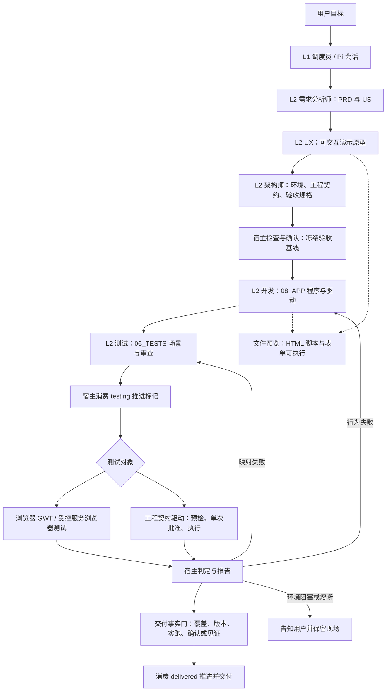

# Proma-Easy 与 Bloma 当前 harness 对照

核对日期：2026-10-26（Asia/Shanghai）。

- Proma-Easy：用户指定 `orphiczhou/Proma-Easy` 的 `p1-quick-engineering` 分支；本次通过 GitHub 读取的 HEAD 为 `df23df7d121d349e6a58365f3207e9b0047c59c5`。以下远端链接均固定该提交。
- Bloma：本地 `sprint2 / c8aeb28e4fdce713212c2716962e30327ca23f62`，比较当前 `software-v1` 制作线；用户已有的生产流程文档改动保持原样。
- 方法：静态查阅实际调用链、工具装配、阶段门、验收与交付代码。未安装或启动 Proma-Easy，未进行新付费模型运行，也未做同任务性能实验。本文区分代码机制、提示词要求与实测结论；不据此推断成功率、成本或速度优劣。

## 1. 主要结论

Proma-Easy 的南大 quick 线由 L1 调度员驱动多个阶段角色，通过阶段产出、确认记录和推进标记进入下一阶段；开发与测试有不同职责及目录。Bloma 当前线在需求与界面确认后，以一个持久 Pi 负责人持续实现、调试、调用宿主验收；宿主在模型结束后复用同一验收器完成发布收口。

两者都使用 Pi，都有宿主执行的验收、版本绑定、失败修复与停止机制。因此不能概括成“Proma-Easy 只有提示词，Bloma 才有 harness”，也不能因为前者多角色、后者单负责人，就直接判定质量高低。

值得优先吸收的是：试用语义、失败责任分流、测试证据输出目录和前置验收规格。没有证据支持把整套角色与 AC 流程搬回来会降低当前 Bloma 的闭环时间。

## 2. Proma-Easy 当前 quick 主链

图中角色阶段由 `nanju-router.makeRoute` 实际定义；不是从旧 `nanju-orchestrator` 的角色序列推断。当前 quick 真实顺序为 requirements → prototype → architecture → coding → testing → delivered。iterative 多一个 planning 阶段。

L1 任务书要求委派、等待、读产出、请求确认和推进。工具权限、阶段产出检查和推进消费器对过程实施宿主校验；不能把模型输出一个推进标记视为完成事实。

来源：[路由定义](https://github.com/orphiczhou/Proma-Easy/blob/df23df7d121d349e6a58365f3207e9b0047c59c5/apps/electron/src/main/lib/nanju-router.ts#L252-L493)、[L1/L2 任务装配](https://github.com/orphiczhou/Proma-Easy/blob/df23df7d121d349e6a58365f3207e9b0047c59c5/apps/electron/src/main/lib/nanju-router-prompt.ts#L1028-L1058)、[推进消费器](https://github.com/orphiczhou/Proma-Easy/blob/df23df7d121d349e6a58365f3207e9b0047c59c5/apps/electron/src/main/lib/nanju-phase-advance-consumer.ts#L582-L697)。

## 3. 与 Bloma 按同一口径比较

| 维度 | Proma-Easy：本次固定分支 | Bloma：当前 software-v1 |
| --- | --- | --- |
| 模型运行 | Pi 会话；L1 调度阶段 L2，角色可继续派 inline 审计 | Pi 持久负责人；默认一个负责人，需要时才做受限委派 |
| 阶段组织 | quick 也必经需求、原型、架构、开发、测试；iterative 加规划 | 确认需求与界面后，持续实现与调试，宿主验收后交付 |
| 原型 | 明确要求以演示数据和 JS 支持核心交互；它仍是模拟原型 | UX 草图禁止模型脚本、事件属性和可执行 URL；真实程序在开发预览出现 |
| 试用来源 | 文件预览、open_preview 与 HTML 变更通知；可执行脚本的原型不代表真实系统能力 | 受管理的服务或调试实例 URL；verify_app 与最终验收会关闭这些实例并清空实时预览 |
| 验收规格 | 架构阶段 acceptance.json；每个 US 要求 normal/boundary/exception 或有理由的豁免；进入编码时冻结 | 已确认需求与 UX 约束；原生 GUI 测试登记后冻结输入、断言和逻辑，支持受限定位修正 |
| 测试作者与执行者 | 独立测试角色生成 GWT；非浏览器工程通常由开发提供驱动，测试角色审查；宿主实际运行 | 通常负责人同时编写程序和原生测试；宿主独立执行并核对需求覆盖、操作与断言记录 |
| 执行接口 | 浏览器 feature + steps.json；工程 engineering.json + 适配器/驱动，缺适配能力时 blocked | 标准 JS / Playwright / node:test 为主，兼容已有 GUI 动作规则和 CLI 检查 |
| 失败责任 | behavior 回开发、mapping 回测试、coverage 补场景或需求；环境阻塞与执行异常另分流 | 工具结果已带 product_assertion / verification_harness / environment 等分类，但主要仍回同一负责人处理 |
| 测试输出 | 浏览器截图、报告在 06_TESTS；工程逐项证据归档也在该目录 | 00_VERIFY 支持可变证据，但任意 shots 输出目录仍可能进入发布指纹，造成这次验收污染 |
| 版本绑定 | 工程线绑定 PRD、engineering.json、声明 artifacts 与 scenarioFiles；旧静态浏览器线的交付指纹更侧重入口 | 独立发布候选、依赖快照和物理文件哈希；凭据还绑定需求、UX、规则、宿主、运行时与环境 |
| 安全与启动收口 | 这条主链以阶段门、GWT/工程驱动及交付事实门为核心；未看到与 Bloma 同等统一的候选安全扫描加正常窗口启动门 | 统一验收器顺序执行安全扫描、核心业务检查、正常启动和版本一致性，再允许发布 |
| 用户等待点 | 多阶段确认；工程逐项单次批准；requiresReal 的额外观察或真人见证；最终满意交付确认 | 当前普通制作工具自主执行，目标改变需确认；通过后宿主发布，不固定增加满意交付确认 |
| 预算与看门狗 | 普通 L2 默认 20 分钟软提示、35 分钟硬停；阶段失败/异常熔断、3 次修复策略；Pi 可选 maxTurns/maxBudgetUsd | 同一 operation 跨准备、实现、续跑累计请求、输出和金额；运行时租约、取消与期限；重复相同宿主失败无改善时停止 |
| 费用保护差异 | 已读取 runtime guard 在收到已知 USD 费用后限制后续轮次；没有在所查主链找到与 Bloma 等价的请求前 RMB 最坏输入预留 | 请求前按本地策略预留责任上界，未结算请求保留占用，预留不足时不发下一次请求 |

Proma-Easy 的默认配置把 coding 与 testing 放在不同提供商家族，并为部分阶段配置攻击/防御角色。实际可被本地参数或 fallback 改变；不同家族并不自动证明测试独立性或覆盖充分。quick 架构明确跳过 inline AC；其他阶段的 AC 主要通过任务书和委派约束驱动，不能把“必须执行”的提示语当成每次均已完成的证据。

来源：[默认模型配置](https://github.com/orphiczhou/Proma-Easy/blob/df23df7d121d349e6a58365f3207e9b0047c59c5/apps/electron/resources/nanju-model-config.json)、[AC 装配](https://github.com/orphiczhou/Proma-Easy/blob/df23df7d121d349e6a58365f3207e9b0047c59c5/apps/electron/src/main/lib/nanju-router-prompt.ts#L613-L646)、[原生运行时守卫](https://github.com/orphiczhou/Proma-Easy/blob/df23df7d121d349e6a58365f3207e9b0047c59c5/apps/electron/src/main/lib/agent-runtime-guards.ts#L53-L91)、[阶段护栏](https://github.com/orphiczhou/Proma-Easy/blob/df23df7d121d349e6a58365f3207e9b0047c59c5/apps/electron/src/main/lib/nanju-project.ts#L234-L257)。

## 4. 与本次卡壳直接相关的机制

### 4.1 原型能交互，不等于真实程序已实现

Proma-Easy 的 prototype 节点明确要求演示数据加 JS 状态机，覆盖点击、输入、切换、提交；预览 iframe 放行 scripts/forms。它因此更早给用户可操作的界面，但网络、硬件、持久化、外部应用效果仍可能只是模拟。当前 Bloma 草图选择静态 HTML；真正试用则来自运行实例。改进时必须给原型演示与真实程序试用不同标签。

来源：[原型要求](https://github.com/orphiczhou/Proma-Easy/blob/df23df7d121d349e6a58365f3207e9b0047c59c5/apps/electron/src/main/lib/nanju-router.ts#L256-L275)、[HTML 预览](https://github.com/orphiczhou/Proma-Easy/blob/df23df7d121d349e6a58365f3207e9b0047c59c5/apps/electron/src/renderer/components/diff/DiffTabContent.tsx#L1776-L1785)。

### 4.2 测试输出与程序目录分开

Proma-Easy 的浏览器执行器统一把截图写到 06_TESTS/screenshots，基线写到 06_TESTS/_screenshots；声明产物在 08_APP。其工程证据绑定的是声明 artifacts 与指定场景，而不是任意生成的整棵测试输出目录。因此不会仅因该规范截图路径新增文件就触发本次 Bloma 的同型错误。

这不证明 Proma-Easy 没有版本污染，也不证明它的指纹覆盖比 Bloma 完整。Bloma 对运行依赖和发布候选的覆盖更广；应保留保护，同时统一传入独立 evidenceDir，而不是给任意目录扩充忽略规则或要求成品删除测试图片。

来源：[浏览器截图目录](https://github.com/orphiczhou/Proma-Easy/blob/df23df7d121d349e6a58365f3207e9b0047c59c5/apps/electron/src/main/lib/nanju-gwt-runner.ts#L1993-L2027)、[工程指纹范围](https://github.com/orphiczhou/Proma-Easy/blob/df23df7d121d349e6a58365f3207e9b0047c59c5/apps/electron/src/main/lib/nanju-engineering-contract.ts#L392-L415)。

### 4.3 失败分流比“都回去修程序”清楚，但分类仍可误判

Proma-Easy 在宿主枚举 behavior/mapping/coverage，并实际向开发或测试的原委派发送对应反馈。Bloma 已有故障类别元数据，但当前修复主线通常仍交给同一模型解释。

不能机械把所有 selector 超时都当作测试定位错误：也可能是产品没有生成应有元素。Proma-Easy 的分类器本身承认混合失败优先 behavior；因此应吸收明确责任与结构化诊断，不照搬其启发式结论为真值。

来源：[分类器](https://github.com/orphiczhou/Proma-Easy/blob/df23df7d121d349e6a58365f3207e9b0047c59c5/apps/electron/src/main/lib/nanju-gwt-runner.ts#L1739-L1765)、[实际分派](https://github.com/orphiczhou/Proma-Easy/blob/df23df7d121d349e6a58365f3207e9b0047c59c5/apps/electron/src/main/lib/agent-orchestrator.ts#L1232-L1302)。

### 4.4 最终交付门比“测试全绿”多一步

工程验收逐项预检后请求单次批准，等待期间和执行之后均重新比对工程指纹；批准不是永久授权。requiresReal 需额外宿主观察或真人见证，且后者明确标注 human-witness-limited，不冒充机器观察。

交付检查还核对报告格式、当前版本、宿主本进程的实跑记录；工程线最终仍需满意交付确认。只有无工程契约的 quick 自动审核路径可以以宿主实跑事实代替满意交付确认。不能笼统写成“auto 开了就全部自动交付”。本进程记录丢失后通常需要重跑，不同于 Bloma 的有界新鲜凭据复用。

来源：[逐项批准及复验](https://github.com/orphiczhou/Proma-Easy/blob/df23df7d121d349e6a58365f3207e9b0047c59c5/apps/electron/src/main/lib/nanju-engineering-execution.ts#L173-L208)、[批准适配器](https://github.com/orphiczhou/Proma-Easy/blob/df23df7d121d349e6a58365f3207e9b0047c59c5/apps/electron/src/main/lib/nanju-engineering-approval.ts#L15-L43)、[交付事实门](https://github.com/orphiczhou/Proma-Easy/blob/df23df7d121d349e6a58365f3207e9b0047c59c5/apps/electron/src/main/lib/nanju-gwt-runner.ts#L619-L745)、[真人见证实际接线](https://github.com/orphiczhou/Proma-Easy/blob/df23df7d121d349e6a58365f3207e9b0047c59c5/apps/electron/src/main/lib/agent-orchestrator.ts#L894-L937)。

## 5. 对 Bloma 的建议顺序（尚未实施）

1. 先建立独立的 evidenceDir，平台和原生测试共用；校验输出落位，防止测试改动发布候选。
2. 将故障对象、类别、文件差异、允许修改范围和建议工具组织成结构化反馈；保持已确认业务预期不变，同时容许有证据的定位、等待、导航与环境修复。
3. 试用与自动验收使用不同进程和数据目录；稳定试用版本在验收期间继续可用，版本更换时明确提示。Proma-Easy 的可交互文件原型并没有直接提供这项完整机制，不能声称可原样迁移。
4. 借鉴编码前规格覆盖 normal/boundary/exception 的原则，但保持平台内部完成，不强迫普通用户审批每份技术文档。AC/US/F 标识关联仍只是结构检查，不能代替语义覆盖审查。
5. 保留 Bloma 的发布候选、依赖字节绑定、请求前费用保护和最终宿主收口；是否增加独立测试角色，应通过固定同任务、同预算、同验收目标实验决定。

## 6. 当前 Bloma 代码入口

- `main/desktop/lean-production.ts`：负责人运行、共享预算、最终验收、修复、发布和清理。
- `main/software/agent-tools.ts`：文件、环境、命令、调试与验收工具装配；子角色没有父负责人同等执行权限。
- `main/software/verification-tool.ts`：冻结原生测试、关闭开发会话、调用统一验收器。
- `main/software/verification.ts`：输入绑定、5 分钟完整通过凭据复用、候选、安全、业务、正常启动与版本校验。
- `main/software/release-store.ts`：物理文件 inventory、依赖快照、发布候选与 promote。
- `main/software/run-state.ts`：运行现场和相同失败观察停止机制；这层不能保证捕获模型内部每次工具重试。
- `main/platform/llm/monetary-budget.ts`、`main/desktop/lean-budget.ts`：请求前金额预留、累计账本与执行期限。
- `renderer/components/DeliveryPanel.tsx`、`ProgramScreenshot.tsx`：真实 URL、已确认草图与静态截图的显示。

本文只新增对照报告，未修改两边的产品源码或运行状态。
